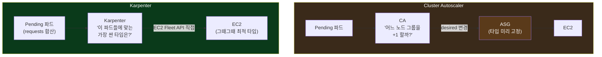
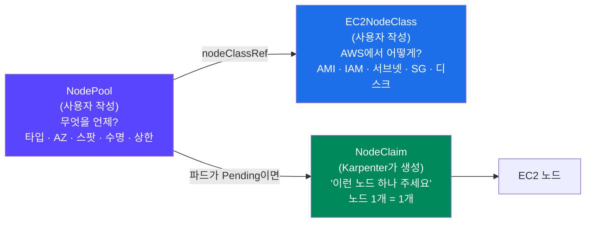
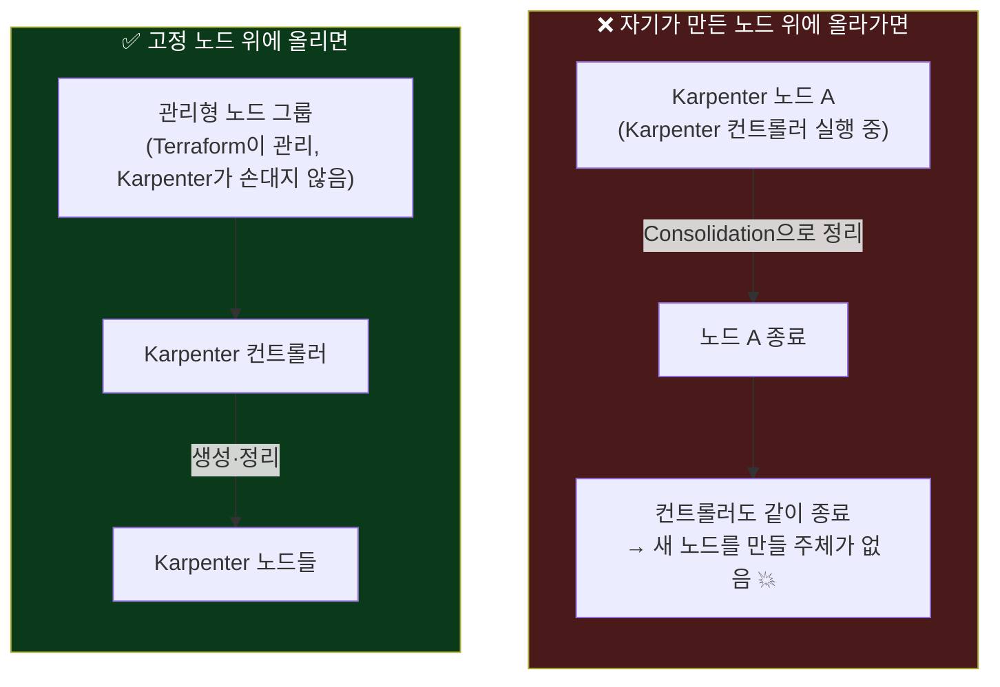
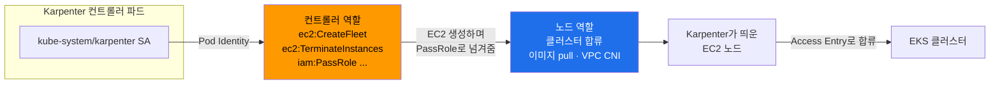
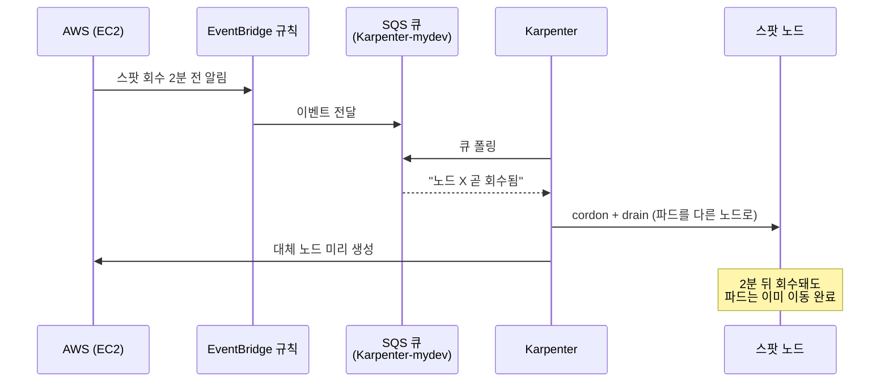
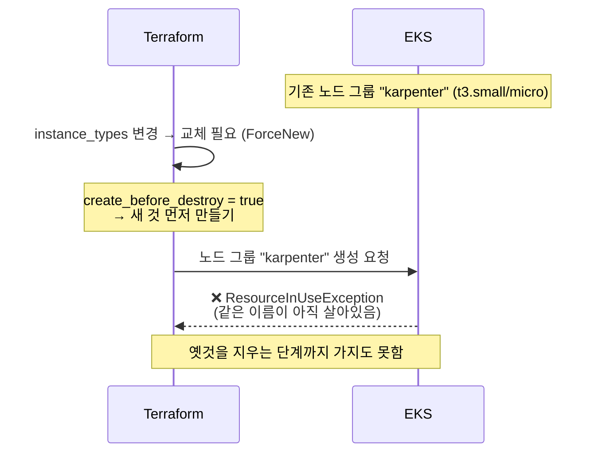

## 📚 들어가며

[6편](/posts/EKS-Rebuild-06-K8s-Storage-EBS-CSI-PV-PVC-StorageClass/)에서 스토리지를 다뤘다. 이번 편은 **노드 오토스케일러 Karpenter**다.

강의 자료는 2024년 1월 기준 **Karpenter v0.33.1 + IRSA + aws-auth ConfigMap** 구성이다. 이 프로젝트는 지금까지 해온 대로 **Karpenter 1.14.1 + EKS Pod Identity + Access Entry**로 옮겨서 설치했다. 버전이 v0.x에서 v1.x로 넘어간 만큼 달라진 게 많다.

| | 강의 (2024년 1월) | 이번 실습 (2026년 10월) |
|---|---|---|
| Karpenter 버전 | v0.33.1 | **1.14.1** |
| CRD API | `v1beta1` | **`v1`** |
| 컨트롤러 권한 | IRSA (OIDC 신뢰 + SA 어노테이션) | **EKS Pod Identity** |
| 노드의 클러스터 합류 권한 | `aws-auth` ConfigMap 수정 | **EKS Access Entry** |
| 권한·태그 준비 방법 | 공식 홈페이지 셸 스크립트 | **Terraform 모듈** (`eks//modules/karpenter`) |
| 스팟 회수 처리 | 설정 없음 | **SQS 큐 + EventBridge 규칙** |
| AMI | Amazon Linux 2 | Amazon Linux 2023 |

이번 편은 **개념 → 권한 구성 → 버전 선택 → 설치 중 만난 에러 → Helm 설치**까지다. NodePool 설계와 실제 오토스케일링 실습은 다음 편에서 다룬다. 처음 보는 사람도 읽을 수 있게 노드 오토스케일링, Cluster Autoscaler, CRD 같은 개념에는 짧게 설명을 붙였다.

> **이번 편 학습 지도**
>
> ```
> 개념 (1장)              권한·버전 (2~4장)          실전 (5~6장)
> ──────────              ─────────────────          ────────────
> HPA vs 노드 오토스케일러  셸 스크립트 → TF 모듈       에러 ① 고정 이름 충돌 🔦
> Cluster Autoscaler       IAM 역할이 두 개인 이유     에러 ② 정책 6,144자 제한
> Karpenter의 장점·주의점  모듈은 AWS만, 설치는 Helm   OCI 차트 · values 비교
> NodePool / EC2NodeClass  1.15가 아니라 1.14.1       설치 전 검증 두 가지
> 고정 노드가 필요한 이유   고정 노드 크기 다시 잡기
> ```

---

## 1. 개념 — 왜 노드 오토스케일러가 필요하고, 왜 Karpenter인가

### 1-1. 파드 오토스케일링 vs 노드 오토스케일링

- **HPA (Horizontal Pod Autoscaler)** — 부하가 늘면 **파드 개수**를 늘린다.
- 그런데 파드를 늘려도 **올라갈 노드에 자리가 없으면** 파드는 `Pending`으로 멈춘다. 이때 **노드를 늘려주는 것**이 노드 오토스케일러의 일이다. 반대로 노드가 놀고 있으면 줄여서 비용을 아낀다.

즉 HPA는 "파드가 몇 개 필요한가", 노드 오토스케일러는 "그 파드들을 담을 그릇이 충분한가"를 맡는다. 둘은 경쟁 관계가 아니라 **위아래로 맞물리는** 관계다.

### 1-2. 기존 방식: Cluster Autoscaler

**Cluster Autoscaler(CA)** 는 쿠버네티스 커뮤니티의 전통적인 노드 오토스케일러다.

- 노드를 **노드 그룹**(AWS에서는 Auto Scaling Group, ASG) 단위로 관리한다.
- `Pending` 파드가 생기면 "어느 노드 그룹의 **노드 개수(desired)** 를 늘릴지"를 정하고, 실제 EC2 생성은 **ASG가** 한다.
- 그래서 **노드 그룹마다 인스턴스 타입이 미리 정해져 있어야** 하고, 다양한 타입을 쓰려면 노드 그룹을 여러 개 만들어 관리해야 한다. 강의 기준으로 노드가 준비되기까지 **2~3분 이상** 걸린다.

### 1-3. Karpenter

AWS가 만든 오픈소스 노드 관리 도구다. CA와 가장 큰 차이는 **중간에 ASG가 없다**는 점이다.



강의 슬라이드에서 짚은 장점을 정리하면 이렇다.

| 장점 | 내용 |
|---|---|
| **단순한 구성** | ASG를 거치지 않고 **EC2를 직접 띄운다** (EC2 Fleet API). 노드 그룹을 미리 여러 개 만들 필요가 없다 |
| **파드에 맞춘 타입 선택** | `Pending` 파드들의 **requests**(CPU·메모리 요청량)를 보고, 허용된 타입 중 **가장 저렴하게 들어맞는** 인스턴스를 고른다 |
| **빠른 노드 준비** | 강의 기준 **약 45초** 내외 (CA는 2~3분 이상) |
| **비용 최적화 재배치 (Consolidation)** | 노드가 비거나 덜 쓰이면 파드를 모아서 **노드를 줄이거나 더 싼 노드로 교체**한다 |

### 1-4. 주의할 점 — Karpenter는 노드를 "적극적으로" 바꾼다

Consolidation 덕분에 비용은 줄지만, 반대로 말하면 **노드가 자주 바뀐다.** 노드가 정리되면 그 위의 파드도 같이 종료되므로, 서비스가 흔들리지 않게 미리 준비해야 한다.

| 준비 | 이유 |
|---|---|
| **Request 조정** (krr, kubecost 등으로 실사용량 측정) | Karpenter는 **requests만 보고** 노드 크기를 정한다. 과하면 비용 낭비, 부족하면 노드에 파드가 너무 몰린다 |
| **LimitRange** | requests를 안 적은 파드에 기본값을 넣어준다 |
| **PDB** (PodDisruptionBudget) | "이 앱은 최소 N개는 항상 떠 있어야 한다"를 보장해서, 노드 정리가 한꺼번에 다 죽이지 않게 한다 |
| **PriorityClass** | 자원이 부족할 때 중요한 파드를 먼저 살린다 |
| **Graceful Shutdown** | 파드가 종료 신호를 받고 진행 중인 요청을 마무리할 시간을 준다 |

> 6편 3-4에서 busybox가 SIGTERM을 무시해 grace period 30초를 꽉 채우고서야 죽는 걸 봤다. Karpenter 환경에서는 그런 파드가 **노드 정리 때마다** 30초씩 버틴다. Graceful Shutdown이 왜 목록에 있는지 바로 와닿는 대목이다.

### 1-5. CRD와 Karpenter의 세 가지 오브젝트

**CRD (Custom Resource Definition)** 는 쿠버네티스가 기본 제공하는 Pod, Service, Deployment 말고 **새로운 종류의 리소스를 정의**하는 방법이다. Karpenter는 Helm 차트와 함께 CRD를 설치하고, 우리는 그 CRD로 Karpenter에게 규칙을 알려준다.



| 오브젝트 | 누가 만드나 | 역할 |
|---|---|---|
| **EC2NodeClass** | 사용자 | 노드를 **AWS에서 어떻게** 만들지 (AMI, IAM 역할, 서브넷, 보안 그룹, 디스크) |
| **NodePool** | 사용자 | **어떤 노드를, 언제** 만들고 없앨지 (인스턴스 타입·AZ·스팟 조건, 수명, 정리 정책, 자원 상한) |
| **NodeClaim** | **Karpenter** | "이런 노드 하나 주세요"라는 실제 요청 기록. 노드 하나당 하나 생긴다 |

**이름의 역사**: v0.32(2023년 10월) 이전에는 `Provisioner`, `AWSNodeTemplate`이라는 이름이었고, v0.32에서 `NodePool`, `EC2NodeClass`로 바뀌었다(`v1beta1`). 강의가 이 버전이다. 이후 **v1.0에서 API가 `v1`으로 정식화**되면서 필드 위치가 일부 바뀌었다. 자세한 차이는 다음 편에서 다룬다. 구글링하면 세 세대의 예제가 섞여 나오니, `apiVersion`부터 확인하는 습관이 필요하다.

### 1-6. Karpenter 자신은 어디서 도나 — "고정 노드"가 필요한 이유

Karpenter 컨트롤러도 결국 파드라서 어떤 노드 위에서 돌아야 한다.



**자기가 만든 노드 위에 올라가면**, Consolidation으로 그 노드가 정리될 때 Karpenter도 같이 죽어서 **새 노드를 만들 주체가 사라진다.** 그래서 Karpenter가 관리하지 않는 **고정 노드**(Terraform이 만든 관리형 노드 그룹)를 최소한으로 두고, 컨트롤러는 거기에만 올린다.

---

## 2. 강의(IRSA, 셸 스크립트)를 Pod Identity로 옮기기

### 2-1. 강의가 손으로 하던 일 → 이 프로젝트의 대응

강의는 Karpenter 공식 홈페이지의 셸 스크립트로 IAM 역할을 만들고, 태그를 달고, `aws-auth` ConfigMap을 직접 편집했다. 이 프로젝트에서는 EKS 모듈 안에 있는 **Karpenter 전용 서브모듈**이 이걸 대부분 대신한다.

| 강의 | 이 프로젝트 |
|---|---|
| `KarpenterControllerRole` 생성, 신뢰 정책에 **OIDC 조건 (IRSA)** | 모듈이 컨트롤러 역할 생성. 신뢰 대상은 `pods.eks.amazonaws.com` (**Pod Identity**) |
| Helm values에 `eks.amazonaws.com/role-arn` 어노테이션 | **삭제.** 모듈이 `kube-system/karpenter` SA에 **Pod Identity association**을 자동 생성 (`create_pod_identity_association`) |
| `KarpenterNodeRole` 생성 + 정책 연결 | 모듈이 노드 역할 생성 (`create_node_iam_role` 기본 `true`) |
| `aws-auth` ConfigMap에 노드 역할 등록 | 모듈이 **Access Entry** 생성 (`create_access_entry` 기본 `true`). 이 클러스터는 `authentication_mode = "API"`라 aws-auth는 **아예 동작하지 않는다** (2편) |
| 스크립트로 서브넷·보안그룹에 `karpenter.sh/discovery` 태그 | 2편에서 `main.tf`에 미리 넣어둠 (`private_subnet_tags`, `node_security_group_tags`) |
| (없음) | 모듈이 스팟 회수 알림용 **SQS 큐 + EventBridge 규칙** 생성 |

### 2-2. IAM 역할이 왜 두 개인가



| 역할 | 쓰는 주체 | 필요한 권한 |
|---|---|---|
| **컨트롤러 역할** | Karpenter 컨트롤러 **파드** | EC2를 띄우고 지우기(`ec2:CreateFleet`, `ec2:TerminateInstances` 등), 노드에 역할 넘겨주기(`iam:PassRole`) |
| **노드 역할** | Karpenter가 띄운 **EC2 노드** | 클러스터 합류, 이미지 pull, VPC CNI 동작 (관리형 노드 그룹의 노드 역할과 같은 성격) |

**주체가 다르니 역할도 다르다.** 컨트롤러는 "노드를 만드는 쪽", 노드 역할은 "만들어진 노드가 쓰는 쪽"이다. 컨트롤러 역할에 `iam:PassRole`이 필요한 이유는, EC2를 띄울 때 **노드 역할을 그 EC2에 넘겨줘야** 하기 때문이다.

### 2-3. 실제 Terraform 코드 (`tf-eks/karpenter.tf`)

```hcl
module "karpenter" {
  source  = "terraform-aws-modules/eks/aws//modules/karpenter"   # EKS 모듈 안의 서브모듈
  version = "~> 21.0"

  cluster_name = module.eks.cluster_name

  # 컨트롤러 → Pod Identity (Helm 설치 때 이름을 맞춰야 해서 명시)
  create_pod_identity_association = true
  namespace                       = "kube-system"
  service_account                 = "karpenter"

  enable_inline_policy = true   # 5-2 에러 때문에 추가

  # 노드 역할: 이름을 고정 (EC2NodeClass YAML에 직접 적어야 하므로)
  node_iam_role_use_name_prefix = false
  node_iam_role_name            = "KarpenterNodeRole-${local.name}"
  node_iam_role_additional_policies = {
    AmazonSSMManagedInstanceCore = "arn:aws:iam::aws:policy/AmazonSSMManagedInstanceCore"
  }

  create_access_entry     = true   # aws-auth ConfigMap 수정을 대체
  enable_spot_termination = true   # 스팟 회수 알림 SQS + EventBridge

  tags = local.tags
}
```

**`node_iam_role_use_name_prefix = false`인 이유**: 3편에서 겪었듯 이 모듈 계열은 이름을 접두사로 쓰고 랜덤 문자열을 붙이는 게 기본이다. 그런데 노드 역할 이름은 EC2NodeClass YAML의 `spec.role`에 **직접 적어야** 해서, apply할 때마다 바뀌면 곤란하다. 그래서 강의와 같은 이름 규칙으로 고정했다.

다음 단계(Helm values, EC2NodeClass)에서 쓸 값은 `outputs.tf`에 output으로 뽑아뒀다.

```
karpenter_queue_name         = "Karpenter-mydev"           # Helm values의 interruptionQueue
karpenter_node_iam_role_name = "KarpenterNodeRole-mydev"   # EC2NodeClass의 role
```

### 2-4. 오해: "`main.tf`에 이미 karpenter가 있던데?"

`main.tf`에서 `karpenter`라는 글자는 세 군데에 있었지만, **Karpenter를 설치하는 코드는 하나도 없었다.**

| 위치 | 정체 |
|---|---|
| `eks_managed_node_groups = { karpenter = {...} }` | **관리형 노드 그룹의 이름.** 1-6의 "고정 노드"가 바로 이것이다. 이름만 `karpenter`일 뿐 평범한 노드 그룹 |
| `node_security_group_tags` | 보안 그룹에 붙인 `karpenter.sh/discovery` **태그** (Karpenter가 노드에 붙일 SG를 찾는 표식) |
| `private_subnet_tags` | 서브넷에 붙인 같은 **태그** (Karpenter가 노드를 띄울 서브넷을 찾는 표식) |

즉 2편에서 **"나중에 Karpenter가 올라갈 자리와 길잡이 표식"** 을 미리 깔아둔 것이고, 실제 설치는 이번이 처음이다.

### 2-5. Terraform 모듈을 썼는데 왜 Helm 설치가 또 필요한가

이름이 "karpenter 모듈"이라 Karpenter를 설치해줄 것 같지만, 모듈 소스를 열어 리소스 종류를 세어보면 **전부 AWS 리소스**다.

```
aws_iam_role (2)          aws_iam_role_policy        aws_iam_role_policy_attachment (4)
aws_iam_policy            aws_iam_instance_profile
aws_eks_pod_identity_association                     aws_eks_access_entry
aws_sqs_queue             aws_sqs_queue_policy
aws_cloudwatch_event_rule aws_cloudwatch_event_target
```

`helm_release`나 `kubernetes_*` 리소스는 **0개**다. 컨트롤러 파드를 클러스터에 올리는 건 **Helm의 몫**이다. (`aws_iam_policy`와 `aws_iam_role_policy`는 둘 다 정의돼 있지만 `enable_inline_policy` 값에 따라 **둘 중 하나만** 만들어진다 — 5-2에서 다룬다)

지금까지 붙인 컨트롤러들과 비교하면 이렇다.

| | AWS 쪽 준비 (Terraform) | 클러스터에 설치 |
|---|---|---|
| LB Controller (3~4편) | Pod Identity 모듈 | Helm |
| EBS CSI (6편) | Pod Identity 모듈 | **Terraform** (EKS 애드온) |
| Karpenter | karpenter 서브모듈 | Helm |

EBS CSI는 **EKS 애드온**이라 AWS API로 설치할 수 있었지만, Karpenter는 EKS 애드온으로 제공되지 않는다. 이 프로젝트는 Terraform이 `aws` provider만 쓰도록 경계를 정해뒀기 때문에(2편에서 `kubernetes` provider를 지운 이유), **AWS 리소스는 Terraform, 클러스터 안은 Helm/kubectl**로 나눴다. 공식 예제처럼 Terraform의 `helm_release`로 Helm 설치까지 한 번에 하는 방법도 있다.

### 2-6. SQS와 EventBridge — 스팟 회수를 미리 아는 법



- **원리**: AWS는 스팟 인스턴스를 회수하기 **2분 전에 알림**을 보낸다. EventBridge가 그 알림을 SQS 큐에 넣고, Karpenter가 큐를 보다가 **회수 전에 파드를 다른 노드로 미리 옮긴다.** 큐 이름을 Helm values에 안 넣으면 이 기능이 꺼지고, 스팟이 회수될 때 노드가 그냥 사라진다.
- **과금**: SQS는 매달 100만 요청까지 무료이고 Karpenter의 사용량은 그보다 훨씬 적다. EventBridge는 AWS 서비스 이벤트를 받는 규칙이라 무료다. 사실상 $0.
- **삭제**: Terraform이 만든 리소스라 `terraform destroy`로 함께 지워진다. 5편의 "Terraform이 모르는 리소스"가 아니다.

---

## 3. 버전 정하기

### 3-1. 호환표 확인

Karpenter 공식 호환표(2026년 10월 기준)다.

| Kubernetes | 1.33 | **1.34** | 1.35 | 1.36 | 1.37 |
|---|:---:|:---:|:---:|:---:|:---:|
| Karpenter | ≥ 1.5 | **≥ 1.6** | ≥ 1.9 | ≥ 1.13 | 1.15.x |

클러스터가 1.34라 **1.6 이상**이면 된다.

### 3-2. 1.15.0이 아니라 1.14.1을 고른 이유

| 버전 | 출시일 | 판단 |
|---|---|---|
| 1.15.0 | 2026-10-10 (설치 시점 기준 **이틀째**) | 보류 |
| **1.14.1** | 2026-08-21 | ✅ 선택 |

- 최신 1.15.0은 **갓 나온 `.0` 릴리스**였다.
- Terraform 모듈(v21.25.0, 8월)이 만드는 컨트롤러 IAM 정책이 **1.15에서 새로 필요해진 권한까지 담고 있는지** 확인되지 않았다. Karpenter는 버전이 오르며 호출하는 AWS API가 늘어나기도 해서, 정책이 따라오지 못하면 특정 동작만 AccessDenied로 실패할 수 있다.
- 그래서 **직전 라인의 패치 버전 1.14.1**을 선택했다. 최신이 꼭 필요하면 1.15로 가고 문제가 생기면 대응하는 방법도 있다.

1편부터 "강의 자료의 시점을 의심하라"고 써왔는데, 반대 방향도 있다는 걸 이번에 느꼈다. **너무 새것도 의심해야 한다.**

---

## 4. 내 계정이라 생긴 준비 작업 — 고정 노드 크기

> 이 장은 **내 학습 계정의 제한** 때문에 생긴 작업이다. 일반 계정이라면 4-3의 제약은 없을 수 있다.

### 4-1. 지금 노드로는 Karpenter가 못 뜬다

설치 전에 노드를 확인했더니 스팟이 **`t3.micro`** 2대를 잡았고, 할당 가능한 메모리가 대당 **약 512Mi**였다. 여기에 이미 LB Controller, external-dns, sealed-secrets, EBS CSI 컨트롤러, snapshot-controller, coredns가 올라가 있었다. Karpenter 컨트롤러(기본 replica 2개, 메모리를 꽤 쓰는 프로그램)가 들어갈 자리가 없다.

```bash
kubectl get nodes -o custom-columns='NAME:.metadata.name,TYPE:.metadata.labels.node\.kubernetes\.io/instance-type,CPU:.status.allocatable.cpu,MEM:.status.allocatable.memory'
```

### 4-2. "메인은 t3.small, micro는 대체 후보"라는 의도가 통하지 않은 이유

3편에서 `instance_types = ["t3.small", "t3.micro"]`로 두면서 "t3.small을 메인으로, t3.micro는 대체 후보"라고 생각했다. 그런데 **스팟은 목록에 있는 타입 중 가격과 확보 가능성이 좋은 것을 AWS가 고른다.** 목록의 순서는 우선순위가 아니다. 그래서 더 싼 `t3.micro`가 잡혔다.

> **💡 스팟의 `instance_types`는 우선순위 목록이 아니라 "후보 집합"이다.** 크기를 보장하려면 목록에 **그 크기의 타입만** 넣어야 한다.

### 4-3. `m7i-flex.large` 하나로

내 계정은 "Free Tier 대상 인스턴스만 띄울 수 있다"는 제한이 있다(3편). 허용 목록 중 x86_64이고 우리 세 AZ(2a/2b/2c)를 모두 지원하는 large급은 `m7i-flex.large`(2vCPU/8GB)뿐이었다. 3편에서 만든 "AZ 지원 여부부터 확인" 습관을 그대로 썼다.

```bash
aws ec2 describe-instance-types --filters Name=free-tier-eligible,Values=true \
  --query 'InstanceTypes[].InstanceType'
aws ec2 describe-instance-type-offerings --location-type availability-zone \
  --filters Name=instance-type,Values=m7i-flex.large
aws ec2 describe-spot-price-history --instance-types m7i-flex.large \
  --product-descriptions "Linux/UNIX"
```

- 스팟 단가: 시간당 $0.027~0.036 → 2대 기준 월 $40~52 (2026년 10월 조회 기준)
- 약점: 타입이 하나라 **스팟 풀이 3곳**(타입 1 × AZ 3)뿐이다. 스팟을 못 잡으면 이 노드 그룹만 온디맨드로 바꾸는 것을 검토한다.

바꾼 뒤 클러스터를 다시 만들고 노드를 확인하면 이렇게 나온다.

```
$ kubectl get nodes -L node.kubernetes.io/instance-type,topology.kubernetes.io/zone,karpenter.sh/controller,eks.amazonaws.com/nodegroup
NAME                                              INSTANCE-TYPE    ZONE              CONTROLLER   NODEGROUP
ip-10-120-5-12.ap-northeast-2.compute.internal    m7i-flex.large   ap-northeast-2a   true         karpenter-a1b2c3d4e5f6...
ip-10-120-40-25.ap-northeast-2.compute.internal   m7i-flex.large   ap-northeast-2c   true         karpenter-a1b2c3d4e5f6...
```

`NODEGROUP` 이름이 `karpenter`가 아니라 **`karpenter-<랜덤>`** 이고 `CONTROLLER=true` 라벨이 붙어 있다. 왜 이렇게 됐는지가 바로 다음 장의 에러 ①이다.

---

## 5. apply 중 만난 에러 두 개

### 5-1. 🔦 에러 ① `NodeGroup already exists with name karpenter`

4-3에서 `instance_types`를 바꾸고 apply했더니 이 에러가 났다.

```
Error: creating EKS Node Group (mydev:karpenter): ... ResourceInUseException:
NodeGroup already exists with name karpenter and cluster name mydev
```

3편에서 똑같은 메시지를 본 적이 있다. 그때는 `CREATE_FAILED` 잔재가 남아서였다. 그런데 이번엔 실패한 노드 그룹이 없었다. 그래서 **모듈 소스를 직접 열어봤다.**

```hcl
# .terraform/modules/eks/modules/eks-managed-node-group/main.tf
resource "aws_eks_node_group" "this" {
  ...
  lifecycle {
    create_before_destroy = true
    ignore_changes = [
      scaling_config[0].desired_size,
    ]
  }
}
```

원인이 여기 있었다.

1. `instance_types`는 노드 그룹에서 **수정할 수 없는 속성**이라, 값을 바꾸면 노드 그룹이 **통째로 교체**된다 (2편의 ForceNew와 같은 개념).
2. 모듈은 교체할 때 **새 것을 먼저 만들고, 성공하면 옛것을 지운다** (`create_before_destroy`). 노드가 하나도 없는 순간을 피하려는 설계다.
3. 그런데 우리는 `use_name_prefix = false`로 이름을 `karpenter`로 **고정**해두었다. 옛것이 아직 살아있는데 **같은 이름으로 하나 더 만들려다** 충돌한 것이다.



> **교훈: "먼저 만들고 나중에 지우기"와 "고정 이름"은 함께 쓸 수 없다.**
>
> 겉보기엔 2편의 IAM `EntityAlreadyExists`와 비슷하다. 하지만 그때는 **삭제 직후의 전파 지연**이었고, 이번엔 **설계상 반드시 겹치는 구조적 충돌**이다. 재시도해도 절대 안 풀린다.

**해결**: `use_name_prefix = true`로 바꿔 실제 이름이 `karpenter-<랜덤>`이 되게 했다. 3편에서 "랜덤 suffix는 재생성 충돌을 원천 차단한다"고 정리했던 그 장점을 이번엔 **의도적으로** 쓴 것이다.

대신 이름이 매번 바뀌니, 강의처럼 노드 그룹 **이름**(`eks.amazonaws.com/nodegroup = karpenter`)으로 고정 노드를 가리킬 수 없다. 그래서 **라벨**을 달았다.

```hcl
karpenter = {
  name            = "karpenter"
  use_name_prefix = true
  labels = {
    "karpenter.sh/controller" = "true"   # Helm 설치 때 nodeSelector로 사용
  }
  ...
}
```

`terraform plan`으로 확인하니 의도대로 바뀌었다.

```
~ instance_types         = [ # forces replacement
+ node_group_name_prefix = "karpenter-" # forces replacement
```

3편의 `CREATE_FAILED` 때와 달리 이번엔 **생성 요청 자체가 거절**돼서 AWS에 남은 잔재가 없었고, 수동 정리 없이 다시 apply하면 됐다.

### 5-2. 에러 ② `Cannot exceed quota for PolicySize: 6144`

```
Error: creating IAM Policy (KarpenterController-...): LimitExceeded: Cannot exceed quota for PolicySize: 6144
```

- 독립된 IAM 정책(managed policy)은 **6,144자** 제한이 있는데, Karpenter 컨트롤러 정책이 그보다 길었다.
- 모듈의 `variables.tf`를 검색했더니, **이 에러 메시지가 설명에 그대로 적힌 전용 옵션**이 있었다.

```hcl
variable "enable_inline_policy" {
  description = "... This can be enabled when the error `LimitExceeded: Cannot exceed quota
                 for PolicySize: 6144` is received since standard IAM policies have a limit
                 of 6,144 characters versus an inline role policy's limit of 10,240 ..."
  default     = false
}
```

`enable_inline_policy = true`로 정책을 역할 안에 직접 넣는 **인라인 정책**(제한 10,240자)으로 바꿨다. **권한 내용은 같고 담기는 위치만 다르다.**

| | Managed policy (기본) | Inline policy |
|---|---|---|
| 형태 | 독립 리소스 (`aws_iam_policy`) → 역할에 연결 | 역할 안에 직접 포함 (`aws_iam_role_policy`) |
| 크기 제한 | 6,144자 | 10,240자 |
| 재사용 | 여러 역할에 붙일 수 있음 | 그 역할 전용 |

> **💡 모듈에서 낯선 에러가 나면 `variables.tf` 설명부터 검색하자.** 자주 나는 에러는 대개 모듈 작성자가 해결 옵션을 이미 만들어뒀다. 에러 메시지 일부를 그대로 grep하면 바로 찾힌다.

---

## 6. Helm으로 컨트롤러 설치

### 6-1. 차트 받기 — OCI 레지스트리

Karpenter 차트는 `helm repo add`가 아니라 **OCI 레지스트리**(컨테이너 이미지 저장소와 같은 방식)에서 바로 받는다.

```bash
cd practice/karpenter
helm pull oci://public.ecr.aws/karpenter/karpenter --version 1.14.1
# values 파일을 먼저 만들어둔 karpenter-1.14.1/ 폴더 안에 풀기
tar -xzf karpenter-1.14.1.tgz --strip-components=1 -C karpenter-1.14.1
rm karpenter-1.14.1.tgz
```

강의는 `tar xvfz` 후 `mv karpenter karpenter-v0.33.1`로 폴더 이름을 바꿨다. 나는 `ci/` 폴더를 미리 만들어둬서, `mv`를 하면 압축 푼 폴더가 **기존 폴더 안으로** 들어가버린다. 그래서 `--strip-components=1`(맨 위 `karpenter/` 디렉토리 한 단계를 벗김)과 `-C`(풀 위치 지정)로 기존 폴더 안에 바로 풀었다.

### 6-2. values — 강의 버전과 비교

**강의 values:**

```yaml
serviceAccount:
  annotations:
    eks.amazonaws.com/role-arn: arn:aws:iam::${AWS_ACCOUNT_ID}:role/KarpenterControllerRole-${CLUSTER_NAME}
settings:
  clusterName: ${CLUSTER_NAME}
affinity:
  nodeAffinity:
    requiredDuringSchedulingIgnoredDuringExecution:
      nodeSelectorTerms:
      - matchExpressions:
        - key: karpenter.sh/nodepool
          operator: DoesNotExist
      - matchExpressions:
        - key: eks.amazonaws.com/nodegroup
          operator: In
          values: [${NODEGROUP}]
```

**이번 values** (`karpenter-1.14.1/ci/mydev-values.yaml`):

```yaml
serviceAccount:
  create: true
  name: karpenter          # Pod Identity association과 정확히 같아야 함. role-arn 어노테이션은 없음

settings:
  clusterName: mydev
  interruptionQueue: Karpenter-mydev   # 스팟 회수 알림 큐 (강의엔 없음)
  # clusterEndpoint는 일부러 생략 → 시작할 때 EKS API로 스스로 알아냄

nodeSelector:
  karpenter.sh/controller: "true"   # 고정 노드에만 뜨도록 (노드 그룹 이름 대신 라벨)

controller:
  resources:
    requests: { cpu: 250m, memory: 1Gi }
    limits:   { memory: 1Gi }
```

| 항목 | 이유 |
|---|---|
| `role-arn` 어노테이션 삭제 | Pod Identity는 **SA 이름만 맞으면** 권한이 연결된다. 남겨두면 IRSA 웹훅이 끼어들어 자격증명 경로가 꼬일 수 있다 (4편 LB Controller에서 겪은 문제) |
| `interruptionQueue` 추가 | 2-6의 스팟 회수 처리를 켠다 |
| `clusterEndpoint` 생략 | 클러스터를 재생성하면 엔드포인트가 바뀐다(4편). 적어두면 5편의 `vpcId`처럼 **재생성할 때마다 고쳐야 하는 값**이 하나 더 생긴다. 비워두면 EKS API(`DescribeCluster`)로 알아낸다 |
| `affinity` → `nodeSelector` 라벨 | 노드 그룹 이름이 `karpenter-<랜덤>`이 되어 이름 기반 조건이 깨진다(5-1). 차트 기본값에 이미 `karpenter.sh/nodepool DoesNotExist`(Karpenter 노드 회피)와 hostname anti-affinity, AZ 분산(topologySpread)이 들어 있어서 그 부분은 따로 안 적어도 된다 |
| `resources` 명시 | 차트 기본값이 `{}`로 비어 있다(주석의 권장 예시는 1 CPU / 1Gi). 고정 노드가 2vCPU라 다른 컨트롤러와 나눠 쓰도록 CPU 요청은 낮게, 메모리는 **요청 = 제한**으로 |

5편에서 "하드코딩한 값의 대가"를 치른 경험이 `clusterEndpoint`를 비워두는 판단으로 이어졌다. **재생성하면 바뀌는 값은 애초에 적지 않는다.**

### 6-3. IMDS 문제는 없나?

4편에서 LB Controller는 노드 IMDS의 hop limit 1 때문에 VPC ID를 못 찾아 크래시가 났다. Karpenter도 시작할 때 **리전 정보**가 필요한데, 같은 문제가 생기지 않을까?

확인해보니 **Pod Identity가 파드에 `AWS_REGION` 환경변수를 넣어준다.** 이미 Pod Identity로 돌고 있던 LB Controller 파드에서 확인했다.

```bash
kubectl get pod -n kube-system -l app.kubernetes.io/name=aws-load-balancer-controller \
  -o jsonpath='{.items[0].spec.containers[0].env[*].name}'
# AWS_STS_REGIONAL_ENDPOINTS AWS_DEFAULT_REGION AWS_REGION AWS_CONTAINER_CREDENTIALS_FULL_URI ...
```

리전은 환경변수로, 클러스터 엔드포인트는 EKS API로 알아내니 **IMDS를 볼 일이 없다.** 4편에서 "IMDS를 막아두고 Pod Identity라는 통제된 경로로만 권한을 준다"고 정리했는데, Pod Identity가 자격증명뿐 아니라 **리전 같은 기본 정보까지 함께 챙겨준다**는 걸 알게 됐다.

### 6-4. 설치 전 검증 두 가지

**① `helm template`으로 렌더링 확인** (클러스터에 아무것도 안 만든다, 4편)

```bash
helm template karpenter . -n kube-system -f ci/mydev-values.yaml | grep -A3 nodeSelector
```

SA 이름 `karpenter`, `role-arn` 어노테이션 **0개**, `nodeSelector`에 라벨, `CLUSTER_NAME` / `INTERRUPTION_QUEUE` 환경변수가 의도대로 들어간 것을 확인했다.

**② 매니페스트를 차트의 CRD 스키마와 대조**

NodePool/EC2NodeClass는 **CRD가 설치되기 전엔** `kubectl apply --dry-run=server`로 검증할 수 없다. 서버가 그 리소스 종류를 아직 모르기 때문이다. 그래서 차트의 `crds/` 폴더에 있는 스키마와 매니페스트 필드를 스크립트로 대조했다. v1에서 필드 위치가 바뀐 게 많아서(다음 편) 이 검증이 쓸모 있었다.

### 6-5. 설치와 확인

```bash
cd karpenter-1.14.1
helm install karpenter -f ci/mydev-values.yaml . -n kube-system

kubectl get pods -n kube-system -l app.kubernetes.io/name=karpenter -o wide   # 고정 노드 2대에 하나씩
kubectl get crd | grep karpenter        # ec2nodeclasses, nodeclaims, nodepools
kubectl logs -n kube-system -l app.kubernetes.io/name=karpenter
```

4편에서 배운 대로 `-n kube-system`을 빠뜨리지 않는다. Pod Identity association이 `kube-system/karpenter`에 걸려 있으니, 네임스페이스가 틀리면 **에러 없이 권한만 안 붙는다.**

---

## 📝 이번 편 요약

```
개념
├─ HPA는 파드 개수, 노드 오토스케일러는 그 파드를 담을 노드
├─ Cluster Autoscaler: 노드 그룹(ASG) 단위, 타입 고정, 2~3분+
├─ Karpenter: ASG 없이 EC2 직접, requests 맞춤 최저가 타입, ~45초, Consolidation
│    └─ 노드를 자주 바꾸므로 requests · PDB · PriorityClass · Graceful Shutdown 필수
├─ EC2NodeClass(어떻게) / NodePool(무엇을 언제) / NodeClaim(실제 요청 기록)
└─ 컨트롤러는 Karpenter가 관리하지 않는 고정 노드에

권한·버전
├─ 셸 스크립트 + IRSA + aws-auth → karpenter 서브모듈 하나
│    컨트롤러 = Pod Identity, 노드 = Access Entry, 스팟 회수 = SQS + EventBridge
├─ IAM 역할 두 개: 노드를 만드는 쪽(컨트롤러) / 만들어진 노드가 쓰는 쪽(노드)
├─ 모듈은 AWS 리소스만. 컨트롤러 설치는 Helm
└─ 1.15.0(이틀째)이 아니라 1.14.1 — 너무 새것도 의심

실전
├─ 스팟 instance_types는 우선순위가 아니라 후보 집합
├─ 에러 ① create_before_destroy + 고정 이름 = 구조적 충돌 → 접두사 + 라벨 🔦
├─ 에러 ② 정책 6,144자 초과 → enable_inline_policy (variables.tf에 답이 있었다)
└─ values: role-arn 삭제, interruptionQueue 추가, clusterEndpoint 생략, 라벨로 nodeSelector
```

| 개념 | 한 줄 정의 |
|---|---|
| **노드 오토스케일러** | Pending 파드가 생기면 노드를 늘리고, 노드가 놀면 줄이는 컨트롤러 |
| **Cluster Autoscaler** | ASG의 desired 값을 조정하는 전통적 방식. 노드 그룹마다 타입 고정 |
| **Karpenter** | ASG 없이 EC2 Fleet API로 파드에 맞는 노드를 직접 띄우는 AWS 오픈소스 |
| **Consolidation** | 덜 쓰이는 노드의 파드를 모아 노드를 줄이거나 더 싼 노드로 교체 |
| **CRD** | 쿠버네티스에 새로운 리소스 종류를 추가하는 정의 |
| **EC2NodeClass / NodePool / NodeClaim** | AWS에서 어떻게 / 무엇을 언제 / 실제 노드 요청 기록 |
| **고정 노드** | Karpenter가 관리하지 않아 컨트롤러가 안전하게 머무는 관리형 노드 그룹 |
| **`create_before_destroy`** | 교체 시 새 리소스를 먼저 만들고 옛것을 나중에 지우는 Terraform lifecycle 옵션 |
| **Inline policy** | 역할 안에 직접 포함되는 IAM 정책. managed policy보다 크기 제한이 큼 (10,240자) |
| **OCI 레지스트리** | 컨테이너 이미지 저장소 방식으로 Helm 차트를 배포·수신하는 방법 |

---

## 💭 느낀 점

**1. "karpenter"라는 글자가 세 군데 있었는데, Karpenter는 하나도 없었다.**

`main.tf`를 보고 "이미 있는 거 아냐?" 했던 게 머쓱했다. 노드 그룹 이름, 태그 두 개 — 전부 2편에서 **미래의 Karpenter를 위해** 깔아둔 자리와 표식이었다. 그때는 "나중에 쓴다"는 주석만 보고 넘어갔는데, 7편에 와서야 그 자리에 실제로 뭔가가 올라갔다. 미리 준비해둔 게 의미를 갖는 순간이 꽤 짜릿했다.

**2. 에러 ①은 메시지만 보면 3편과 똑같았다.**

`NodeGroup already exists with name karpenter`. 3편에서 그대로 본 문장이라 반사적으로 "`CREATE_FAILED` 잔재 지우면 되겠지" 할 뻔했다. 그런데 잔재가 없었다. 그래서 모듈 소스의 `lifecycle` 블록까지 열어봤고, 원인은 완전히 달랐다. 2편의 `already exists`(전파 지연), 3편의 `already exists`(실패 잔재), 이번의 `already exists`(구조적 충돌). **같은 문장, 세 가지 원인.** 에러 메시지는 출발점일 뿐이라는 걸 또 배웠다.

**3. 모듈 소스를 여는 게 점점 자연스러워졌다.**

1편에서는 Terraform이 "디렉터리 단위로 동작한다"는 것부터 배웠는데, 이번엔 `.terraform/modules/` 안의 `lifecycle` 블록과 `variables.tf` 설명을 직접 읽어서 에러 두 개를 다 풀었다. **모듈은 블랙박스가 아니라 그냥 남이 쓴 `.tf` 파일**이라는 감각이 생긴 게 이번 편의 가장 큰 수확 같다.

**4. 너무 새것도 의심해야 한다.**

시리즈 내내 "강의가 오래됐으니 최신으로"를 외쳐왔는데, 이번엔 처음으로 **최신을 일부러 피했다.** 이틀 된 1.15.0과, 8월에 나온 Terraform 모듈의 IAM 정책이 서로 맞는지 확신이 없었기 때문이다. 오래된 것과 너무 새것 사이에서 **"검증된 최신"** 을 고르는 게 실제 판단이라는 걸 느꼈다.

**5. 하드코딩을 피하는 판단이 자연스럽게 나왔다.**

`clusterEndpoint`를 values에 적을 수도 있었지만 비워뒀다. 5편에서 `vpcId` 때문에 재생성할 때마다 커밋을 하나씩 만들었던 경험 덕분이다. **같은 실수를 다른 자리에서 반복하지 않은 것** 자체가 이 시리즈를 기록하며 공부한 보람인 것 같다.

---

## 🔗 다음 편 예고

이번엔 Karpenter 컨트롤러까지만 올렸다. 아직 **노드를 하나도 만들지 않았다** — 무엇을 만들지 알려주는 NodePool이 없으니까.

- **EC2NodeClass와 NodePool 작성** — `v1beta1` → `v1`에서 바뀐 필드
- 강의의 **`service` / `platform` 두 NodePool이 각각 무슨 역할**인지 (라벨과 taint의 차이)
- **eks-node-viewer**로 파드를 늘렸다 줄이며 노드가 생기고 사라지는 걸 지켜보는 실습
- 6편에서 예고한 "볼륨이 있는 AZ에 노드가 있어야 한다"는 제약이 NodePool 설계와 어떻게 얽히는지

---

## 📚 참고

- [Karpenter 공식 문서 — Compatibility](https://karpenter.sh/docs/upgrading/compatibility/) — 3-1 호환표
- [aws/karpenter-provider-aws Releases](https://github.com/aws/karpenter-provider-aws/releases) — 1.14.1(2026-08-21), 1.15.0(2026-10-10)
- [terraform-aws-eks — karpenter 서브모듈](https://github.com/terraform-aws-modules/terraform-aws-eks/tree/master/modules/karpenter)
- [IAM 할당량 — 정책 크기 제한](https://docs.aws.amazon.com/IAM/latest/UserGuide/reference_iam-quotas.html) — managed 6,144자 / inline 10,240자

> 이 글의 계정 ID·IAM 역할 이름의 랜덤 suffix·클러스터명·노드 호스트명은 예시 값으로 치환했다. 버전 정보(1.15.0 출시일, 호환표)와 스팟 단가는 2026년 10월 기준이다. "Free Tier 대상 인스턴스만 띄울 수 있다"는 제한은 내 학습 계정 특유의 것이다.
