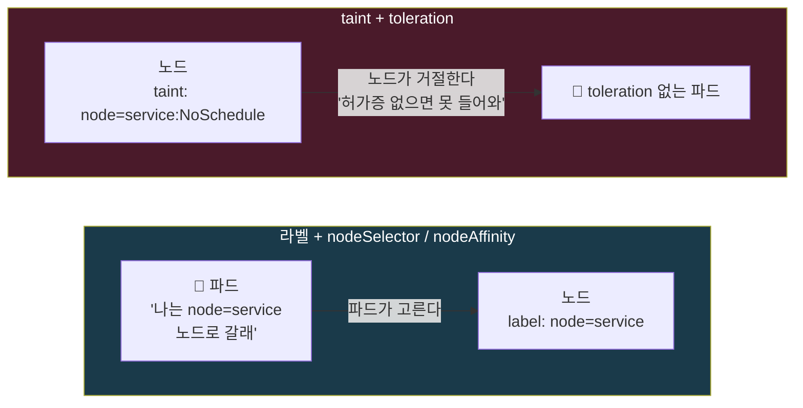
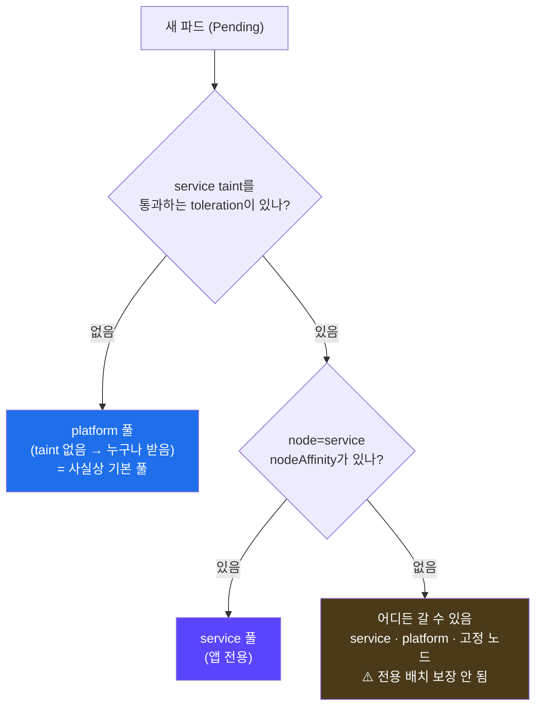
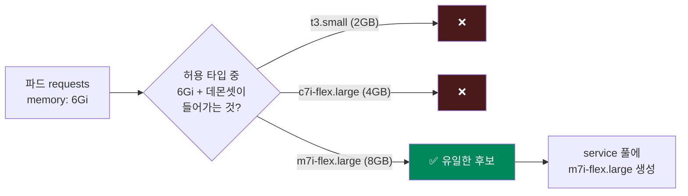
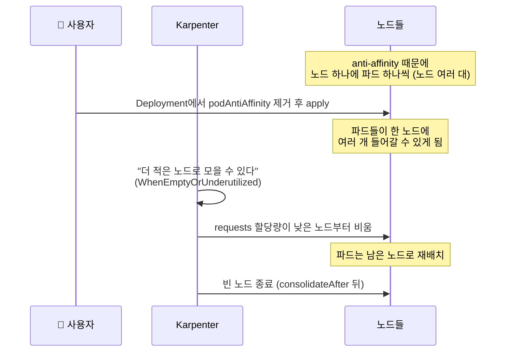
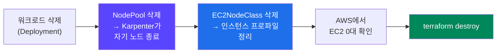

## 📚 들어가며

[7편](/posts/EKS-Rebuild-07-Karpenter-Concepts-and-Pod-Identity-Install/)에서 Karpenter 컨트롤러를 설치했다. 하지만 아직 **노드를 하나도 만들지 않았다.** Karpenter에게 "무엇을, 어떻게 만들지"를 알려주는 규칙이 없기 때문이다.

이번 편에서 그 규칙을 쓴다.

- **EC2NodeClass** — 노드를 AWS에서 **어떻게** 만들지 (1장)
- **NodePool** — **어떤** 노드를 **언제** 만들고 없앨지 (2장)
- 강의는 NodePool을 **`service`와 `platform` 두 개로 나누는데**, 왜 나누는지가 이번 편의 개념적 핵심이다 (3장)
- 그다음 파드를 늘리고 줄이며 노드가 자동으로 생기고 사라지는 원리를 따라간다 (4장)

처음 보는 사람도 읽을 수 있게 taint/toleration, nodeAffinity, requests, consolidation, drift 같은 개념에는 짧게 설명을 붙였다.

> **이번 편 학습 지도**
>
> ```
> EC2NodeClass (1장)       NodePool (2장)              설계와 실습 (3~5장)
> ──────────────────       ──────────────              ───────────────────
> v1beta1 → v1 변경        v1 필드 위치·이름 변경        라벨 vs taint 🔦
> AMI 지정 필수            requirements = 후보 조건      service = 앱 전용 풀
> 태그로 서브넷·SG 찾기     disruption = 언제 없애나      platform = 사실상 기본 풀
> 인스턴스 프로파일 자동    limits = 비용 안전장치        requests가 타입을 정한다
>                                                     destroy 체크리스트 +1
> ```

---

## 1. EC2NodeClass — 노드를 AWS에서 어떻게 만들 것인가

EC2NodeClass는 AMI, IAM 역할, 서브넷, 보안 그룹, 디스크처럼 **"AWS 쪽 노드 속성"** 을 담당한다.

```yaml
apiVersion: karpenter.k8s.aws/v1
kind: EC2NodeClass
metadata:
  name: default
spec:
  amiSelectorTerms:
    - alias: al2023@latest          # v1에서 필수. 강의의 amiFamily: AL2 를 대체
  role: KarpenterNodeRole-mydev     # Terraform이 고정 이름으로 만든 노드 역할 (7편)
  subnetSelectorTerms:
    - tags:
        karpenter.sh/discovery: mydev
  securityGroupSelectorTerms:
    - tags:
        karpenter.sh/discovery: mydev
  blockDeviceMappings:
    - deviceName: /dev/xvda
      ebs:
        volumeSize: 50Gi            # 강의: 100Gi
        volumeType: gp3
        encrypted: true
        deleteOnTermination: true
  tags:
    Name: karpenter-mydev
```

### 1-1. 강의(v1beta1)에서 바뀐 것

| 항목 | 강의 | 이번 | 이유 |
|---|---|---|---|
| apiVersion | `karpenter.k8s.aws/v1beta1` | `karpenter.k8s.aws/v1` | v1.0에서 정식 API |
| AMI | `amiFamily: AL2` | `amiSelectorTerms: [{alias: al2023@latest}]` | v1부터 AMI 지정이 **필수**. 그리고 EKS 1.34용 AL2 AMI는 아예 없다 (2편) |
| role | `KarpenterNodeRole-${CLUSTER_NAME}` (envsubst로 치환) | 이름을 직접 적음 | Terraform에서 이름을 고정해둠 (7편) |
| 디스크 | 100Gi | 50Gi | EBS는 용량만큼 과금되는데 학습용으론 과함 |

> **💡 `al2023@latest`의 주의점 — drift**
>
> **drift**는 "노드의 실제 상태가 NodePool/EC2NodeClass에 적힌 원하는 상태와 달라졌다"는 뜻이다. `@latest`를 쓰면 **새 AMI가 나올 때마다** Karpenter가 "노드가 원하는 AMI와 달라졌다"고 판단해 노드를 교체한다. 학습용으론 편하지만, 운영 환경에서는 `al2023@v20250920`처럼 **버전을 고정**하고 바꿀 때를 직접 정하는 것이 권장된다.

### 1-2. 서브넷·보안 그룹을 "태그로 찾는" 이유

ID를 직접 적지 않고 **태그로 고른다.** 그래서 클러스터를 지웠다 다시 만들어 서브넷 ID가 바뀌어도 YAML을 고칠 필요가 없다. 5편에서 재생성할 때마다 `vpcId`를 고쳐야 했던 것과 정반대다. 태그는 2편에서 Terraform으로 미리 달아뒀다.

```bash
aws ec2 describe-subnets --filters "Name=tag:karpenter.sh/discovery,Values=mydev" \
  --query 'Subnets[].[SubnetId,AvailabilityZone]'
aws ec2 describe-security-groups --filters "Name=tag:karpenter.sh/discovery,Values=mydev" \
  --query 'SecurityGroups[].GroupId'
```

태그가 붙은 보안 그룹이 여러 개면 **노드에 전부 붙는다.** 의도한 보안 그룹 하나에만 태그를 다는 게 안전하다.

### 1-3. Karpenter가 인스턴스 프로파일을 직접 만든다

EC2는 IAM 역할을 바로 붙이지 못하고 **인스턴스 프로파일**이라는 포장을 거쳐야 한다. EC2NodeClass에 `role`을 적으면 **Karpenter가 그 역할로 인스턴스 프로파일을 직접 만든다.** 실제로 AWS에 `mydev_<숫자>` 형태의 인스턴스 프로파일이 생겨 있었다.

7편의 Terraform 모듈에 `aws_iam_instance_profile` 리소스가 정의돼 있는데도 만들지 않은 이유가 이것이다. 모듈의 `create_instance_profile` 기본값이 `false`다 — Karpenter가 알아서 만드니까.

### 1-4. IMDS 설정은 기본값 그대로

`metadataOptions`를 적지 않으면 v1 기본값은 `httpTokens: required`, `httpPutResponseHopLimit: 1`이다. 4편에서 다룬 것처럼 hop limit 1은 **일반 파드가 노드의 IAM 권한을 빌려 쓰지 못하게 막는 보안 기본값**이다. 이 클러스터는 Pod Identity로 권한을 주므로 그대로 둔다.

---

## 2. NodePool — 어떤 노드를, 언제 만들고 없앨 것인가

### 2-1. 강의(v1beta1)에서 바뀐 필드

v1에서는 필드 위치와 이름이 꽤 바뀌었다. 차트에 들어 있는 CRD 스키마(`crds/karpenter.sh_nodepools.yaml`)로 하나씩 확인한 내용이다.

| 항목 | v1beta1 (강의) | v1 |
|---|---|---|
| apiVersion | `karpenter.sh/v1beta1` | `karpenter.sh/v1` |
| nodeClassRef | `name`만 | **`group`, `kind`, `name` 모두 필수** |
| expireAfter | `spec.disruption.expireAfter` | **`spec.template.spec.expireAfter`** 로 이동 |
| consolidationPolicy | `WhenUnderutilized` / `WhenEmpty` | **`WhenEmptyOrUnderutilized`** / `WhenEmpty` (이름 변경) |
| consolidateAfter | 선택 | **필수** |

이렇게 위치가 바뀐 게 많아서, 적용 전에 CRD 스키마와 매니페스트 필드를 대조해 검증했다(7편 6-4). 강의 YAML을 그대로 v1으로 바꾸면 `expireAfter`가 엉뚱한 자리에 있다는 에러부터 만난다.

### 2-2. requirements — "어떤 노드면 되는가"

NodePool은 인스턴스를 **조건**으로 고른다. Karpenter는 이 조건을 만족하는 타입 중에서, 대기 중인 파드의 **requests**를 받을 수 있는 **저렴한** 것을 고른다.

**강의는 이렇게 넓게 열어뒀다.**

```yaml
- key: karpenter.k8s.aws/instance-category    # 인스턴스 계열
  operator: In
  values: ["c", "m", "r"]
- key: karpenter.k8s.aws/instance-generation  # 세대
  operator: Gt
  values: ["5"]
```

"c/m/r 계열의 6세대 이상이면 아무거나"라는 뜻이다. **이렇게 넓게 열어둘수록** Karpenter가 고를 수 있는 선택지가 커지고, 특히 스팟 확보 가능성이 높아진다. 이게 Karpenter의 원래 장점이고, **일반적인 계정이라면 이 방식을 쓰는 게 맞다.**

**내 계정에서는 그렇게 못 했다.** 내 학습 계정은 Free Tier 대상 인스턴스만 띄울 수 있는 제한이 있어서(3편), 넓게 열어두면 Karpenter가 고르는 타입마다 `not eligible for Free Tier`로 실패한다. 그래서 허용 목록의 x86 타입을 직접 나열했다.

```yaml
- key: node.kubernetes.io/instance-type
  operator: In
  values: ["m7i-flex.large", "c7i-flex.large", "t3.small"]
```

여기서 3편과 다른 점이 하나 보인다. `c7i-flex.large`는 서울 리전에서 **2b에만** 있다. 3편에서 관리형 노드 그룹에 2b에만 있는 타입을 넣었다가 실패했었는데, **Karpenter는 타입별로 어느 AZ에서 제공되는지 알고 있어서** 알아서 2b에만 띄운다. 후보에 넣어도 안전하다.

나머지 조건은 이렇다.

```yaml
- key: kubernetes.io/arch
  operator: In
  values: ["amd64"]
- key: karpenter.sh/capacity-type
  operator: In
  values: ["spot"]                 # 스팟만
- key: topology.kubernetes.io/zone
  operator: In
  values: ["ap-northeast-2a", "ap-northeast-2b", "ap-northeast-2c"]
```

**AZ는 강의와 다르게 열어뒀다.** 강의의 `nodepool-service.yaml` / `nodepool-platform.yaml`은 `2a` 하나로 고정하고, "PVC 에러가 나면 바꾸라"는 주석을 달았다. 6편에서 다룬 **EBS 볼륨이 AZ에 묶이는 문제**를 피하려던 것이다. (강의 레포에는 3개 AZ를 여는 `nodepool-multiAz.yaml`도 따로 들어 있다.)

이 프로젝트는 3개 AZ를 모두 열었다. 판단 근거는 두 가지다.

- StorageClass를 `WaitForFirstConsumer`로 쓰고 있고(6편), **Karpenter는 파드가 쓰는 PV가 어느 AZ에 있는지 보고 그 AZ에 노드를 띄운다.** 6편 4장의 "볼륨이 있는 AZ에 노드가 있어야 한다"를 Karpenter가 알아서 맞춰준다.
- 한 AZ로 묶으면 **그 AZ에서 스팟을 못 구할 때** 노드를 아예 못 띄운다. 특히 내 계정은 타입이 3개뿐이라 스팟 풀이 좁아서, AZ까지 좁히면 위험이 더 커진다.

### 2-3. disruption — "언제 없앨 것인가"

```yaml
spec:
  template:
    spec:
      expireAfter: 720h                        # 노드 최대 수명 30일
  disruption:
    consolidationPolicy: WhenEmptyOrUnderutilized
    consolidateAfter: 1m
```

| 설정 | 의미 |
|---|---|
| `expireAfter` | 이 시간이 지나면 노드를 새것으로 교체한다. 오래된 AMI·패치를 계속 쓰지 않게 하는 장치 |
| `consolidationPolicy: WhenEmpty` | **빈 노드만** 없앤다 |
| `consolidationPolicy: WhenEmptyOrUnderutilized` | 빈 노드는 물론, **파드를 다른 노드로 모으면 노드를 줄일 수 있거나, 더 싼 노드로 바꿀 수 있으면** 그렇게 한다 (강의의 `WhenUnderutilized`) |
| `consolidateAfter` | 조건이 맞은 뒤 얼마나 기다렸다가 정리할지. 실습이라 1분으로 짧게 (강의: 3m). 운영에서는 잦은 교체를 피하려고 길게 둔다 |

### 2-4. limits — 비용 안전장치

```yaml
limits:
  cpu: "8"     # 강의: cpu 1000
```

이 NodePool이 띄울 수 있는 자원 **총합의 상한**이다. 허용 타입 셋이 모두 2vCPU라서, CPU 8이면 **최대 4대**다. 실수로 `replicas`를 크게 올려도 노드가 수백 대 뜨지 않는다. 상한에 걸리면 남은 파드는 `Pending`으로 남는다(4-5에서 확인). 학습용 계정이라 강의보다 훨씬 낮게 잡았다.

---

## 3. 🔦 왜 NodePool을 `service`와 `platform` 둘로 나누나

이번 편의 개념적 핵심이다. 강의 슬라이드의 그림이 의도를 보여준다.

```
Service NodePool (with Taint)     Platform NodePool
  SNS · Feed · Timeline             Prometheus · Loki · Kafka
```

**애플리케이션의 목적과 요구 사항에 따라 노드를 분리**한다. 앱 서버와 모니터링·메시징 같은 플랫폼 컴포넌트가 같은 노드에서 자원을 다투지 않게 하고, 장애나 노드 교체의 영향 범위를 나눈다.

그런데 이걸 이해하려면 먼저 라벨과 taint가 **정반대 방향의 장치**라는 걸 알아야 한다.

### 3-1. 개념: 라벨과 taint는 방향이 반대다



| | 라벨 + nodeSelector / nodeAffinity | taint + toleration |
|---|---|---|
| 방향 | **파드가 노드를 고른다** ("나는 저 노드로 갈래") | **노드가 파드를 거절한다** ("허가받은 파드만 들어와") |
| 막아주는 것 | **이 파드가** 다른 노드로 가는 것 | **다른 파드가** 이 노드로 오는 것 |
| 설정 위치 | 노드에 라벨, 파드에 nodeSelector/affinity | 노드에 taint, 파드에 toleration |

**라벨만 쓰면** 앱 파드는 `service` 노드로 가지만, 다른 파드(예: Prometheus)도 빈자리가 있으면 `service` 노드에 올라간다. 라벨은 "끌어오는 힘"만 있지 "막는 힘"이 없다. **taint까지 걸어야 진짜 "앱 전용 노드"** 가 된다.

### 3-2. 두 NodePool의 실제 차이

두 파일을 `diff` 해보면 차이는 딱 이것뿐이다.

```yaml
# nodepool-service.yaml
spec:
  template:
    metadata:
      labels:
        node: service            # 라벨: 앱 파드가 찾아올 수 있게
    spec:
      taints:
      - key: node                # taint: 허가 없는 파드는 거절
        value: service
        effect: NoSchedule
```

```yaml
# nodepool-platform.yaml
spec:
  template:
    metadata:
      labels:
        node: platform           # 라벨만 있고 taint는 없다
```

나머지(타입 목록, AZ, disruption, limits)는 두 파일이 같다.

| | `service` | `platform` |
|---|---|---|
| 라벨 | `node: service` | `node: platform` |
| taint | `node=service:NoSchedule` | 없음 |
| 누가 올라가나 | toleration을 가진 파드만 (SNS 앱) | toleration이 없는 **나머지 전부** |

### 3-3. 흥미로운 발견: `platform`은 사실상 "기본 풀"이다

강의 레포 전체에서 `node: platform`을 지정하는 곳을 찾아봤다. Prometheus, Loki, Kafka 등 플랫폼 컴포넌트의 values 어디에도 없고, **NodePool 자기 자신의 라벨 정의 한 곳뿐**이었다.

```bash
grep -rn --include='*.yaml' -E 'node:\s*platform|\[platform\]' ref/ | grep -v '^ref/karpenter'
# (결과 없음)
```

즉 `platform`은 파드를 **끌어오는** 풀이 아니다. `service`가 taint로 막혀 있으니, **갈 곳 없는 파드를 받아주는 기본 풀**로 동작한다.



반대로 **앱 쪽에는 준비가 되어 있다.** 강의 레포의 SNS 앱 5개(`user-server`, `feed-server`, `timeline-server`, `image-server`, `sns-frontend`)와 helm-starter-template의 values에 아래 설정이 **주석으로** 들어 있다. 앱을 배포하는 단계에서 이 주석을 풀면 앱이 `service` 노드로만 간다.

```yaml
# tolerations:                 ← service 노드의 taint를 통과하는 허가증
# - key: node
#   value: service
#   effect: NoSchedule
# affinity:                    ← 그리고 반드시 service 노드로 가라
#   nodeAffinity:
#     requiredDuringSchedulingIgnoredDuringExecution:
#       nodeSelectorTerms:
#       - matchExpressions:
#         - key: node
#           operator: In
#           values: [service]
```

강의 슬라이드의 그림만 보면 "플랫폼 컴포넌트는 platform 풀로 **보낸다**"처럼 읽힌다. 하지만 실제 구조는 **"앱만 service로 끌어가고, 나머지는 자연스럽게 platform으로 흘러간다"** 이다. 결과는 같아도 설계 방식이 다르다. 앱을 추가할 때는 toleration과 affinity를 챙겨야 하지만, 플랫폼 컴포넌트를 추가할 때는 아무것도 안 해도 된다.

**비용 트레이드오프**: 풀을 나누면 앱 파드와 플랫폼 파드가 같은 노드에 섞이지 못해서, 하나로 운영할 때보다 노드가 더 뜰 수 있다. 이번 구성은 두 풀 모두 `limits.cpu: "8"`이라 합쳐서 최대 8대(16 vCPU)까지 뜰 수 있다.

---

## 4. 오토스케일링 실습

> 이 장의 시간 수치(약 45초, 10초 이내 등)는 **강의 환경 기준**이다. 각 실습은 **무엇을 보면 되는지**와 **예상 동작**으로 정리했다.

### 4-1. 관찰 도구: eks-node-viewer

AWS가 만든 CLI 도구로, 노드별 **실제 용량 대비 requests 할당량**, 노드 타입, 파드 수, 시간당 비용을 실시간으로 보여준다.

```bash
brew tap aws/tap
brew install eks-node-viewer

eks-node-viewer                                   # 전체 노드
eks-node-viewer --resources cpu,memory            # CPU와 메모리 둘 다
eks-node-viewer --node-selector node=service      # service 풀 노드만
eks-node-viewer --node-selector node=platform     # platform 풀 노드만
```

강의처럼 터미널을 두 개로 나눠 한쪽에 `eks-node-viewer`, 다른 쪽에 `kubectl get pod -w`를 띄워두면 노드가 생기고 파드가 배치되는 과정을 동시에 볼 수 있다. 함께 보면 좋은 명령은 이렇다.

```bash
kubectl get nodeclaims -w                                              # Karpenter가 만드는 노드 요청
kubectl get nodes -L karpenter.sh/nodepool,node.kubernetes.io/instance-type,topology.kubernetes.io/zone
kubectl logs -f -n kube-system -l app.kubernetes.io/name=karpenter     # Karpenter의 판단 과정
```

### 4-2. 실습 ① 스케일 아웃 — `platform` 풀 (`deploy-busybox.yaml`)

```yaml
spec:
  replicas: 4
  template:
    spec:
      containers:
      - name: busybox
        image: busybox
        command: ["/bin/sh", "-c", "sleep inf"]
        resources:
          requests:
            cpu: 400m           # Karpenter는 이 값을 보고 노드 크기를 계산한다
            memory: 512Mi
      affinity:
        podAntiAffinity:        # "한 노드에 이 파드는 하나만"
          requiredDuringSchedulingIgnoredDuringExecution:
          - labelSelector:
              matchExpressions:
              - key: app
                operator: In
                values: ["busybox"]
            topologyKey: kubernetes.io/hostname
```

- **podAntiAffinity** — 같은 라벨을 가진 파드끼리 **같은 노드에 못 올라가게** 한다. 그래서 파드 수만큼 노드가 필요해진다. 노드 증가를 눈으로 보기 위한 장치다.

예상 흐름은 이렇다.

1. 고정 노드 2대에 파드 2개가 뜬다.
2. 남은 2개는 anti-affinity 때문에 자리가 없어 `Pending`.
3. toleration이 없으니 `service` 풀(taint)로는 못 가고 **`platform` 풀**에서 Karpenter가 노드 2대를 띄운다.
4. requests가 작으므로(400m / 512Mi) 허용 타입 중 이걸 받을 수 있는 **저렴한 것**이 선택된다. 이 구성이면 보통 `t3.small`.

> **"가장 싼 것"의 정확한 의미 (스팟)**
>
> 온디맨드라면 Karpenter가 들어맞는 타입 중 가장 싼 걸 고른다. **스팟은 조금 다르다.** Karpenter는 들어맞는 후보 타입 여러 개를 EC2 Fleet에 함께 넘기고, AWS가 **가격과 확보 가능성을 같이 보고**(price-capacity-optimized) 고른다. 7편에서 "스팟의 `instance_types`는 우선순위가 아니라 후보 집합"이라고 했던 것과 같은 원리다.

**requests가 왜 중요한가**: Karpenter는 파드가 실제로 얼마나 쓰는지가 아니라 **requests에 적힌 값**만 보고 판단한다. requests가 없으면 "아주 작은 파드"로 보고 기존 노드에 욱여넣거나, 너무 작은 노드를 띄울 수 있다. 7편의 주의 사항 표에서 "Request 조정"이 첫 번째였던 이유다.

### 4-3. 실습 ② `service` 풀로 보내기 — requests가 타입을 정한다 (`deploy-node-affinity.yaml`)

```yaml
spec:
  replicas: 2
  template:
    spec:
      containers:
      - name: httpd
        image: httpd
        resources:
          requests:
            cpu: 100m
            memory: 6Gi           # 일부러 크게
      tolerations:                # service 노드의 taint 통과
      - key: "node"
        value: "service"
        effect: "NoSchedule"
      affinity:
        podAntiAffinity: ...      # 한 노드에 하나씩
        nodeAffinity:             # 반드시 node=service 노드로
          requiredDuringSchedulingIgnoredDuringExecution:
            nodeSelectorTerms:
            - matchExpressions:
              - key: node
                operator: In
                values: ["service"]
```

**toleration과 nodeAffinity가 둘 다 필요한 이유**: toleration만 있으면 taint를 통과할 **"자격"** 만 생긴다. 고정 노드나 `platform` 노드로 가도 막을 게 없다(3-3 그림의 "⚠️ 전용 배치 보장 안 됨"). **nodeAffinity까지 있어야** 반드시 `service` 노드로 간다. 3-1의 "방향이 반대"가 여기서 **둘 다 필요한** 이유다.

**requests로 인스턴스 타입이 결정되는 걸 보기 좋은 설정**이기도 하다.



메모리 6Gi를 받을 수 있는 건 허용 목록 중 `m7i-flex.large`(8GB)뿐이다. 그래서 Karpenter는 이 파드를 위해 **`m7i-flex.large`를 고를 수밖에 없다.** 4-2에서 `t3.small`이 뜨던 것과 대비된다. 같은 NodePool 규칙인데도 **파드의 requests에 따라 다른 타입**이 뜬다는 게 강의 슬라이드의 "파드 Request 설정에 맞게 자동으로 비용 최적화 노드 선택"이다. 강의 기준으로 노드 준비까지 **약 40~46초**가 걸렸다.

확인할 것:

```bash
kubectl get nodes -L karpenter.sh/nodepool,node.kubernetes.io/instance-type
# NODEPOOL=service 인 노드의 INSTANCE-TYPE 이 m7i-flex.large 인지
kubectl get pod -l app=httpd -o wide
# httpd 파드가 그 노드들에 하나씩 떠 있는지
```

### 4-4. 실습 ③ 스케일 인과 Consolidation

**① 빈 노드 정리**: Deployment를 지우면 노드가 비고, `consolidateAfter`(1분) 뒤에 Karpenter가 노드를 종료한다. 강의 기준으로 정리는 약 10초 이내에 끝났다.

```bash
kubectl delete -f deploy-node-affinity.yaml
kubectl get nodeclaims -w     # NodeClaim이 사라지는 것을 확인
```

**② 덜 쓰이는 노드 통합**: 강의는 busybox의 `replicas`를 늘린 뒤 **podAntiAffinity를 제거**하는 방식으로 Consolidation을 보여준다.



anti-affinity가 없어지면 파드들이 한 노드에 여러 개 들어갈 수 있게 되고, Karpenter는 "파드를 더 적은 노드로 모을 수 있다"고 판단해 **requests 할당량이 낮은 노드부터** 비우고 없앤다. 내 레포에서 이걸 보려면 `deploy-busybox-consolidation.yaml`의 `affinity` 블록을 주석 처리하고 다시 apply하면 된다.

### 4-5. 실습 ④ `limits`가 실제로 걸리는 경우

내 레포의 `deploy-busybox-consolidation.yaml`은 **podAntiAffinity가 켜진 상태**로 `replicas: 8`이다. 이대로 apply하면 4-4가 아니라 **limits 실습**이 된다. 계산해보면 이렇다.

| | 노드 수 | busybox 파드 |
|---|:---:|:---:|
| 고정 노드 | 2 | 2 |
| `platform` 풀 (`limits.cpu: "8"` ÷ 2vCPU) | 최대 4 | 4 |
| `service` 풀 | — | toleration 없음 → 못 감 |
| **합계** | **6** | **6 Running / 2 Pending** |

파드 8개가 각자 다른 노드를 원하는데 노드는 6대까지만 생길 수 있으니, **2개는 `Pending`으로 남는다.** `kubectl describe pod`의 Events나 Karpenter 로그에서 상한 때문에 노드를 더 못 띄운다는 내용을 확인할 수 있다. 2-4의 비용 안전장치가 의도대로 동작하는지 보는 실습이다.

정리하면 같은 파일이 설정 하나로 두 실습이 된다.

| `deploy-busybox-consolidation.yaml` 상태 | 보이는 것 |
|---|---|
| `affinity` 블록 **주석 처리** (강의 방식) | 4-4 Consolidation — 노드가 줄어든다 |
| `affinity` 블록 **켜진 채** (현재 커밋 상태) | 4-5 limits — 2개가 `Pending`으로 남는다 |

---

## 5. 정리할 때 — destroy 체크리스트에 한 줄이 추가된다

**Karpenter가 띄운 EC2는 Terraform이 만든 게 아니라서 state에 없다.** 5편의 ALB, 6편의 EBS 볼륨과 같은 종류의 문제다. 그런데 **이번엔 EC2라서, 놓치면 비용이 훨씬 크다.**

| | 누가 만드나 | `terraform destroy`로 지워지나 |
|---|---|---|
| 관리형 노드 그룹의 노드 (고정 노드) | Terraform | ✅ |
| **Karpenter가 띄운 노드** | Karpenter 컨트롤러 | ❌ 고아 EC2로 남아 계속 과금 |
| Karpenter가 만든 인스턴스 프로파일 (1-3) | Karpenter 컨트롤러 | ❌ 껍데기로 남을 수 있음 |

그래서 destroy 전에, **클러스터가 살아있을 때** Karpenter에게 정리를 맡긴다.



```bash
# 1) 클러스터 밖에 리소스를 만드는 것들 (5·6편)
kubectl get ingress -A
kubectl get pvc -A

# 2) Karpenter 워크로드 → NodePool → EC2NodeClass 순서
kubectl delete -f deploy-busybox.yaml -f deploy-node-affinity.yaml
kubectl delete nodepool --all          # Karpenter가 자기가 띄운 노드를 종료
kubectl delete ec2nodeclass --all      # 자기가 만든 인스턴스 프로파일도 정리
kubectl get nodeclaims                 # 비어야 함

# 3) AWS에서 정말 사라졌는지
aws ec2 describe-instances --region ap-northeast-2 \
  --filters "Name=tag-key,Values=karpenter.sh/nodepool" "Name=instance-state-name,Values=pending,running" \
  --query 'Reservations[].Instances[].InstanceId' --output text

# 4) 그다음 tf-eks 에서 terraform destroy
```

**왜 NodePool을 먼저 지우나?** EC2NodeClass는 그걸 쓰는 NodeClaim이 남아 있으면 **finalizer 때문에 삭제가 기다린다.** 5편의 Ingress, 6편의 PVC와 같은 원리다 — "지우기 전에 정리할 게 있으니 기다려." NodePool을 지워 NodeClaim과 노드가 먼저 사라져야 EC2NodeClass가 깔끔하게 지워진다.

5편에서 시작한 "Terraform이 모르는 것" 목록이 이렇게 늘었다.

| 편 | 만든 주체 | 클러스터 밖 리소스 | destroy 전에 지울 것 |
|---|---|---|---|
| 5편 | LB Controller · external-dns | ALB · DNS 레코드 | Ingress |
| 6편 | EBS CSI | EBS 볼륨 | PVC |
| **8편** | **Karpenter** | **EC2 · 인스턴스 프로파일** | **NodePool → EC2NodeClass** |

---

## 📝 이번 편 요약

```
EC2NodeClass = AWS에서 어떻게
├─ v1: AMI 지정 필수 (al2023@latest → 운영에선 버전 고정, drift 주의)
├─ 서브넷·SG는 태그로 찾음 → 재생성해도 YAML 수정 불필요
├─ role만 적으면 인스턴스 프로파일은 Karpenter가 직접 생성
└─ IMDS 기본값(hop limit 1) 그대로

NodePool = 무엇을 언제
├─ v1: nodeClassRef(group·kind·name) · expireAfter 위치 · 정책 이름 · consolidateAfter 필수
├─ requirements: 원래는 계열·세대로 넓게. 내 계정은 Free Tier 탓에 타입 나열
│    └─ Karpenter는 타입별 AZ 제공 여부를 앎 · PV의 AZ에 맞춰 노드를 띄움
├─ disruption: expireAfter(수명) · WhenEmptyOrUnderutilized · consolidateAfter
└─ limits: 총합 상한 = 비용 안전장치

service vs platform 🔦
├─ 라벨 = 파드가 노드를 고름 / taint = 노드가 파드를 거절
├─ service: 라벨 + taint → 앱 전용 (toleration + nodeAffinity 둘 다 필요)
└─ platform: 라벨만 → 갈 곳 없는 파드를 받는 사실상 기본 풀

실습
├─ requests가 노드 타입을 정한다 (512Mi → t3.small, 6Gi → m7i-flex.large)
├─ 빈 노드 정리 · Consolidation (anti-affinity 제거)
└─ limits 초과 → 남은 파드 Pending

정리
└─ Karpenter 노드도 Terraform이 모름 → NodePool → EC2NodeClass 순으로 먼저 삭제
```

| 개념 | 한 줄 정의 |
|---|---|
| **drift** | 노드의 실제 상태가 NodePool/EC2NodeClass의 원하는 상태와 달라진 것. Karpenter가 노드를 교체 |
| **인스턴스 프로파일** | EC2에 IAM 역할을 붙이기 위한 포장. Karpenter가 `role`로부터 직접 생성 |
| **requirements** | NodePool이 허용하는 노드 조건 (타입·계열·세대·AZ·아키텍처·스팟 여부) |
| **expireAfter** | 노드의 최대 수명. 지나면 새 노드로 교체 |
| **Consolidation** | 빈 노드를 없애거나, 파드를 모아 노드를 줄이거나 더 싼 노드로 교체 |
| **limits** | NodePool이 띄울 수 있는 자원 총합의 상한 |
| **taint / toleration** | 노드가 파드를 거절하는 표시 / 그 거절을 통과하는 파드의 허가증 |
| **nodeAffinity** | 파드가 특정 라벨의 노드로만 가도록 하는 조건 |
| **podAntiAffinity** | 같은 라벨의 파드끼리 같은 노드(또는 AZ)에 못 올라가게 하는 조건 |

---

## 💭 느낀 점

**1. 라벨과 taint를 "방향"으로 이해하니 다 풀렸다.**

처음엔 "라벨로 노드를 나누면 되는데 taint는 왜 또 있지?" 싶었다. 그런데 **라벨은 끌어오는 힘, taint는 막는 힘**이라고 정리하고 나니, 앱 파드에 toleration과 nodeAffinity가 **둘 다** 필요한 이유도, `platform`에 taint가 없는 이유도 한 번에 이해됐다. 개념 하나를 "누가 누구를 고르는가"라는 방향으로 다시 보니 흩어져 있던 설정들이 하나로 묶였다.

**2. `platform`은 "보내는" 곳이 아니라 "흘러가는" 곳이었다.**

강의 슬라이드만 보면 Prometheus 같은 컴포넌트를 platform 풀로 보내는 줄 알았다. 그런데 강의 레포 전체를 grep해보니 `node: platform`을 지정하는 곳이 한 군데도 없었다. 앱만 service로 끌어가고, 나머지는 **막힌 길을 피해 자연스럽게** platform으로 간다. 그림과 실제 구조가 미묘하게 다르다는 걸 **코드를 직접 뒤져서** 알게 된 게 이번 편에서 가장 재미있었다.

**3. 3편의 실패가 Karpenter에서는 실패가 아니었다.**

3편에서 `c7i-flex.large`는 2b에만 있어서 관리형 노드 그룹에 넣으면 실패한다고 걸러냈었다. 그런데 Karpenter NodePool에는 넣어도 된다. **타입별로 어느 AZ에서 제공되는지 Karpenter가 알고 있기 때문**이다. 같은 타입, 같은 계정인데 도구가 달라지니 제약이 사라졌다. ASG를 거치지 않는다는 7편의 설명이 이런 식으로 체감됐다.

**4. 6편의 고민을 Karpenter가 대신 해준다.**

6편에서 "볼륨이 있는 AZ에 노드가 있어야 한다"며 걱정했던 게, Karpenter가 PV의 AZ를 보고 그 AZ에 노드를 띄워주면서 상당 부분 해결된다. 강의가 AZ를 2a 하나로 묶은 것도 이 문제를 피하려던 것이었는데, `WaitForFirstConsumer` + Karpenter 조합이면 3개 AZ를 열어둘 수 있다. **앞 편에서 배운 개념이 뒤 편의 설계 판단 근거가 되는** 흐름이 시리즈를 이어 쓰는 이유인 것 같다.

**5. "Terraform이 모르는 것" 목록에 드디어 EC2가 올라왔다.**

5편 ALB, 6편 EBS 볼륨에 이어 이번엔 EC2 인스턴스다. 앞의 둘은 놓쳐도 월 몇 달러였지만, EC2는 놓치면 **훨씬 크게** 청구된다. 6편에서 실제로 고아 EBS 볼륨을 발견했던 경험이 있어서, destroy 전 체크리스트를 **편마다 한 줄씩 늘려가는** 게 이제는 습관이 됐다.

---

## 🔗 다음 편 예고

Karpenter는 노드를 **자주, 적극적으로** 바꾼다. 그럼 노드가 바뀌어도 서비스가 흔들리지 않게 하려면?

- **PDB, PriorityClass, Graceful Shutdown** — 7편 주의 사항 표에 나온 것들을 실제로 적용
- **`karpenter.sh/do-not-disrupt`** — Karpenter가 특정 파드가 있는 노드를 건드리지 못하게 하는 어노테이션
- 그 이후 SNS 앱을 실제로 `service` 풀에 배포하는 단계 (3-3의 주석을 푸는 순간)

---

## 📚 참고

- [Karpenter — NodePools](https://karpenter.sh/docs/concepts/nodepools/)
- [Karpenter — NodeClasses](https://karpenter.sh/docs/concepts/nodeclasses/)
- [Karpenter — Disruption (Consolidation, Drift, Expiration)](https://karpenter.sh/docs/concepts/disruption/)
- [Karpenter — v1 Migration](https://karpenter.sh/docs/upgrading/v1-migration/) — 2-1 변경점
- [Kubernetes — Taints and Tolerations](https://kubernetes.io/docs/concepts/scheduling-eviction/taint-and-toleration/)
- [aws/eks-node-viewer](https://github.com/awslabs/eks-node-viewer)

> 이 글의 클러스터명·IAM 역할 이름·인스턴스 프로파일 이름은 예시 값으로 치환했다. 4장의 시간 수치는 강의 환경 기준이다. "Free Tier 대상 인스턴스만 띄울 수 있다"는 제한은 내 학습 계정 특유의 것이다.
