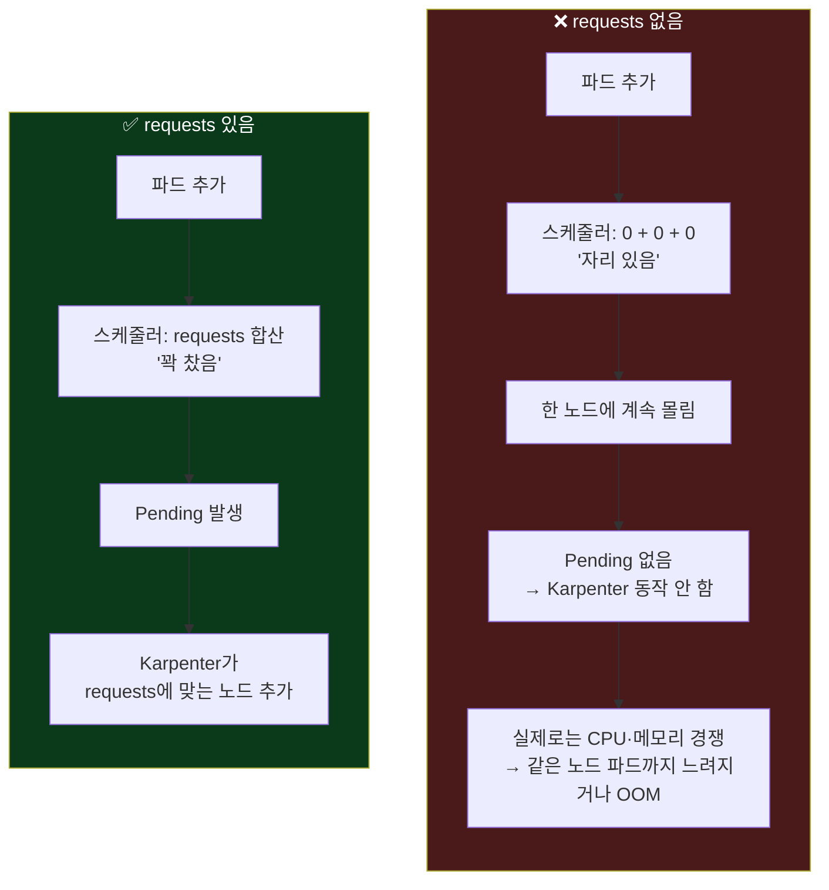
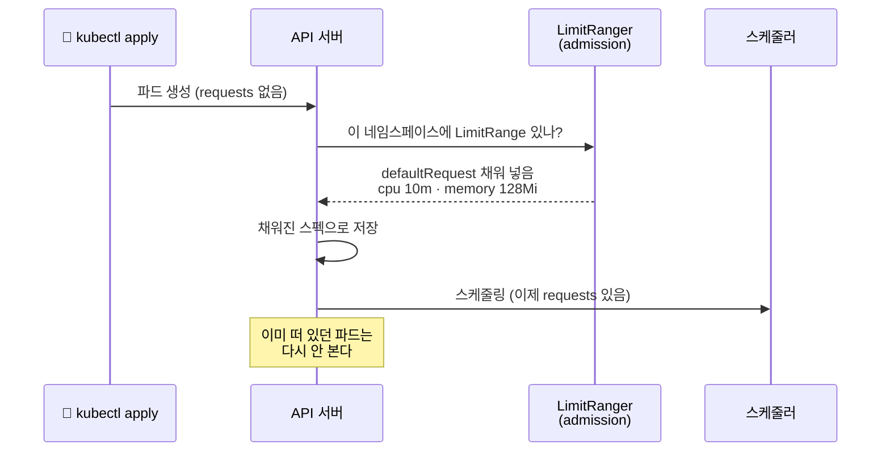
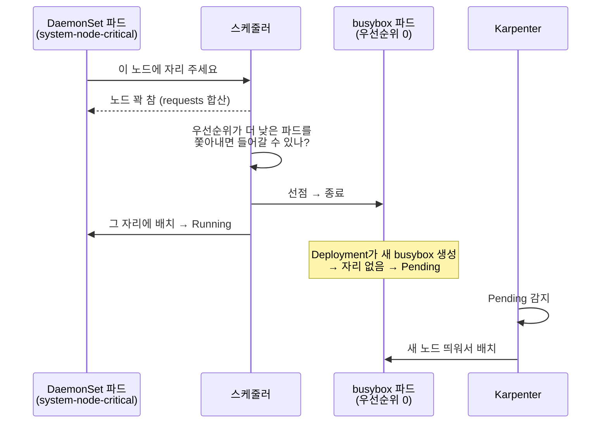

## 📚 들어가며

[7편](/posts/EKS-Rebuild-07-Karpenter-Concepts-and-Pod-Identity-Install/)과 [8편](/posts/EKS-Rebuild-08-Karpenter-NodePool-Design-and-Autoscaling/)에서 Karpenter를 설치하고 노드가 늘고 줄어드는 원리를 봤다. 그런데 7편에서 정리한 주의 사항이 계속 마음에 걸렸다.

> Karpenter는 노드를 **자주, 적극적으로** 바꾼다. 그리고 노드 크기를 정할 때 파드가 실제로 얼마나 쓰는지가 아니라 **requests에 적힌 값만** 본다.

강의도 Karpenter 다음에 **"안전하게 Karpenter를 사용하는 방법"** 을 세 파트에 걸쳐 다룬다. 나는 이걸 두 편으로 나눴다.

| 편 | 주제 | 다루는 것 |
|---|---|---|
| **9편 (이번)** | 파드가 노드에 **자리를 잡을 때** | requests, LimitRange, PriorityClass |
| 10편 | 파드가 노드를 **떠날 때** | PodDisruptionBudget, do-not-disrupt, Graceful Shutdown |

자리를 잡을 때 필요한 건 두 가지다.

1. **requests가 정확히 적혀 있어야** 노드가 알맞은 크기로 뜬다 → **LimitRange**가 빈칸을 막아준다
2. **자원이 모자랄 때 누가 먼저 자리를 차지할지** 정해져 있어야 중요한 파드가 밀려나지 않는다 → **PriorityClass**

처음 보는 사람도 읽을 수 있게 requests/limits, QoS 클래스, 선점(preemption)부터 기초로 설명했다.

> **이번 편 학습 지도**
>
> ```
> 개념 (1~2장)               LimitRange (3장)             PriorityClass (4장)
> ────────────               ────────────────             ───────────────────
> requests vs limits         네임스페이스 기본값            우선순위 숫자
> QoS 클래스                 파드 생성 순간에만 적용        선점(preemption)
> 내 클러스터 점검 🔦         클러스터 전체 = ns마다 하나    system-node-critical
> requests 없으면 Karpenter? kube-system은 보호 밖         DaemonSet 실습 · 직접 만들기
> ```

---

## 1. 개념 — requests와 limits, 그리고 QoS 클래스

### 1-1. requests vs limits

```yaml
resources:
  requests:        # "최소 이만큼은 보장해줘" → 스케줄링 기준
    cpu: 200m
    memory: 512Mi
  limits:          # "이 이상은 못 쓰게 막아줘" → 실행 중 상한
    memory: 1Gi
```

| | requests | limits |
|---|---|---|
| 언제 쓰이나 | **파드를 어느 노드에 놓을지 정할 때** (스케줄러, Karpenter) | **실행 중**에 넘지 못하게 막을 때 (kubelet) |
| CPU를 넘으면 | — | 느려진다 (스로틀링) |
| 메모리를 넘으면 | — | 컨테이너가 강제 종료된다 (OOMKilled) |

`200m`은 0.2 vCPU라는 뜻이다(1 vCPU = 1000m).

> **핵심**: 스케줄러는 노드에 남은 자리를 **requests의 합**으로 계산한다. 실제 사용량이 아니다. 그리고 requests가 없으면 그 파드는 **0을 요청한 것으로 취급**된다.

### 1-2. QoS 클래스 — 자원이 부족할 때 누가 먼저 쫓겨나나

쿠버네티스는 requests/limits 설정에 따라 파드에 **QoS(Quality of Service) 클래스**를 자동으로 붙인다.

| QoS 클래스 | 조건 | 노드 메모리가 부족할 때 |
|---|---|---|
| **BestEffort** | requests도 limits도 **없음** | **가장 먼저** 쫓겨난다 |
| **Burstable** | requests가 있지만 limits와 다르거나 일부만 있음 | 그다음 |
| **Guaranteed** | 모든 컨테이너가 CPU·메모리 **requests = limits** | 가장 나중 |

조금 더 정확히 말하면, 노드 메모리가 모자랄 때 kubelet은 **① 사용량이 requests를 넘었는가 → ② 파드 우선순위(4장) → ③ requests 대비 얼마나 넘었는가** 순서로 쫓아낼 파드를 고른다. BestEffort는 requests가 0이니 **조금만 써도 항상 "넘은" 상태**라서 사실상 맨 먼저 쫓겨난다. 우선순위가 여기에도 끼어든다는 점은 4장에서 다시 나온다.

### 1-3. 🔦 내 클러스터를 점검해보니

개념을 공부한 뒤 내 클러스터의 시스템 파드들을 확인해봤다.

```bash
kubectl get pods -A -o custom-columns='NAME:.metadata.name,PRIORITY_CLASS:.spec.priorityClassName,QOS:.status.qosClass'
```

| 파드 | QoS |
|---|---|
| aws-node, kube-proxy, coredns, ebs-csi-*, karpenter | Burstable |
| **aws-load-balancer-controller, external-dns, sealed-secrets-controller, eks-pod-identity-agent** | **BestEffort** |

**4편에서 Helm으로 설치한 컨트롤러 셋이 BestEffort였다.** values에 `resources`를 안 적었기 때문이다. 스케줄러와 Karpenter는 이 파드들이 **자원을 0만큼 쓴다고** 보고, 노드 메모리가 부족해지면 이 파드들이 **가장 먼저** 쫓겨난다.

ALB를 만드는 컨트롤러, DNS를 관리하는 컨트롤러, 시크릿을 복호화하는 컨트롤러가 클러스터에서 가장 먼저 쫓겨나는 파드였던 것이다. Karpenter만 7편에서 values에 `resources`를 명시해서 Burstable이다. 그때는 "요청량이 없으면 스케줄러가 모른다" 정도로만 이해하고 넣었는데, 이번 편을 공부하고 나니 **다른 컨트롤러에도 requests를 넣어야 한다**는 게 보였다.

---

## 2. requests가 없으면 Karpenter에서 무슨 일이 생기나

강의 슬라이드의 그림을 옮기면 이렇다.

```
Without LimitRange (requests 없음)         With LimitRange (requests 0.5 vCPU)
┌─────────── 2vCPU ───────────┐             ┌──── 2vCPU ────┐ ┌──── 2vCPU ────┐
│ pod pod pod pod pod pod ... │             │ 0.5  0.5  0.5 │ │ 0.5  0.5      │
└─────────────────────────────┘             └───────────────┘ └───────────────┘
  스케줄러: "0 + 0 + 0 = 아직 자리 있음"       스케줄러: "꽉 찼음 → Karpenter가 노드 추가"
```



- requests가 0이면 스케줄러는 한 노드에 **얼마든지** 밀어 넣는다. 실제로는 CPU·메모리를 다투다가 같은 노드의 **다른 파드까지 느려지거나 죽는다.**
- Karpenter 입장에서는 `Pending` 파드가 생기지 않으니 **노드를 늘릴 이유가 없다.** 노드 오토스케일러가 있어도 **동작하지 않는** 상태가 된다.
- 반대로 requests가 실제보다 **너무 크면** 노드가 필요 이상으로 많이 뜬다. 강의가 krr, kubecost 같은 도구로 **실사용량에 맞춰 조정**하라고 하는 이유다.

실습 파일로 이 차이를 볼 수 있다.

| 파일 | 네임스페이스 | requests | 기대 동작 |
|---|---|---|---|
| `deployment/limitrange/deploy-busybox.yaml` | default | **없음** (replicas 4) | 기존 노드에 다 몰린다. Karpenter가 노드를 안 띄운다 |
| `deployment/limitrange/deploy-request-busybox.yaml` | default | 200m / 512Mi (replicas 20) | 자리가 모자라 `Pending`이 생긴다 → Karpenter가 노드를 띄운다 |
| `deployment/limitrange/deploy-node-affinity.yaml` | **sns** | **없음** (httpd) | 3장의 LimitRange가 기본 requests를 넣어준다 |

확인은 이렇게 한다.

```bash
kubectl get pod -o wide                 # 파드가 어느 노드에 몰렸는지
kubectl get nodeclaims                  # Karpenter가 노드를 띄웠는지
eks-node-viewer --resources cpu,memory  # 노드별 requests 할당률 (8편)
```

`deploy-busybox.yaml`을 띄우고 eks-node-viewer를 보면, 파드는 늘었는데 노드의 requests 할당률은 **그대로**인 장면이 나와야 한다. 스케줄러 눈에 이 파드들은 "없는 것"과 같기 때문이다.

---

## 3. LimitRange — requests를 깜빡해도 기본값을 넣어주는 장치

### 3-1. 개념

**LimitRange**는 **네임스페이스 단위**로 "이 네임스페이스의 컨테이너는 자원을 최소·최대 얼마까지, 안 적으면 기본 얼마로"를 정하는 정책이다.

내 실습 파일(강의 레포와 동일)은 이렇다.

```yaml
apiVersion: v1
kind: Namespace
metadata:
  name: sns
---
apiVersion: v1
kind: LimitRange
metadata:
  name: resource-limit-range
  namespace: sns
spec:
  limits:
  - type: Container
    defaultRequest:      # requests를 안 적은 컨테이너에 넣어줄 기본 requests
      cpu: 10m
      memory: 128Mi
    default: {}          # limits를 안 적은 컨테이너에 넣어줄 기본 limits (여기선 비워둠)
```

| 필드 | 의미 |
|---|---|
| `defaultRequest` | requests를 **안 적었을 때** 넣어줄 기본 requests |
| `default` | limits를 **안 적었을 때** 넣어줄 기본 limits |
| `min` / `max` | 컨테이너가 적을 수 있는 값의 **하한·상한**. 벗어나면 파드 생성 자체가 거부된다 |
| `maxLimitRequestRatio` | limits가 requests의 몇 배까지 허용되는지 |
| `type` | `Container`, `Pod`, `PersistentVolumeClaim` 중 무엇에 적용할지 |

이 글에서는 위의 `default: {}` 버전, 즉 **기본 requests만 넣고 limits는 걸지 않는** 설정을 기준으로 설명한다. 참고로 강의 슬라이드는 `default`에 `memory: 2Gi`를 넣어 **기본 메모리 limits**까지 걸었다. 그러면 limits를 안 적은 컨테이너가 2Gi를 넘을 때 OOMKilled된다.

> **💡 기본값 10m / 128Mi는 "0이 아닌 최소값"일 뿐이다**
>
> LimitRange를 걸면 BestEffort 파드가 Burstable이 되고, 스케줄러가 최소한 128Mi씩은 계산에 넣는다. 그런데 **10m은 거의 0에 가깝다.** 실제로 CPU를 많이 쓰는 앱이 이 기본값으로 뜨면 여전히 한 노드에 몰릴 수 있다. LimitRange는 **"깜빡한 파드가 0으로 취급되는 사고"를 막는 안전망**이고, 진짜 해법은 앱마다 실사용량을 재서 requests를 직접 적는 것이다.

### 3-2. 동작 시점: "파드가 만들어질 때" 한 번

LimitRange는 **파드가 생성되는 순간**, API 서버의 admission 단계에서 값을 채워 넣는다.



- **이미 떠 있는 파드는 바뀌지 않는다.** LimitRange를 만든 뒤 파드를 다시 만들어야(`kubectl rollout restart` 등) 적용된다.
- 적용됐는지는 파드 스펙에서 확인한다.

```bash
kubectl describe limitrange -n sns
kubectl get pod -n sns <파드이름> -o yaml | grep -A4 resources
# requests:
#   cpu: 10m
#   memory: 128Mi
```

- 파드에 `kubernetes.io/limit-ranger` 어노테이션이 붙어서 **"LimitRange가 값을 넣었다"는 기록**도 남는다. 매니페스트에 없던 requests가 왜 생겼는지 헷갈릴 때 이걸 보면 된다.

5편과 6편에서 본 finalizer가 "지울 때 끼어드는" 장치였다면, LimitRange는 **"만들 때 끼어드는"** 장치다.

### 3-3. "클러스터 전체에 적용"은 네임스페이스마다 하나씩이다

강의는 "신규로 생성하는 모든 네임스페이스에 기본 설정으로 적용"한다고 설명한다. 다만 LimitRange는 **네임스페이스에 속하는 리소스**라서 클러스터 전체에 한 번에 거는 기능은 없다. 그래서 앞으로 쓸 네임스페이스마다 같은 내용의 파일을 하나씩 만들었다.

```
namespace/
├── namespace-limitrange-argocd.yaml
├── namespace-limitrange-kafka.yaml
├── namespace-limitrange-karpenter.yaml
├── namespace-limitrange-monitoring.yaml
├── namespace-limitrange-mysql-cluster.yaml
├── namespace-limitrange-mysql-operator.yaml
├── namespace-limitrange-redis.yaml
└── namespace-limitrange-sns.yaml
```

각 파일은 Namespace + LimitRange를 함께 만든다. **네임스페이스 이름 외에는 8개 모두 내용이 같다.**

```bash
kubectl apply -f namespace/
kubectl get limitranges -A
```

새 네임스페이스가 생길 때마다 자동으로 LimitRange를 붙이고 싶다면, **Kyverno** 같은 정책 도구로 "네임스페이스가 생기면 LimitRange를 생성"하는 규칙을 만드는 방법이 있다.

> **⚠️ kube-system은 이 보호 밖에 있다**
>
> 이 프로젝트의 Karpenter는 강의와 달리 `kube-system`에 설치했다(7편). 그래서 `karpenter` 네임스페이스용 파일은 강의 환경에 맞춘 것이고 지금은 쓰이지 않는다.
>
> 더 중요한 건, **`kube-system`에는 LimitRange를 걸지 않았다**는 점이다. 그래서 1-3에서 본 BestEffort 컨트롤러들(LB Controller, external-dns, sealed-secrets)은 이 장치의 보호를 받지 못한다. 시스템 네임스페이스에 기본값을 강제로 넣는 건 다른 시스템 파드에 예상 못 한 영향을 줄 수 있어서, **이 컨트롤러들은 Helm values에서 직접 `resources`를 적는 게 맞다.**

---

## 4. PriorityClass — 자리가 모자랄 때 누가 먼저 앉을까

### 4-1. 개념

**PriorityClass**는 파드에 **우선순위 숫자**를 붙이는 리소스다. 숫자가 클수록 중요하다.

자리가 없을 때 높은 우선순위 파드는 **낮은 우선순위 파드를 쫓아내고 그 자리에 들어갈 수 있다.** 이걸 **선점(preemption)** 이라고 한다. 쫓겨난 파드는 `Pending`이 되고, Karpenter가 있다면 그 파드를 위해 **새 노드를 띄운다.**

```
Without PriorityClass                       With PriorityClass
┌──── 2vCPU (꽉 참) ────┐                   ┌──── 2vCPU ────┐   ┌──── 2vCPU (새 노드) ────┐
│ busybox busybox ...  │  DaemonSet 파드    │ DaemonSet 파드 │   │ 쫓겨난 busybox          │
└──────────────────────┘  → Pending         └───────────────┘   └────────────────────────┘
                                             DaemonSet: Running   busybox: Karpenter가 새 노드에 배치
```



PriorityClass와 Karpenter의 조합이 여기서 보인다. 선점은 **중요한 파드에게 자리를 양보시키는** 장치이고, Karpenter는 **양보한 파드에게 새 자리를 만들어주는** 장치다. 둘이 같이 있으면 누구도 영원히 `Pending`에 머물지 않는다.

### 4-2. 기본으로 있는 두 개

```bash
kubectl get priorityclasses
# NAME                      VALUE        GLOBAL-DEFAULT   PREEMPTIONPOLICY
# system-cluster-critical   2000000000   false            PreemptLowerPriority
# system-node-critical      2000001000   false            PreemptLowerPriority
```

| 이름 | 용도 | 이 클러스터에서 쓰는 파드 |
|---|---|---|
| `system-node-critical` | **그 노드에 반드시 있어야 하는** 파드 (다른 노드로 옮기면 의미 없음) | aws-node, kube-proxy, ebs-csi-node, eks-pod-identity-agent |
| `system-cluster-critical` | **클러스터 어딘가에 반드시 있어야 하는** 파드 | coredns, ebs-csi-controller, karpenter, aws-load-balancer-controller |

강의 설명대로 **네트워크와 스토리지에 관련된 DaemonSet 파드**들이 `system-node-critical`을 쓴다. 노드마다 하나씩 반드시 떠야 하는 파드들이라, 노드가 꽉 차 있어도 다른 파드를 밀어내고 들어가야 하기 때문이다. `aws-node`(VPC CNI)가 없으면 그 노드의 파드는 IP를 못 받고, `ebs-csi-node`가 없으면 볼륨을 마운트하지 못한다.

여기서 1-3의 점검 결과와 겹쳐 보면 재밌는 조합이 하나 있다. **`aws-load-balancer-controller`는 `system-cluster-critical`인데 QoS는 BestEffort**다. 차트가 우선순위는 기본으로 높게 잡아주지만, requests는 사용자가 정하라고 비워뒀기 때문이다. 1-2에서 본 대로 kubelet은 쫓아낼 파드를 고를 때 우선순위도 보니 BestEffort라고 무조건 첫 번째는 아니지만, **"중요하다고 표시해놓고 자원은 0이라고 신고한"** 어정쩡한 상태인 건 맞다.

### 4-3. 실습: DaemonSet이 자리를 못 잡는 상황

**DaemonSet**은 "모든 노드에 하나씩" 띄우는 리소스다(3편의 `aws-node`, `kube-proxy`가 그 예). 노드가 이미 꽉 찬 상태에서 새 DaemonSet을 배포하면, 그 노드에 들어갈 파드는 자리가 없어 `Pending`이 된다. DaemonSet 파드는 **다른 노드로 옮겨갈 수도 없다.** 그 노드 전용이니까.

여기서 Karpenter와 얽히는 포인트가 하나 있다. Karpenter는 새 노드를 띄울 때 **이미 존재하는 DaemonSet들의 requests를 미리 빼고** 노드 크기를 계산한다. 하지만 노드가 뜬 **뒤에** 추가된 DaemonSet은 그 계산에 없었으니, 빡빡하게 채워진 Karpenter 노드에는 자리가 없을 수 있다.

```yaml
apiVersion: apps/v1
kind: DaemonSet
metadata:
  name: nginx-daemonset
  namespace: default
spec:
  template:
    spec:
      containers:
      - name: nginx-container
        image: nginx:latest
        resources:
          requests:
            cpu: 200m
            memory: 512Mi
      # 처음 실행 시 주석 처리, 이후 주석 해제
      priorityClassName: system-node-critical
```

실습 순서(파일 주석의 의도)는 이렇다.

1. 노드를 busybox로 꽉 채운다 (2장의 `deploy-request-busybox.yaml`, 200m/512Mi × 20)
2. `priorityClassName`을 **주석 처리한 채** DaemonSet 적용 → 꽉 찬 노드에서는 DaemonSet 파드가 `Pending`
3. **주석을 풀고** 다시 적용 → DaemonSet 파드가 busybox를 **선점**하고 `Running`, 쫓겨난 busybox는 `Pending` → Karpenter가 새 노드를 띄운다

```bash
kubectl get pod -o wide -w
kubectl get events --sort-by=.lastTimestamp | grep -i preempt   # 선점 기록
```

> **⚠️ 선점이 안 보일 수도 있다 — requests 크기 주의**
>
> 강의 슬라이드의 DaemonSet은 CPU requests가 **1400m**인데, 내 실습 파일(강의 레포와 동일)은 **200m**이다. 2 vCPU 노드(`m7i-flex.large` 등)에서 200m이면 **이미 남은 자리에 그냥 들어가서** 선점이 일어나지 않을 수 있다.
>
> 선점 장면을 보려면 둘 중 하나가 필요하다.
> - 노드를 **확실히 꽉 채운다** — busybox `replicas`를 늘려서 노드마다 남은 CPU가 200m 미만이 되게
> - DaemonSet의 requests를 **강의처럼 키운다** — `cpu: 1400m` 정도면 웬만한 2 vCPU 노드에서는 자리가 모자란다
>
> 확인은 `kubectl describe node`의 `Allocated resources`에서 노드별 CPU requests 합계를 보면 된다.

**실무에서는 이렇게 쓴다**: 강의 정리처럼 **Prometheus Node-Exporter** 같은 모니터링 DaemonSet이 대표적인 적용 사례다. 노드가 꽉 찼다고 그 노드의 모니터링이 빠지면, 정작 문제가 생긴 노드를 못 보게 된다.

### 4-4. 직접 PriorityClass를 만들 때

실습에서는 기본 클래스를 그대로 썼지만, `system-*`은 이름 그대로 **시스템 핵심 컴포넌트용**이다. 일반 워크로드는 직접 만든 클래스를 쓰는 게 좋다.

```yaml
apiVersion: scheduling.k8s.io/v1
kind: PriorityClass
metadata:
  name: high-priority-app
value: 1000000                     # 사용자가 정하는 값은 10억(1000000000) 이하
globalDefault: false               # true면 priorityClassName이 없는 모든 파드의 기본값이 된다
preemptionPolicy: PreemptLowerPriority   # Never로 두면 "줄은 앞에 서되, 남을 쫓아내진 않는다"
description: "결제 API 등 중요한 서비스"
```

| 필드 | 의미 |
|---|---|
| `value` | 우선순위 숫자. 사용자 클래스는 **10억 이하**. 그 위는 `system-*` 전용 구간이다 |
| `globalDefault` | `true`면 `priorityClassName`이 없는 모든 파드의 기본값. 클러스터에 하나만 둘 수 있다 |
| `preemptionPolicy` | `PreemptLowerPriority`(기본) = 남을 쫓아낼 수 있음 / `Never` = 대기 줄에서만 앞에 섬 |

쓸 때 기억할 것 두 가지.

- **모든 걸 높은 우선순위로 만들면 아무것도 우선이 아니게 된다.** 정말 밀려나면 안 되는 것만 올린다.
- 높은 우선순위 파드가 선점하면 낮은 쪽 파드는 **종료**된다. 그래서 다음 편의 **PDB, Graceful Shutdown**과 함께 써야 쫓겨나는 쪽도 안전하게 정리된다. 6편 3-4에서 SIGTERM을 무시한 busybox가 30초를 버티던 장면을 떠올리면, 쫓겨나는 쪽의 종료 처리도 설계의 일부라는 게 보인다.

---

## 📝 이번 편 요약

```
requests · limits · QoS
├─ requests = 스케줄링 기준 / limits = 실행 중 상한
├─ 스케줄러와 Karpenter는 requests 합으로 판단. 없으면 0
├─ QoS: BestEffort → Burstable → Guaranteed 순으로 먼저 쫓겨남
└─ 내 클러스터 점검 🔦: LB Controller · external-dns · sealed-secrets가 BestEffort

requests가 없으면
├─ 한 노드에 몰려 서로 방해
└─ Pending이 안 생겨 Karpenter가 노드를 안 늘림 (오토스케일러가 무력화)

LimitRange
├─ 네임스페이스 단위 기본 requests/limits (min · max · 비율도 가능)
├─ 파드 생성 순간(admission)에만 적용 → 기존 파드는 재생성 필요
├─ 클러스터 전체 = 네임스페이스마다 하나씩 (자동화는 Kyverno 등)
└─ 기본값 10m은 안전망일 뿐. kube-system 컨트롤러는 values에 직접

PriorityClass
├─ 자리가 없으면 높은 우선순위가 낮은 쪽을 선점
├─ 선점(양보시키기) + Karpenter(새 자리 만들기) = 아무도 영원히 Pending이 아님
├─ 노드 필수 DaemonSet = system-node-critical
└─ 일반 워크로드는 직접 만든 클래스 (10억 이하, 꼭 필요한 것만)
```

| 개념 | 한 줄 정의 |
|---|---|
| **requests** | "최소 이만큼은 보장" — 스케줄러와 Karpenter의 배치·크기 판단 기준 |
| **limits** | "이 이상은 못 씀" — CPU는 스로틀링, 메모리는 OOMKilled |
| **QoS 클래스** | requests/limits 설정으로 자동 결정되는 파드 등급. 메모리 부족 시 쫓겨나는 순서에 영향 |
| **LimitRange** | 네임스페이스 단위로 컨테이너의 기본·최소·최대 자원값을 정하는 정책 |
| **admission** | API 서버가 오브젝트를 저장하기 전 검사·수정하는 단계. LimitRange가 여기서 동작 |
| **PriorityClass** | 파드에 우선순위 숫자를 붙이는 리소스 |
| **선점 (preemption)** | 높은 우선순위 파드가 자리를 위해 낮은 우선순위 파드를 쫓아내는 것 |
| **DaemonSet** | 모든 노드(또는 조건에 맞는 노드)에 하나씩 파드를 띄우는 리소스 |

---

## 💭 느낀 점

**1. 개념을 내 클러스터에 대보니 문제가 보였다.**

QoS 클래스를 공부하고 나서 별생각 없이 `kubectl get pods -A`에 QoS 컬럼을 붙여봤다. 그랬더니 4편에서 고생해서 설치한 컨트롤러 셋이 **BestEffort**, 즉 "가장 먼저 쫓겨나는 파드"로 떠 있었다. 4편을 쓸 때는 "설치됐고 잘 돈다"에서 멈췄는데, 이번 편의 개념으로 다시 보니 **잘 도는 것과 안전하게 도는 것은 다른 문제**였다. 다음에 이 values들을 손볼 때 `resources`부터 넣을 생각이다.

**2. "노드 오토스케일러가 있는데 노드가 안 늘어나는" 상황이 가능하다.**

Karpenter를 깔면 자원이 모자랄 때 알아서 노드가 늘어날 거라고 막연히 생각했다. 그런데 requests가 없으면 **Pending 자체가 안 생기니** Karpenter는 아무 일도 안 한다. 파드들은 한 노드에서 서로 자원을 뺏으며 느려지는데, 오토스케일러 눈에는 평화로운 상태다. 8편에서 "requests가 노드 타입을 정한다"고 썼는데, 사실 그보다 먼저 **requests가 있어야 Karpenter가 움직이기라도 한다.**

**3. LimitRange의 기본값이 해결책은 아니다.**

처음엔 "LimitRange 걸면 끝"이라고 생각했다. 그런데 기본값이 `10m`이다. 0은 아니지만 거의 0이다. LimitRange는 **실수를 막는 안전망**이지, 앱마다 적절한 requests를 정해주는 도구가 아니다. 강의가 krr, kubecost 같은 측정 도구를 함께 언급한 이유를 이 숫자를 보고서야 이해했다.

**4. finalizer는 "지울 때", LimitRange는 "만들 때" 끼어든다.**

5편의 Ingress, 6편의 PVC, 8편의 EC2NodeClass에서 계속 finalizer를 봤다. 이번엔 반대로 **생성 순간에 끼어들어 값을 바꾸는** admission을 만났다. 쿠버네티스가 "내가 쓴 YAML이 그대로 저장되는 게 아니다"라는 걸 점점 실감한다. 매니페스트에 없던 requests가 파드에 붙어 있으면, 이제는 `limit-ranger` 어노테이션부터 찾아볼 것 같다.

---

## 🔗 다음 편 예고

10편은 파드가 노드를 **떠날 때**다.

- **PodDisruptionBudget** — Karpenter가 노드를 정리하거나 `kubectl drain`을 할 때, "이 앱은 최소 N개는 살아 있어야 한다"를 보장
- **`karpenter.sh/do-not-disrupt`** — 특정 파드가 있는 노드는 건드리지 말라는 표시
- **Graceful Shutdown** — 종료 신호를 받은 파드가 하던 일을 마무리할 시간을 주는 방법 (6편의 30초 버틴 busybox가 반면교사)

---

## 📚 참고

- [Kubernetes — Resource Management for Pods and Containers](https://kubernetes.io/docs/concepts/configuration/manage-resources-containers/)
- [Kubernetes — Pod Quality of Service Classes](https://kubernetes.io/docs/concepts/workloads/pods/pod-qos/)
- [Kubernetes — Node-pressure Eviction](https://kubernetes.io/docs/concepts/scheduling-eviction/node-pressure-eviction/) — 1-2의 쫓아내는 순서
- [Kubernetes — Limit Ranges](https://kubernetes.io/docs/concepts/policy/limit-range/)
- [Kubernetes — Pod Priority and Preemption](https://kubernetes.io/docs/concepts/scheduling-eviction/pod-priority-preemption/)

> 1-3의 QoS 점검 결과는 내 클러스터에서 직접 조회한 것이다. 2장과 4-3의 실습은 확인 방법과 기대 동작으로 정리했다.
