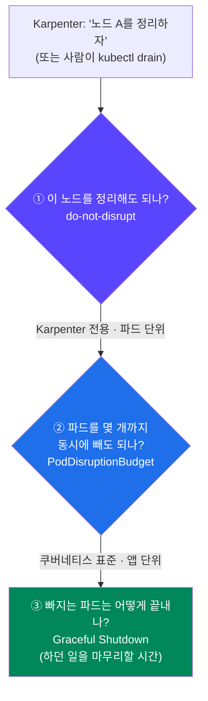
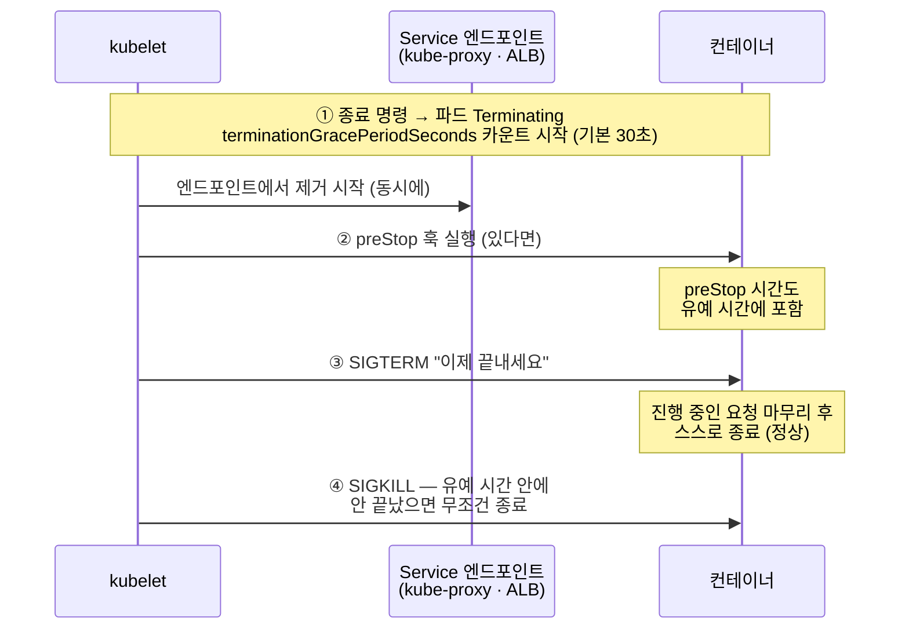
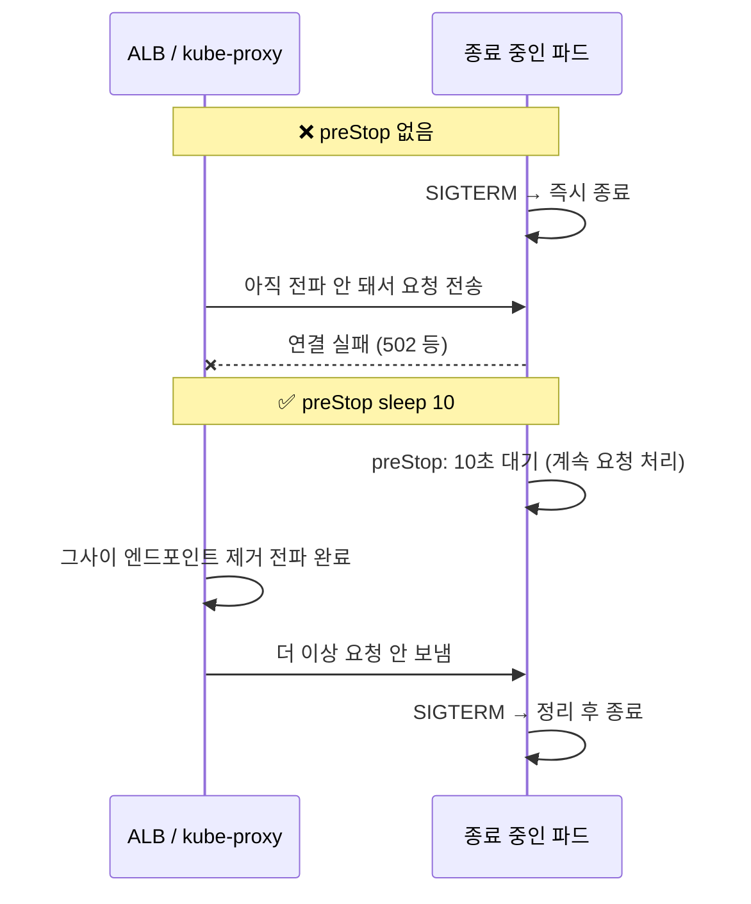
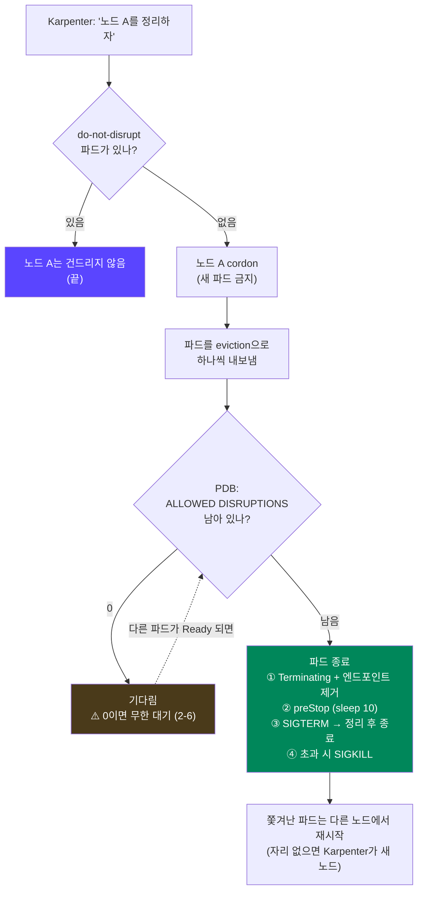

## 📚 들어가며

[9편](/posts/EKS-Rebuild-09-Requests-LimitRange-PriorityClass/)에서는 파드가 노드에 **자리를 잡을 때**의 안전장치(requests, LimitRange, PriorityClass)를 다뤘다. 이번 편은 반대로 파드가 노드를 **떠날 때**다.

Karpenter는 노드를 자주 바꾼다(7·8편). Consolidation으로 덜 쓰이는 노드를 정리하고, AMI가 바뀌면 drift로 교체하고, `expireAfter`가 지나면 만료시킨다. 노드가 사라질 때마다 그 위의 파드도 함께 내려와야 하는데, 이때 **서비스가 끊기지 않게** 하는 장치가 셋 있다.

### 큰 그림 — 노드가 정리될 때 일어나는 일



세 장치가 각각 한 단계씩 맡는다. 처음 보는 사람도 읽을 수 있게 자발적/비자발적 중단, eviction, drain, 종료 신호(SIGTERM/SIGKILL), preStop 훅부터 설명했다.

> **이번 편 학습 지도**
>
> ```
> PDB (2장)                  do-not-disrupt (3장)       Graceful Shutdown (4장)
> ─────────                  ────────────────────       ───────────────────────
> 자발적 vs 비자발적 중단     Karpenter 전용 어노테이션   종료 순서: preStop → SIGTERM → SIGKILL
> ALLOWED DISRUPTIONS 계산   파드 하나가 노드를 지킴      같은 명령, 다른 종료 시간
> drain이 막히는 장면         drain은 막지 못함           PID 1은 왜 신호를 무시하나 🔦
> 너무 빡빡한 PDB의 함정      끝이 있는 작업에만          preStop sleep의 진짜 이유
> ```

---

## 1. 개념 — 자발적 중단과 비자발적 중단

파드가 원하지 않게 내려오는 상황은 두 종류로 나뉜다.

| | 자발적 중단 (voluntary) | 비자발적 중단 (involuntary) |
|---|---|---|
| 예 | `kubectl drain`, **Karpenter의 Consolidation·Drift·만료(expireAfter)**, 클러스터 업그레이드 | 노드 하드웨어 장애, 커널 패닉, 메모리 부족으로 인한 강제 종료 |
| 누가 일으키나 | 사람이나 컨트롤러가 **계획해서** | 예측 못 한 사고 |
| 방식 | **eviction API**로 파드를 하나씩 내보냄 | 그냥 사라짐 |

- **drain** — 노드를 비우는 작업. 먼저 노드를 **cordon**(새 파드가 못 오게 표시)한 뒤, 그 위의 파드를 하나씩 내보낸다.
- **eviction** — "이 파드를 정중하게 내보내 주세요"라는 요청이다. `kubectl delete pod`처럼 바로 지우는 게 아니라, 쿠버네티스가 **"지금 내보내도 되는지"를 먼저 확인**한다. 그 확인 기준이 PDB다.

> PDB와 do-not-disrupt는 **자발적 중단에만** 효과가 있다. 노드가 그냥 죽는 건 막을 수 없다. 그래서 replicas를 여러 개 두고 노드·AZ에 흩어놓는 것(8편의 podAntiAffinity, 7편 Karpenter 차트의 topologySpread)이 기본이고, PDB는 그 위에 얹는 장치다.

---

## 2. PodDisruptionBudget (PDB)

### 2-1. 개념

**PDB**는 "이 앱은 자발적 중단 중에도 **최소 몇 개는 항상 떠 있어야 한다**"를 정하는 정책이다.

```yaml
apiVersion: policy/v1
kind: PodDisruptionBudget
metadata:
  name: nginx-pdb
  namespace: default
spec:
  minAvailable: 3          # 항상 최소 3개는 Running
  selector:
    matchLabels:
      app: nginx           # 이 라벨을 가진 파드들에 적용
```

| 필드 | 의미 |
|---|---|
| `minAvailable` | 최소 몇 개(또는 몇 %)는 살아 있어야 하는가 |
| `maxUnavailable` | 최대 몇 개(또는 몇 %)까지 동시에 빠져도 되는가 |

둘 중 **하나만** 쓴다. 숫자(`3`)나 비율(`"50%"`) 모두 된다.

### 2-2. PDB가 없으면 왜 서비스가 끊기나

강의 슬라이드의 그림을 옮기면 이렇다.

```
Without PDB                                  With PDB (minAvailable: 2)
Node Drain → [Terminating] ... [Running]     Node Drain → [Running] → 새 파드 Running 후 → [Terminating]
             먼저 죽고, 새 파드가 뜰 때까지           최소 개수를 지키면서 하나씩 교체
             서비스 중단
```

실습 Deployment는 이걸 눈으로 보려고 **일부러 늦게 준비되는 파드**를 만든다.

```yaml
# deployment/podDisruptionBudget/deployment-nginx.yaml
spec:
  replicas: 5
  template:
    spec:
      containers:
      - name: nginx
        image: nginx:latest
        startupProbe:              # 컨테이너가 "시작 완료"됐는지 확인하는 검사
          httpGet:
            path: /
            port: 80
          initialDelaySeconds: 30  # 30초 동안은 검사 자체를 안 함 → 최소 30초는 Ready가 안 됨
          periodSeconds: 5
          failureThreshold: 3
```

**startupProbe**는 컨테이너가 시작을 끝냈는지 확인하는 검사다. 통과하기 전에는 파드가 `Ready`가 되지 않고 Service로 트래픽도 안 받는다. 여기서는 `initialDelaySeconds: 30`으로 **새 파드가 준비되기까지 최소 30초**가 걸리게 만들었다. 실제 앱이 JVM을 띄우고 캐시를 데우는 데 걸리는 시간을 흉내 낸 것이다.

PDB 없이 replicas 1로 `kubectl drain`을 하면, 기존 파드가 먼저 `Terminating`되고 새 파드는 30초 넘게 `Ready`가 아니다. **그 사이 서비스가 끊긴다.** 강의 화면에서도 기존 파드가 종료된 뒤 새 파드가 `1/1 Running`이 되기까지 35초가 걸렸다.

### 2-3. ALLOWED DISRUPTIONS — 지금 몇 개까지 빼도 되나

```bash
kubectl get pdb
# NAME        MIN AVAILABLE   MAX UNAVAILABLE   ALLOWED DISRUPTIONS
# nginx-pdb   3               N/A               2
```

**ALLOWED DISRUPTIONS = 현재 정상인 파드 수 − minAvailable**

| 상황 | 계산 | 결과 |
|---|---|---|
| replicas 5, `minAvailable: 3` (내 실습 값) | 5 − 3 = 2 | 한 번에 2개까지 내보낼 수 있다 |
| replicas 5, `minAvailable: 1` (강의 레포 값) | 5 − 1 = 4 | 4개까지 |
| **replicas 1, `minAvailable: 3`** (`deployment-nginx-single.yaml`) | 1 − 3 → **0** | **하나도 못 내보낸다** |

내 실습 PDB는 강의 슬라이드와 같은 `minAvailable: 3`이고, 강의 레포의 파일은 `1`이다. 강의 슬라이드의 drain 실습 화면은 ALLOWED DISRUPTIONS가 0인 상황이라, replicas 1짜리 `deployment-nginx-single.yaml`과 `minAvailable: 3`을 함께 쓴 것으로 보인다.

### 2-4. 실습: PDB가 drain을 막는 장면

replicas 1인 Deployment에 `minAvailable: 3` PDB를 걸고 노드를 drain하면, eviction이 계속 거절된다. 강의 화면은 이랬다.

```
$ kubectl drain <NODE_NAME>
error when evicting pods/"nginx-deployment-..." -n "default" (will retry after 5s):
Cannot evict pod as it would violate the pod's disruption budget.
```

drain은 5초마다 재시도하며 **PDB가 허락할 때까지 기다린다.** PDB가 파드를 지킨 것이다.

```bash
kubectl drain <노드> --ignore-daemonsets --delete-emptydir-data   # DaemonSet 파드는 무시
kubectl uncordon <노드>                                          # 실습 후 원복
```

`--ignore-daemonsets`가 필요한 이유는 9편에서 본 대로 DaemonSet 파드는 **그 노드 전용**이라 다른 노드로 옮길 수 없기 때문이다.

### 2-5. 그럼 그 노드를 비우려면? — `rollout restart`

강의는 이때 `kubectl rollout restart`로 파드를 옮겼다.

```bash
kubectl rollout restart deployment nginx-deployment
```

새 파드가 다른 노드에 먼저 뜨고 `Running`이 된 뒤에 기존 파드가 `Terminating`된다. 서비스 중단 없이 파드가 옮겨지고, 기다리던 drain도 진행된다. (drain 중인 노드는 cordon 상태라 새 파드는 자연스럽게 다른 노드로 간다.)

**왜 이건 PDB에 안 막히나?** `rollout restart`는 eviction을 쓰지 않는다. Deployment의 **롤링 업데이트**로 동작하고, 롤링 업데이트는 Deployment 자신의 `strategy`를 따른다.

| 설정 | 의미 | 기본값 | replicas 1일 때 |
|---|---|---|---|
| `maxSurge` | 새 파드를 몇 개 **먼저** 띄울지 | 25% | 올림 → **1개** |
| `maxUnavailable` | 동시에 몇 개까지 내릴지 | 25% | 내림 → **0개** |

replicas 1이어도 "새 걸 1개 먼저 띄우고, 하나도 안 내린 상태에서 시작"이 되니 끊기지 않는다. 옛 파드는 ReplicaSet이 줄어들면서 **삭제**되는 것이지 eviction이 아니다.

> PDB를 우회하는 방법은 또 있다. `kubectl delete pod`는 eviction이 아니라 **삭제**라서 PDB를 무시한다. **PDB는 "정중한 퇴거 요청"만 막는다.**

### 2-6. 주의: 너무 빡빡한 PDB는 노드를 영원히 못 비우게 만든다

`deployment-nginx-single.yaml` + `minAvailable: 3`처럼 **ALLOWED DISRUPTIONS가 0**이면, drain뿐 아니라 **Karpenter의 Consolidation, 클러스터 업그레이드**까지 그 노드에서 멈춘다. 운영 중에 노드가 계속 안 빠지는 흔한 원인이다.

Karpenter v1에는 이걸 끊어내는 장치가 있다. NodePool의 **`spec.template.spec.terminationGracePeriod`** 다. 차트에 들어 있는 CRD 설명을 보면 이렇게 적혀 있다.

> *"...this feature takes precedence over a Pod's terminationGracePeriodSeconds value, and **bypasses any blocked PDBs or the karpenter.sh/do-not-disrupt annotation**."*

노드 정리를 시작한 뒤 이 시간이 지나면 **PDB와 do-not-disrupt를 무시하고** 파드를 강제로 내보낸다. 설정하지 않으면 Karpenter는 **무기한** 기다린다. 보안 패치처럼 노드를 일정 기간 안에 **반드시** 교체해야 하는 운영 환경에서 쓰는 설정이다. 8편의 NodePool에는 아직 넣지 않았다.

---

## 3. do-not-disrupt — Karpenter에게 "이 파드는 건드리지 마"

### 3-1. 개념

```yaml
spec:
  template:
    metadata:
      annotations:
        karpenter.sh/do-not-disrupt: "true"
```

파드에 이 어노테이션을 달면, **Karpenter는 이 파드가 떠 있는 노드를 자발적으로 정리하지 않는다**(Consolidation, Drift 등). 강의 정리대로 "중요한 파드가 노드 중단 여부에 영향을 받지 않고 항상 실행하도록" 하는 설정이다. 강의 레포에는 `karpenter/deploy-do-not-disrupt.yaml`로 실습 파일이 들어 있다.

| | PDB | do-not-disrupt |
|---|---|---|
| 누구의 기능인가 | 쿠버네티스 표준 | **Karpenter 전용** |
| 보호 단위 | 앱 전체 (최소 N개 유지) | **파드 하나** (이 파드가 있는 노드 자체를 건드리지 않음) |
| `kubectl drain` | 막는다 (eviction을 거절) | **막지 않는다** (Karpenter가 아니라 사람이 하는 일이라서) |
| 대표 용도 | 웹 서버처럼 여러 개 떠 있는 앱 | 중간에 끊기면 처음부터 다시 해야 하는 **배치 작업, 긴 학습 작업** |

둘은 보호하는 대상이 다르다. PDB는 **"앱이 몇 개 살아있나"** 를 보고, do-not-disrupt는 **"이 파드 하나가 지금 무슨 일을 하고 있나"** 를 본다. 3시간째 돌고 있는 배치 작업은 replicas가 1이든 10이든 중간에 끊기면 손해다.

### 3-2. 주의

- 이 어노테이션이 달린 파드가 노드마다 하나씩만 있어도 Karpenter는 **그 노드들을 영원히 정리하지 못한다.** 비용 최적화가 멈추고, 만료(`expireAfter`)된 노드도 이 파드 때문에 비워지지 않는다.
- 그래서 **끝이 있는 작업**(Job)에 쓰는 게 자연스럽다. 작업이 끝나 파드가 사라지면 노드는 다시 정리 대상이 된다.
- 2-6의 NodePool `terminationGracePeriod`가 여기에도 적용된다. 이 시간이 지나면 do-not-disrupt도 무시된다.

---

## 4. Graceful Shutdown — 종료 신호를 받은 파드에 정리할 시간 주기

### 4-1. 개념: 파드가 종료되는 순서



| 용어 | 의미 |
|---|---|
| **SIGTERM** | "종료해 주세요"라는 신호. 앱이 받으면 진행 중인 요청을 마무리하고 스스로 종료하는 게 정상 동작 |
| **SIGKILL** | 무조건 즉시 죽이는 신호. 앱이 거부하거나 정리할 수 없다 |
| **preStop 훅** | SIGTERM을 보내기 **전에** 실행할 명령 |
| **terminationGracePeriodSeconds** | ①부터 ④까지 기다려주는 **전체 시간**. **preStop 실행 시간도 여기에 포함**된다 |

강의의 정의대로, 이 시간은 "종료 시점에 자원을 안전하게 해제하고 중요한 작업을 마무리하는 시간"이다.

### 4-2. 실습 네 가지 — 같은 종료 명령, 다른 종료 시간

이번 편의 핵심 표다. 네 파드에 **똑같이 종료 명령**을 내렸는데 끝나는 시간이 제각각이다.

| 실습 파일 | 설정 | 강의 화면의 종료 시간 | 왜 그 시간인가 |
|---|---|---|---|
| `deploy-busybox.yaml` | 기본값 (30초) | Terminating 54s → 종료 84s, **30초** | busybox가 SIGTERM을 무시해서 30초를 다 채우고 SIGKILL |
| `deploy-gracefulShutdown.yaml` | `terminationGracePeriodSeconds: 60` | 10s → 70s, **60초** | 같은 이유로 60초를 다 채움 |
| `pod-nginx.yaml` | 기본값 | 15s → 16s, **거의 즉시** | nginx는 종료 신호를 처리해서 바로 끝난다 |
| `pod-preStop.yaml` | preStop `sleep 10`, 유예 60초 | 11s → 21s, **10초** | preStop 10초 후 종료 신호, nginx 즉시 종료 |

```bash
kubectl apply -f gracefulShutdown/<파일>
kubectl delete -f gracefulShutdown/<파일> &   # 종료 명령
kubectl get pod -w                             # Terminating이 얼마나 유지되는지
```

`busybox`의 30초·60초는 **"유예 시간을 정확히 다 썼다"** 는 뜻이고, `nginx`의 1초는 **"신호를 받자마자 스스로 끝냈다"** 는 뜻이다. 6편 3-4에서 busybox 두 개가 30초 동안 같은 파일에 동시에 쓰던 장면도 바로 이 30초였다.

### 4-3. 🔦 왜 busybox는 SIGTERM을 무시할까 — PID 1의 특별한 규칙

> 이 절은 강의에서 직접 다루지 않은 내용이다. "busybox는 왜 매번 30초를 꽉 채우는가?"가 궁금해서 따로 찾아본 것이다.

```yaml
command: ["/bin/sh", "-c", "sleep inf"]
```

컨테이너 안에서 처음 실행된 프로세스는 **PID 1**이 된다. 리눅스에서 PID 1은 특별해서, **신호 처리 코드(핸들러)를 직접 등록하지 않은 신호는 무시된다.** 보통 프로세스라면 SIGTERM을 받으면 기본 동작으로 종료되지만, PID 1에는 그 기본 동작이 적용되지 않는다. (원래 PID 1은 시스템의 init 프로세스라서, 실수로 죽지 않도록 커널이 보호해주는 규칙이다.)

| | busybox (`sh` / `sleep`) | nginx |
|---|---|---|
| PID 1인가 | ✅ | ✅ |
| 종료 신호 핸들러 | ❌ 없음 | ✅ 있음 |
| 종료 신호를 받으면 | **무시** → 유예 시간을 다 채우고 SIGKILL | 정리 후 **즉시** 스스로 종료 |

`sh`나 `sleep`은 SIGTERM 핸들러가 없으니 신호를 무시하고, 쿠버네티스는 유예 시간을 다 기다린 뒤 SIGKILL로 끝낸다. 그래서 **정확히 30초, 60초**가 걸린 것이다.

> **각주 — nginx는 사실 SIGTERM이 아니라 SIGQUIT을 받는다**
>
> nginx 공식 이미지의 Dockerfile에는 `STOPSIGNAL SIGQUIT`이 지정돼 있다. 컨테이너 런타임은 이미지에 지정된 종료 신호를 쓰기 때문에, nginx 컨테이너는 SIGTERM 대신 **SIGQUIT**을 받는다. nginx에게 SIGQUIT은 "진행 중인 요청을 마치고 정상 종료(graceful shutdown)"라는 뜻이다. 실습에선 처리 중인 요청이 없으니 즉시 끝난 것이다. 어느 신호든 핵심은 같다 — **nginx는 핸들러가 있고, busybox는 없다.**

**실무에서 이 문제가 생기면**(앱이 SIGTERM을 무시해 배포·노드 정리 때마다 유예 시간을 다 채움) 두 가지 방법이 있다.

- **앱 코드에서 SIGTERM을 처리**한다. 대부분의 웹 프레임워크(Spring Boot의 graceful shutdown 등)는 설정으로 켤 수 있다.
- **`tini` 같은 작은 init 프로세스를 PID 1로** 두어, 신호를 받아 앱에 전달하게 한다. 셸 스크립트로 앱을 띄우는 이미지에서 흔히 쓰는 방법이다.

Karpenter 환경에서는 이게 특히 중요하다. 노드가 자주 정리되니, **SIGTERM을 무시하는 파드가 있으면 노드 정리 때마다 그만큼씩 늦어진다.**

### 4-4. preStop에 `sleep`을 넣는 진짜 이유

`pod-preStop.yaml`의 `sleep 10`은 실습용 예시처럼 보이지만, **실무에서 실제로 쓰는 패턴**이다.

4-1에서 "파드가 엔드포인트에서 빠지는 것"과 "종료가 시작되는 것"이 **동시에** 일어난다고 했다. 그런데 엔드포인트 제거가 kube-proxy와 **ALB**까지 전파되는 데는 시간이 걸린다.



앱이 SIGTERM을 받고 먼저 꺼져버리면, **아직 그 파드로 오던 요청이 실패**한다. preStop에서 몇 초 기다리면, 그동안 파드는 계속 요청을 처리하고 트래픽이 다른 파드로 넘어갈 시간을 번다.

**이 프로젝트에도 이미 그렇게 들어 있다.** 강의 레포의 Helm 차트 템플릿(`helm-starter-template`, SNS 앱들이 쓰는 그것)에는 모든 컨테이너에 이 설정이 박혀 있다.

```yaml
# helm-starter-template/templates/deployment.yaml
lifecycle:
  preStop:
    exec:
      command: ["/bin/sh","-c","sleep 10"]
```

그리고 SNS 앱 values의 `terminationGracePeriodSeconds`는 이렇게 들어 있다.

| 앱 | `terminationGracePeriodSeconds` |
|---|:---:|
| user-server, feed-server, timeline-server, sns-frontend | 30 |
| **image-server** | **60** |

업로드 처리처럼 마무리에 오래 걸리는 서버에 더 긴 시간을 준 것으로 보인다. 9편에서 앱 values에 주석으로 들어 있던 toleration을 찾았듯, **강의 레포에는 이미 운영 감각이 녹아 있는 설정들이 숨어 있다.**

**설정할 때의 규칙**

- `terminationGracePeriodSeconds` > **preStop 시간 + 앱이 정리하는 데 걸리는 시간**. preStop이 유예 시간을 다 써버리면 앱은 정리할 틈도 없이 SIGKILL을 맞는다. (`pod-preStop.yaml`에 주석으로 있는 `sleep 40`으로 바꿔보면, 유예 60초 안에서 40초 뒤 종료되는 걸 볼 수 있다)
- ALB를 쓰는 경우 타깃 그룹의 **deregistration delay(기본 300초)** 도 함께 고려한다. LB Controller에서는 Ingress 어노테이션 `alb.ingress.kubernetes.io/target-group-attributes: deregistration_delay.timeout_seconds=30` 같은 식으로 줄일 수 있다(5편의 어노테이션 표에 한 줄 추가할 항목).
- 강의 설명처럼 배치 작업 등은 필요에 따라 **4시간** 같은 긴 값도 쓴다. 다만 2-6의 NodePool `terminationGracePeriod`가 설정돼 있으면 그쪽이 우선한다.

### 4-5. 헷갈리기 쉬운 것: 노드의 Graceful Shutdown

이름이 비슷한 다른 설정이 있다. 강의 레포의 `tf-eks-v1.30`에는 이런 설정이 있었다.

```yaml
kubelet:
  config:
    shutdownGracePeriod: 30s
```

| | `terminationGracePeriodSeconds` (이번 편) | `shutdownGracePeriod` |
|---|---|---|
| 대상 | **파드 하나**가 종료될 때 | **노드(EC2) 자체**가 꺼질 때 |
| 설정 위치 | 파드 스펙 | kubelet 설정 (노드) |
| 하는 일 | 그 파드에 정리 시간 부여 | 노드가 꺼지기 전 kubelet이 모든 파드에 종료 신호를 보낼 시간 확보 |

노드가 갑자기 꺼지는 상황에서도 파드가 SIGTERM을 받을 기회를 주려면 노드 쪽 설정도 필요하다. 다만 스팟 회수의 경우, 이 프로젝트는 7편에서 **SQS 큐로 회수 2분 전 알림을 받아 Karpenter가 미리 drain**하게 해뒀다. 두 장치는 경쟁이 아니라 보완 관계다 — 알림이 오면 Karpenter가 정중하게 비우고, 알림 없이 꺼지면 kubelet이 마지막 기회를 준다.

---

## 5. 세 장치가 함께 동작하는 모습

Karpenter가 덜 쓰이는 노드를 Consolidation으로 정리하려는 상황을 따라가 보자.



9편과 합치면 **"안전하게 Karpenter 쓰기"의 전체 그림**이 된다.

| 시점 | 장치 | 막아주는 것 | 편 |
|---|---|---|:---:|
| 자리 잡을 때 | requests / LimitRange | 파드가 한 노드에 몰려 서로 방해하는 것, Karpenter가 노드를 안 띄우는 것 | 9 |
| 자리 잡을 때 | PriorityClass | 중요한 파드가 자리를 못 잡는 것 | 9 |
| 떠날 때 | do-not-disrupt | 끊기면 안 되는 작업 중인 노드가 정리되는 것 | 10 |
| 떠날 때 | PDB | 앱의 파드가 한꺼번에 빠지는 것 | 10 |
| 떠날 때 | Graceful Shutdown | 처리 중이던 요청이 끊기는 것 | 10 |

---

## 📝 이번 편 요약

```
중단의 종류
└─ PDB · do-not-disrupt는 자발적 중단(drain · Karpenter 정리 · 업그레이드)에만 효과
     비자발적 중단(노드 장애)은 replicas 분산으로 대비

PDB
├─ "최소 N개는 항상 떠 있어야" — ALLOWED DISRUPTIONS = 정상 파드 수 − minAvailable
├─ eviction만 막는다. rollout restart(롤링 업데이트) · delete pod(삭제)는 못 막음
└─ ALLOWED DISRUPTIONS 0 → 노드를 영원히 못 비움
     └─ Karpenter v1 NodePool terminationGracePeriod로 강제 종료 가능

do-not-disrupt
├─ Karpenter 전용, 파드 하나가 그 노드 전체를 지킴
├─ kubectl drain은 못 막음
└─ 끝이 있는 작업(Job)에만. 남발하면 Consolidation이 멈춤

Graceful Shutdown
├─ 순서: Terminating(+엔드포인트 제거) → preStop → SIGTERM → (초과 시) SIGKILL
├─ 유예 시간에는 preStop 시간도 포함
├─ PID 1은 핸들러 없는 신호를 무시 🔦 → busybox는 매번 유예 시간을 다 채움
├─ preStop sleep = 엔드포인트·ALB 전파 동안 요청을 계속 받는 실무 패턴
└─ 노드의 shutdownGracePeriod와는 다른 설정
```

| 개념 | 한 줄 정의 |
|---|---|
| **자발적 / 비자발적 중단** | 계획된 중단(drain, Karpenter 정리) / 예측 못 한 사고(노드 장애) |
| **eviction** | "지금 내보내도 되는지" 확인을 거치는 정중한 파드 퇴거 요청 |
| **drain / cordon** | 노드의 파드를 모두 내보내기 / 새 파드가 못 오게 표시 |
| **PDB** | 자발적 중단 중에도 최소 몇 개는 살아 있어야 하는지 정하는 정책 |
| **ALLOWED DISRUPTIONS** | 지금 동시에 내보낼 수 있는 파드 수 |
| **do-not-disrupt** | Karpenter가 그 파드가 있는 노드를 자발적으로 정리하지 않게 하는 어노테이션 |
| **SIGTERM / SIGKILL** | "종료해 주세요" / "무조건 즉시 종료" |
| **preStop 훅** | SIGTERM 전에 실행되는 명령 |
| **terminationGracePeriodSeconds** | 종료 시작부터 SIGKILL까지의 전체 유예 시간 (preStop 포함) |
| **PID 1** | 컨테이너의 첫 프로세스. 핸들러가 없는 신호는 무시됨 |

---

## 💭 느낀 점

**1. 6편의 30초가 드디어 설명됐다.**

6편에서 파드를 지웠더니 busybox 두 개가 30초 동안 같은 파일에 동시에 썼다. 그때는 "SIGTERM을 무시해서 30초를 채웠다"까지만 적었는데, **왜** 무시하는지는 몰랐다. 이번에 PID 1의 규칙을 알고 나니 4-2 표의 30초, 60초, 1초가 한 줄로 설명된다. 몇 편 전의 의문이 뒤에서 풀리는 경험이 이 시리즈를 쓰는 재미다.

**2. PDB는 "정중한 요청"만 막는다.**

처음엔 PDB를 걸면 파드가 무조건 보호되는 줄 알았다. 그런데 `kubectl delete pod`도, `rollout restart`도 PDB를 그냥 지나간다. PDB가 막는 건 **eviction이라는 특정한 경로** 하나뿐이다. 보호 장치를 쓸 때는 "무엇을 막는가"만큼 **"무엇은 못 막는가"** 를 알아야 한다는 걸 배웠다.

**3. 보호 장치를 너무 세게 걸면 그게 장애가 된다.**

ALLOWED DISRUPTIONS가 0인 PDB, 노드마다 하나씩 붙은 do-not-disrupt. 둘 다 "안전하게" 하려다 노드를 **영원히 못 비우게** 만든다. 그래서 Karpenter v1이 `terminationGracePeriod`라는 "보호를 무시하는 장치"를 따로 만들어둔 게 인상적이었다. 안전장치에도 **탈출구**가 필요하다.

**4. preStop `sleep 10`은 실습용 숫자가 아니었다.**

처음엔 "시간 차이를 보여주려는 예시"인 줄 알았다. 그런데 강의 레포의 Helm 템플릿을 열어보니 **모든 앱 컨테이너에** 똑같이 들어 있었다. 엔드포인트 제거가 ALB까지 전파되는 시간을 버는 실무 패턴이었다. 9편의 주석 처리된 toleration에 이어, 강의 레포에는 **설명 없이 들어 있는 운영 감각**이 꽤 있다는 걸 또 느꼈다.

**5. "안전하게 Karpenter 쓰기"는 결국 Karpenter 얘기가 아니었다.**

9·10편에서 다룬 것 중 Karpenter 전용은 do-not-disrupt와 `terminationGracePeriod` 정도다. 나머지 — requests, LimitRange, PriorityClass, PDB, Graceful Shutdown — 는 전부 **쿠버네티스 표준**이다. Karpenter는 노드를 자주 바꿀 뿐이고, 그걸 버티는 힘은 **각 앱이 쿠버네티스의 기본기를 얼마나 잘 지키느냐**에서 나온다.

---

## 🔗 다음 편 예고

지금까지 만든 인프라(EKS, Karpenter, LB Controller, external-dns, EBS CSI) 위에 **데이터 계층**을 올린다.

- MySQL, Kafka, Redis 같은 상태 저장 컴포넌트 (6편의 EBS·StatefulSet 이야기가 실제로 쓰이는 단계)
- 이후 SNS 앱 배포로 이어진다
- 그때 9편의 LimitRange(`sns`, `kafka`, `redis` 네임스페이스)와 이번 편의 Graceful Shutdown 설정이 실제로 쓰인다

---

## 📚 참고

- [Kubernetes — Disruptions (PDB)](https://kubernetes.io/docs/concepts/workloads/pods/disruptions/)
- [Kubernetes — Safely Drain a Node](https://kubernetes.io/docs/tasks/administer-cluster/safely-drain-node/)
- [Kubernetes — Pod Lifecycle: Termination of Pods](https://kubernetes.io/docs/concepts/workloads/pods/pod-lifecycle/#pod-termination)
- [Kubernetes — Node Graceful Shutdown](https://kubernetes.io/docs/concepts/cluster-administration/node-shutdown/)
- [Karpenter — Disruption (do-not-disrupt, terminationGracePeriod)](https://karpenter.sh/docs/concepts/disruption/)
- [nginx 공식 Docker 이미지 Dockerfile](https://github.com/nginx/docker-nginx) — `STOPSIGNAL SIGQUIT`
- [krallin/tini](https://github.com/krallin/tini) — 컨테이너용 경량 init

> 4-2와 2-2·2-4의 시간 수치와 출력은 강의 화면 기준이다. 4-3(PID 1)은 강의에 없는, 내가 덧붙인 설명이다.
