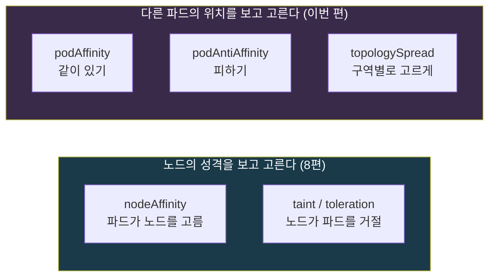
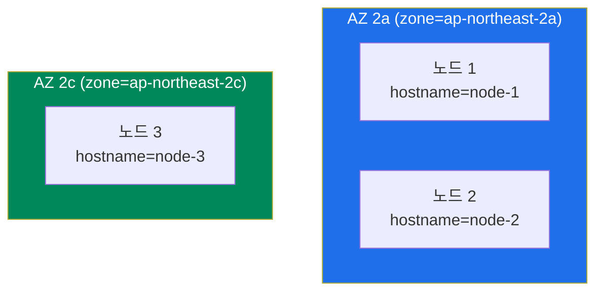
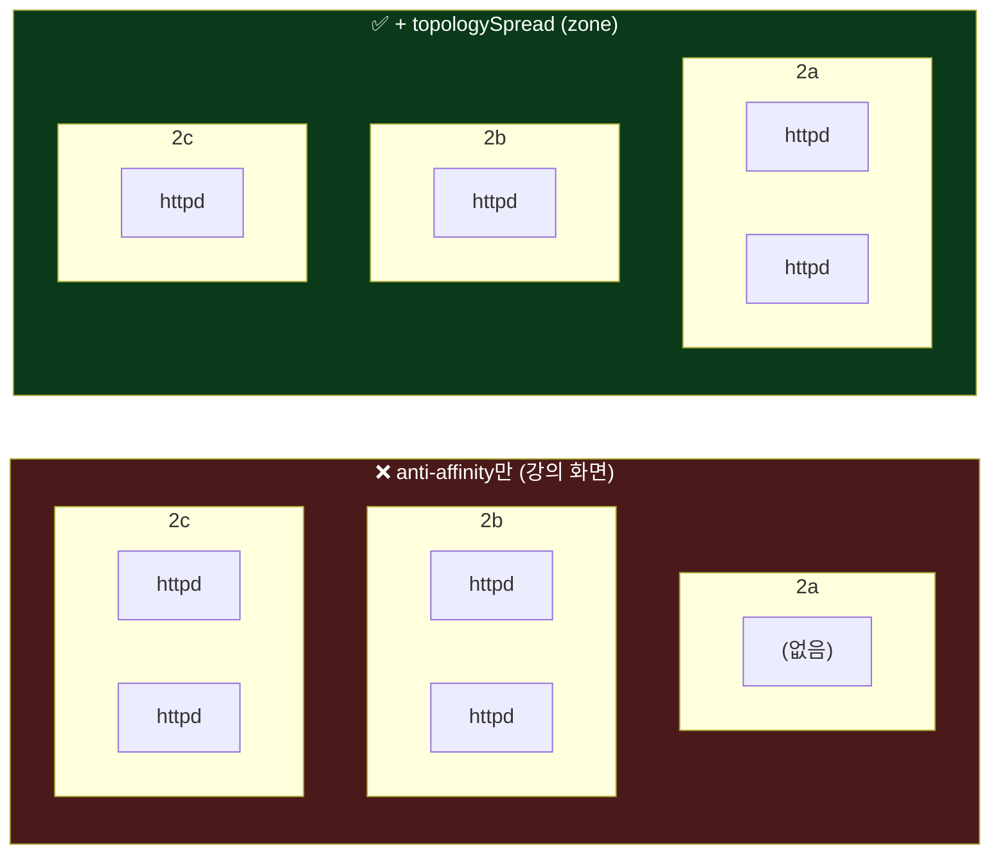
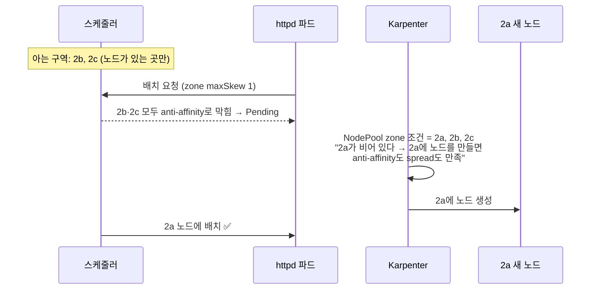

## 📚 들어가며

강의의 **"Advanced Pod Scheduling"** 파트다. 이 파트는 두 부분으로 나뉜다.

- **Part 1** — Taint, Toleration, Node Affinity. [8편](/posts/EKS-Rebuild-08-Karpenter-NodePool-Design-and-Autoscaling/)에서 Karpenter의 `service`/`platform` NodePool을 다루며 이미 정리했다.
- **Part 2** — **Pod Anti-Affinity**와 **Pod Topology Spread Constraints**. 이번 편이다.

[10편](/posts/EKS-Rebuild-10-PDB-Do-Not-Disrupt-Graceful-Shutdown/)에서 "PDB는 자발적 중단에만 효과가 있고, 노드가 그냥 죽는 건 replicas를 노드·AZ에 흩어놓는 걸로 대비한다"고 썼다. 이번 편이 바로 그 **"흩어놓는 방법"** 이다.

처음 보는 사람도 읽을 수 있게 topologyKey, maxSkew, required/preferred의 차이를 기초부터 설명했다.

### 지금까지 나온 스케줄링 도구 지도

파드를 "어디에 놓을지" 정하는 도구가 여러 편에 걸쳐 나왔다. 이번 편까지 합쳐서 한 번에 정리하면 이렇다.

| 도구 | 관계 | 질문 | 나온 편 |
|---|---|---|:---:|
| **nodeSelector / nodeAffinity** | 파드 → 노드 | "나는 **이런 노드**로 갈래" | 8편 |
| **taint / toleration** | 노드 → 파드 | "**허가받은 파드만** 이 노드에 들어와" | 8편 |
| PriorityClass | 파드 ↔ 파드 | "자리가 모자라면 **내가 먼저**" | 9편 |
| **podAffinity** | 파드 ↔ 파드 | "**저 파드가 있는 곳**에 같이 있을래" | 이번 편 (언급) |
| **podAntiAffinity** | 파드 ↔ 파드 | "**저 파드가 있는 곳은 피할래**" | **이번 편** |
| **topologySpreadConstraints** | 파드 ↔ 구역 | "**구역(노드·AZ)마다 고르게** 나눠 앉을래" | **이번 편** |



8편의 도구는 "**노드가 어떤 노드인가**"를 보고, 이번 편의 도구는 "**다른 파드가 지금 어디 있는가**"를 본다.

> **이번 편 학습 지도**
>
> ```
> Pod Anti-Affinity (1장)         Topology Spread (2장)            비교 (3장)
> ───────────────────────         ─────────────────────            ──────────
> 같은 앱끼리 같은 노드 피하기      노드는 달라도 AZ가 같을 수 있다   표현 방식의 차이
> topologyKey = "같은 곳"의 단위    maxSkew = 구역 간 차이 허용치      파드 수 > 구역 수일 때
> required vs preferred            노드가 없는 AZ는 안 센다           둘을 함께 쓰기
> 노드 수보다 replicas가 많으면?    Karpenter가 빈 AZ를 메운다 🔦
> ```

---

## 1. Pod Anti-Affinity — 같은 파드끼리 같은 노드에 앉지 않기

### 1-1. 왜 필요한가

강의 슬라이드가 든 이유는 두 가지다.

- **고가용성** — 같은 앱의 파드가 한 노드에 몰려 있으면, 그 노드 하나가 죽을 때 앱 전체가 멈춘다. 서로 다른 노드에 있으면 일부만 영향을 받는다.
- **부하 분산** — HPA로 파드가 늘어날 때, 한 노드에 몰리지 않고 클러스터 전체 노드의 자원을 고르게 쓴다.

그리고 Karpenter 환경에서는 이게 특히 중요하다.

> **Karpenter는 파드의 requests만 보고 배치를 정한다.** 자리만 있으면 같은 종류의 파드가 **한 노드에 전부** 들어갈 수 있다. 9편에서 봤듯 Karpenter는 노드를 빡빡하게 채우는 게 특기라서, 오히려 몰리기 쉽다.

### 1-2. 설정

```yaml
affinity:
  podAntiAffinity:
    requiredDuringSchedulingIgnoredDuringExecution:
    - labelSelector:              # 어떤 파드를 피할지
        matchExpressions:
        - key: app
          operator: In
          values:
          - httpd                 # app=httpd 라벨을 가진 파드 (= 나와 같은 앱)
      topologyKey: kubernetes.io/hostname   # "같은 곳"의 단위 = 노드
```

읽는 법은 이렇다. "**`app=httpd` 파드가 이미 있는 노드(hostname)에는 나를 놓지 마라.**" 자기 자신과 같은 라벨을 지정했으니, 결과적으로 **httpd 파드끼리 서로 다른 노드**에 앉는다.

### 1-3. 핵심 개념: topologyKey — "같은 곳"을 무엇으로 볼 것인가

`topologyKey`는 노드에 붙은 **라벨의 이름**이다. 이 라벨 값이 같은 노드들을 **"같은 곳"** 으로 묶는다.



| topologyKey | "같은 곳"의 단위 | 위 그림에서 |
|---|---|---|
| `kubernetes.io/hostname` | **노드 하나** | 노드 1, 2, 3이 **모두 다른 곳** |
| `topology.kubernetes.io/zone` | **AZ** | 노드 1과 2는 **같은 곳**(2a), 노드 3만 다른 곳 |
| `topology.kubernetes.io/region` | 리전 | 셋 다 같은 곳 |

같은 문법으로 `topologyKey`만 `zone`으로 바꾸면 "같은 AZ에 두 개를 두지 마라"가 된다. 이 개념이 2장의 Topology Spread에서도 그대로 쓰인다.

### 1-4. 핵심 개념: required vs preferred

| | `requiredDuringScheduling...` | `preferredDuringScheduling...` |
|---|---|---|
| 강도 | **반드시** 지켜야 함 (hard) | **가능하면** 지킴 (soft, 가중치로 점수를 매김) |
| 못 지키면 | 파드가 `Pending` | 규칙을 어기고라도 배치 |

이름이 긴데, 뒤쪽의 **`IgnoredDuringExecution`** 은 "**스케줄링할 때만** 확인하고, 이미 실행 중인 파드는 나중에 조건이 바뀌어도 쫓아내지 않는다"는 뜻이다. 8편의 nodeAffinity에서도 같은 이름을 썼다.

### 1-5. 실습: 있을 때와 없을 때

| 실습 파일 | 설정 | 강의 화면 결과 |
|---|---|---|
| `deployment/affinity/deploy-httpd.yaml` | anti-affinity 없음, replicas 4 | 노드 2대에 **2개씩** 몰림 |
| `deployment/affinity/deploy-pod-anti-affinity.yaml` | `required` + `hostname`, replicas 4 | **노드 4대에 하나씩** |

```bash
kubectl apply -f deployment/affinity/deploy-httpd.yaml
kubectl get pod -o wide                        # NODE 열에 같은 노드가 반복됨

kubectl apply -f deployment/affinity/deploy-pod-anti-affinity.yaml
kubectl get pod -o wide                        # NODE가 전부 다름
kubectl get nodeclaims                         # 모자란 노드는 Karpenter가 새로 띄움
```

anti-affinity를 적용하면 파드 4개가 **4대의 노드**를 원한다. 노드가 모자라면 파드는 `Pending`이 되고, **Karpenter가 그만큼 노드를 띄운다.** 8편의 오토스케일링 실습에서 노드 증가를 보여주려고 busybox에 anti-affinity를 걸었던 것도 같은 원리다.

### 1-6. 주의할 점

- **`required` + replicas > 노드 수** — 고정 노드 그룹만 있는 클러스터에서는 남는 파드가 **영원히 `Pending`** 이다. Karpenter가 있으면 노드를 늘려서 해결하지만, 그만큼 **비용**이 늘고 NodePool의 `limits`(8편)에 걸리면 역시 `Pending`이 된다. 8편 4-5의 "6 Running / 2 Pending"이 바로 이 경우였다.
- 엄격할 필요가 없으면 **`preferred`** 로 "가능하면 흩어지게"만 거는 것도 방법이다.
- 쿠버네티스 공식 문서에 따르면 파드 간 affinity/anti-affinity는 계산량이 많아서, **노드가 수백 대 이상인 큰 클러스터에서는 스케줄링이 느려질 수 있다.** 그런 규모에서는 2장의 Topology Spread가 더 권장된다.
- 반대 개념인 **podAffinity**는 "저 파드가 있는 노드에 **같이** 놓아라"다. 서로 많이 통신하는 앱과 캐시를 같은 노드에 붙여 네트워크 지연을 줄일 때 쓴다.

---

## 2. Pod Topology Spread Constraints — 노드를 넘어 AZ 단위로 고르게

### 2-1. 왜 필요한가 — 노드가 달라도 같은 AZ일 수 있다

anti-affinity로 파드를 서로 다른 노드에 흩어놓아도, **그 노드들이 전부 같은 AZ**에 있을 수 있다. 1-3의 그림에서 노드 1과 2가 그렇다. 그러면 **AZ 하나가 통째로 장애**가 날 때 앱 전체가 멈춘다.

강의는 데이터센터 단위 장애의 예로 **2022년 카카오 장애**(데이터센터 화재로 서비스가 장시간 중단된 사건)를 들었다. 노드 단위가 아니라 **랙, 데이터센터, AZ 단위** 장애에 대비하려면 "**구역마다 고르게**" 나눠 놓아야 한다.

강의 실습 화면이 정확히 이 상황을 보여준다. anti-affinity만 걸고 Topology Spread를 안 걸었더니, 노드는 4대로 흩어졌지만 **AZ는 3개 중 2개(2b, 2c)에만** 있었고 2a에는 하나도 없었다.



(각 httpd는 anti-affinity 때문에 **서로 다른 노드**에 있다. 그림은 AZ 단위로만 묶어서 보여준 것이다. 강의 화면에서 확인된 건 "왼쪽은 2b·2c에만, 오른쪽은 세 AZ 모두"라는 점이고, AZ별 개수는 예시다.)

왼쪽은 노드 4대에 하나씩이라 노드 장애에는 강하지만, **2b가 통째로 죽으면 절반이 사라진다.** 오른쪽은 어느 AZ가 죽어도 최대 절반, 대개는 4분의 1만 잃는다.

### 2-2. 노드에는 이미 "구역" 라벨이 붙어 있다

클라우드(EKS)에서는 노드가 만들어질 때 자동으로 위치 라벨이 붙는다. 6편에서 EBS 볼륨의 AZ를 볼 때 쓴 바로 그 라벨이다.

```bash
kubectl get nodes -L topology.kubernetes.io/zone,topology.kubernetes.io/region
kubectl get node <노드> -o yaml | grep topology.kubernetes.io
# topology.kubernetes.io/region: ap-northeast-2
# topology.kubernetes.io/zone: ap-northeast-2b
```

강의 설명대로 **온프레미스 환경은 이 라벨을 직접** 붙여야 한다. 랙 단위로 나누고 싶으면 `rack: r1` 같은 라벨을 노드에 달고 그걸 `topologyKey`로 쓰면 된다. topologyKey는 결국 **아무 노드 라벨**이나 될 수 있다.

### 2-3. 설정

```yaml
topologySpreadConstraints:
- maxSkew: 1                                  # 구역 간 파드 수 차이를 최대 1까지만 허용
  topologyKey: topology.kubernetes.io/zone    # 구역 = AZ
  whenUnsatisfiable: DoNotSchedule            # 못 지키면 배치하지 않음 (또는 ScheduleAnyway)
  labelSelector:
    matchLabels:
      app: httpd                              # 어떤 파드들의 개수를 셀지
```

| 필드 | 의미 |
|---|---|
| `topologyKey` | 무엇을 "구역"으로 볼지 (1-3과 같은 개념) |
| `labelSelector` | 어떤 파드들을 셀지. 보통 자기 자신과 같은 앱 |
| `maxSkew` | **가장 많은 구역과 가장 적은 구역의 파드 수 차이**를 최대 몇까지 허용할지 |
| `whenUnsatisfiable` | `DoNotSchedule`: 못 지키면 `Pending` (hard) / `ScheduleAnyway`: 가능한 한 지키되 안 되면 그냥 배치 (soft) |

**maxSkew 계산 예시** — AZ 3개, 파드 4개, `maxSkew: 1`

```
2a: ●●   2b: ●   2c: ●     → 최대 2, 최소 1, 차이 1 → OK
2a: ●●●  2b: ●   2c: (0)   → 최대 3, 최소 0, 차이 3 → 위반
```

다섯 번째 파드가 들어오면 개수가 적은 2b나 2c로 가야 한다.

> **💡 `labelSelector`는 자기 자신의 라벨과 맞아야 한다**
>
> 공식 문서의 Known limitations에 나오는 함정이다. 파드의 라벨이 자기 constraint의 `labelSelector`와 **안 맞으면**, 그 파드는 계산에서 **자기 자신을 세지 않는다.** 그러면 몇 개를 띄워도 "아직 0개"로 보여서 한 구역에 계속 쌓일 수 있다. 복붙하다가 앱 이름을 안 바꾸면 생기는 실수다.

> **📝 강의 밖 설명 — 노드가 없는 구역은 "최소"에 안 들어간다**
>
> 여기서 "최소"는 **노드가 있는 구역만** 센다. 공식 문서 표현으로는 "eligible domain"(조건에 맞는 노드가 있는 구역)만 계산에 들어간다. 노드가 하나도 없는 AZ는 스케줄러가 **그런 AZ가 있는지조차 모른다.** 그래서 AZ 3개 중 2개에만 노드가 있으면, 2개에만 고르게 나눠도 규칙을 만족한다.
>
> 쿠버네티스 표준만으로 이걸 막으려면 `minDomains` 필드가 있다. "구역이 최소 N개는 있어야 한다, 모자라면 최소값을 0으로 본다"는 뜻이라, `minDomains: 3`이면 노드가 2개 AZ에만 있을 때 새 파드가 `Pending`이 된다. 그다음 **누군가 세 번째 AZ에 노드를 만들어줘야** 풀린다. 그 "누군가"가 2-5의 Karpenter다.

### 2-4. 실습 파일 구성 — 네 가지 규칙이 겹쳐 있다

`deployment/topologySpreadConstraints/deploy-topologySpreadConstraints.yaml`은 지금까지 나온 도구를 한꺼번에 쓴다.

```yaml
tolerations:                     # ① multiaz 노드의 taint를 통과할 허가증
- key: "node"
  value: "multiaz"
  effect: "NoSchedule"
affinity:
  nodeAffinity:                  # ② 반드시 node=multiaz 노드로
    requiredDuringSchedulingIgnoredDuringExecution:
      nodeSelectorTerms:
      - matchExpressions:
        - key: node
          operator: In
          values: ["multiaz"]
  podAntiAffinity:               # ③ 노드마다 하나씩
    requiredDuringSchedulingIgnoredDuringExecution:
    - labelSelector:
        matchExpressions:
        - key: app
          operator: In
          values: ["httpd"]
      topologyKey: kubernetes.io/hostname
topologySpreadConstraints:       # ④ AZ마다 고르게
- maxSkew: 1
  topologyKey: topology.kubernetes.io/zone
  whenUnsatisfiable: DoNotSchedule
  labelSelector:
    matchLabels:
      app: httpd
```

| 규칙 | 역할 | 어디서 본 구조인가 |
|---|---|---|
| ① toleration + ② nodeAffinity | 실습 전용 NodePool(`multiaz`)로 보낸다 | 8편에서 `service` NodePool로 보내던 것과 같다 |
| ③ podAntiAffinity (hostname) | 노드 단위 분산 | 1장 |
| ④ topologySpreadConstraints (zone) | AZ 단위 분산 | 이번 장 |

비교용인 `deploy-nodeAffinity.yaml`은 **④만 빠진** 같은 파일이다(`diff`로 확인하면 차이가 정확히 그 7줄뿐이다). 두 파일을 번갈아 적용하면 2-1 그림의 왼쪽(노드는 흩어졌지만 AZ는 치우침)과 오른쪽(AZ까지 고르게)을 비교할 수 있다. 강의 화면 기준으로 ④가 없을 때는 2b·2c에만, 있을 때는 **2a·2b·2c 모두**에 노드가 생겼다.

```bash
kubectl get nodes -l node=multiaz -L topology.kubernetes.io/zone
kubectl get pod -o wide -l app=httpd
```

> **⚠️ 따라 하기 전에: `multiaz` NodePool이 먼저 있어야 한다**
>
> 두 실습 파일은 `node=multiaz` 라벨과 `node=multiaz:NoSchedule` taint가 있는 노드를 요구한다. 강의 레포에는 `karpenter/nodepool-multiAz.yaml`이 있는데 — 8편에서 "강의 레포에 3개 AZ를 여는 NodePool이 따로 있다"고 했던 바로 그 파일이다 — **v1beta1 형식**이라 그대로는 못 쓴다. 이 NodePool 없이 적용하면 파드가 갈 노드가 없어 `Pending`으로 남는다.
>
> 8편의 v1 NodePool을 기준으로 이름·라벨·taint만 바꾸면 이렇게 된다.
>
> ```yaml
> apiVersion: karpenter.sh/v1
> kind: NodePool
> metadata:
>   name: multiaz
> spec:
>   template:
>     metadata:
>       labels:
>         node: multiaz
>     spec:
>       taints:
>       - key: node
>         value: multiaz
>         effect: NoSchedule
>       nodeClassRef:
>         group: karpenter.k8s.aws
>         kind: EC2NodeClass
>         name: default
>       requirements:                     # 내 계정 사정(8편 2-2)에 맞춘 타입 목록
>         - key: node.kubernetes.io/instance-type
>           operator: In
>           values: ["m7i-flex.large", "c7i-flex.large", "t3.small"]
>         - key: kubernetes.io/arch
>           operator: In
>           values: ["amd64"]
>         - key: karpenter.sh/capacity-type
>           operator: In
>           values: ["spot"]
>         - key: topology.kubernetes.io/zone
>           operator: In
>           values: ["ap-northeast-2a", "ap-northeast-2b", "ap-northeast-2c"]   # 세 AZ 모두
>       expireAfter: 720h
>   disruption:
>     consolidationPolicy: WhenEmptyOrUnderutilized   # v1beta1의 WhenUnderutilized
>     consolidateAfter: 1m
>   limits:
>     cpu: "8"      # 2vCPU × 4대 = replicas 4에 딱 맞음
> ```
>
> 8편 2-1의 v1 변경점(`nodeClassRef`의 `group/kind`, `expireAfter` 위치, 정책 이름, `consolidateAfter`)이 그대로 적용된 모습이다. `limits.cpu: "8"`은 anti-affinity 때문에 파드 4개가 노드 4대를 원하니, 2vCPU 노드 4대가 딱 들어가는 값이다.

### 2-5. 🔦 Karpenter와 함께 쓸 때

**Karpenter는 파드의 Topology Spread 규칙을 읽고 모자란 AZ에 노드를 띄운다.** 2-3에서 "노드가 없는 AZ는 스케줄러가 모른다"고 했는데, 공식 문서도 이 한계를 인정하면서 해법을 이렇게 적어두었다.

> *"You can work around this by using a Node autoscaler that is aware of Pod topology spread constraints and is also aware of the overall set of topology domains."*

**토폴로지 규칙과 전체 구역 목록을 둘 다 아는 노드 오토스케일러** — Karpenter가 정확히 그 역할이다. 스케줄러는 지금 있는 노드만 보지만, Karpenter는 **NodePool의 `topology.kubernetes.io/zone` 조건**을 통해 "원래 갈 수 있는 AZ가 셋"이라는 걸 안다. 그래서 2a가 비어 있으면 2a에 노드를 만든다.



함께 쓸 때 알아둘 것들이다.

- **NodePool의 zone 조건에 그 AZ가 들어 있어야 한다.** 8편에서 강의와 달리 세 AZ를 모두 열어둔 판단이 여기서도 쓸모가 있다. 강의의 `service`/`platform`처럼 `2a` 하나로 묶은 NodePool에서는 Topology Spread를 걸어도 퍼질 곳이 없다.
- **`DoNotSchedule`인데 특정 AZ에서 스팟을 구하지 못하면**, 그 AZ로 가야 할 파드는 `Pending`으로 남는다. 고가용성을 위한 규칙이 오히려 가용성을 해치는 역설이다. 특히 내 계정처럼 타입이 셋뿐이고, 그중 `c7i-flex.large`는 2b에만 있으면 AZ별 스팟 풀이 좁다(8편 2-2). 상황에 따라 `ScheduleAnyway`를 쓴다.
- **실제 사용 예가 이미 클러스터에 있다.** Karpenter Helm 차트의 기본값(7편 6-2)에 컨트롤러 파드용으로 이 설정이 들어 있다.

  ```yaml
  topologySpreadConstraints:
    - maxSkew: 1
      topologyKey: topology.kubernetes.io/zone
      whenUnsatisfiable: DoNotSchedule
  ```

  그래서 Karpenter 파드 2개가 고정 노드 2대에 **서로 다른 AZ(2a, 2c)로** 나뉘어 떴다. **노드 오토스케일러 자신이 AZ 하나의 장애로 같이 멈추지 않게** 하려는 설정이다. 7편에서 "차트 기본값에 이미 들어 있으니 따로 안 적어도 된다"고 넘어갔던 줄이 이번 편의 개념이었다.
- **6편의 EBS 볼륨과의 관계** — PVC를 쓰는 파드는 볼륨이 있는 AZ에 묶인다. Topology Spread는 **처음 배치될 때** AZ를 고르게 나눠주고, 그 뒤엔 각 파드의 볼륨이 그 AZ에 고정된다. 그래서 상태가 없는(stateless) 앱에서 가장 자연스럽게 쓰인다.
- **스케일 인 후에는 다시 치우칠 수 있다.** Topology Spread는 배치할 때만 지킨다(1-4의 `IgnoredDuringExecution`과 같은 성격). 파드를 줄이면 남은 파드가 한 AZ에 몰릴 수 있고, 다시 고르게 하려면 Descheduler 같은 도구가 필요하다.

### 2-6. 아무것도 안 걸면 완전히 한 노드에 몰리나?

> **📝 강의 밖 설명**

꼭 그렇지는 않다. 쿠버네티스 스케줄러는 Topology Spread를 직접 적지 않은 파드에도 **기본값으로 약한(soft) 분산**을 적용한다. 공식 문서의 built-in default constraints는 이렇다.

```yaml
defaultConstraints:
  - maxSkew: 3
    topologyKey: "kubernetes.io/hostname"
    whenUnsatisfiable: ScheduleAnyway
  - maxSkew: 5
    topologyKey: "topology.kubernetes.io/zone"
    whenUnsatisfiable: ScheduleAnyway
```

노드 간 차이 3, AZ 간 차이 5까지는 **가능하면** 맞추려고 점수를 매긴다. 강의 화면에서 anti-affinity 없이도 노드 2대에 2개씩 나뉜 것도 이런 영향이 있다. 다만 `ScheduleAnyway`라서 **보장은 아니다.** 분산이 꼭 필요하면 이번 편의 규칙을 직접 거는 것이 맞다.

---

## 3. Anti-Affinity와 Topology Spread, 언제 무엇을 쓰나

| | Pod Anti-Affinity | Topology Spread Constraints |
|---|---|---|
| 표현 방식 | "같은 곳에 **두 개 이상 두지 마**" | "구역 간 **차이를 N 이하로**" |
| 파드 수 > 구역 수일 때 | `required`면 남는 파드는 `Pending` | 구역마다 여러 개씩 고르게 들어감 |
| 주로 쓰는 단위 | 노드 (`hostname`) | AZ (`zone`), 노드도 가능 |
| 큰 클러스터에서 | 계산이 무거움 | 상대적으로 가벼움 |
| 대표 용도 | 노드당 1개가 확실히 필요한 경우 | 여러 구역에 고르게 퍼뜨리고 싶을 때 |

두 번째 줄이 결정적인 차이다. AZ가 3개인데 파드가 6개라면, `zone` 기준 anti-affinity(`required`)는 **3개만 뜨고 3개는 영원히 Pending**이다. Topology Spread는 **2개씩 고르게** 넣는다. "하나씩만"이 아니라 "고르게"를 원한다면 Topology Spread가 맞는 도구다.

실무에서는 이번 실습 파일처럼 **둘을 함께**(노드 단위는 anti-affinity, AZ 단위는 Topology Spread) 쓰는 경우가 많다.

---

## 📝 이번 편 요약

```
스케줄링 도구 지도
├─ 노드의 성격을 본다: nodeAffinity (파드→노드), taint (노드→파드)  [8편]
└─ 다른 파드의 위치를 본다: podAffinity · podAntiAffinity · topologySpread  [이번 편]

Pod Anti-Affinity
├─ "같은 곳에 두지 마" — topologyKey가 "같은 곳"의 단위 (hostname / zone)
├─ required = 반드시 (못 지키면 Pending) / preferred = 가능하면
├─ IgnoredDuringExecution = 스케줄링 때만 확인
└─ replicas > 노드 수 + required → Pending (Karpenter가 늘려주지만 limits 주의)

Topology Spread Constraints
├─ 노드가 달라도 같은 AZ일 수 있다 → zone 기준으로 고르게
├─ maxSkew = 가장 많은 구역 − 가장 적은 구역 허용치
├─ DoNotSchedule(hard) / ScheduleAnyway(soft)
├─ 노드가 없는 AZ는 계산에 안 들어감 (minDomains로 강제 가능)
├─ Karpenter가 NodePool의 zone 조건을 보고 빈 AZ에 노드를 띄움 🔦
└─ 아무것도 안 걸어도 기본 soft 분산 (hostname 3 · zone 5, 보장 아님)

언제 무엇을
└─ 노드당 하나 = anti-affinity / 구역별로 고르게 = topology spread / 보통 둘 다
```

| 개념 | 한 줄 정의 |
|---|---|
| **podAffinity / podAntiAffinity** | 특정 파드가 있는 곳에 같이 / 피해서 배치 |
| **topologyKey** | "같은 곳"을 묶는 기준이 되는 노드 라벨 이름 (hostname, zone 등) |
| **required / preferred** | 반드시 지킴(못 지키면 Pending) / 가능하면 지킴(점수) |
| **IgnoredDuringExecution** | 스케줄링 때만 확인하고 실행 중인 파드는 안 건드림 |
| **topologySpreadConstraints** | 구역 간 파드 수 차이를 제한해 고르게 분산 |
| **maxSkew** | 가장 많은 구역과 가장 적은 구역의 파드 수 차이 허용치 |
| **whenUnsatisfiable** | 못 지킬 때 `DoNotSchedule`(Pending) / `ScheduleAnyway`(그냥 배치) |
| **minDomains** | 구역이 최소 N개 있어야 한다는 조건. 모자라면 최소값을 0으로 봄 |

---

## 💭 느낀 점

**1. "노드가 다르다"와 "안전하다"는 다른 말이었다.**

anti-affinity로 파드 4개가 노드 4대에 흩어진 걸 보고 "이 정도면 고가용성이지" 싶었다. 그런데 그 4대가 AZ 2개에만 있었다. 노드 장애엔 강하지만 **AZ 장애엔 여전히 절반이 날아가는** 구조다. 장애의 단위가 노드 → 랙 → 데이터센터 → AZ로 커질 때, 분산도 그 단위로 따라가야 한다는 걸 처음 구체적으로 생각해봤다.

**2. 7편에서 넘어갔던 한 줄이 이번 편의 주제였다.**

7편에서 Karpenter values를 쓰면서 "차트 기본값에 hostname anti-affinity와 topologySpread가 이미 있으니 안 적어도 된다"고 넘어갔다. 그때는 그냥 "알아서 해주는 것"이었는데, 이번 편을 공부하고 나서 다시 보니 **노드 오토스케일러가 AZ 장애로 같이 죽지 않게** 하려는 설정이었다. 8편의 `nodepool-multiAz.yaml`도 마찬가지로, "왜 있는지 모르던 파일"이 이번 편에서 용도가 드러났다. 시리즈를 이어 쓰다 보니 **앞에서 지나친 것들이 뒤에서 의미를 갖는** 경험이 계속 쌓인다.

**3. 스케줄러는 "없는 AZ"를 모른다.**

maxSkew를 계산할 때 노드가 없는 구역은 아예 세지 않는다는 게 의외였다. 스케줄러는 **지금 있는 노드**만 볼 수 있으니 당연하긴 하다. 그 빈틈을 공식 문서가 "토폴로지를 아는 노드 오토스케일러로 메우라"고 적어둔 걸 보고, Karpenter가 단순히 "노드를 늘리는 도구"가 아니라 **스케줄러가 못 보는 것을 대신 보는 도구**라는 걸 알게 됐다.

**4. 고가용성 규칙이 가용성을 해칠 수도 있다.**

`DoNotSchedule`로 AZ 분산을 강제했는데 그 AZ에 스팟이 없으면 파드가 못 뜬다. 10편의 "너무 빡빡한 PDB는 노드를 영원히 못 비운다"와 같은 구조다. 안전장치는 세게 걸수록 좋은 게 아니라, **못 지킬 때 어떻게 될지**까지 같이 정해야 한다. `ScheduleAnyway`와 `preferred`가 있는 이유가 그거다.

---

## 🔗 다음 편 예고

강의 Part 7의 이후 단계로 이어간다. SNS 앱을 실제로 올릴 때, 앱 Deployment에 지금까지 쌓은 것들을 한꺼번에 적용하게 된다.

- 이번 편의 **anti-affinity와 Topology Spread** (노드·AZ 분산)
- 10편의 **PDB와 Graceful Shutdown** (떠날 때)
- 9편의 **requests와 LimitRange** (자리 잡을 때)
- 8편의 **toleration과 nodeAffinity** (`service` 풀로)

---

## 📚 참고

- [Kubernetes — Assigning Pods to Nodes (Inter-pod affinity and anti-affinity)](https://kubernetes.io/docs/concepts/scheduling-eviction/assign-pod-node/)
- [Kubernetes — Pod Topology Spread Constraints](https://kubernetes.io/docs/concepts/scheduling-eviction/topology-spread-constraints/) — built-in default constraints, Known limitations, minDomains
- [Karpenter — Scheduling (Topology Spread)](https://karpenter.sh/docs/concepts/scheduling/)
- [kubernetes-sigs/descheduler](https://github.com/kubernetes-sigs/descheduler) — 스케일 인 후 치우친 분포 재조정

> 1-5와 2-1, 2-4의 실습 결과는 강의 화면 기준이다. 2-3의 "노드가 없는 구역" 설명과 2-6의 "기본 분산"은 강의에 없는, 내가 덧붙인 설명이다. 2-4의 `multiaz` NodePool(v1)은 8편의 NodePool을 바탕으로 옮겨 쓴 것으로, 아직 실제 클러스터에 적용해보지는 않았다.
