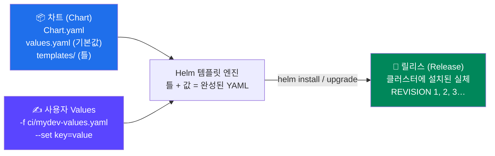
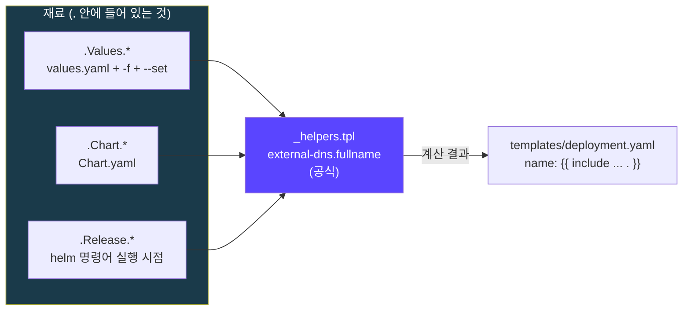
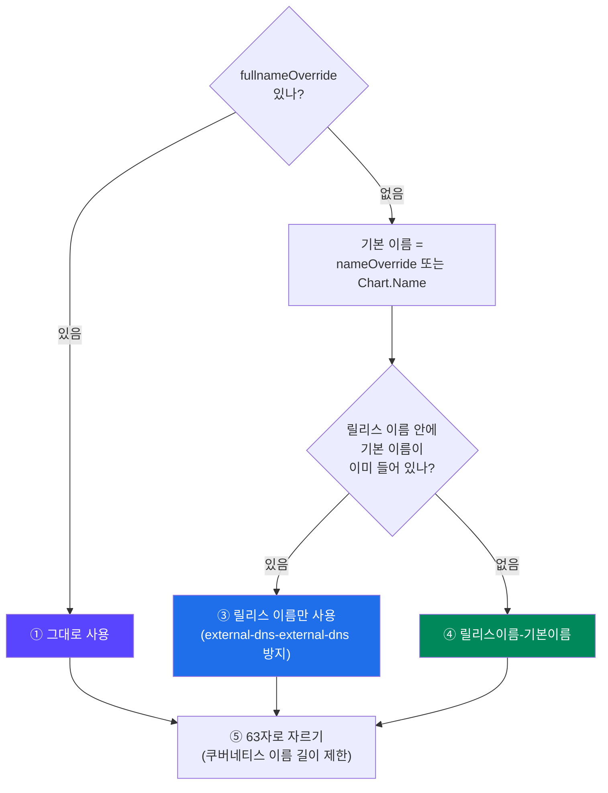
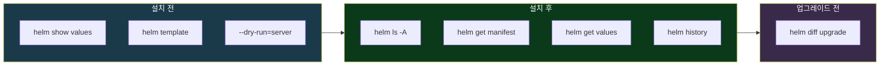

## 📚 들어가며

돌아보면 이 시리즈에서 Helm을 꽤 많이 썼다. 4편에서 LB Controller·external-dns·sealed-secrets를, 7편에서 Karpenter를 전부 Helm으로 설치했다. 네임스페이스 함정(4편)도 겪었고, release name이 내가 짓는 별명이라는 것(5편)도 정리했다.

그런데 솔직히 **"일단 따라 친" 부분이 많았다.** `templates/deployment.yaml`을 열면 `{{ include "external-dns.fullname" . }}` 같은 게 보이는데, 이게 정확히 어디서 값을 가져오는지 몰랐다.

이번 편은 강의의 Helm 파트를 들으며 그 빈칸을 채운 기록이다.

- **왜 Helm을 쓰나** (1장)
- **세 가지 구성 요소** — 차트, 릴리스, Values (2장)
- **템플릿은 값을 어디서 가져오나** — `_helpers.tpl`의 정체 (3장, 이번 편의 핵심)
- **주요 명령어** — 설치 전, 설치 후, 업그레이드 전 (4장)

실제 설치 실습(Redis)은 다음 편에서 한다. 처음 보는 사람도 읽을 수 있게 패키지 매니저, 차트, 릴리스, 템플릿 문법, Values 우선순위부터 설명했다.

> **이번 편 학습 지도**
>
> ```
> 왜 (1장)              구성 요소 (2장)          템플릿 (3장) 🔦              명령어 (4장)
> ────────              ──────────────          ───────────────              ────────────
> YAML 열 몇 개 관리     차트 = 포장             _helpers.tpl = 공식           설치 전: template · dry-run
> 패키지 매니저          릴리스 = 설치한 실체     재료 = Values·Chart·Release   설치 후: get manifest · values
> 공식 차트             Values = 덮어쓰기        직접 돌려본 이름 실험          업그레이드 전: helm-diff
> ```

---

## 1. 왜 Helm을 쓰나

### 1-1. Helm 없이 설치한다면

AWS Load Balancer Controller 하나만 해도 Deployment, Service, ServiceAccount, ClusterRole, ClusterRoleBinding, Webhook 설정, PDB, IngressClass… **리소스가 열 개 넘게** 필요하다. Helm 없이 하면 이렇게 된다.

- YAML 파일 열 몇 개를 직접 관리해야 하고
- 버전을 올릴 때 **어느 파일의 어느 줄이 바뀌었는지** 직접 찾아야 하고
- 지울 때 하나라도 빠뜨리면 찌꺼기가 남는다

### 1-2. Helm = 쿠버네티스의 패키지 매니저

`apt`, `brew`, `npm`처럼 **여러 리소스를 하나의 패키지로 묶어서 설치·업그레이드·삭제**한다. 강의 슬라이드가 정리한 장점은 셋이다.

| 장점 | 내용 |
|---|---|
| **패키지 관리** | 리소스 여러 개를 한 번에 설치·업그레이드·삭제. 라이프사이클 관리가 쉽다. 의존성(다른 차트)도 함께 처리 |
| **베스트 프랙티스** | Prometheus, Argo, Grafana 같은 커뮤니티와 벤더가 **공식 차트**를 제공한다. 그 프로젝트를 가장 잘 아는 사람들이 만든 표준 구성을 그대로 쓴다 |
| **다양한 환경 적용** | 같은 차트에 **Values 파일만 바꿔서** dev/stage/prod를 다르게 구성한다 |

강의 슬라이드의 AS-IS/TO-BE가 이걸 보여준다. `helm get manifest karpenter` 한 줄로 Karpenter가 만든 PDB, ServiceAccount, Deployment 등 **전부를 한 번에** 볼 수 있다. 7편에서 Karpenter를 설치할 때 실제로 그랬다.

두 번째 장점은 이 시리즈에서 여러 번 체감했다. 7편의 Karpenter 차트에는 hostname anti-affinity와 AZ topologySpread가 **기본값으로** 들어 있었고(11편), 10편에서 본 강의 레포의 Helm 템플릿에는 `preStop sleep 10`이 모든 컨테이너에 박혀 있었다. **차트를 쓰는 것만으로 남들이 쌓은 운영 감각을 물려받는다.**

---

## 2. Helm의 세 가지 구성 요소



### 2-1. 차트(Chart)의 생김새

**차트**는 쿠버네티스 리소스를 정의하는 파일 묶음이다. 지금까지 받은 차트들을 열어보면 구조가 같다.

```
external-dns-1.21.1/
├── Chart.yaml          ← 차트의 이름표 (이름, 버전, 앱 버전, 의존성)
├── values.yaml         ← 기본 설정값
├── values.schema.json  ← (선택) values 형식 검증 규칙
├── templates/          ← 쿠버네티스 리소스의 "틀"
│   ├── _helpers.tpl    ← 이름·라벨을 만드는 공식 모음 (리소스가 아님)
│   ├── deployment.yaml
│   ├── serviceaccount.yaml
│   ├── ...
│   └── NOTES.txt       ← 설치 후 화면에 출력할 안내문
├── crds/               ← (선택) 템플릿보다 먼저 설치되는 CRD (4편)
├── charts/             ← (선택) 의존하는 다른 차트
└── README.md
```

| 파일 | 역할 |
|---|---|
| `Chart.yaml` | 차트 이름(`name`), **차트 버전**(`version`), **앱 버전**(`appVersion`), 의존 차트(`dependencies`) |
| `values.yaml` | 템플릿에 들어갈 **기본값** |
| `templates/` | `{{ }}` 자리에 값을 채우면 완성되는 **YAML 틀** |

**차트 버전 vs 앱 버전** — 다음 편에서 설치할 Redis 차트의 `Chart.yaml`을 보면 이렇다.

```yaml
name: redis
version: 28.3.1      # 차트 버전 = 포장지의 버전
appVersion: 8.10.2   # 앱 버전 = 안에 든 Redis의 버전
```

**차트 버전은 포장지의 버전**(템플릿·기본값이 바뀌면 올라감), **앱 버전은 안에 든 Redis의 버전**이다. 둘은 따로 움직인다. 같은 Redis 8.10.2를 담고 있어도 템플릿이 고쳐지면 차트 버전만 올라간다. 7편의 Karpenter(`1.14.1` / `1.14.1`)처럼 둘을 맞춰서 내는 프로젝트도 있다.

**의존 차트 예시** — Redis 차트의 `Chart.yaml`에는 `common`이 의존성으로 들어 있다.

```yaml
dependencies:
- name: common
  repository: oci://registry-1.docker.io/bitnamicharts
  version: 2.41.0
```

`common`은 Bitnami의 **라이브러리 차트**다. 라이브러리 차트는 리소스를 직접 만들지 않고, 여러 Bitnami 차트가 같이 쓰는 공식(이름 규칙, 라벨 등)을 제공한다. 3장의 `_helpers.tpl`을 **여러 차트가 공유하도록 아예 차트로 뺀 것**이라고 보면 된다.

### 2-2. 릴리스(Release)

**릴리스**는 차트를 **클러스터에 한 번 설치한 실체**다. 같은 차트를 이름을 바꿔 여러 번 설치하면 릴리스가 여러 개 생긴다.

```bash
helm install redis -f ci/mydev-values.yaml . -n redis
#            ^^^^^  ← 릴리스 이름 (내가 짓는다, 5편)
```

- 업그레이드할 때마다 **REVISION**이 1, 2, 3…으로 올라간다.
- `helm history <릴리스>`로 이력을 보고, `helm rollback <릴리스> <리비전>`으로 되돌릴 수 있다.
- 릴리스 정보는 **그 네임스페이스에 Helm이 관리하는 Secret으로** 저장된다. 그래서 4편에서 겪었듯 **`helm ls`, `helm get`도 네임스페이스를 지정해야** 보인다. 4편의 함정이 왜 생겼는지가 여기서 설명된다.

### 2-3. Values

차트의 `values.yaml`(기본값) 위에 **사용자 값**을 덮어써서 최종 구성을 만든다. 강의 표현으로 "default + 사용자 정의 값"이다.


**오른쪽으로 갈수록 우선**한다. 같은 키가 여러 곳에 있으면 가장 오른쪽 값이 이긴다.

4편에서 정한 원칙이 이 구조 때문이다. **차트의 `values.yaml`은 직접 고치지 않고, 바꿀 값만 `ci/mydev-values.yaml`에 적는다.** 그래야 차트 버전을 올릴 때 **"내가 바꾼 것"이 명확히 남는다.** 4-2에서 이 원칙이 실제로 어떤 차이를 만드는지 다시 나온다.

---

## 3. 🔦 템플릿은 값을 어디서 가져오나

이번 공부의 핵심 질문이었다. external-dns 차트의 `templates/deployment.yaml`에 이렇게 적혀 있다.

```yaml
metadata:
  name: {{ include "external-dns.fullname" . }}
```

이게 `_helpers.tpl`을 참조한다는 건 알겠는데, **그럼 `_helpers.tpl`은 값을 어디서 가져오나?**

### 3-1. `_helpers.tpl`은 "값"이 아니라 "공식"이다

`_helpers.tpl`은 값을 갖고 있지 않다. **이름을 만드는 공식(함수)** 을 모아둔 파일이다. 재료는 다른 곳에서 받아온다.

```
{{ include "external-dns.fullname" . }}
           │                       │
           공식 이름                "." = 지금 가진 재료 전부를 넘긴다
```

`include "공식이름" .`은 **"이 공식을 지금 재료(`.`)로 계산해서 결과를 여기 넣어줘"** 라는 뜻이다. 끝의 **점(`.`)** 이 중요하다. 템플릿이 쓸 수 있는 **모든 재료를 통째로** 넘긴다는 의미다. 점을 빼먹으면 공식이 재료 없이 돌아가서 엉뚱한 결과가 나온다.

그리고 파일 이름이 **밑줄(`_`)로 시작하면 Helm은 그 파일을 쿠버네티스 리소스로 만들지 않는다.** 공식만 정의하는 파일이라는 표시다.

### 3-2. 재료는 세 곳에서 온다

external-dns 차트의 실제 `external-dns.fullname` 공식이다.

```
{{- define "external-dns.fullname" -}}
{{- if .Values.fullnameOverride }}                           ← ① Values
  {{- .Values.fullnameOverride | trunc 63 | trimSuffix "-" }}
{{- else }}
  {{- $name := default .Chart.Name .Values.nameOverride }}    ← ② Chart.yaml
  {{- if contains $name .Release.Name }}                       ← ③ helm 명령어
    {{- .Release.Name | trunc 63 | trimSuffix "-" }}
  {{- else }}
    {{- printf "%s-%s" .Release.Name $name | trunc 63 | trimSuffix "-" }}
  {{- end }}
{{- end }}
{{- end }}
```



| 재료 | 어디서 오나 | 이 차트에서의 값 |
|---|---|---|
| `.Values.*` | 차트의 `values.yaml` + `-f` 파일 + `--set` | `nameOverride`, `fullnameOverride` 모두 비어 있음 |
| `.Chart.*` | 차트의 `Chart.yaml` | `.Chart.Name` = `external-dns` |
| `.Release.*` | **helm 명령어를 실행할 때** 정해짐 | `.Release.Name` = `helm install <여기>`, `.Release.Namespace` = `-n <여기>` |

세 번째가 재미있다. `.Release`는 어떤 파일에도 적혀 있지 않다. **내가 명령어를 치는 순간** 정해지는 값이다. 그래서 같은 차트, 같은 values로도 `helm install` 뒤의 이름만 바꾸면 리소스 이름이 달라진다.

### 3-3. 공식을 말로 풀면



1. `fullnameOverride`가 있으면 → **그대로 쓴다**
2. 없으면 기본 이름 = `nameOverride`가 있으면 그것, 없으면 `Chart.yaml`의 이름
3. 릴리스 이름 안에 기본 이름이 **이미 들어 있으면** → 릴리스 이름만 쓴다 (`external-dns-external-dns` 같은 중복 방지)
4. 아니면 → `<릴리스 이름>-<기본 이름>`
5. 63자로 자른다

### 3-4. 직접 돌려본 결과

`helm template`으로 릴리스 이름과 `--set` 값만 바꿔가며 Deployment 이름을 확인했다. `helm template`은 클러스터에 접속하지 않으니 마음껏 실험할 수 있다.

```bash
cd external-dns-1.21.1
helm template external-dns .                           | grep -A2 '^kind: Deployment'
helm template my-dns .                                 | grep -A2 '^kind: Deployment'
helm template my-dns . --set nameOverride=dns          | grep -A2 '^kind: Deployment'
helm template my-dns . --set fullnameOverride=edns     | grep -A2 '^kind: Deployment'
```

| 명령 | 결과 | 공식의 단계 |
|---|---|---|
| `helm template external-dns .` | `external-dns` | ③ 릴리스 이름에 `external-dns`가 이미 들어 있음 |
| `helm template my-dns .` | `my-dns-external-dns` | ④ 안 들어 있어서 붙임 |
| `helm template my-dns . --set nameOverride=dns` | `my-dns` | ②→③ 기본 이름이 `dns`가 됐고, `my-dns`에 포함됨 |
| `helm template my-dns . --set fullnameOverride=edns` | `edns` | ① 무조건 이 값 |

세 번째 줄이 가장 흥미롭다. `nameOverride=dns`를 줬는데 결과에 `dns`라는 글자가 따로 붙지 않는다. `my-dns`라는 릴리스 이름 안에 이미 `dns`가 들어 있으니 ③번 규칙이 걸린 것이다. **공식을 모르고 결과만 보면 이해가 안 가는 장면**이다.

**그리고 나는 이미 이걸 써먹은 적이 있다.** 4편에서 sealed-secrets를 설치할 때 values에 이렇게 넣었다.

```yaml
fullnameOverride: "sealed-secrets-controller"
```

kubeseal CLI가 기본으로 `kube-system`의 `sealed-secrets-controller`를 찾기 때문에, ①번 단계를 써서 **릴리스 이름과 상관없이** 이름을 고정한 것이다. 그때는 "kubeseal이 이 이름을 찾는다니까"로 넘어갔는데, 이번에 공식을 보니 **왜 `nameOverride`가 아니라 `fullnameOverride`여야 했는지**가 보인다. `nameOverride`였다면 릴리스 이름에 따라 결과가 달라졌을 것이다.

### 3-5. 왜 공식을 따로 빼두나

같은 이름이 Deployment, Service, ServiceAccount, 라벨 등 **여러 템플릿에서 반복**된다. 공식을 한 곳에 두면 모든 리소스 이름이 같은 규칙으로 나온다.

공식끼리 서로 부르기도 한다. 예를 들어 `external-dns.serviceAccountName`은 내부에서 `external-dns.fullname`을 다시 부른다.

```
{{- define "external-dns.serviceAccountName" -}}
{{- if .Values.serviceAccount.create }}
{{- default (include "external-dns.fullname" .) .Values.serviceAccount.name }}
{{- else }}
{{- default "default" .Values.serviceAccount.name }}
{{- end }}
```

"SA를 만든다면, 이름을 따로 안 줬을 때 **fullname 공식의 결과**를 쓴다"는 뜻이다. 그래서 4편의 LB Controller처럼 Pod Identity association과 SA 이름을 맞춰야 할 때는, 공식에 맡기지 않고 `serviceAccount.name`을 **직접 적는 게** 안전하다. 릴리스 이름이 바뀌어도 SA 이름이 흔들리지 않기 때문이다.

### 3-6. 템플릿 문법 몇 가지

강의 슬라이드의 예시들로 자주 나오는 문법을 정리했다.

```yaml
spec:
  replicas: {{ .Values.replicaCount }}             # 값을 그대로 넣기
  {{- with .Values.serviceAccount.annotations }}    # 값이 있을 때만 이 블록을 넣기
  annotations:
    {{- toYaml . | nindent 4 }}                      # 맵을 YAML로 바꿔 4칸 들여쓰기
  {{- end }}
```

| 문법 | 의미 |
|---|---|
| `{{ .Values.x }}` | 값 넣기 |
| `{{- ... }}` / `{{ ... -}}` | 앞/뒤 공백·줄바꿈 제거 (YAML 들여쓰기가 깨지지 않게) |
| `if` / `else` / `end` | 조건 |
| `with` | 값이 있을 때만 블록 실행. **블록 안에서 `.`이 그 값으로 바뀐다** |
| `$` | 블록 안에서도 **맨 처음의 재료 전체**(최상위 `.`)를 가리킨다 |
| `default A B` | B가 비어 있으면 A |
| `toYaml` + `nindent N` | values의 맵/리스트를 YAML로 바꿔 N칸 들여쓰기 |
| `include "공식" .` | `_helpers.tpl`의 공식 호출 |

`with`와 `$`는 짝으로 기억하면 좋다. `with` 블록 안에서는 `.`이 좁아져서 `.Values`, `.Release` 같은 재료에 접근할 수 없다. 그럴 때 **`$`로 원래 재료 전체를 다시 꺼낸다.** 실제 LB Controller 차트의 ServiceAccount 템플릿이 이렇게 쓴다.

```yaml
# aws-load-balancer-controller-3.5.0/templates/serviceaccount.yaml
  {{- with .Values.serviceAccount.annotations }}
  annotations:
    {{- tpl (toYaml .) $ | nindent 4 }}
  {{- end }}
```

(`tpl`은 values 안에 적힌 문자열을 다시 템플릿으로 해석하는 함수다. 그 해석에 원래 재료가 필요해서 `$`를 넘긴다.)

**이게 바로 4편의 IRSA 어노테이션이 사라진 원리다.** 강의 values에는 `serviceAccount.annotations`에 `eks.amazonaws.com/role-arn`이 들어 있었다. 우리가 Pod Identity로 바꾸면서 이 값을 **비워두니**, `with` 블록의 조건이 거짓이 되어 **`annotations:` 블록 자체가 렌더링되지 않았다.** 4편 3-7에서 "IRSA 어노테이션을 지웠다"고 썼던 그 한 줄의 효과가, 템플릿 쪽에서 보면 이렇게 일어난 것이다.

---

## 4. 주요 명령어



### 4-1. 설치 전에 확인하기

| 명령 | 하는 일 | 클러스터 접속 |
|---|---|:---:|
| `helm show values <차트>` | 원격 차트의 기본 `values.yaml` 출력 | ❌ |
| `helm template <릴리스> . -f ci/...` | 템플릿을 **렌더링만** 해서 출력 | ❌ |
| `helm install ... --dry-run=client` | 설치를 흉내 냄. 렌더링 + 기본 검사 | ❌ |
| `helm install ... --dry-run=server` | **API 서버에 검증까지** 받아봄 | ✅ |

강의는 Helm 3 시절이라 `--dry-run`만 썼다. 지금 쓰는 **Helm 4.2.2**에서는 `--dry-run`이 `none`(기본값, 실제 설치) / `client` / `server` 중 하나를 고르는 옵션이라, **어느 쪽인지 명시하는 게 확실하다.**

`client`와 `server`의 차이가 실제로 중요했던 장면이 있다. 다음 편에서 Redis 차트의 `serviceMonitor`를 켜면 `ServiceMonitor`라는 CRD가 필요한데, 이 클러스터에는 아직 없다(Prometheus Operator를 안 깔았으니까).

| 명령 | 결과 |
|---|---|
| `helm template` | 그냥 YAML을 뽑아줄 뿐이라 **문제를 못 잡는다** |
| `--dry-run=server` | API 서버가 **"그런 종류의 리소스 없음"** 이라고 거절해서 미리 잡아낸다 |

7편에서 "CRD가 설치되기 전엔 `--dry-run=server`로 검증할 수 없다"고 썼던 것과 같은 원리를 반대 방향에서 본 것이다. 서버 검증은 **서버가 아는 리소스 종류만** 통과시킨다.

강의는 원격 차트로 바로 설치할 때 `helm show values ... > default-values.yaml`로 기본값을 내려받아 보고, 그중 바꿀 값을 골라 values 파일을 만드는 방법을 보여준다.

### 4-2. 설치 후에 확인하기

| 명령 | 하는 일 |
|---|---|
| `helm ls -A` | 전체 릴리스 목록 (`-A` 없으면 현재 네임스페이스만, 4편) |
| `helm get manifest <릴리스> -n <ns>` | 그 릴리스가 **실제로 만든 리소스 전부** |
| `helm get values <릴리스> -n <ns>` | 설치할 때 **내가 준 값만** (`USER-SUPPLIED VALUES`) |
| `helm get values <릴리스> -n <ns> -a` | 기본값까지 합친 **최종 값 전체** |
| `helm history <릴리스> -n <ns>` | 리비전 이력 |

`helm get values`가 **"내가 준 값만"** 보여준다는 점이 특히 유용하다. Redis 설치 후 확인해보니 values 파일에 적은 항목만 정확히 나왔다.

여기서 2-3의 원칙이 실제 차이를 만든다. 강의는 `values.yaml`을 통째로 복사(`cp values.yaml ci/jerry-dev-values.yaml`)한 뒤 수정했다. 그렇게 하면 이 출력에 **바꾸지 않은 기본값 수천 줄까지 전부** "내가 준 값"으로 찍힌다. 몇 달 뒤 "이 릴리스에서 내가 뭘 바꿨더라?"를 확인하려 해도 찾을 수가 없다.

| 방식 | `helm get values` 출력 | 나중에 차트 버전 올릴 때 |
|---|---|---|
| `values.yaml` 통째로 복사 (강의) | 수천 줄 전부 | 옛 기본값까지 고정돼서 새 기본값이 안 들어옴 |
| **바꿀 값만 적기** (이 프로젝트) | 내가 바꾼 몇 줄만 | 나머지는 새 차트의 기본값을 자연스럽게 따름 |

오른쪽 열이 더 중요하다. 통째로 복사하면 **차트를 올려도 옛 기본값이 내 파일에 박혀 있어서** 새 버전의 개선된 기본값을 못 받는다. 다음 편의 Redis가 정확히 그 경우와 관련이 있다.

### 4-3. 업그레이드 전에 차이 보기 — helm-diff 플러그인

```bash
helm plugin install https://github.com/databus23/helm-diff
helm diff upgrade redis -f ci/mydev-values.yaml . -n redis
# redis, redis-replicas, StatefulSet (apps) has changed:
#   spec:
# -   replicas: 1
# +   replicas: 2
```

`terraform plan`처럼 **업그레이드하면 무엇이 바뀌는지**를 미리 보여준다. 강의 표현으로 "예기치 않은 작업 방지"다. 2편부터 `terraform plan`으로 바뀔 내용을 먼저 보는 습관을 들였는데, Helm 쪽에도 같은 도구가 있었다.

참고로 위 출력은 강의 화면을 옮긴 것이다. 지금 내 로컬에는 설치하지 않았다(`helm plugin list`가 비어 있다). 그리고 **Helm 4에서는 플러그인을 설치할 때 서명 검증을 한다.** `helm plugin install --help`에 따르면 서명 검증을 건너뛰려면 `--verify=false`를 줘야 하는데, 도움말에도 "NOT recommended"라고 적혀 있으니 플러그인의 출처를 확인하고 쓰는 게 맞다.

---

## 📝 이번 편 요약

```
왜 Helm
└─ 쿠버네티스의 패키지 매니저 — 여러 리소스를 한 묶음으로, 공식 차트로 베스트 프랙티스 물려받기

세 가지 구성 요소
├─ 차트 = Chart.yaml + values.yaml + templates/  (차트 버전 = 포장지, 앱 버전 = 내용물)
├─ 릴리스 = 설치한 실체. REVISION으로 이력 · rollback. 정보는 그 ns의 Secret에 저장
└─ Values = values.yaml < -f 파일(뒤가 우선) < --set. 차트 values.yaml은 안 고친다

템플릿 🔦
├─ _helpers.tpl = 값이 아니라 공식. include "공식" . 의 . = 재료 전체
├─ 재료 = .Values(values 파일) · .Chart(Chart.yaml) · .Release(helm 명령어)
├─ fullname 공식: fullnameOverride > (릴리스 이름에 포함? 그대로 : 릴리스-차트명) > 63자
├─ 4편의 fullnameOverride = 이 공식의 ①번 단계
└─ with는 값이 없으면 블록째 사라짐 → 4편 IRSA 어노테이션이 사라진 원리

명령어
├─ 설치 전: show values · template · --dry-run=client / server (Helm 4는 명시)
├─ 설치 후: ls -A · get manifest · get values (내가 준 값만) · history
└─ 업그레이드 전: helm-diff (Helm 4는 플러그인 서명 검증)
```

| 개념 | 한 줄 정의 |
|---|---|
| **차트 (Chart)** | 쿠버네티스 리소스를 정의하는 템플릿과 기본값의 묶음 |
| **릴리스 (Release)** | 차트를 클러스터에 한 번 설치한 실체. 이름은 내가 짓는다 |
| **REVISION** | 릴리스를 설치·업그레이드할 때마다 올라가는 이력 번호 |
| **차트 버전 / 앱 버전** | 포장지(템플릿·기본값)의 버전 / 안에 든 애플리케이션의 버전 |
| **라이브러리 차트** | 리소스를 만들지 않고 공통 공식만 제공하는 차트 (예: Bitnami `common`) |
| **`_helpers.tpl`** | 이름·라벨을 만드는 공식(named template) 모음. 리소스로 렌더링되지 않음 |
| **`include "공식" .`** | 공식을 현재 재료 전체(`.`)로 계산해 결과를 넣기 |
| **`.Values` / `.Chart` / `.Release`** | values 파일 / Chart.yaml / helm 명령어에서 오는 재료 |
| **`with` / `$`** | 값이 있을 때만 블록 실행(안에서 `.`이 바뀜) / 블록 안에서도 최상위 재료 |
| **helm-diff** | 업그레이드 전에 바뀔 리소스를 diff로 보여주는 플러그인 |

---

## 💭 느낀 점

**1. 4편에서 넣은 한 줄의 의미를 여덟 편이 지나서야 알았다.**

`fullnameOverride: "sealed-secrets-controller"`. 4편에서 kubeseal이 그 이름을 찾는다고 해서 넣었는데, 왜 `nameOverride`가 아니라 `fullnameOverride`여야 했는지는 몰랐다. 이번에 공식을 따라가며 `helm template`으로 이름을 바꿔보니, `nameOverride`였다면 **릴리스 이름에 따라 결과가 달라졌을 것**이다. "따라 쳐서 동작한 것"과 "이해해서 동작하는 것"의 차이를 이번에 처음 제대로 구분할 수 있었다.

**2. `_helpers.tpl`을 "값"이 아니라 "공식"으로 보니 다 풀렸다.**

처음엔 `_helpers.tpl` 안 어딘가에 이름이 적혀 있을 줄 알고 찾았다. 그런데 거기엔 값이 하나도 없었다. 있는 건 **"이런 재료가 오면 이렇게 조합하라"는 규칙**뿐이었다. 재료가 values 파일, Chart.yaml, 그리고 **내가 치는 명령어**에서 온다는 걸 알고 나니, 같은 차트가 왜 릴리스 이름마다 다른 리소스 이름을 만드는지 이해됐다.

**3. "바꿀 값만 적기"는 취향이 아니라 유지보수 전략이었다.**

4편에서 "차트의 values.yaml은 고치지 않는다"를 원칙으로 정했을 때는 깔끔하려고 그런 거였다. 그런데 `helm get values`가 "내가 준 값만" 보여준다는 걸 알고 나니, 이 원칙은 **나중의 나를 위한 기록**이었다. 통째로 복사하면 내가 뭘 바꿨는지 사라지고, 차트를 올려도 옛 기본값에 묶인다. 다음 편 Redis에서 이 차이가 실제로 문제가 된다.

**4. Helm도 결국 "plan 먼저"다.**

Terraform에서 `plan` 없이 `apply`하지 않는 습관을 2편부터 들였다. Helm에도 `template`, `--dry-run=server`, `helm-diff`라는 같은 계열의 도구가 있었다. 도구는 달라도 **"바뀔 내용을 먼저 보고 실행한다"** 는 원칙은 똑같다. 인프라를 다루는 도구라면 어디에나 이런 장치가 있다는 게 이제는 당연하게 느껴진다.

---

## 🔗 다음 편 예고

13편은 Helm으로 **Redis를 실제로 설치**한다.

버전을 지정하지 않고 받았더니 강의(18.12.1)보다 **10 메이저나 높은 28.3.1**이 받아졌다. 그 사이 **Bitnami의 무료 이미지 정책이 바뀌어서**, 강의 values를 그대로 쓰면 이미지를 못 받는 상황이 됐다. 1편에서 "강의 자료의 시점을 의심하라"고 썼던 게 Helm 차트에서도 그대로 반복된다.

---

## 📚 참고

- [Helm 공식 문서 — Charts](https://helm.sh/docs/topics/charts/)
- [Helm 공식 문서 — Values Files](https://helm.sh/docs/chart_template_guide/values_files/)
- [Helm 공식 문서 — Named Templates (`define`, `include`)](https://helm.sh/docs/chart_template_guide/named_templates/)
- [Helm 공식 문서 — Flow Control (`if`, `with`, `range`)](https://helm.sh/docs/chart_template_guide/control_structures/)
- [databus23/helm-diff](https://github.com/databus23/helm-diff)

> 3-4의 이름 실험은 external-dns 1.21.1 차트로 직접 `helm template`을 돌려 확인한 결과다. 4-3의 helm-diff 출력은 강의 화면을 옮긴 것이다. Helm 관련 동작은 Helm 4.2.2 기준이다.
