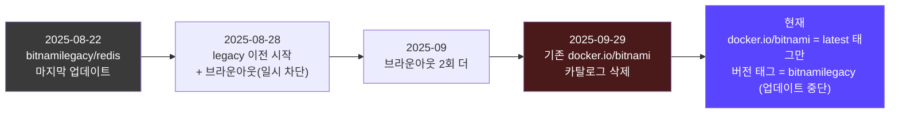
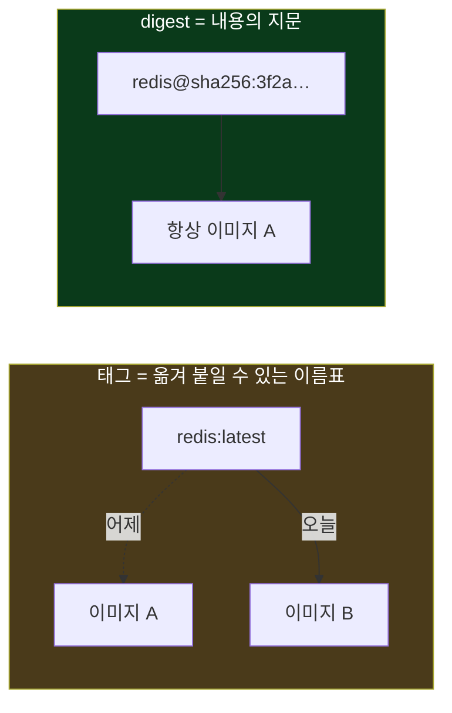
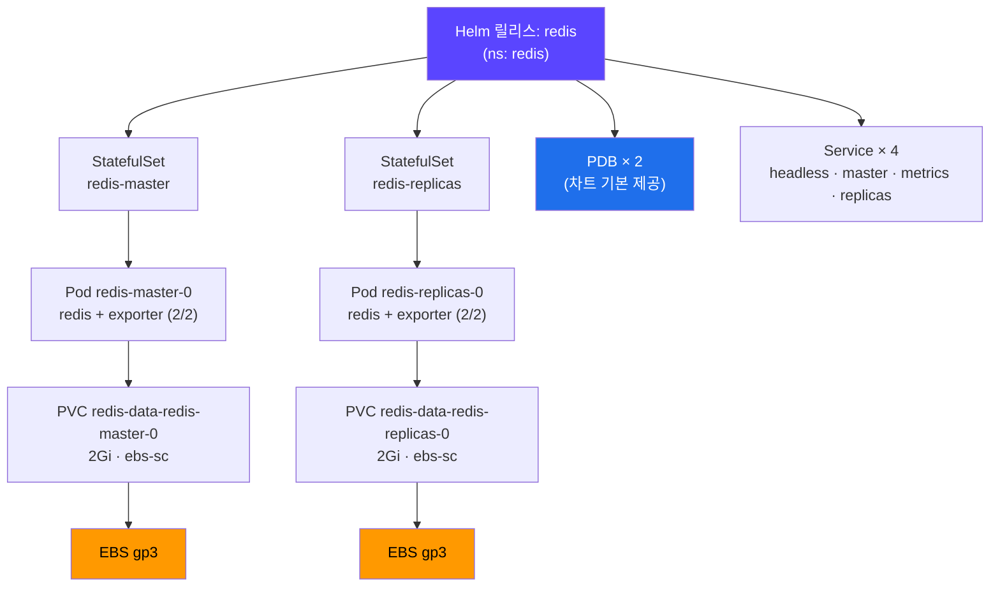
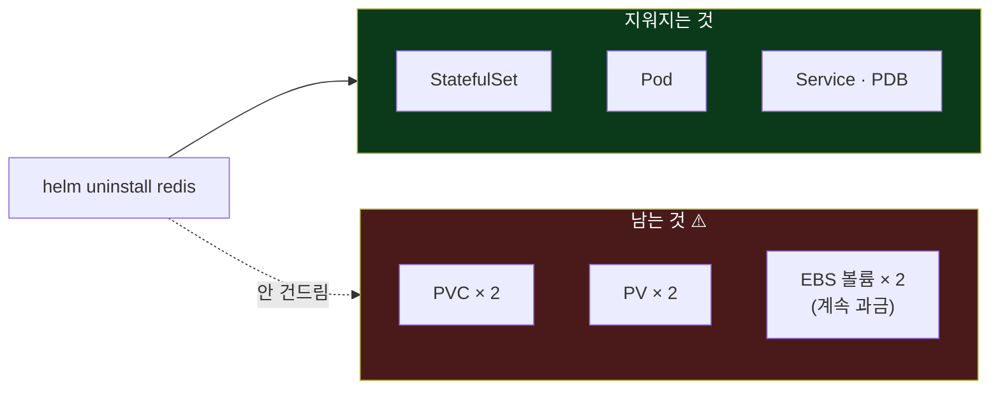
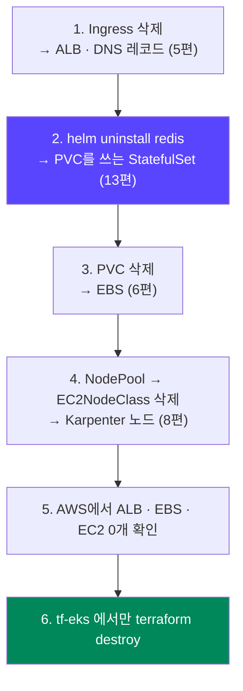
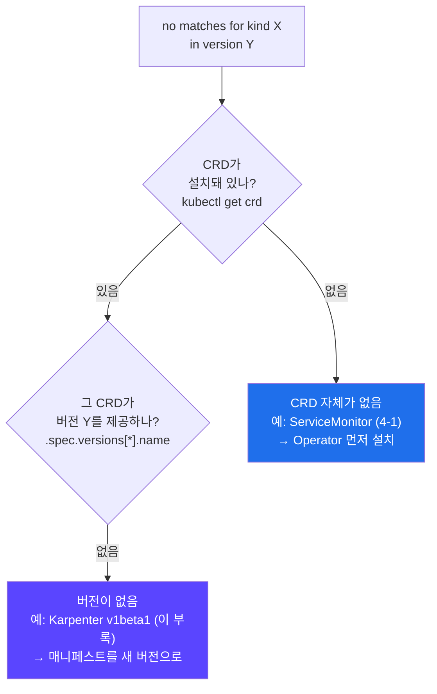

## 📚 들어가며

[12편](/posts/EKS-Rebuild-12-Helm-Chart-Template-Values/)에서 Helm의 차트·템플릿·Values를 정리했다. 이번 편은 그걸 실제로 써서 **Redis를 설치**한다.

강의를 따라 차트를 받았는데, **버전을 지정하지 않아서** 강의(18.12.1)보다 10 메이저나 높은 **28.3.1**이 받아졌다. 차트 자체는 문제가 없었다. 문제는 그 사이 **Bitnami의 무료 이미지 배포 정책이 바뀌어서**, 강의 values를 그대로 쓰면 이미지를 못 받는다는 것이었다.

- **설치 방법 두 가지와 버전** (1~2장)
- **Bitnami 이미지 정책 변경** — 이번 편의 가장 중요한 실전 정보 (3장)
- **values 작성과 설치** — 강의 대비 바꾼 것들 (4~5장)
- **StatefulSet 정리법** — `helm uninstall`로 PVC가 안 지워지는 이유 (6장)
- **부록** — 11편의 `multiaz` NodePool이 적용되지 않았던 이유 (7장)

StatefulSet, PVC 보존, 이미지 태그와 digest 개념도 같이 설명했다.

> **이번 편 학습 지도**
>
> ```
> 받기 (1~2장)          이미지 (3장) 🔦               설치 (4~5장)            정리 (6장)
> ────────────          ──────────────               ────────────            ──────────
> 로컬 vs 원격 설치      강의 태그 → 404               image 블록 삭제          StatefulSet = 정체성 + 저장소
> 버전 없이 → 28.3.1    docker.io/bitnami = latest만  ServiceMonitor는 나중에   uninstall해도 PVC는 남음
> 디렉토리에 버전 넣기   태그 vs digest                command 없는 sysctl 끄기  destroy 체크리스트 합본
> ```

---

## 1. Helm으로 앱을 설치하는 두 가지 방법

강의 슬라이드의 비교다.

| | ① 로컬에 차트 다운로드 | ② 원격 저장소에서 바로 설치 |
|---|---|---|
| 방법 | `helm pull` → 압축 해제 → `helm install ... .` | `helm install <이름> oci://...` |
| 장점 | 커스터마이징이 쉽고, 오프라인 설치 가능, **버전이 명확히 남음** | 간편함 |
| 단점 | 단계가 하나 더 있음 | 커스터마이징 제약, 온라인이어야 함 |

이 프로젝트는 지금까지 ①을 써왔다. 차트를 받아 values 파일과 같이 커밋하는 방식이다(4편의 vendoring 논의).

**① 로컬 차트 설치 순서** (강의 기준)

1. 차트 검색, 로컬 다운로드
2. 압축 해제, **버전이 들어간 디렉토리 이름**으로 변경 (`redis` → `redis-18.12.1`)
3. 커스텀 values 파일 작성
4. 설치
5. 정상 설치 확인

2번의 "버전을 넣은 디렉토리 이름"이 왜 중요한지는 바로 다음 장에서 드러난다.

---

## 2. 버전 지정 없이 받았더니 28.3.1

```bash
helm pull oci://registry-1.docker.io/bitnamicharts/redis --untar
```

강의는 `--version 18.12.1`을 지정했지만 이번엔 지정하지 않아서 **최신인 28.3.1**이 받아졌다.

| | 강의 | 이번 |
|---|---|---|
| 차트 버전 | 18.12.1 | **28.3.1** |
| Redis 버전 (appVersion) | 7.2.4 | **8.10.2** |
| 디렉토리 이름 | `redis-18.12.1` | `redis` (버전 없이) |

12편에서 정리한 대로 **차트 버전은 포장지, appVersion은 내용물**이다. 포장지는 10 메이저, 내용물은 Redis 7 → 8로 올라갔다. 차트 자체는 Kubernetes 버전 제약이 없어서 이 클러스터(1.34)에서 문제없었다. 문제는 **차트가 쓰는 이미지**였다.

> 강의가 "버전을 넣은 디렉토리 이름으로 바꾸라"고 한 이유가 여기서 보인다. 디렉토리가 그냥 `redis`면, 나중에 어떤 버전을 받았는지 `Chart.yaml`을 열어봐야 안다. 지금까지 받은 차트들(`external-dns-1.21.1`, `karpenter-1.14.1` 등)은 전부 버전을 붙였는데, 이번에 처음으로 그 규칙을 놓쳤다.

---

## 3. 🔦 핵심 함정 — Bitnami 이미지 정책 변경

### 3-1. 강의 values의 이미지 설정

```yaml
image:
  registry: docker.io
  repository: bitnami/redis
  tag: 7.2.4-debian-11-r5
```

강의 당시엔 당연히 받아지던 이미지다.

### 3-2. 2025년 8월 말 이후 바뀐 것

Bitnami(현재 Broadcom 소유)가 2025년 8월 말에 무료 이미지 배포 방식을 바꿨다. GitHub의 `bitnami/containers` 저장소에 올라온 공지를 정리하면 이렇다.



- **2025-08-28부터** 기존의 모든 이미지와 버전 태그가 `docker.io/bitnami`에서 **`docker.io/bitnamilegacy`** 로 옮겨지기 시작했다. 옮겨진 이미지는 **더 이상 업데이트되지 않는다.**
- 그 사이 일부 이미지를 하루씩 막아보는 **브라운아웃**이 세 번 있었다. 미리 알아채라는 경고였다.
- 기존 `docker.io/bitnami` 카탈로그 삭제는 한 차례 연기된 끝에 **2025-09-29**에 이뤄졌다.
- 이후 `docker.io/bitnami`에는 일부 이미지의 **`latest` 태그만** 무료로 남았다. 운영용으로는 유료인 Bitnami Secure Images를 권한다.

차트 README에도 안내가 있다.

> *"If you are looking for our previous generation of images based on Debian Linux, please see the Bitnami Legacy registry."*

공지만 믿지 않고 Docker Hub API로 직접 확인해봤다.

```bash
curl -s -o /dev/null -w '%{http_code}' https://hub.docker.com/v2/repositories/bitnami/redis/tags/<태그>
```

| 이미지 | 결과 |
|---|---|
| `bitnami/redis:latest` | ✅ 200 — 있음 |
| `bitnami/redis:8.10.2` (차트의 appVersion) | ❌ 404 — 없음 |
| `bitnami/redis:7.2.4-debian-11-r5` (**강의 값**) | ❌ 404 — 없음 → 그대로 쓰면 `ImagePullBackOff` |
| `bitnamilegacy/redis:7.2.4-debian-11-r5` | ✅ 200 — 있음 (단 2025-08-22 이후 업데이트 없음) |

두 번째 줄이 특히 의외였다. **차트가 담고 있다는 Redis 8.10.2 태그조차 없다.** `docker.io/bitnami/redis`에서 버전 태그는 사라지고 `latest`만 남은 것이다.

### 3-3. 그래서 차트 28.x는 기본값이 `latest`다

차트의 `values.yaml`을 열어보니 이렇게 되어 있었다.

```yaml
image:
  registry: registry-1.docker.io
  repository: bitnami/redis
  tag: latest
  digest: ""
```

redis-exporter, os-shell, kubectl 등 차트가 쓰는 **다른 이미지도 전부 `tag: latest`** 였다. 차트가 이미 새 정책에 맞춰져 있는 것이다. 그래서 **values에서 `image` 블록을 아예 빼고 차트 기본값을 쓰는 것**이 정상 동작이다.

12편에서 "values를 통째로 복사하면 차트를 올려도 옛 기본값에 묶인다"고 썼다. 바로 이 경우다. 강의처럼 values 전체를 복사해서 이미지 태그까지 박아뒀다면, 차트를 28.x로 올려도 **옛 태그가 그대로 남아 이미지를 못 받는다.** 바꿀 값만 적는 원칙 덕에 이번엔 `image` 블록을 지우는 것만으로 끝났다.

### 3-4. 선택지 — 그리고 태그와 digest

| 방법 | 장점 | 단점 |
|---|---|---|
| **차트 기본값 (`latest`)** ← 선택 | 그대로 동작, 무료 이미지 중 최신 | 받을 때마다 내용이 바뀔 수 있음 (재현성 없음) |
| `latest`를 **digest로 고정** | 같은 이미지를 계속 보장 | digest를 직접 확인해서 넣어야 함 |
| `bitnamilegacy` 이미지 | 강의와 같은 버전 | 업데이트 중단, 보안 패치 없음 |
| 다른 차트로 교체 (공식 Redis/Valkey 이미지 기반 등) | 장기적으로 안정 | 강의와 구성이 달라짐 |

**개념: 태그와 digest**



- **태그**(`latest`, `8.10.2`)는 이미지에 붙인 **이름표**다. 같은 태그를 다른 이미지로 옮겨 붙일 수 있다. `latest`는 특히 새 버전이 나올 때마다 계속 옮겨진다.
- **digest**(`sha256:...`)는 이미지 **내용 자체의 지문**이다. 내용이 1비트라도 다르면 값이 달라지므로, digest로 지정하면 **언제 받아도 같은 이미지**가 보장된다. 위 `values.yaml`에서 봤듯 Bitnami 차트는 `image.digest` 값을 지원한다.

학습 단계라 지금은 `latest`로 두고, values 파일 주석에 digest 고정 방법을 남겨뒀다. 8편에서 Karpenter의 `al2023@latest`를 운영에서는 버전 고정하라고 했던 것과 같은 고민이다 — **`latest`는 편하지만, 언제 무엇이 바뀔지 내가 정하지 못한다.**

설치 후 실제로 어떤 이미지로 떴는지 확인한 결과다.

```bash
kubectl get pod -n redis -o jsonpath='{range .items[*]}{.metadata.name}{"  "}{range .spec.containers[*]}{.image}{" "}{end}{"\n"}{end}'
# redis-master-0    registry-1.docker.io/bitnami/redis:latest registry-1.docker.io/bitnami/redis-exporter:latest
# redis-replicas-0  registry-1.docker.io/bitnami/redis:latest registry-1.docker.io/bitnami/redis-exporter:latest
```

> **이 시리즈에서 같은 계열의 문제는 두 번째다.** 4편에서 sealed-secrets의 Helm 저장소가 `bitnami-labs`에서 `bitnami`로 옮겨져 예전 URL이 404였다. 오래된 강의 자료를 따라 할 때 **Bitnami 쪽 이미지·저장소 주소는 반드시 현재 상태를 확인**해야 한다. 4편에서는 "URL이 죽는 경우도 있다"고 썼는데, 이번엔 **태그가 죽었다.**

---

## 4. values 작성 — 강의 대비 바꾼 것

```yaml
# ci/mydev-values.yaml (주석 제외)
architecture: replication
auth:
  enabled: false
master:
  count: 1
  resources:
    requests: { cpu: 10m, memory: 256Mi }
    limits:   { memory: 256Mi }
  persistence:
    size: 2Gi
replica:
  replicaCount: 1
  resources:
    requests: { cpu: 10m, memory: 256Mi }
    limits:   { memory: 256Mi }
  persistence:
    size: 2Gi
sentinel:
  enabled: false
metrics:
  enabled: true
  serviceMonitor:
    enabled: false
  prometheusRule:
    enabled: false
sysctl:
  enabled: false
```

| 항목 | 강의 | 이번 | 이유 |
|---|---|---|---|
| `image` | `bitnami/redis:7.2.4-debian-11-r5` | **삭제** | 3장 |
| `metrics.serviceMonitor`, `prometheusRule` | `true` | **`false`** (지금은) | 4-1 |
| `sysctl.enabled` | `true` | **`false`** | 4-2 |
| `master/replica.persistence.size` | 미설정 (기본 8Gi) | **2Gi** | EBS는 용량만큼 과금 (6편) |
| `architecture`, `auth`, `count`, `replicaCount`, `resources`, `sentinel`, `metrics.enabled` | | 그대로 | |

강의 values와 비교하면서 **각 키가 28.3.1에도 그대로 있는지** 먼저 확인했다. 10 메이저 버전 차이가 나면 키 이름이 바뀌는 경우가 흔한데(2편의 EKS 모듈 v19→v21에서 `cluster_` 접두사가 통째로 사라졌던 것처럼), 이 키들은 모두 그대로였다.

### 4-1. ServiceMonitor는 왜 껐나

`ServiceMonitor`와 `PrometheusRule`은 쿠버네티스 기본 리소스가 아니라 **Prometheus Operator가 제공하는 CRD**다(7편의 CRD 개념). 이 클러스터에는 아직 모니터링 스택(kube-prometheus-stack)을 설치하지 않아서 CRD가 없다.

```bash
kubectl get crd | grep monitoring.coreos.com   # → 없음
```

켜둔 채 설치하면 `no matches for kind "ServiceMonitor"`로 실패한다. 12편 4-1에서 "`helm template`은 이걸 못 잡고 `--dry-run=server`는 잡는다"고 했던 바로 그 장면이다. 강의 레포의 values 주석에도 *"after prometheus-operator is installed, set to true"* 라고 적혀 있다. **모니터링 스택을 설치한 뒤 켜고 `helm upgrade`** 한다.

`metrics.enabled: true`(redis-exporter 사이드카)는 CRD와 무관해서 그대로 켰다. 지표를 **내보내는** 쪽은 지금 켜두고, 지표를 **수집하라고 알려주는** 쪽(ServiceMonitor)만 나중에 켜는 것이다. 파드가 `2/2`인 이유가 이 사이드카다.

### 4-2. sysctl은 왜 껐나

`sysctl.enabled`는 **privileged(루트, 호스트 커널 접근) 권한의 init 컨테이너**를 추가해서 노드의 커널 파라미터를 바꾸는 기능이다. 실제로 바꿀 값은 `sysctl.command`에 적어야 하는데, 강의 values는 `command` 없이 `enabled`만 켜두었다. 템플릿을 열어보면 그 경우 **아무 일도 하지 않는 루트 권한 컨테이너만** 생긴다.

```yaml
# templates/master/application.yaml 중
{{- if .Values.sysctl.enabled }}
- name: init-sysctl
  securityContext:
    privileged: true
    runAsUser: 0
  {{- if .Values.sysctl.command }}   # ← command가 있을 때만 실제 명령이 들어감
```

12편에서 배운 템플릿 읽기가 여기서 바로 쓰였다. `enabled`는 **컨테이너를 만들지**를 정하고, `command`는 **그 컨테이너가 무엇을 할지**를 정한다. 둘이 따로 노는 구조라 `enabled`만 켜면 빈 껍데기가 생긴다. 불필요한 루트 권한은 두지 않는 게 원칙이라 껐다. Redis 로그에 커널 설정 관련 경고가 나오면 그때 `command`와 함께 켠다.

### 4-3. resources를 명시한 이유

9편에서 배운 그대로다. requests가 있어야 스케줄러와 Karpenter가 제대로 판단한다.

그리고 하나 더 있다. 최근 Bitnami 차트는 `resources`를 비워두면 **`resourcesPreset`**(`nano`, `micro`, `small` 등)으로 값을 **자동으로 채운다.** 28.3.1의 기본값은 `resourcesPreset: "nano"`다. 차트 주석에도 *"master.resources is recommended for production"* 이라고 적혀 있다. 의도하지 않은 값이 들어가지 않도록 직접 적었다.

### 4-4. 릴리스 이름과 네임스페이스는 반드시 `redis`

강의의 timeline-server는 Redis를 `redis-master.redis.svc.cluster.local`로 찾아간다. 12편의 이름 공식대로 서비스 이름이 `<릴리스명>-master`로 만들어지므로, **릴리스 이름 `redis` + 네임스페이스 `redis`** 여야 이 주소가 나온다.

```
redis-master . redis . svc.cluster.local
└─ 릴리스명    └─ 네임스페이스
   + -master
```

`helm template`으로 미리 확인했다.

```
redis-headless / redis-master / redis-metrics / redis-replicas   ← 만들어지는 Service
```

릴리스 이름을 `my-redis`로 지었다면 서비스는 `my-redis-master`가 되어 앱이 Redis를 못 찾았을 것이다. **릴리스 이름은 내가 짓는 별명(5편)이지만, 다른 앱이 그 이름을 주소로 쓰고 있다면 더 이상 자유롭지 않다.**

---

## 5. 설치와 확인

```bash
# 네임스페이스 + LimitRange (9편에서 만든 파일)
kubectl apply -f namespace/namespace-limitrange-redis.yaml

cd redis
helm template redis . -n redis -f ci/mydev-values.yaml   # 렌더링으로 사전 확인
helm install redis -f ci/mydev-values.yaml . -n redis

kubectl get pods,pvc,pdb -n redis
helm get values redis -n redis     # 내가 준 값만 정확히 나오는지 (12편)
```

실제 결과다.

```
NAME                   READY   STATUS
pod/redis-master-0     2/2     Running
pod/redis-replicas-0   2/2     Running

NAME                                              STATUS   CAPACITY   STORAGECLASS
persistentvolumeclaim/redis-data-redis-master-0   Bound    2Gi        ebs-sc
persistentvolumeclaim/redis-data-redis-replicas-0 Bound    2Gi        ebs-sc

NAME                                       MAX UNAVAILABLE   ALLOWED DISRUPTIONS
poddisruptionbudget.policy/redis-master    1                 1
poddisruptionbudget.policy/redis-replicas  1                 1
```



지금까지의 편들이 이 한 번의 설치에 다 들어 있다.

- **PVC** — 6편의 기본 StorageClass(`ebs-sc`, gp3)로 2Gi EBS가 만들어졌다. 값을 안 적었는데도 `ebs-sc`가 쓰인 건 그게 default 클래스이기 때문이다.
- **PDB** — 차트가 **기본으로** 만들어준다. 10편에서 배운 그 PDB다. 12편에서 "공식 차트가 베스트 프랙티스를 담고 있다"고 했던 게 이런 의미다.
- **LimitRange** — 9편에서 만든 `redis` 네임스페이스 파일이 처음으로 실제 앱에 쓰였다. (이번엔 resources를 직접 적어서 기본값이 끼어들 일은 없었다.)
- **배치된 노드** — 두 파드 모두 고정 노드(관리형 노드 그룹, `m7i-flex.large`)에 떴다. toleration이 없으니 taint가 걸린 `service`·`multiaz` 풀로는 못 가고(8편), 고정 노드에 자리가 있어서 Karpenter가 새 노드를 띄울 필요가 없었다.
- **`helm get values`** — 12편에서 말한 대로 values 파일에 적은 항목만 정확히 나왔다.

---

## 6. 정리할 때 — StatefulSet의 PVC는 `helm uninstall`로 안 지워진다

### 6-1. 개념: StatefulSet

**StatefulSet**은 DB처럼 **각 파드가 자기만의 정체성과 저장소를 가져야 하는** 워크로드용 리소스다.

| | Deployment | StatefulSet |
|---|---|---|
| 파드 이름 | `date-deploy-85b68f5694-zg6ld` (랜덤 해시) | `redis-master-0` (**순번으로 고정**) |
| 저장소 | 여러 파드가 PVC 하나를 공유하거나 없음 | `volumeClaimTemplates`로 **파드마다 PVC 하나씩** |
| 파드가 다시 뜨면 | 새 이름, 새 정체성 | **같은 이름, 같은 PVC에 다시 붙음** |
| 교체 방식 | 새 파드를 먼저 띄울 수 있음 | 같은 순번 파드는 **이전 것이 완전히 종료된 뒤** 생성 |

마지막 줄이 6편 3-4와 연결된다. 6편에서 Deployment로 파드를 지웠더니 **이전 파드와 새 파드가 30초 동안 같은 파일에 동시에 썼다.** 그때 "DB라면 사고라서 StatefulSet을 쓴다"고 적었는데, Redis 차트가 정확히 StatefulSet으로 만들어져 있다.

### 6-2. 그래서 PVC는 일부러 남겨둔다

StatefulSet이 만든 PVC는 **StatefulSet을 지워도 삭제되지 않는 게 기본**이다. 실수로 앱을 지워도 데이터는 살아 있게 하려는 설계다. 그래서 `helm uninstall redis`를 해도 PVC와 EBS 볼륨이 남는다.



Helm은 **자기가 템플릿으로 만든 리소스만** 지운다. PVC는 Helm이 아니라 **StatefulSet 컨트롤러가 `volumeClaimTemplates`를 보고 만든 것**이라 Helm의 관리 목록에 없다. 5편의 "Terraform은 자기가 state에 기록한 것만 지운다"와 똑같은 구조다. 도구는 달라도 **"내가 만든 것만 내가 지운다"** 는 원칙은 같다.

이 동작을 바꾸고 싶으면 Bitnami 차트의 `persistentVolumeClaimRetentionPolicy` 옵션으로 "StatefulSet을 지울 때 PVC도 지운다"를 설정할 수 있다.

### 6-3. Q. 클러스터를 지울 때 `kubectl delete pvc --all -A` 해도 되나?

> **A. 된다. 단 순서와 확인이 필요하다.**

**① 워크로드를 먼저 지운다.** 파드가 PVC를 쓰고 있으면 PVC의 `kubernetes.io/pvc-protection` finalizer 때문에 `Terminating`에서 멈춘다(6편). 더 큰 문제는, StatefulSet이 살아 있으면 파드가 다시 뜰 때 **PVC를 새로 만들어버린다**는 것이다.

```bash
helm uninstall redis -n redis    # StatefulSet, 파드 삭제 (PVC는 남음)
kubectl delete pvc --all -A      # 이제 막힘 없이 삭제
```

**② PVC를 지운다고 항상 EBS가 지워지는 건 아니다.** PV의 `reclaimPolicy`가 `Delete`일 때만 EBS까지 지워진다(6편). 지금 `ebs-sc`는 `Delete`라 괜찮지만, `Retain`으로 만든 볼륨은 따로 지워야 한다.

**③ AWS에서 정말 사라졌는지 확인한다.**

```bash
kubectl get pv
aws ec2 describe-volumes --region ap-northeast-2 \
  --filters "Name=tag-key,Values=kubernetes.io/created-for/pvc/name" \
  --query 'Volumes[].[VolumeId,State]' --output text
```

6편에서 실제로 고아 EBS 볼륨을 발견했던 경험이 있어서, 이 확인은 이제 습관이 됐다.

> **⚠️ `-A`(모든 네임스페이스)는 클러스터를 통째로 지울 때만** 쓴다. 평소에 쓰면 모든 데이터가 한 번에 날아간다.

### 6-4. destroy 체크리스트 — 지금까지의 합본

5편에서 시작해 편마다 한 줄씩 늘어난 체크리스트를 한곳에 모았다.



```bash
# 1) 클러스터 밖에 리소스를 만드는 것들부터
kubectl delete ingress --all -A          # ALB, DNS 레코드 (5편)
helm uninstall redis -n redis            # PVC를 쓰는 StatefulSet (이번 편)
kubectl delete pvc --all -A              # EBS (6편)
kubectl delete nodepool --all            # Karpenter 노드 (8편)
kubectl delete ec2nodeclass --all

# 2) AWS에서 확인
aws elbv2 describe-load-balancers --region ap-northeast-2 \
  --query 'LoadBalancers[].LoadBalancerName'
aws ec2 describe-volumes --region ap-northeast-2 \
  --filters "Name=tag-key,Values=kubernetes.io/created-for/pvc/name" \
  --query 'Volumes[].VolumeId'
aws ec2 describe-instances --region ap-northeast-2 \
  --filters "Name=tag-key,Values=karpenter.sh/nodepool" "Name=instance-state-name,Values=pending,running" \
  --query 'Reservations[].Instances[].InstanceId'

# 3) tf-eks 에서만 (backend-s3 는 건드리지 않는다, 1·2편)
terraform destroy
```

| 편 | 클러스터 밖 리소스 | 만든 주체 | 먼저 지울 것 |
|---|---|---|---|
| 5편 | ALB · DNS 레코드 | LB Controller · external-dns | Ingress |
| 6편 | EBS 볼륨 | EBS CSI | PVC |
| 8편 | EC2 · 인스턴스 프로파일 | Karpenter | NodePool → EC2NodeClass |
| **13편** | (PVC가 남는 원인) | StatefulSet | **helm uninstall → PVC** |

---

## 7. 부록 — 11편 후속: `multiaz` NodePool이 적용되지 않은 이유

[11편](/posts/EKS-Rebuild-11-Pod-Anti-Affinity-Topology-Spread/)의 Topology Spread 실습에 필요한 `multiaz` NodePool을 강의 레포에서 가져와 적용했더니, 다른 NodePool과 달리 이것만 실패했다.

```
error: resource mapping not found for name: "multiaz" ...
no matches for kind "NodePool" in version "karpenter.sh/v1beta1"
ensure CRDs are installed first
```

**원인**: 강의 파일이 `v1beta1` 형식 그대로였다. 설치된 Karpenter 1.14.1의 CRD가 제공하는 API 버전을 확인해보면 `v1` 하나뿐이다.

```bash
kubectl get crd nodepools.karpenter.sh -o jsonpath='{.spec.versions[*].name}'   # → v1
```

`platform`, `service`는 8편에서 v1으로 다시 썼기 때문에 문제가 없었던 것이다.

**`apiVersion`만 바꾸면 끝나지 않는다.** `--dry-run=server`(API 서버 검증, 실제로는 안 만듦)로 돌려보면 다음 에러가 나온다.

```
strict decoding error: unknown field "spec.disruption.expireAfter"
```

8편에서 정리한 v1beta1 → v1 변경이 본문에 그대로 남아 있었다. dry-run은 첫 에러에서 멈추기 때문에, **하나 고치면 다음 에러가 나온다.** 그래서 한 번에 고칠 목록을 만들었다.

| 위치 | v1beta1 (강의) | v1 |
|---|---|---|
| `nodeClassRef` | `name`만 | `group`, `kind`, `name` |
| `expireAfter` | `spec.disruption` 아래 | `spec.template.spec` 아래 |
| `consolidationPolicy` | `WhenUnderutilized` | `WhenEmptyOrUnderutilized` |
| `consolidateAfter` | 없음 | 필수 |
| 인스턴스 조건 | c/m/r 계열 6세대 이상 | Free Tier 허용 타입 나열 (**내 학습 계정의 경우**, 3편) |
| `limits.cpu` | `1000` | `"8"` (비용 안전장치) |

결국 `service` 풀과 같은 형식에 이름·라벨·taint만 `multiaz`로 바꾼 파일이 됐다. 11편 2-4에 미리 적어둔 v1 YAML과 같은 모양이다.



> **교훈**: `no matches for kind ... in version ...` 에러는 대부분 **"그 CRD가 없다"** 아니면 **"그 버전이 없다"** 다. 강의 자료가 오래됐다면 후자를 먼저 의심하고, `kubectl get crd <이름> -o jsonpath='{.spec.versions[*].name}'`으로 제공 버전을 확인한다. 같은 에러가 이번 편 4-1의 ServiceMonitor처럼 **"CRD 자체가 없음"** 을 뜻할 때도 있다. 에러 문구 끝의 `ensure CRDs are installed first`만 보고 CRD 설치부터 하면 헛수고가 될 수 있다.

---

## 📝 이번 편 요약

```
설치 방법과 버전
├─ 로컬 차트(커스터마이징·버전 관리) vs 원격 저장소(간편) — 로컬이면 디렉토리에 버전을
└─ 버전 없이 helm pull → 최신(28.3.1). 강의와 메이저가 크게 다르면 키 이름과 이미지부터 확인

Bitnami 이미지 정책 🔦
├─ 2025-08-28 legacy 이전 시작 → 2025-09-29 기존 카탈로그 삭제
├─ docker.io/bitnami = latest 태그만 / 버전 태그 = bitnamilegacy (업데이트 중단)
├─ 강의 태그도, 차트 appVersion 태그도 404 → image 블록을 지우고 차트 기본값(latest)
└─ 태그 = 옮겨 붙는 이름표 / digest = 내용의 지문 (재현성이 필요하면 digest)

values와 설치
├─ ServiceMonitor는 Prometheus Operator CRD가 생긴 뒤에
├─ command 없는 sysctl = 빈 privileged 컨테이너 → 끔
├─ resources 직접 (안 적으면 resourcesPreset "nano")
├─ 릴리스명·ns = redis (다른 앱이 redis-master.redis로 찾아옴)
└─ PDB는 차트가 기본 제공

정리
├─ StatefulSet의 PVC는 helm uninstall로 안 지워짐 (Helm은 자기가 만든 것만 지운다)
├─ 워크로드 → PVC → AWS에서 EBS 확인 순서
└─ destroy 체크리스트: Ingress → Redis → PVC → NodePool·EC2NodeClass → AWS 확인 → destroy

부록
└─ no matches for kind = CRD가 없거나, 그 API 버전이 없거나
```

| 개념 | 한 줄 정의 |
|---|---|
| **Bitnami Legacy** | 2025-08 이후 옮겨진 옛 Bitnami 이미지 저장소. 업데이트 중단 |
| **이미지 태그** | 이미지에 붙이는 이름표. 다른 이미지로 옮겨 붙일 수 있음 (`latest`) |
| **이미지 digest** | 이미지 내용의 해시(`sha256:…`). 같은 digest = 항상 같은 이미지 |
| **ServiceMonitor** | Prometheus Operator의 CRD. "이 서비스의 지표를 수집하라"는 설정 |
| **privileged 컨테이너** | 호스트 커널에 접근할 수 있는 특권 컨테이너 |
| **resourcesPreset** | Bitnami 차트에서 resources가 비었을 때 자동으로 채우는 프리셋 |
| **StatefulSet** | 순번으로 고정된 이름과 파드별 PVC를 갖는 상태 저장 워크로드 |
| **volumeClaimTemplates** | StatefulSet이 파드마다 PVC를 하나씩 만드는 틀 |

---

## 💭 느낀 점

**1. 강의 values에서 가장 먼저 의심해야 할 건 이미지 태그였다.**

키 이름이 바뀌었는지는 꼼꼼히 확인했는데, 정작 문제는 **이미지가 존재하지 않는 것**이었다. 그것도 강의의 옛 태그만이 아니라 **차트가 자기 appVersion이라고 적어둔 8.10.2 태그조차** 없었다. 코드는 그대로인데 그 코드가 가리키는 외부 세계가 바뀌어 있었다. 오래된 자료를 따라 할 때 "코드가 맞나"만큼 **"코드가 가리키는 게 아직 존재하나"** 를 봐야 한다는 걸 배웠다.

**2. "바꿀 값만 적기" 원칙이 이번에 처음 제 역할을 했다.**

12편에서 "values 통째로 복사하면 옛 기본값에 묶인다"고 썼는데, 쓰면서도 실감은 없었다. 그런데 이번에 정확히 그 상황이었다. 차트 28.x는 이미 `latest`로 바뀌어 있었으니, `image` 블록만 안 적으면 끝이었다. 강의처럼 통째로 복사했다면 옛 태그가 박혀서 `ImagePullBackOff`를 보고 한참 헤맸을 것이다. **원칙은 문제가 터지기 전엔 귀찮은 규칙이고, 터진 뒤엔 시간을 아껴준 이유가 된다.**

**3. "Helm은 자기가 만든 것만 지운다"는 Terraform과 똑같았다.**

`helm uninstall`을 했는데 PVC가 남아서 처음엔 버그인 줄 알았다. 그런데 PVC는 Helm이 아니라 StatefulSet 컨트롤러가 만든 것이었다. 5편에서 Terraform이 ALB를 모르는 것, 8편에서 Terraform이 Karpenter 노드를 모르는 것과 **완전히 같은 구조**다. 도구가 Terraform이든 Helm이든, "누가 만들었나 → 그 누가 지우나"를 따라가면 남는 게 무엇인지 예측할 수 있다. 이 시리즈에서 가장 많이 반복된 교훈인 것 같다.

**4. 한 번의 설치에 열두 편이 다 들어 있었다.**

`helm install redis` 한 줄의 결과를 뜯어보니 6편의 StorageClass, 9편의 LimitRange와 requests, 10편의 PDB, 8편의 taint 때문에 고정 노드로 간 배치, 12편의 이름 공식이 전부 들어 있었다. 따로따로 배운 개념들이 **실제 앱 하나에서 동시에 동작하는 걸** 처음 확인한 편이었다.

---

## 🔗 다음 편 예고

강의는 이어서 MySQL, Kafka 같은 다른 데이터 계층과 **모니터링 스택**(kube-prometheus-stack)을 다룬다. 모니터링 스택이 설치되면 이번 편에서 꺼둔 Redis의 `serviceMonitor`를 켜서 Prometheus가 Redis 지표를 수집하게 할 수 있다 — 4-1에서 미뤄둔 `helm upgrade`를 그때 한다.

---

## 📚 참고

- [bitnami/containers — Upcoming changes to the Bitnami catalog (#83267)](https://github.com/bitnami/containers/issues/83267) — 3-2의 날짜 근거
- [Docker Hub — bitnamilegacy/redis](https://hub.docker.com/r/bitnamilegacy/redis)
- [Kubernetes — StatefulSets (PersistentVolumeClaim retention)](https://kubernetes.io/docs/concepts/workloads/controllers/statefulset/#persistentvolumeclaim-retention)
- [Bitnami Redis 차트](https://github.com/bitnami/charts/tree/main/bitnami/redis)

> 3-2의 Docker Hub 확인 결과, 3-4의 이미지 확인, 5장의 `kubectl get pods,pvc,pdb` 결과는 내 클러스터와 Docker Hub에서 직접 조회한 값이다. 3-2의 정책 변경 날짜는 Bitnami의 공식 공지(GitHub 이슈)를 근거로 했다.
