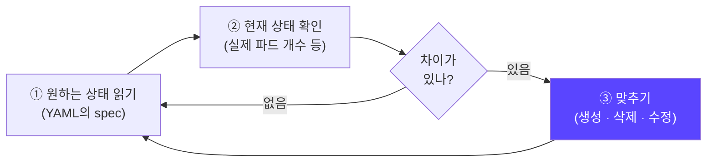
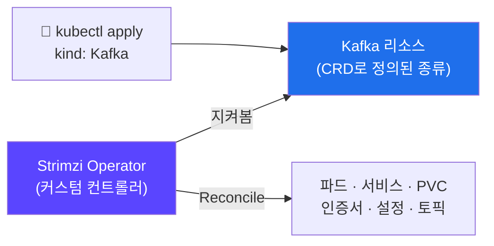
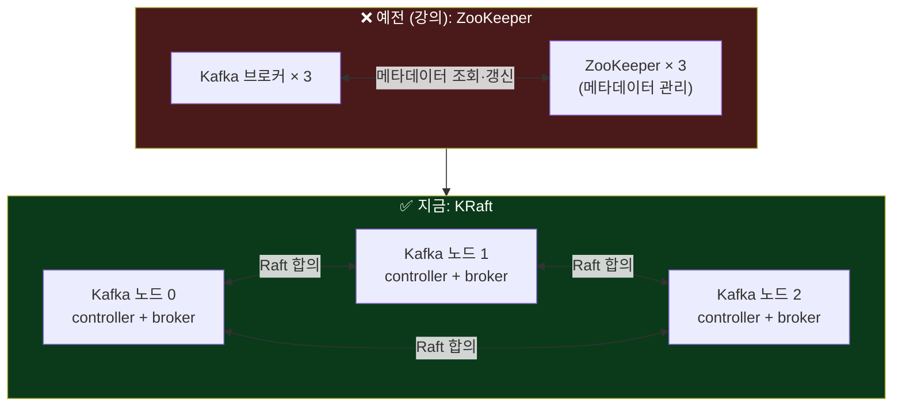
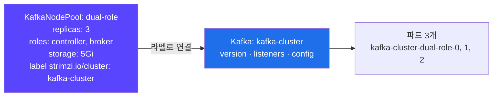
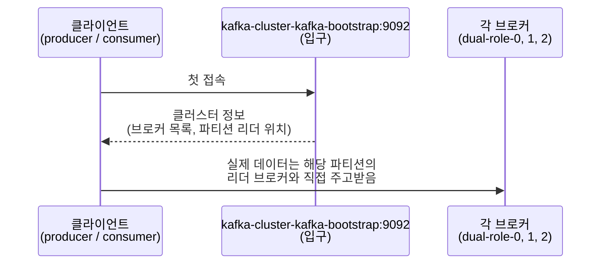
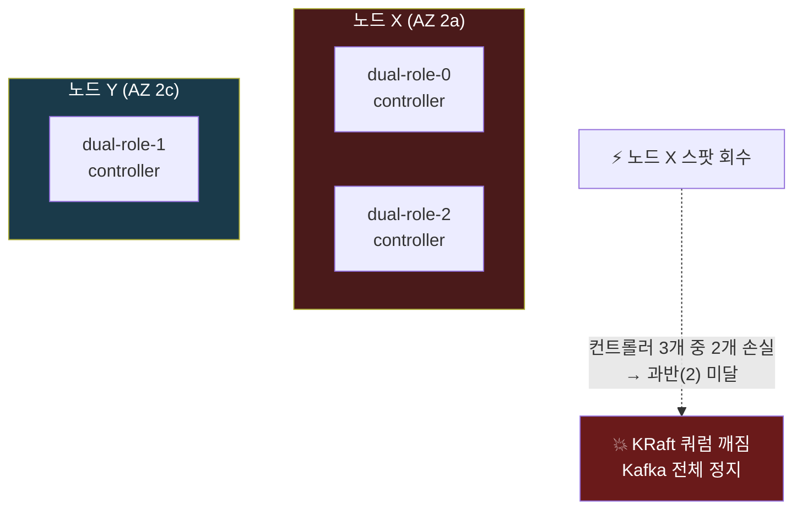
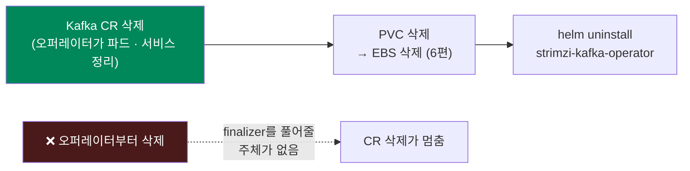

## 📚 들어가며

[13편](/posts/EKS-Rebuild-13-Helm-Redis-Bitnami-Image-Policy/)에서 Helm으로 Redis를 설치했다. 이번 편은 데이터 계층의 두 번째, **Kafka**다. 그런데 이번엔 Helm 차트로 Kafka를 바로 설치하지 않는다. **Operator**라는 걸 먼저 설치하고, Operator에게 "Kafka를 이렇게 만들어줘"라고 선언한다.

그리고 이번에도 강의와의 시간 차이가 크게 작용했다.

| | 강의 | 이번 (2026년 10월) |
|---|---|---|
| Strimzi (Kafka Operator) | 0.39.0 | **1.2.0** |
| Kafka | 3.6.1 | **4.3.1** |
| 메타데이터 관리 | ZooKeeper | **KRaft** |
| API | `v1beta2` | **`v1`** |

**ZooKeeper도, `v1beta2` API도 모두 사라져서 강의의 Kafka YAML을 그대로 쓸 수 없다.** 강의 따라 했더니 에러 → 왜 바뀌었나 → 새 방식으로 다시 쓰기, 이 흐름이 이번 편의 핵심이다.

처음 보는 사람도 읽을 수 있게 Operator, 컨트롤러, CRD, KRaft, KafkaNodePool, ISR 같은 개념을 기초부터 설명했다.

> **이번 편 학습 지도**
>
> ```
> 개념 (1·3장)                 버전 (2장)                설치·작성 (4~5장)          운영 (6~8장)
> ────────────                 ──────────                ─────────────────          ────────────
> 컨트롤러 = Reconcile 루프     1.3.0이 아니라 1.2.0       오퍼레이터 = CRD + 컨트롤러  토픽도 리소스로
> CRD = 새 리소스 종류          강의 YAML이 세 군데서 깨짐  crds/는 install 때만        StatefulSet이 아니다
> Operator = 둘의 묶음          ZooKeeper · v1beta2 제거   KafkaNodePool로 분리        노드 쏠림 = 쿼럼 위험 🔦
> ZooKeeper → KRaft                                     min.insync.replicas = 2     오퍼레이터가 살아 있을 때 삭제
> ```

---

## 1. Operator란?

### 1-1. 정의

강의 슬라이드는 이렇게 정의한다.

> 특정 애플리케이션을 관리하기 위한 **커스텀 컨트롤러**. 애플리케이션에 특화된 **CRD**를 사용해서 설치, 스케일링, 업데이트, 자동 복구 같은 작업을 자동으로 실행한다.

이 정의를 이해하려면 먼저 "컨트롤러"와 "CRD"가 뭔지 알아야 한다.

### 1-2. 컨트롤러 — 쿠버네티스가 일하는 방식

쿠버네티스의 모든 기능은 **"원하는 상태(desired state)"와 "현재 상태(current state)"를 비교해서 차이를 메우는 루프**로 동작한다. 이 루프를 도는 프로그램이 **컨트롤러**다.



예를 들어 Deployment에 `replicas: 3`을 쓰면, Deployment 컨트롤러가 파드가 3개인지 계속 확인하고 하나가 죽으면 새로 띄운다. 이 "맞추는 작업"을 **Reconcile(조정)** 이라고 부른다. 5장에서 볼 Strimzi 로그에도 `Reconciliation #1`처럼 이 단어가 그대로 나온다.

사실 이 시리즈에서 이미 여러 컨트롤러를 봤다. 5편의 LB Controller는 Ingress를 보고 ALB를 맞추고, 7~8편의 Karpenter는 Pending 파드를 보고 노드를 맞춘다. 전부 같은 루프다.

### 1-3. CRD — 쿠버네티스에 새 리소스 종류를 추가하기

Pod, Deployment, Service는 쿠버네티스에 원래 있는 리소스다. **CRD(Custom Resource Definition)** 는 여기에 `Kafka`, `InnoDBCluster` 같은 **새로운 종류를 추가하는 설계도**다. CRD를 설치하면 `kubectl get kafka`처럼 기본 리소스와 똑같이 다룰 수 있다.

이 시리즈에서도 CRD를 여러 번 썼다.

- 4편: SealedSecrets의 `SealedSecret`
- 7~8편: Karpenter의 `NodePool`, `EC2NodeClass`
- 13편: 아직 없어서 못 켠 Prometheus Operator의 `ServiceMonitor`

### 1-4. Operator = CRD + 그 CRD를 처리하는 컨트롤러

CRD만 있으면 `kubectl apply`로 객체를 저장할 수는 있지만 **아무 일도 일어나지 않는다.** 그 객체를 보고 실제로 일하는 컨트롤러가 있어야 한다. **Operator는 이 두 개를 묶은 것**이다.



| | 일반 컨트롤러 (Deployment 등) | Operator |
|---|---|---|
| 다루는 리소스 | 쿠버네티스 기본 리소스 | 앱 전용 커스텀 리소스 (Kafka, MySQL…) |
| 아는 것 | "파드를 N개 유지" 같은 범용 규칙 | "Kafka 브로커는 어떤 순서로 재시작해야 안전한가" 같은 **앱 운영 지식** |
| 만든 사람 | 쿠버네티스 | 앱 벤더나 커뮤니티 (Strimzi, Oracle 등) |

핵심은 **"사람 운영자(Operator)가 하던 일을 코드로 옮겼다"** 는 점이다. Kafka 클러스터를 손으로 운영하면 브로커 설정, 인증서 발급, 롤링 재시작 순서, 장애 복구를 사람이 챙겨야 한다. Operator를 쓰면 `Kafka` 리소스 하나를 선언하고 나머지는 Operator가 알아서 한다.

12편에서 "Helm 차트를 쓰면 남들이 쌓은 운영 감각을 물려받는다"고 썼다. Operator는 한 단계 더 나간다. 차트는 **설치할 때의 구성**을 물려주지만, Operator는 **설치 후 계속 돌면서 운영까지** 대신한다.

### 1-5. OperatorHub와 성숙도 레벨

[operatorhub.io](https://operatorhub.io)에서 다양한 Operator를 찾을 수 있다. 강의는 **Level 4(Deep Insights) 이상의 Operator를 쓰라고** 권한다.

| Level | 이름 | 할 수 있는 것 |
|:---:|---|---|
| 1 | Basic Install | 설치 |
| 2 | Seamless Upgrades | 업그레이드 |
| 3 | Full Lifecycle | 백업, 장애 복구 |
| 4 | Deep Insights | 메트릭, 알림, 로그 분석 |
| 5 | Auto Pilot | 자동 스케일링, 자동 튜닝 |

> 레벨 이름은 OperatorHub의 Capability Level 기준이다. 슬라이드에는 "Level 4 - Deep Insights, Auto Pilot 이상"이라고만 적혀 있어서, 표는 일반적인 정의로 보충했다.

---

## 2. 버전 고르기 — 강의 이후 Strimzi가 크게 바뀌었다

설치하기 전에 GitHub 릴리스와 CHANGELOG로 현재 버전을 확인했다(2026-10-21 기준).

| 버전 | 출시 | 지원 k8s | 지원 Kafka |
|---|---|---|---|
| 1.3.0 (최신) | 2026-10-12 | 1.32 이상 | 4.2.0 ~ 4.3.1 |
| **1.2.0 ← 선택** | 2026-08-20 | 1.30 이상 | 4.2.0 ~ 4.3.1 (기본 4.3.1) |
| 0.39.0 (강의) | 2024년 초 | — | 3.6.1 사용 |

**1.2.0을 고른 이유**: 1.3.0은 나온 지 9일 된 `.0` 릴리스였고, 1.2.0은 두 달 동안 패치 없이 쓰였다. 지원하는 Kafka 범위도 같아서 1.3.0을 고를 이점이 크지 않았다. 7편에서 Karpenter를 1.15.0이 아니라 1.14.1로 고른 것과 같은 기준이다 — **너무 새것도 의심한다.**

### 강의 이후 바뀐 것 — 강의 YAML이 세 군데서 깨진다

| 변경 | 언제 | 영향 |
|---|---|---|
| **ZooKeeper 지원 제거** | Strimzi 0.46.0 | `spec.zookeeper` 블록을 못 쓴다. **KRaft 모드**로 바꿔야 한다 |
| **`v1beta2` API 제거** | Strimzi 1.0.0 | `apiVersion: kafka.strimzi.io/v1`로 바꿔야 한다 |
| **Kafka 3.x → 4.x** | — | 3.6.1은 지원 목록에 없다. Kafka 4.0부터 Kafka 자체에서도 ZooKeeper가 빠졌다 |

받아둔 1.2.0 차트의 Kafka CRD 파일을 열어보면, 제공하는 API 버전이 **`v1` 하나뿐**이다. 그래서 강의의 `v1beta2`를 그대로 쓰면 13편 부록의 Karpenter와 **같은 종류의 에러**가 난다.

```
no matches for kind "Kafka" in version "kafka.strimzi.io/v1beta2"
```

13편에서 정리한 판단 흐름 그대로다. CRD는 있는데(**오퍼레이터를 설치했으니까**) **그 버전이 없는** 경우다.

---

## 3. KRaft와 KafkaNodePool

### 3-1. ZooKeeper → KRaft

Kafka 클러스터에는 "어떤 브로커가 살아 있는지", "각 파티션의 리더가 누구인지" 같은 **메타데이터**가 있다. 이걸 누가 관리하느냐가 바뀌었다.



| | 예전 (강의) | 지금 (KRaft) |
|---|---|---|
| 메타데이터 관리 | 별도의 **ZooKeeper** 클러스터 | Kafka 노드 중 일부가 **컨트롤러** 역할을 맡아 직접 관리 |
| 구성 | Kafka 3대 + ZooKeeper 3대 = **6파드** | 컨트롤러·브로커 겸용 노드 **3파드** 가능 |
| 운영 | 시스템 두 개(Kafka, ZooKeeper)를 따로 관리 | Kafka 하나만 관리 |

KRaft는 "Kafka Raft"의 줄임말이다. **Raft**는 여러 노드가 투표로 리더를 정하고 같은 데이터를 유지하는 **합의 알고리즘**이다. 그래서 컨트롤러는 **과반(쿼럼)이 살아 있어야** 동작한다. 컨트롤러가 3개면 2개까지는 살아 있어야 한다. 이 점이 7장에서 실제 위험으로 다시 나온다.

### 3-2. KafkaNodePool

강의에서는 `Kafka` 리소스 안에 `replicas: 3`과 `storage`를 직접 적었다. 지금은 이 부분이 **`KafkaNodePool`** 이라는 별도 리소스로 분리됐다.



- 노드 풀 = **역할(controller / broker)과 저장소 설정이 같은 Kafka 노드 묶음**
- `strimzi.io/cluster: <Kafka 이름>` 라벨로 어느 Kafka 클러스터에 속하는지 연결한다
- 풀을 여러 개 만들면 "컨트롤러 전용 3대 + 브로커 전용 5대"처럼 나눌 수도 있다

이름이 Karpenter의 NodePool(8편)과 비슷하지만 다른 개념이다. Karpenter의 NodePool은 **EC2 노드**의 묶음이고, KafkaNodePool은 **Kafka 프로세스(파드)** 의 묶음이다.

---

## 4. Strimzi Operator 설치

### 4-1. 차트 받기

강의는 `helm repo add strimzi https://strimzi.io/charts/`로 저장소를 추가했다. 지금 차트는 **Quay의 OCI 레지스트리**에서 받는다. 7편의 Karpenter처럼 OCI 방식이다.

```bash
cd practice
helm pull oci://quay.io/strimzi-helm/strimzi-kafka-operator --version 1.2.0 --untar
```

13편에서 버전 없이 받았다가 28.3.1이 받아졌던 걸 교훈 삼아, 이번엔 **`--version`을 명시**했다.

### 4-2. values — 바꾼 값은 없다

강의도 이 차트는 기본 values로 설치했다. 지금도 기본값으로 충분해서 values 파일에는 **값 대신 알아둘 기본값만 주석으로** 적었다.

| 기본값 | 의미 |
|---|---|
| `watchNamespaces: []`, `watchAnyNamespace: false` | 오퍼레이터는 **자기가 설치된 네임스페이스(`kafka`)의 Kafka CR만** 지켜본다. 그래서 Kafka CR도 `kafka`에 만들어야 한다 |
| `resources`: requests 200m / 384Mi | 기본으로 requests가 있다. 9편에서 문제였던 BestEffort가 아니다 |
| `replicas: 1` | 오퍼레이터는 Kafka를 "관리"만 한다. 오퍼레이터 파드가 잠깐 죽어도 이미 떠 있는 Kafka는 계속 동작한다 |

세 번째 줄이 Operator의 성격을 잘 보여준다. 오퍼레이터는 Kafka의 **데이터 경로에 있지 않다.** 메시지는 브로커끼리, 클라이언트와 브로커 사이로만 오간다. 오퍼레이터가 죽으면 "새로운 변경"만 반영이 안 될 뿐이다. 7편의 Karpenter도 마찬가지다 — 컨트롤러가 잠깐 죽어도 이미 떠 있는 노드는 그대로다.

> **⚠️ Helm의 `crds/` 폴더는 처음 `install`할 때만 적용된다**
>
> 나중에 `helm upgrade`로 Strimzi 버전을 올려도 **CRD는 옛것 그대로** 남는다. Helm이 CRD 업그레이드를 일부러 안 하기 때문이다(CRD를 잘못 바꾸면 그 종류의 리소스 전체가 영향을 받으니까). 업그레이드할 때는 새 버전의 `crds/`를 `kubectl apply`로 먼저 적용해야 한다. 7편의 Karpenter, 다음에 다룰 MySQL Operator도 마찬가지다.

### 4-3. 설치

```bash
kubectl apply -f ../namespace/namespace-limitrange-kafka.yaml    # 9편의 네임스페이스 + LimitRange
helm install strimzi-kafka-operator -f ci/mydev-values.yaml . -n kafka
kubectl get pods -n kafka                                         # strimzi-cluster-operator Running
kubectl get crd | grep -i kafka                                   # Kafka 관련 CRD 확인
```

9편에서 미리 만들어둔 `kafka` 네임스페이스 파일이 여기서 쓰였다.

CRD가 여러 개 생긴다. 받아둔 1.2.0 차트의 `crds/` 폴더를 보면 이렇다.

| CRD | 용도 |
|---|---|
| `kafkas` | Kafka 클러스터 |
| `kafkanodepools` | Kafka 노드 묶음 (3-2) |
| `kafkatopics`, `kafkausers` | 토픽, 사용자 (6장) |
| `kafkaconnects`, `kafkaconnectors` | Kafka Connect |
| `kafkabridges` | HTTP 브리지 |
| `kafkamirrormaker2s` | 클러스터 간 복제 |
| `kafkarebalances` | 파티션 재분배 (Cruise Control) |
| `strimzipodsets` | **Strimzi 전용 파드 관리 리소스** (6-4) |

강의 때 있던 `kafkamirrormakers`(MirrorMaker 1)는 빠졌고, `strimzipodsets`가 있다. 마지막 줄이 6-4에서 중요해진다.

> 이 차트는 Kafka를 설치하지 않는다. **Kafka를 대신 운영해줄 오퍼레이터와 CRD만 설치한다.** 실제 Kafka는 다음 단계에서 `Kafka` 리소스를 `kubectl apply`하면 오퍼레이터가 만든다. 13편의 Redis는 차트가 곧 Redis였지만, 이번엔 **차트가 "Kafka를 만드는 기계"** 다.

---

## 5. Kafka 클러스터 작성 — 강의 YAML을 새 형식으로

### 5-1. 강의 vs 이번

| 항목 | 강의 (0.39 / Kafka 3.6.1) | 이번 (1.2.0 / Kafka 4.3.1) |
|---|---|---|
| API | `v1beta2` | **`v1`** |
| 메타데이터 관리 | ZooKeeper 3대 | **KRaft** (노드가 컨트롤러 겸임) |
| 브로커 정의 | Kafka CR 안 `replicas` / `storage` | **`KafkaNodePool`** 로 분리 |
| 파드 구성 | Kafka 3 + ZooKeeper 3 = 6개 | 컨트롤러·브로커 겸용 **3개** |
| 볼륨 | 10Gi × 6 | **5Gi × 3** (학습용으로 축소) |
| resources | 없음 | requests 100m / 1Gi, JVM 힙 512m |
| `min.insync.replicas` | 1 (강의 레포 파일 기준) | **2** |
| `inter.broker.protocol.version` | `"3.6"` | 삭제 → **`metadataVersion`** 이 대신함 |
| AZ 분산 | 없음 | **Topology Spread** (11편) |
| 메트릭 | jmxPrometheusExporter + kafkaExporter | **보류** (Prometheus 설치 후 추가) |

> **짚을 점**: 강의 슬라이드에는 `min.insync.replicas: 2`로 나오는데, 강의 레포의 파일에는 `1`로 되어 있다. 이번에는 Strimzi 공식 예제 값이자 슬라이드 값인 **2**를 썼다. 10편 PDB 실습에서도 슬라이드(3)와 레포 파일(1)이 달랐는데, 강의 자료끼리도 이렇게 어긋나는 경우가 있다.

### 5-2. 최종 YAML (주석 줄임)

```yaml
apiVersion: kafka.strimzi.io/v1
kind: KafkaNodePool
metadata:
  name: dual-role
  labels:
    strimzi.io/cluster: kafka-cluster   # 아래 Kafka 리소스 이름과 같아야 연결된다
spec:
  replicas: 3
  roles:
    - controller
    - broker
  storage:
    type: jbod
    volumes:
      - id: 0
        type: persistent-claim
        size: 5Gi                       # storageClass를 안 적으면 기본 클래스(ebs-sc, gp3)
        deleteClaim: false              # Kafka CR을 지워도 PVC는 남는다
        kraftMetadata: shared           # KRaft 메타데이터 로그를 이 볼륨에 같이 저장
  resources:
    requests:
      cpu: 100m
      memory: 1Gi
    limits:
      memory: 1Gi
  jvmOptions:
    -Xms: 512m
    -Xmx: 512m
  template:
    pod:
      topologySpreadConstraints:
        - maxSkew: 1
          topologyKey: topology.kubernetes.io/zone
          whenUnsatisfiable: ScheduleAnyway
          labelSelector:
            matchLabels:
              strimzi.io/pool-name: dual-role
---
apiVersion: kafka.strimzi.io/v1
kind: Kafka
metadata:
  name: kafka-cluster
spec:
  kafka:
    version: 4.3.1
    metadataVersion: 4.3-IV0
    listeners:
      - name: plain
        port: 9092
        type: internal
        tls: false
      - name: tls
        port: 9093
        type: internal
        tls: true
    config:
      offsets.topic.replication.factor: 3
      transaction.state.log.replication.factor: 3
      transaction.state.log.min.isr: 2
      default.replication.factor: 3
      min.insync.replicas: 2
  entityOperator:
    topicOperator: {}
    userOperator: {}
```

### 5-3. 설정별 설명

**① 이름은 바꾸면 안 된다 — `kafka-cluster` / `kafka` 네임스페이스**

강의의 user-server, feed-server, timeline-server가 Kafka를 이 주소로 찾아간다.

```
kafka-cluster-kafka-brokers.kafka.svc.cluster.local:9092   (PLAINTEXT)
```

Strimzi는 서비스 이름을 `<Kafka 이름>-kafka-brokers`로 만든다. 그래서 Kafka 이름은 `kafka-cluster`, 네임스페이스는 `kafka`여야 한다. 13편 4-4의 Redis(`redis-master.redis`)와 똑같은 상황이다 — **다른 앱이 주소로 쓰고 있는 이름은 더 이상 내 맘대로 못 짓는다.**

**② 겸용 노드 3개 (dual-role)**

공식 예제에는 컨트롤러 3 + 브로커 3으로 나눈 구성(`kafka-persistent.yaml`)도 있다. 학습용으로는 겸용 3개(`kafka-with-dual-role-nodes.yaml` 방식)가 **파드 수와 EBS 볼륨 수를 절반**으로 줄인다. 운영에서 부하가 크면 역할을 나눠, 컨트롤러가 브로커 부하에 휘둘리지 않게 한다.

**③ resources와 JVM 힙**

- 강의 레포에는 resources가 없었다. 9편에서 봤듯이 requests가 없으면 BestEffort가 되고 Karpenter가 노드 크기를 제대로 계산하지 못한다.
- Kafka는 **JVM(자바)** 위에서 돈다. 힙 크기를 정하지 않으면 JVM이 컨테이너 메모리 한도를 기준으로 스스로 정하는데, 그러면 Kafka가 성능을 위해 쓰는 **OS 페이지 캐시**에 쓸 여유가 없어질 수 있다. 그래서 힙(512m)을 컨테이너 메모리(1Gi)보다 작게 잡아 여유를 뒀다.

**④ `min.insync.replicas`와 ISR**

- **ISR(In-Sync Replicas)** — 리더의 데이터를 제때 따라잡고 있는 복제본 목록
- **`min.insync.replicas`** — 메시지를 "저장 성공"으로 인정하려면 ISR이 최소 몇 개여야 하는지

| 값 | 의미 | 위험 |
|---|---|---|
| 1 | 리더 하나에만 써져도 성공 | 리더 브로커가 바로 죽으면 메시지를 잃을 수 있다 |
| **2** | 복제본 2개 이상에 써져야 성공 | 브로커 1대가 내려가도(스팟 회수 등) 나머지 2대로 계속 쓸 수 있고 데이터도 지켜진다 |

`replication.factor: 3` + `min.insync.replicas: 2`는 Kafka에서 가장 흔한 조합이다. 10편의 PDB `minAvailable`과 생각하는 방식이 비슷하다 — **"최소 몇 개가 살아 있어야 정상으로 볼 것인가."**

**⑤ `metadataVersion`**

KRaft 메타데이터 형식의 버전이다. ZooKeeper 시절 `inter.broker.protocol.version`이 하던 역할을 대신한다. 나중에 Kafka를 올릴 때는 `version`을 먼저 올리고, 모든 노드가 새 버전으로 뜬 뒤에 `metadataVersion`을 올린다. **메타데이터 버전은 되돌리기 어려워서** 순서를 나눈다.

**⑥ Topology Spread (11편 적용)**

브로커 3개를 AZ마다 하나씩 흩어놓으려는 설정이다. 11편에서 배운 걸 처음으로 실제 앱에 넣었다. `ScheduleAnyway`(가능하면)로 둔 이유는 한 AZ에서 스팟을 못 구해도 Kafka가 아예 못 뜨는 일이 없게 하기 위해서다(11편 2-5의 "고가용성 규칙이 가용성을 해치는 역설"). 단, 한 번 만들어진 PVC는 그 AZ에 묶인다(6편). — 그런데 이 "가능하면"이 7장에서 문제가 된다.

**⑦ Entity Operator**

`KafkaTopic`, `KafkaUser`를 쿠버네티스 리소스로 관리하게 해주는 컴포넌트다. 토픽을 YAML로 선언하면 Topic Operator가 Kafka에 실제 토픽을 만든다. Operator 안에 또 작은 Operator들이 있는 구조다.

**⑧ 메트릭은 보류**

지표를 수집할 Prometheus가 아직 없다. 13편에서 Redis의 `serviceMonitor`를 끈 것과 같은 이유다. 모니터링 스택을 설치할 때 Strimzi 1.2.0 예제(`packaging/examples/metrics/kafka-metrics.yaml`)를 기준으로 추가할 예정이다.

### 5-4. 검증하고 적용

오퍼레이터를 설치하기 전에는 `--dry-run=server`를 쓸 수 없다. 서버에 Kafka CRD가 없으니까(12편 4-1). 그래서 **차트에 들어 있는 CRD 파일과 직접 대조**했다. 7편에서 Karpenter NodePool을 검증할 때 쓴 방법 그대로다. CRD가 제공하는 버전이 `v1` 하나뿐이고 필드에도 문제가 없는 걸 확인했다.

```bash
cd ../kafka
kubectl apply --dry-run=server -f kafka-mydev-persistent.yaml -n kafka   # 오퍼레이터 설치 후엔 서버 검증 가능
kubectl apply -f kafka-mydev-persistent.yaml -n kafka
kubectl get kafka,kafkanodepool,pods,pvc -n kafka -w
```

`Kafka`의 `READY`가 `True`가 되면 완료다. 파드는 `kafka-cluster-dual-role-0~2`(Kafka 노드)와 `kafka-cluster-entity-operator-...`가 뜬다.

강의처럼 오퍼레이터 로그로 진행 상황을 볼 수도 있다. 로그에 `Reconciliation #N ... reconciled`가 찍힌다 — 1-2의 Reconcile 루프가 실제로 도는 모습이다.

```bash
kubectl logs -n kafka deploy/strimzi-cluster-operator -f
```

---

## 6. Kafka 동작 테스트

> 이 장은 **테스트 방법**을 정리한 것이다. 각 명령에서 무엇을 확인하면 되는지를 함께 적었다.

### 6-1. 토픽 만들기 — 오퍼레이터 방식

강의는 프로듀서가 없는 토픽에 메시지를 보내서 자동 생성되게 했다. **Strimzi다운 방식은 토픽도 리소스로 선언하는 것**이다.

```yaml
apiVersion: kafka.strimzi.io/v1
kind: KafkaTopic
metadata:
  name: test-topic
  namespace: kafka
  labels:
    strimzi.io/cluster: kafka-cluster
spec:
  partitions: 3
  replicas: 3
```

```bash
kubectl apply -f kafka-topic-test.yaml
kubectl get kafkatopic -n kafka       # READY=True 확인
```

토픽이 YAML로 남으니 git으로 관리할 수 있다. 자동 생성은 오타 하나로 엉뚱한 토픽이 생겨도 모르고 지나가지만, 선언 방식은 **어떤 토픽이 있어야 하는지가 코드에 남는다.**

### 6-2. 메시지 보내고 받기

터미널 두 개를 연다. 이미지 태그가 강의의 `0.39.0-kafka-3.6.1`에서 **`1.2.0-kafka-4.3.1`** 로 바뀐다.

```bash
# 터미널 1: 프로듀서 (메시지 입력 후 Enter)
kubectl run kafka-producer -n kafka -ti --rm --restart=Never \
  --image=quay.io/strimzi/kafka:1.2.0-kafka-4.3.1 -- \
  bin/kafka-console-producer.sh --bootstrap-server kafka-cluster-kafka-bootstrap:9092 --topic test-topic

# 터미널 2: 컨슈머
kubectl run kafka-consumer -n kafka -ti --rm --restart=Never \
  --image=quay.io/strimzi/kafka:1.2.0-kafka-4.3.1 -- \
  bin/kafka-console-consumer.sh --bootstrap-server kafka-cluster-kafka-bootstrap:9092 --topic test-topic --from-beginning
```



- `kafka-cluster-kafka-bootstrap:9092`는 클라이언트가 **처음 접속하는 입구** 서비스다. 접속하면 클러스터 정보를 받아서, 실제 데이터는 각 브로커와 직접 주고받는다.
- 5-3 ①의 `kafka-cluster-kafka-brokers`는 브로커 하나하나를 직접 가리키는 headless 서비스다. 앱 설정에 따라 둘 중 하나를 쓴다.
- `--rm`이라 Ctrl+C로 끝내면 파드가 지워진다.

터미널 1에 입력한 문장이 터미널 2에 그대로 나오면 성공이다.

### 6-3. 복제 상태 보기

```bash
kubectl exec -n kafka kafka-cluster-dual-role-1 -- \
  bin/kafka-topics.sh --bootstrap-server localhost:9092 --describe --topic test-topic
```

파티션마다 `Leader`(쓰기를 받는 브로커), `Replicas`(복제본 위치), `Isr`(5-3 ④)가 나온다. **정상이면 Isr에 3개가 다 있다.**

### 6-4. 파드 삭제 테스트 — Kafka는 StatefulSet이 아니다

```bash
kubectl get sts -n kafka
# No resources found in kafka namespace.
kubectl delete pod -n kafka kafka-cluster-dual-role-1
```

강의가 짚은 재미있는 점이다. Kafka는 상태가 있는 앱인데 **StatefulSet이 없다.** 13편에서 Redis는 StatefulSet으로 떠 있었는데, Kafka는 다르다. Strimzi는 파드를 **자체 리소스 `StrimziPodSet`** 으로 관리하고, 그 컨트롤러가 지워진 파드를 같은 이름으로 다시 만든다. 4-3 CRD 표의 마지막 줄이 이것이다.

```bash
kubectl get strimzipodset -n kafka   # StatefulSet 대신 이게 있다
```

> **왜 StatefulSet을 안 쓰나?**
>
> StatefulSet은 모든 파드가 같은 설정이어야 하고, 순서대로만 재시작할 수 있다. Kafka는 노드 풀마다 설정이 다를 수 있고, "지금 이 파티션의 리더가 아닌 브로커부터" 같은 **앱 사정에 맞춰** 재시작 순서를 정해야 한다. 그래서 Strimzi가 파드를 직접 관리한다.
>
> 1-4에서 Operator를 "앱 운영 지식을 코드로 옮긴 것"이라고 했는데, 여기서 그게 구체적으로 보인다. **범용 컨트롤러(StatefulSet)로는 부족한 운영 지식이 있어서 아예 자기 컨트롤러를 만든 것**이다.

`min.insync.replicas: 2`라서 브로커 1대를 지워도 메시지가 계속 오가야 한다. 6-3 명령을 다시 실행하면 **Isr이 잠깐 2개로 줄었다가 돌아오는** 것을 볼 수 있다.

---

## 7. 🔦 주의: Kafka 노드가 한 노드에 몰렸다

> 강의에는 없는 내용이다. 테스트 전에 상태를 직접 확인하다가 발견했다.

```bash
kubectl get pods -n kafka -o wide -l strimzi.io/pool-name=dual-role
```

확인해보니 **Kafka 노드 3개 중 2개(`dual-role-0`, `-2`)가 같은 노드(2a)에 있었다.**



- **원인**: 고정 노드가 2대뿐이고, Topology Spread를 `ScheduleAnyway`(가능하면)로 걸었기 때문이다. 스케줄러는 AZ 2개에만 노드가 있으니 2:1로 나누는 걸 "가능한 한 고르게"로 받아들였다(11편 2-3의 "노드가 없는 AZ는 계산에 안 들어간다").
- **위험**: 그 노드 하나가 스팟 회수로 사라지면 컨트롤러 3개 중 2개를 잃는다. **KRaft 쿼럼(과반)이 깨져서 Kafka 전체가 멈춘다**(3-1).
- 그래서 파드 삭제 테스트는 **한 번에 하나만** 해야 한다. 같은 노드의 `-0`과 `-2`를 같이 지우면 쿼럼이 깨진다.

`min.insync.replicas: 2`로 **데이터**는 브로커 1대 손실에 대비했는데, **메타데이터(컨트롤러)** 는 배치 때문에 노드 1대 손실에도 무너질 수 있는 상태였던 것이다. 설정값만 보고 안심하면 안 되고, **실제로 어디에 떴는지**를 봐야 한다.

해결 방법은 두 가지가 있다. 학습 중이라 아직 적용하지는 않았다.

| 방법 | 효과 | 대가 |
|---|---|---|
| `whenUnsatisfiable: DoNotSchedule`로 바꾸기 | "반드시" 흩어짐. 자리가 없으면 Pending → Karpenter가 다른 AZ에 노드를 띄움 (11편 2-5) | 스팟을 못 구하면 Kafka가 못 뜰 수 있음 |
| Kafka를 3개 AZ의 Karpenter 노드(`multiaz` 풀)로 보내기 | toleration + nodeAffinity로 세 AZ가 열린 풀에 배치 (11편, 13편 부록) | Karpenter 노드 비용, 노드 교체 시 브로커 재시작 |

11편에서 "고가용성 규칙은 못 지킬 때 어떻게 될지까지 정해야 한다"고 썼는데, 이번엔 반대로 **"가능하면"으로 느슨하게 둔 대가**를 본 셈이다. 엄격하게 걸면 못 뜰 위험, 느슨하게 걸면 몰릴 위험. 둘 중 무엇을 감수할지는 그 앱이 무엇을 잃으면 안 되는지로 정해야 한다.

---

## 8. 정리할 때

`deleteClaim: false`라서 Kafka CR을 지워도 **PVC 3개가 남는다.** 13편의 StatefulSet PVC와 같은 문제다.

```bash
kubectl delete kafka --all -n kafka        # 오퍼레이터가 살아 있을 때 지운다
kubectl delete pvc --all -n kafka
```



> **오퍼레이터가 관리하는 리소스는 오퍼레이터가 살아 있을 때 지운다.** 오퍼레이터부터 지우면, CR에 걸린 finalizer(삭제 전 정리 작업 표시)를 풀어줄 주체가 없어서 삭제가 멈출 수 있다.
>
> 5편부터 반복된 원칙의 또 다른 버전이다. Ingress는 LB Controller가 살아 있을 때(5편), NodePool은 Karpenter가 살아 있을 때(8편), Kafka는 Strimzi가 살아 있을 때 지운다. **만든 주체가 살아 있을 때, 그 주체에게 정리를 맡긴다.**

---

## 📝 이번 편 요약

```
Operator
├─ 컨트롤러 = 원하는 상태와 현재 상태를 맞추는 루프 (Reconcile)
├─ CRD = 쿠버네티스에 새 리소스 종류를 추가하는 설계도
├─ Operator = CRD + 그 CRD를 처리하는 컨트롤러 = 사람의 운영 지식을 코드로
└─ OperatorHub Capability Level — 강의 권장은 Level 4 이상

버전 (강의 YAML이 깨지는 세 곳)
├─ Strimzi 0.46: ZooKeeper 제거 → KRaft
├─ Strimzi 1.0: v1beta2 제거 → v1 (no matches for kind 에러)
└─ Kafka 4.x: 3.6.1 미지원. 1.3.0(9일 차)이 아니라 1.2.0 선택

KRaft와 KafkaNodePool
├─ 메타데이터를 Kafka 노드(컨트롤러)가 직접 관리. 과반(쿼럼)이 살아 있어야 동작
└─ replicas · roles · storage는 KafkaNodePool로 분리, 라벨로 Kafka와 연결

설치와 작성
├─ 차트 = 오퍼레이터 + CRD (Kafka를 만드는 기계). crds/는 install 때만 적용
├─ 이름 고정: kafka-cluster / kafka (앱이 주소로 씀)
├─ RF 3 + min.insync.replicas 2 = 브로커 1대 손실에도 데이터 보호
└─ JVM 힙 < 컨테이너 메모리 (페이지 캐시 여유)

운영
├─ 토픽도 KafkaTopic 리소스로 선언
├─ StatefulSet이 아니라 StrimziPodSet (앱에 맞춘 재시작 순서)
├─ 🔦 컨트롤러 2개가 한 노드에 → 노드 1대 손실로 쿼럼 붕괴 가능
└─ 삭제는 오퍼레이터가 살아 있을 때, PVC는 따로
```

| 개념 | 한 줄 정의 |
|---|---|
| **컨트롤러 / Reconcile** | 원하는 상태와 현재 상태를 비교해 맞추는 루프 / 그 맞추는 작업 |
| **CRD** | 쿠버네티스에 새로운 리소스 종류를 추가하는 정의 |
| **Operator** | 특정 앱 전용 CRD + 그걸 처리하는 커스텀 컨트롤러 |
| **KRaft** | ZooKeeper 없이 Kafka 노드가 Raft 합의로 메타데이터를 직접 관리하는 방식 |
| **쿼럼** | 합의가 동작하려면 살아 있어야 하는 과반수 |
| **KafkaNodePool** | 역할·저장소 설정이 같은 Kafka 노드 묶음. 라벨로 Kafka와 연결 |
| **ISR** | 리더를 제때 따라잡고 있는 복제본 목록 |
| **`min.insync.replicas`** | 쓰기를 성공으로 인정하는 데 필요한 최소 ISR 수 |
| **`metadataVersion`** | KRaft 메타데이터 형식 버전. 업그레이드는 Kafka 버전 다음에 |
| **StrimziPodSet** | StatefulSet 대신 Strimzi가 Kafka 파드를 직접 관리하는 리소스 |

---

## 💭 느낀 점

**1. "컨트롤러"라는 단어 하나로 지금까지가 정리됐다.**

LB Controller, Karpenter, EBS CSI 컨트롤러, 그리고 이번 Strimzi. 이 시리즈에서 만난 것들이 전부 **"원하는 상태와 현재 상태를 맞추는 루프"** 였다. 처음엔 각자 다른 도구로 보였는데, Operator를 공부하면서 같은 원리의 변주라는 게 보였다. 쿠버네티스를 "YAML을 적용하는 도구"가 아니라 **"수많은 Reconcile 루프의 집합"** 으로 보게 된 게 이번 편의 가장 큰 수확이다.

**2. 강의 YAML이 세 군데서 동시에 깨졌다.**

ZooKeeper 제거, API 버전 제거, Kafka 메이저 업그레이드. 13편의 Redis는 이미지 태그 하나였는데, 이번엔 **아키텍처 자체**가 바뀌어 있었다. ZooKeeper 블록을 지우고 KafkaNodePool로 나누는 건 "값을 고치는" 수준이 아니라 **구성을 다시 설계하는** 일이었다. 그래도 7편 Karpenter, 13편 부록에서 v1beta1 → v1을 한 번 겪어서인지, `no matches for kind`를 보자마자 "버전이 없구나"를 떠올릴 수 있었다.

**3. 설정값이 안전하다고 배치가 안전한 건 아니었다.**

`min.insync.replicas: 2`, 브로커 3대, Topology Spread까지 걸어서 꽤 튼튼하게 만들었다고 생각했다. 그런데 `kubectl get pods -o wide`를 보니 컨트롤러 2개가 한 노드에 있었다. **노드 하나만 사라져도 Kafka 전체가 멈추는** 상태였다. 11편에서 "고가용성 규칙이 가용성을 해칠 수 있다"고 썼는데, 이번엔 반대로 규칙을 느슨하게 둬서 생긴 위험이다. 결국 **설정을 믿지 말고 결과를 확인해야** 한다.

**4. "만든 주체가 살아 있을 때 지운다"가 Operator에서도 반복됐다.**

5편 Ingress, 6편 PVC, 8편 NodePool, 13편 StatefulSet, 그리고 이번 Kafka CR. 도구는 계속 바뀌는데 정리 원칙은 하나다. 이 시리즈에서 가장 많이 반복된 교훈이고, 이제는 새 도구를 깔 때마다 **"이건 지울 때 누가 정리하지?"** 를 먼저 묻게 된다.

---

## 🔗 다음 편 예고

15편은 이번 Kafka 설치 **직후에 겪은 장애**다. Kafka, Redis, external-dns 파드 3개가 **동시에 CrashLoopBackOff**가 났다. 헬스체크 문제처럼 보였던 원인은 사실 **Karpenter 노드와 고정 노드의 보안 그룹이 갈라져 있던 것**이었다.

---

## 📚 참고

- [Strimzi 공식 문서](https://strimzi.io/docs/operators/latest/overview)
- [strimzi/strimzi-kafka-operator Releases](https://github.com/strimzi/strimzi-kafka-operator/releases) — 1.2.0(2026-08-20), 1.3.0(2026-10-12)
- [Strimzi 예제 — kafka-with-dual-role-nodes.yaml](https://github.com/strimzi/strimzi-kafka-operator/tree/main/packaging/examples/kafka)
- [Kubernetes — Operator pattern](https://kubernetes.io/docs/concepts/extend-kubernetes/operator/)
- [Kubernetes — Custom Resources (CRD)](https://kubernetes.io/docs/concepts/extend-kubernetes/api-extension/custom-resources/)
- [Helm — Custom Resource Definitions (crds/ 디렉토리의 한계)](https://helm.sh/docs/chart_best_practices/custom_resource_definitions/)
- [OperatorHub.io](https://operatorhub.io)

> 2장의 버전·출시일은 GitHub 릴리스로, 4-3의 CRD 목록과 2장의 API 버전은 받아둔 1.2.0 차트의 `crds/` 파일로 확인했다. 6장은 테스트 방법을 정리한 것이고, 7장의 노드 쏠림은 내 클러스터에서 직접 확인한 상태다. 1-5의 레벨 표는 OperatorHub의 일반적인 Capability Level 정의로 보충했다.
