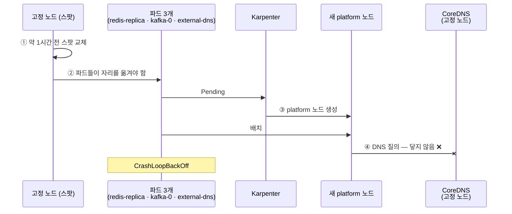
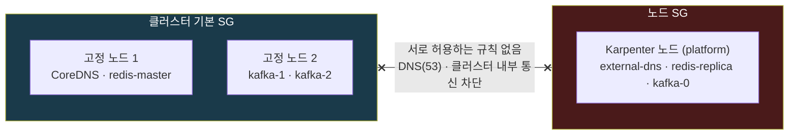
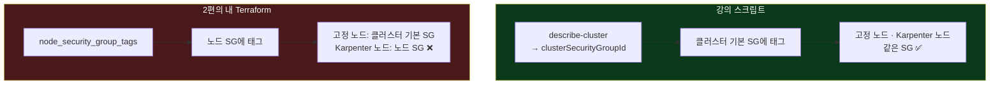
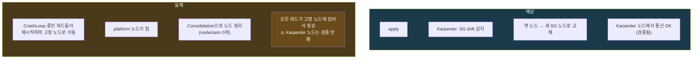

## 📚 들어가며

[14편](/posts/EKS-Rebuild-14-Operator-Strimzi-Kafka-KRaft/)에서 Kafka를 설치한 바로 그날, 장애가 났다. **Kafka, Redis, external-dns 파드 3개가 동시에 `CrashLoopBackOff`** 에 빠졌다.

처음엔 헬스체크 설정 문제로 보였다. 그런데 하나씩 좁혀보니 진짜 원인은 전혀 다른 곳에 있었다. **Karpenter가 띄운 노드와 고정 노드가 서로 다른 보안 그룹을 쓰고 있어서, 네트워크가 둘로 갈라져 있었다.** 그리고 그 원인은 2편에서 강의 스크립트를 Terraform으로 옮기면서 **내가 놓친 한 줄**이었다.

이번 편은 강의에 없는 장애의 트러블슈팅 기록이다.


처음 보는 사람도 읽을 수 있게 보안 그룹의 자기 참조 규칙, EKS의 두 가지 보안 그룹, Karpenter가 보안 그룹을 고르는 방식, drift를 설명했다.

---

## 1. 증상

`kubectl get po -A`를 했더니 파드 3개가 `CrashLoopBackOff`였다.

| 파드 | 네임스페이스 |
|---|---|
| external-dns | kube-system |
| redis-replicas-N | redis |
| kafka-cluster-dual-role-0 | kafka |

`kubectl describe`를 보면 **헬스체크(liveness/readiness probe) 실패**로 재시작을 반복하고 있었다. 처음엔 "헬스체크 설정이 잘못됐나?"라고 생각했다. 14편에서 막 설치한 Kafka까지 끼어 있으니 더 그렇게 보였다.

---

## 2. 원인 좁히기

### 2-1. 로그가 말해준 것 — 전부 DNS 실패

헬스체크가 실패한 **이유**를 보려고 각 파드의 로그를 봤다.

```bash
kubectl logs -n kube-system deploy/external-dns --previous
kubectl logs -n redis redis-replicas-N --previous
kubectl logs -n kafka kafka-cluster-dual-role-0 --previous
```

> `--previous`: CrashLoop 중인 파드는 **방금 죽은 컨테이너**의 로그를 봐야 원인이 나온다. 그냥 `logs`를 하면 막 다시 뜬 컨테이너의 시작 로그만 보인다.

| 파드 | 로그 |
|---|---|
| external-dns | `lookup api.cloudflare.com: i/o timeout` |
| redis | `Unable to connect to MASTER redis-master-0.redis-headless...` |
| kafka | `UnknownHostException: kafka-cluster-dual-role-1...` |

**세 개 모두 이름 조회(DNS)에 실패**하고 있었다.

- external-dns는 Cloudflare API 주소를 못 찾아서 프로세스가 죽었다.
- Redis replica는 master를, Kafka 0번은 동료 노드를 못 찾아서 준비 상태가 되지 못했고, 그래서 헬스체크에 실패했다.

**헬스체크는 원인이 아니라 결과**였다.

> **교훈**: probe 실패는 "앱이 건강하지 않다"는 신호일 뿐이다. **왜** 건강하지 않은지는 `describe`가 아니라 **로그**에 있다.

2편에서 "에러 메시지가 가리키는 계층을 먼저 보라"고 정리했었다. 이번엔 `describe`의 "probe 실패"가 **앱 계층**을 가리키는 것처럼 보였지만, 로그의 `i/o timeout`과 `UnknownHostException`은 **네트워크 계층**을 가리키고 있었다.

### 2-2. 공통점 — 셋 다 같은 노드에 있었다

서로 다른 앱 셋이 **동시에** 같은 종류의 에러를 낸다면, 앱이 아니라 그 앱들이 공유하는 무언가가 문제일 가능성이 높다.

```bash
kubectl get pods -A -o wide | grep -vE 'Running|Completed'
kubectl get nodes -L karpenter.sh/nodepool
```

세 파드는 모두 **Karpenter가 띄운 `platform` 노드** 위에 있었다. 시간 순으로 정리하면 이렇다.



1. 약 1시간 전, 고정 노드 1대(스팟)가 교체됐다. 3편부터 봐온 스팟의 일상이다.
2. 그 위에 있던 Redis replica, Kafka 0번, external-dns가 자리를 옮겨야 했다.
3. 고정 노드에 자리가 모자라서 Karpenter가 `platform` 노드를 새로 띄웠고(8편), 세 파드가 그쪽으로 갔다.
4. 그 노드의 파드들은 **고정 노드에 있는 CoreDNS에 닿지 못했다.**

**지금까지 문제가 안 보였던 이유**: 8편의 busybox 같은 테스트 파드는 `sleep inf`만 했지 네트워크를 쓰지 않았다. Redis·Kafka는 이번 교체 전까지 고정 노드에만 있었다. **Karpenter 노드에서 다른 노드와 통신하는 파드가 처음 생긴 것**이다. 버그는 2편부터 있었는데, 그걸 밟는 조건이 이제야 갖춰진 셈이다.

---

## 3. 근본 원인: 보안 그룹이 둘로 갈라져 있었다

### 3-1. 보안 그룹과 "자기 참조" 규칙

**보안 그룹(Security Group, SG)** 은 EC2에 붙는 가상 방화벽이다. 규칙의 출발지로 IP 대역뿐 아니라 **다른 SG**를 지정할 수 있다. 그래서 "이 SG가 붙은 인스턴스끼리는 서로 통신 허용"처럼 **자기 자신을 출발지로 쓰는 규칙(자기 참조, self)** 이 흔하다.

EKS 노드 SG들도 이 방식이다. Terraform EKS 모듈이 만드는 노드 SG의 규칙을 열어보면 이렇다.

```hcl
ingress_self_coredns_tcp = {
  description = "Node to node CoreDNS"
  from_port   = 53
  to_port     = 53
  self        = true      # ← 같은 SG를 단 인스턴스에서 온 것만
}
ingress_nodes_ephemeral = {
  description = "Node to node ingress on ephemeral ports"
  from_port   = 1025
  to_port     = 65535
  self        = true
}
```

이 규칙은 **같은 SG를 단 인스턴스끼리만** 통하게 한다. 그러니 노드마다 **다른 SG**가 붙으면 서로 막힌다.

### 3-2. EKS의 두 가지 SG

EKS 클러스터에는 이름이 비슷한 SG가 두 개 있다.

| SG | 누가 만드나 | 이름 예 |
|---|---|---|
| **클러스터 기본 SG** (cluster primary SG) | **EKS가** 클러스터를 만들 때 자동 생성 | `eks-cluster-sg-mydev-<숫자>` |
| **노드 SG** | **Terraform EKS 모듈이** 생성 | `mydev-node-<숫자>` |

### 3-3. 실제 상태 — 두 섬

| 노드 | 붙은 SG | 허용 범위 |
|---|---|---|
| 고정 노드 2대 | **클러스터 기본 SG** | 같은 SG끼리만 전부 허용 |
| Karpenter 노드 | **노드 SG** | 같은 SG끼리만 DNS·포트 허용 |



서로 상대 SG에서 오는 트래픽을 허용하는 규칙이 없어서, 두 노드 그룹이 **섬처럼 분리**돼 있었다. CoreDNS는 고정 노드에 있으니, Karpenter 노드의 파드는 DNS 서버에 닿을 수 없었다.

(그림은 설명용으로 단순화한 것이다. 실제 SG 규칙에는 컨트롤 플레인과의 통신 같은 다른 규칙도 섞여 있다.)

### 3-4. 왜 이렇게 됐나 — 2편에서 Terraform으로 옮기면서 놓친 부분

**① 고정 노드는 왜 클러스터 기본 SG만 쓰나**

2편에서 관리형 노드 그룹에 `use_custom_launch_template = false`를 줬다. AWS 기본 시작 템플릿을 쓰겠다는 뜻이다. 이 경우 노드에는 **EKS 클러스터 기본 SG만** 붙고, 모듈이 만든 노드 SG는 붙지 않는다. 모듈의 노드 SG는 **모듈이 만드는 커스텀 시작 템플릿을 통해서만** 노드에 붙기 때문이다.

**② Karpenter는 왜 노드 SG를 골랐나**

Karpenter는 `EC2NodeClass`의 `securityGroupSelectorTerms`에 적힌 태그로 SG를 찾는다(8편 1-2).

```yaml
securityGroupSelectorTerms:
- tags:
    karpenter.sh/discovery: mydev
```

그리고 2편에서 "강의 스크립트가 손으로 하던 태깅을 Terraform으로 미리 해두자"며 이 태그를 **모듈의 노드 SG**에 달았다.

```hcl
node_security_group_tags = {
  "karpenter.sh/discovery" = local.name
}
```

**③ 강의는 어디에 달았나**

강의 레포의 `karpenter/karpenter.sh`를 다시 열어봤다. 태그를 단 대상이 이거였다.

```bash
SECURITY_GROUPS=$(aws eks describe-cluster --name ${CLUSTER_NAME} \
    --query "cluster.resourcesVpcConfig.clusterSecurityGroupId" --output text)
aws ec2 create-tags --tags "Key=karpenter.sh/discovery,Value=${CLUSTER_NAME}" \
    --resources ${SECURITY_GROUPS}
```

`clusterSecurityGroupId`, 즉 **클러스터 기본 SG**였다. 그대로 따랐어야 했다.



2편에서 이 줄을 쓸 때는 "강의가 손으로 하던 걸 코드로 미리 해뒀다"고 꽤 뿌듯해했다. 7편에서도 "2편에서 미리 깔아둔 길잡이 표식"이라고 소개했다. **하는 일(태그 달기)은 맞게 옮겼는데, 대상(어느 SG에)을 잘못 옮긴 것**이다.

> **교훈**: 강의의 수작업 스크립트를 IaC로 옮길 때는 "**무엇을** 하는지"뿐 아니라 "**어느 리소스에** 하는지"까지 정확히 대응시켜야 한다. 이름이 비슷한 리소스(노드 SG vs 클러스터 SG)가 있으면 특히 그렇다.

---

## 4. 해결 방법 고르기

| 방법 | 장점 | 단점 |
|---|---|---|
| **① 클러스터 기본 SG에 태그를 달고 노드 SG 태그 제거** ← 선택 | 강의와 같은 구조. 고정 노드는 바뀌지 않음 | — |
| ② 고정 노드 그룹을 `use_custom_launch_template = true`로 | 모든 노드가 노드 SG를 쓰게 됨. 4편에서 보류한 IMDS hop limit 문제도 같이 해결 가능 | 고정 노드가 교체되는 큰 변경 |
| ③ 두 SG 사이에 서로 허용 규칙 추가 | 빠름 | 구조적인 원인은 그대로 남음 |

②는 매력적이었다. 4편에서 `vpcId`를 하드코딩하게 만든 IMDS hop limit까지 한 번에 풀 수 있기 때문이다. 하지만 지금은 장애를 고치는 중이라 **변경 범위가 가장 작은 ①**을 골랐다. ③은 증상만 덮는다 — 다음에 또 다른 SG 조합이 생기면 같은 일이 반복된다.

---

## 5. 수정

### 5-1. `karpenter.tf` — 클러스터 기본 SG에 태그 하나 추가

```hcl
resource "aws_ec2_tag" "cluster_primary_sg_karpenter_discovery" {
  resource_id = module.eks.cluster_primary_security_group_id
  key         = "karpenter.sh/discovery"
  value       = local.name
}
```

**왜 `aws_ec2_tag`인가?** 클러스터 기본 SG는 Terraform이 아니라 **EKS가 만든다.** Terraform은 그 SG 자체를 관리하지 않으니, **태그 하나만** 별도 리소스로 관리한다. `aws_ec2_tag`는 "남이 만든 리소스에 태그 하나만 붙이는" 리소스다. 5편부터 반복해온 "누가 만들었나"의 구분이 여기서도 나온다 — SG는 EKS 것, 태그는 내 것.

**왜 모듈 전체 `tags`에 넣지 않나?** 그러면 VPC, 노드 SG 등 모든 리소스에 태그가 붙어서 discovery 태그가 **여러 SG에** 달린다. 8편 1-2에서 썼듯 **Karpenter는 태그가 달린 SG를 전부 노드에 붙이므로**, discovery 태그는 SG 하나에만 다는 게 원칙이다.

### 5-2. `main.tf` — 노드 SG의 태그 삭제

`node_security_group_tags` 블록을 지우고, 그 자리에 이번 증상과 원인을 **주석으로** 남겼다.

```hcl
# [삭제] node_security_group_tags = { "karpenter.sh/discovery" = local.name }
# (이유: 고정 노드는 클러스터 기본 SG만 쓰는데 Karpenter 노드만 노드 SG를 써서
#  두 노드 그룹 간 DNS가 막혔다. 태그는 karpenter.tf 에서 클러스터 기본 SG에 단다.)
```

나중에 누군가(아마 미래의 나) 이 블록이 왜 없는지 궁금해할 때를 위해서다.

### 5-3. plan으로 변경 범위 확인

```bash
terraform plan
# Plan: 1 to add, 3 to change, 0 to destroy.
```

**1개 추가, 3개 변경.** 예상은 "1 추가, 1 변경"이었다. 숫자가 맞지 않아서 하나씩 확인했다.

| 리소스 | 변경 | 의도한 변경? |
|---|---|:---:|
| `aws_ec2_tag.cluster_primary_sg_karpenter_discovery` | 생성 | ✅ |
| `module.eks.aws_security_group.node[0]` | discovery 태그 제거 | ✅ |
| `aws-ebs-csi-driver` 애드온 | v1.67.0 → v1.67.1 | ⚠️ 무관 |
| `snapshot-controller` 애드온 | v8.6.0 → v8.7.0 | ⚠️ 무관 |

**의도하지 않은 변경 2개가 섞여 있었다.** 이번 수정 때문이 아니라, EKS 모듈의 애드온 설정이 `most_recent = true`(모듈 기본값)라서 생긴 것이다. 마지막 apply 이후 AWS가 새 애드온 버전을 냈고, Terraform이 그걸 최신으로 올리려 했다. 패치·마이너 업데이트라 같이 적용했다.

섞고 싶지 않으면 `-target`으로 의도한 것만 적용할 수 있다.

```bash
terraform apply -target=aws_ec2_tag.cluster_primary_sg_karpenter_discovery \
                -target=module.eks.aws_security_group.node
```

> **교훈**: plan에서 `N to change`의 N이 예상보다 크면 **항목을 하나씩** 확인한다. `most_recent = true`는 편하지만, **아무것도 안 바꿔도 plan에 변경이 생기는** 원인이 된다. 운영 환경이라면 애드온 버전을 고정하는 게 낫다.

2편에서 "plan은 검사 도구가 아니라 디버깅 도구"라고 썼다. 이번엔 **장애를 고치는 와중에 엉뚱한 변경이 끼어드는 걸** plan이 잡아냈다. 8편의 `al2023@latest`, 13편의 Bitnami `latest` 태그에 이어, **"최신을 자동으로"** 가 언제 무엇을 바꿀지 내가 정하지 못하게 만드는 사례가 하나 더 늘었다.

---

## 6. 검증 — "고쳐진 것처럼 보이는 것"과 "고쳐진 것"은 다르다

### 6-1. 예상과 다른 정상화

apply 후 **노드가 재시작되지도 않았는데** 파드들이 정상이 됐다. 원래 예상은 이랬다.

> Karpenter가 EC2NodeClass가 고르는 SG가 바뀐 것을 감지(**drift**)해서, 기존 Karpenter 노드를 새 SG가 붙은 노드로 교체한다.

**Drift**는 8편에서 AMI와 관련해 짧게 다뤘다. Karpenter는 NodePool·EC2NodeClass의 설정과 실제 노드의 상태를 계속 비교한다. 설정이 바뀌어서 기존 노드가 "설정과 달라졌다(drift)"고 판단하면, PDB를 지키면서 노드를 하나씩 새것으로 교체한다. SG 선택이 바뀌는 것도 drift 대상이다.

그런데 실제 클러스터를 조회해보니 **Karpenter 노드가 하나도 없었다.**

```bash
kubectl get ec2nodeclass default -o jsonpath='{.status.securityGroups[*].name}'; echo
# eks-cluster-sg-mydev-<숫자>   ← 설정은 의도대로 반영됨
kubectl get nodeclaims
# No resources found            ← Karpenter 노드가 없음
```

discovery 태그가 달린 SG도 AWS에서 직접 확인했다. **클러스터 기본 SG 하나뿐**이다.

```bash
aws ec2 describe-security-groups --region ap-northeast-2 \
  --filters "Name=tag:karpenter.sh/discovery,Values=mydev" \
  --query 'SecurityGroups[].GroupName' --output text
# eks-cluster-sg-mydev-<숫자>
```

설정은 맞게 반영됐다. 그런데 문제의 노드는 drift로 **교체**된 게 아니라 **사라진** 것이었다.



CrashLoop 중이던 파드들이 재시작되며 고정 노드로 옮겨갔고, 노드가 비자 Karpenter가 **Consolidation**(8편)으로 정리한 것으로 보인다.

즉 지금 잘 되는 건 **모든 파드가 고정 노드에 있기 때문**이고, "Karpenter 노드에서도 통신이 된다"는 건 **아직 증명되지 않았다.** 겉보기엔 고쳐졌지만, 장애가 났던 조건(Karpenter 노드에서 통신하는 파드)이 **사라졌을 뿐**이다.

### 6-2. 제대로 검증하는 방법 — 일부러 Karpenter 노드에 띄우기

검증하려면 **장애가 났던 조건을 다시 만들어야** 한다. Kafka 컨슈머를 `nodeSelector`로 **강제로 Karpenter 노드에 띄운다.** Karpenter 노드가 없으니 새로 하나 뜨고, 그 노드는 이제 **클러스터 기본 SG**를 달고 나온다.

```bash
kubectl run kafka-consumer-karpenter -n kafka -ti --rm --restart=Never \
  --image=quay.io/strimzi/kafka:1.2.0-kafka-4.3.1 \
  --overrides='{"spec":{"nodeSelector":{"karpenter.sh/nodepool":"platform"}}}' -- \
  bin/kafka-console-consumer.sh --bootstrap-server kafka-cluster-kafka-bootstrap:9092 \
  --topic test-topic --from-beginning
```

| 결과 | 의미 |
|---|---|
| 1분 정도 `Pending`(노드 생성 중) → 메시지가 찍힘 | Karpenter 노드에서 **DNS와 Kafka 통신이 모두 된다** ✅ |
| `UnknownHostException` | 문제가 아직 남아 있다 ❌ |

이 파드는 세 가지를 한 번에 확인한다. **① 새 Karpenter 노드가 뜨는가**(8편), **② 그 노드에서 CoreDNS에 닿는가**(이번 장애), **③ 다른 노드의 Kafka 브로커와 통신하는가**(14편). 컨슈머를 끝내면 노드는 `consolidateAfter`(1분) 뒤 자동으로 정리된다.

> **교훈**: 장애가 "사라졌다"고 끝내지 말고, **장애가 났던 조건을 일부러 다시 만들어서** 고쳐졌는지 확인한다.

6편 3-3에서 "파드를 지워도 데이터가 남는지"를 일부러 파드를 지워서 확인했고, 10편에서는 PDB가 drain을 막는지 일부러 drain을 해서 봤다. 검증은 늘 **"정상일 때 괜찮은가"가 아니라 "그 상황이 다시 와도 괜찮은가"** 를 묻는 일이었다.

---

## 📝 이번 편 요약

```
좁히기
├─ probe 실패는 결과. 원인은 --previous 로그에서 (셋 다 DNS 실패)
└─ 여러 파드가 동시에 죽으면 공통점부터 (셋 다 Karpenter 노드)

근본 원인
├─ EKS의 SG 두 개: 클러스터 기본 SG(EKS 생성) / 노드 SG(모듈 생성)
├─ 기본 시작 템플릿을 쓰는 관리형 노드 그룹 = 클러스터 기본 SG만
├─ Karpenter = discovery 태그가 달린 SG → 2편에서 노드 SG에 달아둠
├─ 노드 SG 규칙은 self(자기 참조) → 서로 다른 SG의 노드끼리 차단
└─ 강의 스크립트는 clusterSecurityGroupId에 달았다 — "무엇을"은 맞고 "어디에"가 틀렸다

수정
├─ aws_ec2_tag로 클러스터 기본 SG에만 태그 (남이 만든 리소스에 태그 하나만)
├─ node_security_group_tags 삭제 + 이유를 주석으로
└─ plan 변경 수가 예상보다 많음 → 애드온 most_recent = true가 끼어듦 (-target으로 분리 가능)

검증
├─ 노드는 drift로 교체된 게 아니라 Consolidation으로 사라짐 → 겉보기 정상
└─ nodeSelector로 Karpenter 노드에 일부러 띄워서 재현 검증
```

| 개념 | 한 줄 정의 |
|---|---|
| **보안 그룹 (SG)** | EC2에 붙는 가상 방화벽. 출발지로 IP 대역이나 다른 SG를 지정 |
| **자기 참조 규칙 (self)** | "같은 SG가 붙은 인스턴스끼리만 허용"하는 규칙 |
| **클러스터 기본 SG** | EKS가 클러스터 생성 시 자동으로 만드는 SG. 기본 시작 템플릿 노드에 붙음 |
| **노드 SG** | Terraform EKS 모듈이 만드는 SG. 커스텀 시작 템플릿을 통해 노드에 붙음 |
| **`karpenter.sh/discovery`** | Karpenter가 서브넷·SG를 찾는 태그. 붙은 SG는 전부 노드에 붙음 |
| **`aws_ec2_tag`** | Terraform이 관리하지 않는 리소스에 태그 하나만 붙이는 리소스 |
| **`most_recent`** | EKS 애드온을 항상 최신 버전으로 맞추는 옵션. 예상 밖 plan 변경의 원인 |
| **drift** | 실제 노드가 NodePool/EC2NodeClass 설정과 달라진 상태. Karpenter가 교체 |
| **`--previous`** | 직전에 죽은 컨테이너의 로그를 보는 옵션 |

---

## 💭 느낀 점

**1. "헬스체크 실패"라는 말에 끌려갈 뻔했다.**

`describe`에 probe 실패가 찍혀 있으니 자연스럽게 probe 설정부터 의심했다. 그런데 로그를 보니 세 앱이 전부 DNS 이름을 못 찾고 있었다. **증상이 찍힌 자리와 원인이 있는 자리는 다르다.** 2편에서 DNS 에러를 보고 "에러가 가리키는 계층을 먼저 보라"고 썼는데, 이번엔 그 계층을 가리키는 단서가 `describe`가 아니라 로그에 있었다.

**2. 2편의 버그가 14편에서 터졌다.**

discovery 태그를 노드 SG에 단 건 2편이었다. 7편에서 Karpenter를 깔고, 8편에서 노드를 띄우고 지우는 실습까지 했는데 아무 문제가 없었다. busybox는 네트워크를 안 썼고, 데이터 계층은 고정 노드에만 있었기 때문이다. **버그는 있었지만 밟는 조건이 없었다.** 스팟 교체 한 번에 조건이 갖춰지자 바로 터졌다. 테스트가 통과했다고 버그가 없는 게 아니라, **테스트가 그 버그를 밟지 않았을 뿐**일 수 있다는 걸 처음으로 실감했다.

**3. 옮길 때는 "무엇을"보다 "어디에"를 봐야 했다.**

2편에서 강의 스크립트를 Terraform으로 옮길 때, 나는 "보안 그룹에 discovery 태그를 단다"는 **동작**만 옮겼다. 강의 스크립트가 `clusterSecurityGroupId`라는 **대상**을 명시하고 있었는데 그걸 놓쳤다. 이 시리즈 내내 "강의를 그대로 따라 하지 말고 최신으로 재구축하자"고 해왔는데, 재구축할 때도 **원본이 정확히 무엇을 하는지는 그대로 이해해야** 한다는 걸 배웠다. 바꾸는 것과 놓치는 것은 다르다.

**4. 고쳐진 것처럼 보이는 게 제일 위험하다.**

apply하고 나서 파드가 다 Running이 되니 "됐다"고 끝낼 뻔했다. 그런데 확인해보니 Karpenter 노드 자체가 없어서 **문제가 날 수 있는 자리가 사라졌을 뿐**이었다. 다음 스팟 교체 때 같은 장애가 나는지 아닌지는 아무도 모르는 상태였다. 6편, 10편에서 일부러 상황을 만들어 확인했던 것처럼, **장애도 일부러 다시 만들어봐야** 고쳐졌다고 말할 수 있다.

---

## 🔗 다음 편 예고

16편은 **MySQL Operator로 InnoDB Cluster를 설치**한다. 14편의 Kafka(StrimziPodSet)와 달리 **StatefulSet을 쓰는 Operator**이고, MySQL 버전 번호 체계가 바뀐 이야기도 나온다.

---

## 📚 참고

- [Amazon EKS — 보안 그룹 요구 사항 (클러스터 보안 그룹)](https://docs.aws.amazon.com/eks/latest/userguide/sec-group-reqs.html)
- [Amazon EKS — 관리형 노드 그룹과 시작 템플릿](https://docs.aws.amazon.com/eks/latest/userguide/launch-templates.html)
- [Karpenter — NodeClasses (securityGroupSelectorTerms)](https://karpenter.sh/docs/concepts/nodeclasses/)
- [Karpenter — Disruption (Drift)](https://karpenter.sh/docs/concepts/disruption/)
- [Terraform AWS Provider — aws_ec2_tag](https://registry.terraform.io/providers/hashicorp/aws/latest/docs/resources/ec2_tag)

> 2-1의 로그 문구와 5-3의 plan 결과·애드온 버전은 실제 출력 기준이다. 6-1의 EC2NodeClass SG, nodeclaim 0개, discovery 태그가 달린 SG는 내 클러스터와 AWS에서 직접 조회한 결과다. 6-2는 검증 방법을 정리한 것이다. 3-3의 그림은 설명용으로 단순화했다. SG 이름의 숫자와 노드 정보는 마스킹했다.
