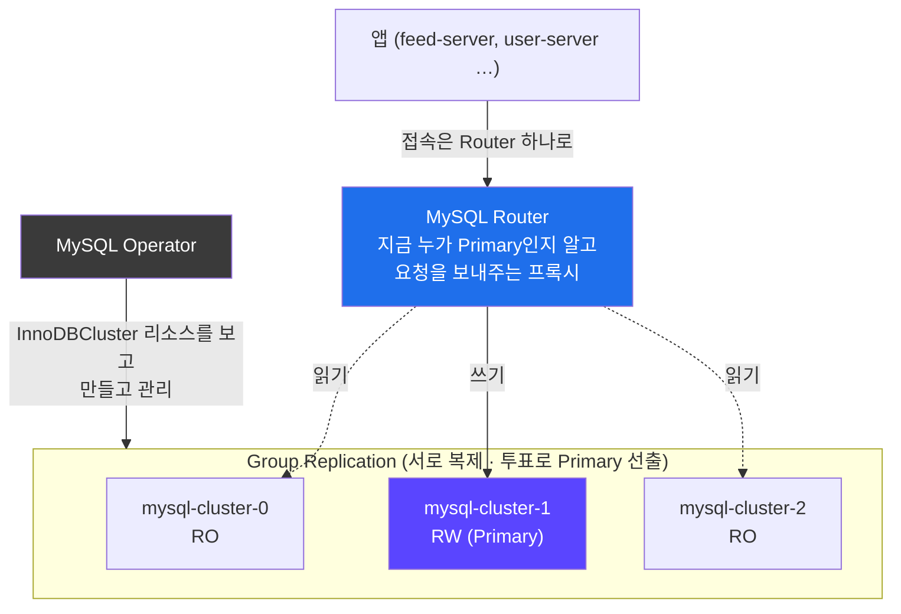
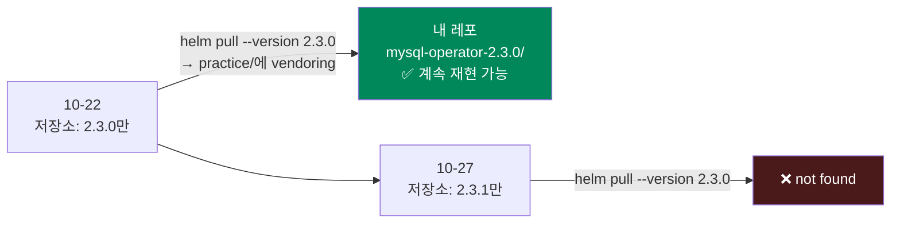
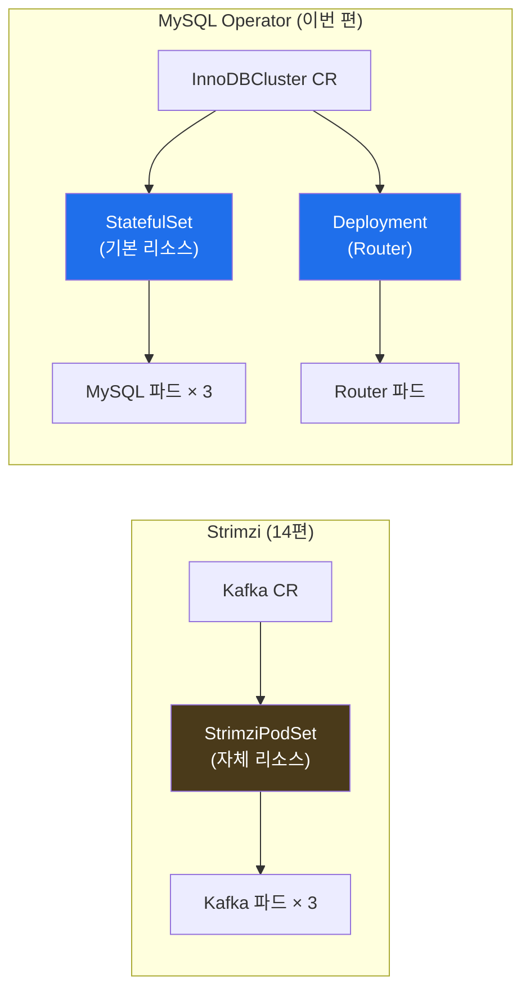
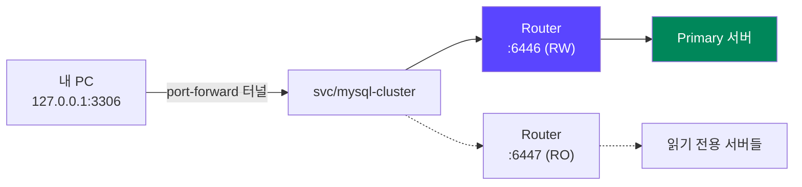
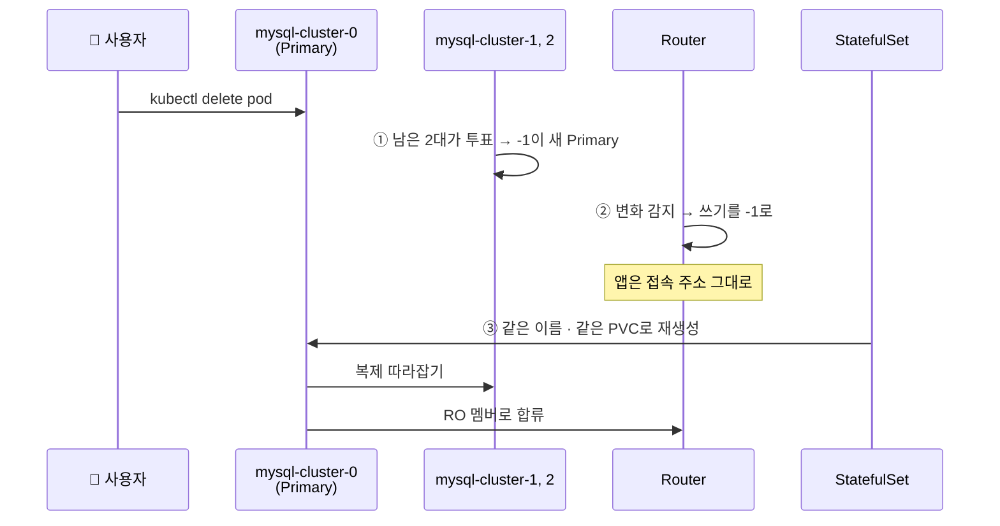

## 📚 들어가며

[14편](/posts/EKS-Rebuild-14-Operator-Strimzi-Kafka-KRaft/)에서 Strimzi Operator로 Kafka를 설치했다. 이번 편은 두 번째 Operator, **MySQL Operator**로 **InnoDB Cluster**를 설치한다.

강의는 MySQL Operator **2.1.2**(강의 레포는 2.2.1)를 쓴다. 그런데 지금 공식 Helm 저장소에는 **차트 버전이 하나만** 남아 있고, MySQL 자체의 버전 번호 체계도 바뀌었다. 그리고 이 글을 쓰는 사이에 그 "하나뿐인 버전"이 또 바뀌어서, **내가 설치한 버전을 이제는 저장소에서 받을 수 없게** 됐다.

같은 Operator지만 Kafka와는 구현 방식이 꽤 다르다. 이번 편은 계속 **"14편 Kafka와 무엇이 다른가"** 를 짚으면서 간다.

처음 보는 사람도 읽을 수 있게 InnoDB Cluster 구성 요소(Group Replication, MySQL Router), Kopf, LTS와 Innovation 릴리스, port-forward를 설명했다.

> **이번 편 학습 지도**
>
> ```
> 구성 (1장)                 버전 (2장) 🔦                 설치 (3~4장)               운영 (5~7장)
> ──────────                 ──────────────                ────────────               ────────────
> 서버 3대 + Router          저장소엔 차트가 하나뿐          오퍼레이터: values 없이     port-forward → Router
> Group Replication          쓴 버전이 사라졌다             CRD 5개 · zalando.org?      Primary 삭제 → 자동 전환
> single-primary             MySQL은 달력 버전(YY.M)        InnoDB Cluster: mycnf 등    오퍼레이터가 살아 있을 때
>                            서버 버전 상한                 StatefulSet + Deployment    PVC는 따로
> ```

---

## 1. MySQL InnoDB Cluster 구성

강의 슬라이드는 **오라클 벤더가 제공하는** MySQL Operator로 InnoDB Cluster를 설치한다. 구성 요소는 MySQL Operator, InnoDBCluster, MySQL Router, StatefulSet이다.

**InnoDB Cluster**는 MySQL 서버 여러 대를 하나의 고가용성 클러스터로 묶은 구성이다.



(어느 파드가 Primary인지는 그때그때 다르다. 그림은 예시다.)

| 구성 요소 | 역할 |
|---|---|
| **MySQL Server × 3** | 실제 DB. **Group Replication**으로 서로 데이터를 복제한다. 기본은 **single-primary** — 1대만 쓰기(RW), 나머지는 읽기(RO) |
| **MySQL Router** | 앱이 접속하는 프록시. Primary가 바뀌어도 앱은 **Router 주소만** 알면 된다 |
| **MySQL Operator** | `InnoDBCluster` 리소스를 보고 위 구성을 만들고 관리한다 |

> 14편 Kafka의 KRaft처럼 MySQL Group Replication도 **과반 투표**로 동작한다. 그래서 서버를 3대(홀수)로 둔다. 14편 7장에서 "컨트롤러 2개가 한 노드에 몰리면 노드 하나로 쿼럼이 깨진다"고 했는데, MySQL 서버 3대도 똑같은 위험을 갖는다.

---

## 2. 🔦 버전 고르기 — 선택지가 하나뿐이었고, 그마저 사라졌다

### 2-1. 공식 저장소에 차트가 하나만 있다

2026-10-22, 설치하던 날 공식 Helm 저장소의 `index.yaml`을 직접 열어보니 두 차트 모두 **2.3.0 하나만** 있었다.

| 차트 | 강의 | 강의 레포 | 설치 당시 (10-22) |
|---|---|---|---|
| mysql-operator | 2.1.2 | 2.2.1 | **2.3.0** (오퍼레이터 이미지 `26.7.0-2.3.0`) |
| mysql-innodbcluster | 2.1.2 | 2.2.1 | **2.3.0** (appVersion `26.7.0`) |

7편(Karpenter)이나 14편(Strimzi)처럼 "최신 `.0`을 피하고 직전 패치를 고른다"는 선택 자체가 불가능했다. 저장소가 **최신 하나만** 남기는 방식이었기 때문이다.

### 2-2. 그리고 이 글을 쓰는 사이에 바뀌었다

닷새 뒤 이 글을 쓰면서 버전을 다시 확인했더니, 저장소에는 **2.3.1만** 있었다. GitHub 태그를 보면 `26.10.0-2.3.1`이 새로 나왔다.

```bash
helm pull mysql-operator --repo https://mysql.github.io/mysql-operator/ --version 2.3.0
# Error: chart "mysql-operator" version "2.3.0" not found in https://mysql.github.io/mysql-operator/ repository
```

**닷새 전에 설치한 버전을, 오늘은 공식 저장소에서 받을 수 없다.**



4편에서 "Helm 차트를 git에 커밋하는 게 맞나?"를 고민하면서, vendoring이 합리적인 경우로 **"정확한 버전 재현 보장 — upstream이 해당 버전을 내려도 안전"** 을 들었다. 그때는 이론적인 장점이었는데, 이번에 정확히 그 상황이 왔다. **차트를 받아서 커밋해둔 덕에 내 레포의 `mysql-operator-2.3.0/`은 그대로 남아 있고, 언제든 같은 구성으로 다시 설치할 수 있다.** 반대로 3-1의 `helm pull --version 2.3.0` 명령은 지금 따라 하면 실패한다. 따라 하는 사람은 그 시점의 최신 버전을 받아야 한다.

### 2-3. 오퍼레이터가 "단일 버전 체계"로 바뀌었다

2.3.0 릴리스 노트에 따르면 이전의 8.4 시리즈 / 9.7 시리즈 오퍼레이터가 중단됐고, **이 버전 하나가 MySQL 8.4, 9.7, 26.7과 호환**된다. 지원 쿠버네티스는 문서상 "1.21 이상"이다. 저장소에 차트가 하나뿐인 이유도 이것으로 보인다 — 서버 버전마다 오퍼레이터를 따로 낼 필요가 없어졌다.

### 2-4. MySQL 버전 번호가 달력 방식이 됐다

- **9.7이 순차 번호의 마지막**이고, 다음부터는 **달력 방식(YY.M)** 이다. `26.7.0`은 2026년 7월 릴리스라는 뜻이다. 2.3.1의 `26.10.0`은 2026년 10월이다.
- MySQL은 두 종류의 릴리스를 낸다.

| 종류 | 특징 | 예 |
|---|---|---|
| **LTS** (Long Term Support) | 오래 지원, 버그·보안 패치만. 운영 환경용 | 8.4.x, **9.7.x** |
| **Innovation** | 새 기능을 빨리 넣는 단기 릴리스. 다음 릴리스가 나오면 지원 종료 | 9.0 ~ 9.6 |

- 강의 레포의 MySQL **9.0.1은 Innovation 릴리스**였다. 즉 강의 당시에도 "오래 쓸 버전"은 아니었다.
- 26.7이 LTS인지는 공식 문서에서 확인하지 못했다. 문서도 "달력 버전만으로는 LTS인지 알 수 없다"고 한다.

### 2-5. 서버 버전에는 상한이 있다

오퍼레이터 소스의 `config.py`를 태그별로 열어보면 이렇다.

```python
# 26.7.0-2.3.0 태그
DEFAULT_VERSION_TAG = "26.7.0"
MAX_SUPPORTED_MYSQL_VERSION = DEFAULT_VERSION_TAG   # → 26.7.0
```

설치 당시 Oracle 레지스트리에는 이미 서버 `26.7.1`, `26.10.0`이 올라와 있었다. **오퍼레이터가 지원하는 최대 버전보다 높은 서버 태그**가 있었던 것이다. "최신 태그를 쓰면 되겠지" 하고 무심코 올리면 막힐 수 있다. 실제로 `26.10.0`을 지원하는 오퍼레이터는 며칠 뒤인 2.3.1에서야 나왔다. **서버가 먼저 나오고, 오퍼레이터가 따라온다.**

그래서 **확인된 LTS이면서 지원 범위 안에 있는 `9.7.4`를 명시하는 것**을 추천한다. innodbcluster 차트는 `serverVersion`을 안 적으면 차트의 appVersion(`26.7.0`)을 쓴다.

> **📝 내 설치는 실제로 26.7.0이었다**
>
> 9.7.4를 추천해놓고, 정작 내 values 파일에는 `serverVersion`을 넣지 않았다(강의 레포 파일을 거의 그대로 옮겨서). 그 values로 `helm template`을 돌려보면 렌더링된 InnoDBCluster의 `version`이 **`26.7.0`** 으로 나온다. 즉 내 클러스터는 차트 기본값인 **26.7.0 서버**로 떴다. 운영이라면 버전을 명시해서 "언제 무엇이 바뀔지"를 내가 정해야 한다 — 8편 `al2023@latest`, 13편 Bitnami `latest`, 15편 애드온 `most_recent`에 이어 같은 교훈이다.

### 2-6. 이미지는 Docker Hub가 아니라 Oracle Container Registry

`container-registry.oracle.com/mysql/...`에서 받는다. 받을 수 있는 태그를 직접 조회해서 확인했다(10-22 기준).

| 이미지 | 확인된 태그 |
|---|---|
| `community-operator` | `26.7.0-2.3.0` ✅ |
| `community-server` | `9.7.4` ✅ (`26.7.0`, `26.7.1`, `26.10.0`도 있음) |
| `community-router` | 오퍼레이터 기본값 `26.7.0` ✅ |

> 13편 Redis에서 겪은 Bitnami 이미지 문제(Docker Hub에 `latest`만 남음)가 여기서는 없다. 벤더가 자기 레지스트리에서 **버전 태그를 계속 제공**한다. 차트는 최신 하나만 남기지만, 이미지는 옛 버전도 남아 있다. 차트와 이미지가 서로 다른 정책을 쓰는 셈이다.

---

## 3. 1단계: MySQL Operator 설치

### 3-1. 차트 받기

```bash
helm repo add mysql-operator https://mysql.github.io/mysql-operator/
helm repo update

cd practice
helm pull mysql-operator/mysql-operator --version 2.3.0 --untar      # ⚠️ 지금은 2.3.1만 받을 수 있다 (2-2)
mv mysql-operator mysql-operator-2.3.0
helm pull mysql-operator/mysql-innodbcluster --version 2.3.0 --untar
mv mysql-innodbcluster mysql-innodbcluster-2.3.0
```

> **디렉토리 이름에 버전 넣기**: 13편에서 `redis`로 받아놓고 버전을 몰랐던 교훈대로, 받자마자 이름을 바꿨다. 같은 날 Redis 디렉토리도 `redis` → `redis-8.10.2`로 바꿔서 커밋했다. Redis는 차트 버전(28.3.1)이 아니라 **앱 버전**(8.10.2)을 붙였다 — 디렉토리를 볼 때 궁금한 건 "어떤 Redis인가"라서.

### 3-2. 설치 — values 파일 없이

강의도 이 차트는 기본 values로 설치했다. 렌더링해보니 기본값 그대로 `community-operator:26.7.0-2.3.0` 이미지를 써서 바꿀 값이 없었다. 14편 Strimzi와 같은 상황이다.

```bash
cd mysql-operator-2.3.0
helm install mysql-operator . -n mysql-operator
```

`mysql-operator` 네임스페이스는 9편의 LimitRange 파일로 이미 만들어 뒀다.

> 강의는 `helm upgrade --install mysql-operator mysql-operator/mysql-operator --version 2.1.2 --namespace mysql-operator --create-namespace`를 썼다. **`upgrade --install`은 "없으면 설치, 있으면 업그레이드"** 라서 여러 번 실행해도 안전하다. 스크립트나 CI에서 자주 쓰는 형태다. 나는 받아둔 로컬 차트(`.`)로 설치했다.

### 3-3. 확인

```bash
kubectl get pods -n mysql-operator               # mysql-operator-... Running
kubectl get crd | grep -Ei "oracle|zalando"
helm ls -n mysql-operator
```

차트의 `crds/crd.yaml`을 열어보면 CRD가 **5개** 정의돼 있다.

| CRD | 용도 |
|---|---|
| `innodbclusters.mysql.oracle.com` | InnoDB 클러스터 정의 |
| `mysqlbackups.mysql.oracle.com` | 백업 작업 정의 |
| `mysqlclustersetfailovers.mysql.oracle.com` | ClusterSet(여러 클러스터를 묶은 구성)의 페일오버 작업 |
| `kopfpeerings.zalando.org` | (아래 설명) |
| `clusterkopfpeerings.zalando.org` | (아래 설명) |

**Kopf와 `zalando.org` CRD** — 오라클의 MySQL 오퍼레이터인데 왜 `zalando.org`가 나올까? 이 오퍼레이터는 **Kopf**(Kubernetes Operator Pythonic Framework, 파이썬으로 오퍼레이터를 만드는 프레임워크)로 만들어졌고, Kopf를 처음 만든 곳이 Zalando라서 CRD 그룹 이름이 `zalando.org`다. `KopfPeering`은 **오퍼레이터 여러 개가 같은 리소스를 동시에 처리하지 않도록 조정**하는 용도다.

14편에서 "Operator = CRD + 커스텀 컨트롤러"라고 했다. 그 컨트롤러를 **처음부터 짜지 않고 프레임워크로 만들 수 있다**는 게 여기서 보인다. Reconcile 루프, 이벤트 감시, 재시도 같은 공통 부분은 Kopf가 맡고, 오퍼레이터 개발자는 "InnoDBCluster가 생기면 무엇을 할지"만 쓰면 된다.

> 14편과 마찬가지로 차트의 `crds/`는 **처음 install할 때만** 적용된다. 업그레이드할 땐 CRD를 `kubectl apply`로 먼저 올린다.

강의에서 쓴 `k get-all -n mysql-operator`는 krew 플러그인 `get-all`로, 네임스페이스의 **모든** 리소스(ConfigMap, Secret, Endpoint 등 `kubectl get all`이 안 보여주는 것까지)를 보여준다. `helm get manifest mysql-operator -n mysql-operator`로 Helm이 실제로 만든 YAML을 볼 수도 있다(12편).

---

## 4. 2단계: InnoDB Cluster 설치

### 4-1. values

강의 슬라이드는 values에서 **사용자 정보, 서버 인스턴스 수, mycnf(RDS의 Parameter Group에 해당), 스토리지**를 수정한다.

```yaml
# ci/mydev-values.yaml
credentials:
  root:
    user: root
    host: "%"            # 어느 호스트에서든 root 접속 허용

serverInstances: 3       # MySQL 서버 3대 (Group Replication)
routerInstances: 1       # MySQL Router 1대
baseServerId: 1000

serverConfig:
  mycnf: |
    [mysqld]
    max_connections=300  # my.cnf 설정. RDS라면 Parameter Group에서 바꾸는 값

tls:
  useSelfSigned: true    # 클러스터 내부 통신용 자체 서명 인증서

datadirVolumeClaimTemplate:
  accessModes:
  resources:
    requests:
      storage: 10Gi      # 서버마다 EBS 10Gi (StorageClass를 안 적으면 ebs-sc)

# 추천: serverVersion: 9.7.4   ← 안 적으면 차트 기본값(26.7.0) (2-5)
```

| 항목 | 의미 |
|---|---|
| `host: "%"` | MySQL 계정은 `user@host` 단위다. `%`는 "모든 호스트"라는 와일드카드 |
| `serverConfig.mycnf` | MySQL 설정 파일(my.cnf) 내용을 그대로 넣는다 |
| `datadirVolumeClaimTemplate` | StatefulSet의 `volumeClaimTemplates`처럼 서버마다 PVC를 하나씩 만든다(13편) |
| `tls.useSelfSigned` | 서버·Router 간 통신용 인증서를 자체 서명으로 만든다. 운영에선 cert-manager 등으로 발급한 인증서를 쓴다 |

### 4-2. 설치

```bash
kubectl apply -f ../namespace/namespace-limitrange-mysql-cluster.yaml
cd mysql-innodbcluster-2.3.0
helm install mysql-cluster --set credentials.root.password='<비밀번호>' \
  -f ci/mydev-values.yaml -n mysql-cluster .
```

> **⚠️ 비밀번호를 `--set`으로 넣는 방식**
>
> 강의 방식이고 학습용으로는 빠르지만, 비밀번호가 **두 군데에 남는다.**
> - **셸 히스토리** — 4편 6-4에서 `read -s`로 피했던 바로 그 문제
> - **Helm 릴리스 기록** — 12편 2-2에서 봤듯 릴리스 정보는 그 네임스페이스의 Secret에 저장되고, `helm get values mysql-cluster -n mysql-cluster`로 누구나 다시 꺼내볼 수 있다
>
> 강의 자료에 예시 비밀번호가 나오지만, **실제로 쓰는 비밀번호를 그대로 따라 쓰면 안 된다.** 실무에서는 4편에서 Cloudflare 토큰을 다룬 것처럼 **SealedSecret**으로 Secret을 만들고 차트가 그것을 참조하게 하는 게 맞다. 이번에는 다음 단계로 미뤄뒀다.

### 4-3. 확인

```bash
kubectl get innodbclusters -n mysql-cluster
# NAME            STATUS   ONLINE   INSTANCES   ROUTERS   AGE
# mysql-cluster   ONLINE   3        3           1         2m35s      ← 강의 화면 기준

kubectl get sts,deploy -n mysql-cluster
# statefulset.apps/mysql-cluster          3/3
# deployment.apps/mysql-cluster-router    1/1
```

**Kafka와 다른 점** — 강의가 짚은 부분이다. Strimzi는 StatefulSet 없이 자체 `StrimziPodSet`으로 파드를 관리했다(14편 6-4). MySQL Operator는 **쿠버네티스 기본 리소스(StatefulSet, Deployment)를 만들어서** 파드를 배포한다.



| | Strimzi (Kafka) | MySQL Operator |
|---|---|---|
| 서버 파드 관리 | `StrimziPodSet` (자체 리소스) | **StatefulSet** |
| 프록시 | 없음 (클라이언트가 브로커와 직접 통신) | **MySQL Router** (Deployment) |
| 만든 언어 / 프레임워크 | Java | Python (**Kopf**) |
| 메타데이터 합의 | KRaft | Group Replication |
| 차트 values | 기본값 그대로 | 오퍼레이터는 기본값, 클러스터는 values 작성 |

**같은 Operator라도 구현 방식은 벤더마다 다르다.** Strimzi는 "StatefulSet으로는 Kafka의 재시작 순서를 표현할 수 없다"며 자기 리소스를 만들었고, MySQL Operator는 StatefulSet으로 충분하다고 봤다. 둘 다 "앱 운영 지식을 코드로 옮긴다"는 목표는 같지만, **어디까지 직접 만들고 어디부터 쿠버네티스에 맡길지**의 선이 다르다.

---

## 5. DB 접속하기

### 5-1. port-forward로 로컬에서 접속

```bash
kubectl port-forward -n mysql-cluster svc/mysql-cluster 3306:3306
# Forwarding from 127.0.0.1:3306 -> 6446
```

다른 터미널에서 접속한다.

```bash
mysql -u root -h127.0.0.1 -p
mysql> show databases;
```

**port-forward**는 내 PC의 포트(3306)를 클러스터 안의 서비스로 터널링한다. 5편의 Ingress처럼 외부에 공개하지 않고, **잠깐 접속해볼 때** 쓴다.



출력의 `-> 6446`이 흥미롭다. `mysql-cluster` 서비스는 MySQL 서버가 아니라 **Router**로 연결되고, Router의 **6446은 읽기·쓰기(Primary로 보냄)** 포트다. 읽기 전용 포트(6447)도 따로 있다(MySQL Router의 일반적인 기본값). 접속 후 서버 버전에 `-router`가 붙어 보이는 것도 Router를 거쳤기 때문이다.

### 5-2. 오퍼레이터에 들어 있는 MySQL Shell로 접속

로컬에 mysql 클라이언트가 없으면 오퍼레이터 파드에 있는 `mysqlsh`를 쓴다.

```bash
kubectl exec -it -n mysql-operator deploy/mysql-operator -- mysqlsh
MySQL  JS > \connect root@mysql-cluster.mysql-cluster.svc.cluster.local
```

`mysql-cluster.mysql-cluster.svc.cluster.local`은 `<서비스>.<네임스페이스>.svc.cluster.local` 형식의 클러스터 내부 DNS 이름이다. 나중에 SNS 앱들(feed-server 등)도 이 주소로 MySQL에 접속한다(강의 레포의 `MYSQL_HOST`). 13편 Redis의 `redis-master.redis`, 14편 Kafka의 `kafka-cluster-kafka-brokers.kafka`에 이어, **앱이 쓰는 주소가 정해져 있어서 이름을 마음대로 못 바꾸는** 세 번째 사례다.

---

## 6. 고가용성 테스트 — Primary 파드를 지워보기

```bash
kubectl delete pod -n mysql-cluster mysql-cluster-0
kubectl logs -n mysql-cluster deploy/mysql-cluster-router -f
```

강의 화면에서는 Router 로그에 클러스터 멤버 3개와 각자의 역할이 찍힌다.

```
Metadata for cluster 'mysql_cluster' has 3 member(s), single-primary:
  mysql-cluster-1.mysql-cluster-instances... - mode=RW     ← 새 Primary
  mysql-cluster-2.mysql-cluster-instances... - mode=RO
  mysql-cluster-0.mysql-cluster-instances... - mode=RO     ← 다시 돌아와서 읽기 전용으로 합류
```



1. Primary였던 `-0`이 지워지면 남은 2대가 **투표로** 새 Primary(`-1`)를 뽑는다. 3대 중 2대가 남았으니 과반이다.
2. Router가 이 변화를 감지하고 쓰기 요청을 새 Primary로 보낸다. **앱은 접속 주소를 바꿀 필요가 없다.**
3. StatefulSet이 `-0`을 **같은 이름·같은 PVC로** 다시 만들고(13편 6-1), `-0`은 복제를 따라잡은 뒤 RO 멤버로 합류한다. 예전 Primary라고 자리를 돌려받지 않는다.

14편 6-4의 Kafka 파드 삭제 테스트와 비교하면, Kafka는 StrimziPodSet이, MySQL은 StatefulSet이 파드를 되살린다. **되살리는 주체는 달라도, 같은 이름과 같은 저장소로 돌아온다는 결과는 같다.**

---

## 7. 정리할 때


- InnoDB Cluster를 지울 때는 **오퍼레이터가 살아 있을 때** `helm uninstall mysql-cluster -n mysql-cluster`를 먼저 한다. 14편 8장과 같은 이유다 — finalizer를 풀어줄 주체가 있어야 한다.
- StatefulSet이라 **PVC(`datadir-mysql-cluster-0~2`)는 남는다.** 13편 6장처럼 직접 지운다.
- 이걸 잊고 클러스터를 먼저 지웠을 때 무슨 일이 생기는지는 다음 편에서 다룬다.

---

## 📝 이번 편 요약

```
구성
└─ InnoDB Cluster = MySQL 서버 3대(Group Replication, single-primary) + Router + Operator

버전 🔦
├─ 공식 Helm 저장소는 최신 차트 하나만 남긴다 (10-22: 2.3.0 → 10-27: 2.3.1)
│    └─ 쓴 버전이 사라짐 → vendoring해둔 차트 덕에 재현 가능 (4편의 그 장점)
├─ 오퍼레이터는 단일 버전 체계 (8.4 · 9.7 · 26.x 호환)
├─ MySQL은 9.7 이후 달력 버전(YY.M). 9.7.x = LTS, 강의 9.0.1 = Innovation
├─ 오퍼레이터마다 최대 서버 버전 (2.3.0 = 26.7.0). 서버가 먼저, 오퍼레이터가 나중
└─ serverVersion 미지정 → 차트 기본값(26.7.0). 9.7.4 명시 추천

설치
├─ 오퍼레이터: values 없이. CRD 5개 (zalando.org = Kopf 프레임워크)
├─ 클러스터: 인스턴스 수 · mycnf · 스토리지. 비밀번호 --set은 기록에 남음
└─ Strimzi와 달리 StatefulSet + Deployment(Router)

운영
├─ port-forward → svc → Router 6446(RW) / 6447(RO)
├─ Primary 삭제 → 투표로 새 Primary, Router가 전환, 앱은 그대로
└─ 오퍼레이터가 살아 있을 때 클러스터 삭제, PVC는 따로
```

| 개념 | 한 줄 정의 |
|---|---|
| **InnoDB Cluster** | Group Replication으로 묶인 MySQL 서버들 + Router로 구성된 고가용성 클러스터 |
| **Group Replication** | MySQL 서버끼리 데이터를 복제하고 과반 투표로 Primary를 정하는 기능 |
| **single-primary** | 한 대만 쓰기(RW), 나머지는 읽기(RO)를 받는 모드 |
| **MySQL Router** | Primary 위치를 알고 요청을 보내주는 프록시. 6446(RW) / 6447(RO) |
| **LTS / Innovation** | 오래 지원하는 안정판 / 새 기능을 빨리 내는 단기 릴리스 |
| **달력 버전 (YY.M)** | 9.7 이후 MySQL의 버전 표기. 26.7 = 2026년 7월 |
| **Kopf** | 파이썬으로 Operator를 만드는 프레임워크. `zalando.org` CRD를 함께 설치 |
| **port-forward** | 로컬 포트를 클러스터 안 서비스로 터널링하는 임시 접속 방법 |
| **`helm upgrade --install`** | 없으면 설치, 있으면 업그레이드. 반복 실행해도 안전 |

---

## 💭 느낀 점

**1. vendoring의 장점을 닷새 만에 체감했다.**

4편에서 차트를 레포에 커밋할지 고민하며 "upstream이 버전을 내려도 안전하다"를 장점으로 적었다. 솔직히 그땐 "그런 일이 실제로 있나?" 싶었다. 그런데 MySQL Operator 저장소는 **최신 하나만 남기는** 방식이었고, 설치하고 닷새 뒤에 내 버전이 사라졌다. 차트를 받아 커밋해둔 덕에 레포의 `mysql-operator-2.3.0/`은 그대로 쓸 수 있다. 4편의 결정이 이번에 이렇게 돌아올 줄은 몰랐다.

**2. "선택지가 없다"는 것도 하나의 정보다.**

7편과 14편에서는 "최신 `.0` 대신 직전 패치"를 골랐다. 이번엔 고를 게 없었다. 처음엔 당황했는데, 이유를 찾아보니 오퍼레이터가 단일 버전 체계로 바뀌어서 서버 버전마다 따로 낼 필요가 없어진 것이었다. **저장소가 어떤 정책으로 버전을 남기는지**도 버전을 고를 때 알아야 할 정보라는 걸 배웠다.

**3. 추천한 것과 실제로 한 것이 달랐다.**

9.7.4를 명시하라고 정리해놓고, 정작 내 values에는 `serverVersion`이 없었다. 강의 레포 파일을 거의 그대로 옮겼기 때문이다. `helm template`으로 확인하니 26.7.0이 렌더링됐다. 블로그에 "9.7.4로 설치했다"고 쓸 뻔했는데, **기억이 아니라 렌더링 결과로 확인**한 덕에 바로잡을 수 있었다. 12편에서 배운 `helm template`이 이런 확인에도 쓰인다.

**4. 같은 "Operator"인데 이렇게 다를 수 있다.**

14편 Strimzi는 자체 리소스(StrimziPodSet)까지 만들어서 파드를 직접 관리했고, MySQL Operator는 StatefulSet과 Deployment로 충분하다고 봤다. Java와 Python(Kopf), 프록시가 없는 구조와 Router가 있는 구조. Operator라는 **패턴**은 같아도 **구현**은 앱의 성격에 따라 완전히 달라진다. 두 개를 연달아 보니 "Operator = CRD + 컨트롤러"라는 정의가 훨씬 입체적으로 이해됐다.

---

## 🔗 다음 편 예고

다음 편은 **Stateful Application과 Snapshot**이다. Kafka·Redis·MySQL처럼 상태가 있는 앱의 데이터를 **EBS 스냅샷으로 백업하고 복원**한다. 그리고 그 전에 겪은 사고 — **PVC를 안 지우고 클러스터를 먼저 destroy해서 EBS 볼륨 15개가 남은 일** — 도 함께 정리한다. 이번 편 7장의 "이걸 잊으면"이 실제로 일어난 이야기다.

---

## 📚 참고

- [mysql/mysql-operator (GitHub)](https://github.com/mysql/mysql-operator) — 태그 `26.7.0-2.3.0`, `26.10.0-2.3.1`
- [MySQL Operator for Kubernetes 문서](https://dev.mysql.com/doc/mysql-operator/en/)
- [MySQL Router — 기본 포트](https://dev.mysql.com/doc/mysql-router/en/)
- [MySQL 릴리스 모델 (LTS / Innovation)](https://dev.mysql.com/doc/refman/en/mysql-releases.html)
- [Kopf — Kubernetes Operator Pythonic Framework](https://kopf.readthedocs.io/)

> 2-1의 버전 정보와 2-6의 이미지 태그는 2026-10-22에, 2-2의 저장소 상태와 2-5의 태그별 `config.py`는 이 글을 쓰는 2026-10-27에 직접 조회했다. 3-3의 CRD 목록은 받아둔 2.3.0 차트의 `crds/crd.yaml`로 확인했다. 4-3, 5장, 6장의 출력은 강의 화면 기준이다. 1장 그림의 RW/RO 위치는 예시다.
