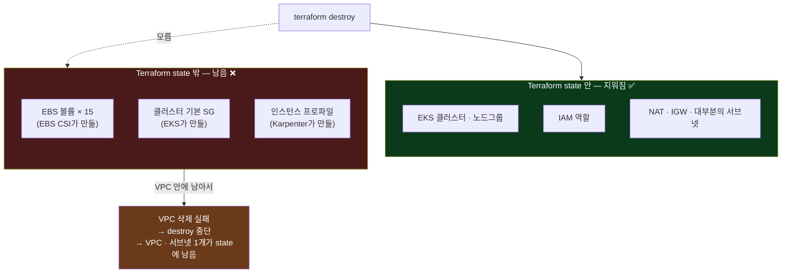
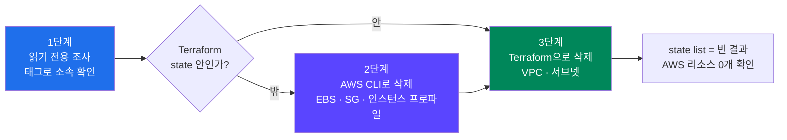
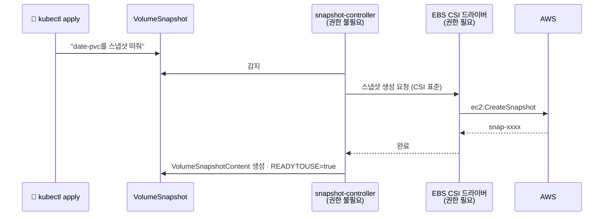
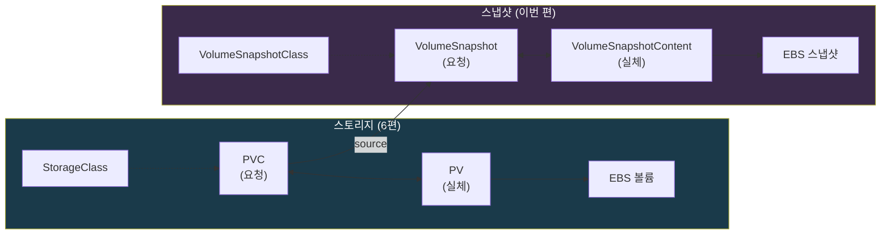
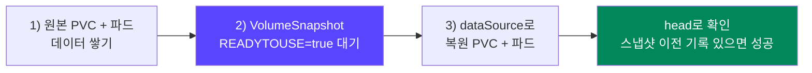
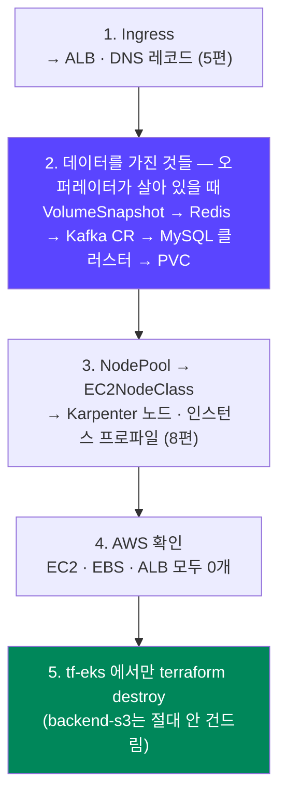

## 📚 들어가며

[14편](/posts/EKS-Rebuild-14-Operator-Strimzi-Kafka-KRaft/)~[16편](/posts/EKS-Rebuild-16-MySQL-Operator-InnoDB-Cluster/)에서 Kafka, Redis, MySQL을 설치했다. 이번 편은 강의의 **Stateful Application과 Snapshot** 파트다. 상태(데이터)를 가진 앱의 데이터를 **EBS 스냅샷으로 백업하고 복원**한다.

그런데 그 전에 **사고가 하나 있었다.** 학습을 마치고 비용을 아끼려고 `terraform destroy`를 바로 했더니, 다음 날 AWS에 **EBS 볼륨 15개와 보안 그룹, VPC**가 남아 있었다.

두 이야기는 같은 주제다. **상태(데이터)는 클러스터 밖, AWS에 남는다.** 그래서 이번 편은 순서를 이렇게 잡았다.

1. **사고 회고** — 무엇이 왜 남았고, 어떻게 치웠나 (2장)
2. **스냅샷 실습** — 그래서 데이터를 어떻게 백업·복원하나 (3~6장)
3. **정리 순서** — 이번엔 제대로 지우기 (7장)

처음 보는 사람도 읽을 수 있게 Stateful vs Stateless, 스냅샷 리소스 3종, `dataSource`, Terraform state 밖의 리소스를 설명했다.

> **이번 편 학습 지도**
>
> ```
> 사고 (2장) 🔦                 스냅샷 (3~6장)                     정리 (7장)
> ─────────────                 ──────────────                     ──────────
> destroy 후 EBS 15개 남음       snapshot-controller + EBS CSI      스냅샷 → 데이터 CR → PVC
> 누가 만들었나 = 누가 지우나     Class / Snapshot / Content          → NodePool → AWS 확인
> 태그로 소속 확인               = StorageClass / PVC / PV           → terraform destroy
> state 밖은 CLI, 안은 Terraform  dataSource로 복원                  만든 주체가 살아 있을 때
> ```

---

## 1. Stateful vs Stateless

### 1-1. SNS 앱에서 상태를 가진 것들

강의의 SNS 애플리케이션 구성도를 보면 서버들(Frontend, User, Social Feed, Timeline, Image)과 함께 **Kafka, Redis, MySQL**이 있다. 14~16편에서 설치한 이 셋이 SNS 앱의 **상태(데이터)를 가진 애플리케이션**이다.

### 1-2. 비교

강의 슬라이드를 정리하면 이렇다.

| | Stateful (상태를 가지는) | Stateless (상태를 가지지 않는) |
|---|---|---|
| 데이터 저장 | 서버·사용자 데이터, 클라이언트 상태(세션 등)를 저장 | 클라이언트 상태를 서버에 저장하지 않음 |
| 예시 | Redis, Kafka, MySQL, PostgreSQL, Prometheus | 웹 서버, REST API, 스테이트리스 마이크로서비스 |
| 스케일링 | 데이터 일관성·동기화가 필요해서 복잡 | 비교적 간단하게 수평 확장 |
| 장애 복구 | 상태 복구를 위한 추가 장치가 필요할 수 있음 | 요청이 독립적이라 단순 |
| 배포 | 상태의 지속성 관리 때문에 복잡 | 단순 |

강의의 결론은 이렇다. Stateful 앱은 관리할 게 더 많지만, **비용 절감과 관리 통합을 위해 최근에는 쿠버네티스에서 많이 운영한다.** 대신 데이터의 **백업과 이전**을 따로 챙겨야 하고, 그 수단 중 하나가 **스냅샷**이다.

지금까지 Stateful 앱을 다루며 본 장치들이 전부 이 표의 "복잡"을 해결하는 것들이었다. 파드마다 고정된 이름과 저장소(13편 StatefulSet), 과반 투표(14편 KRaft, 16편 Group Replication), 앱에 맞춘 재시작 순서(14편 StrimziPodSet). 이번 편은 그 마지막 조각인 **백업**이다.

---

## 2. 🔦 먼저 사고 이야기 — destroy했더니 EBS 15개가 남았다

### 2-1. 무슨 일이 있었나

학습을 마치고 비용을 아끼려고 `terraform destroy`를 바로 실행했다. 다음 날 확인해보니 AWS에 이런 것들이 남아 있었다.

| 남은 리소스 | 개수 | 왜 남았나 |
|---|:---:|---|
| EBS 볼륨 (Kafka 6, Redis 6, MySQL 3) | 15 | PVC를 먼저 안 지우고 클러스터를 지워서 |
| 클러스터 기본 SG `eks-cluster-sg-mydev-<숫자>` | 1 | Terraform이 아니라 **EKS가** 만든 SG라서 |
| VPC, private 서브넷 1개 | 2 | 위 SG가 VPC 안에 남아서 삭제가 막힘 |
| Karpenter 인스턴스 프로파일 `mydev_<숫자>` | 1 | **Karpenter가** 실행 중에 직접 만든 것이라서 |

> Kafka와 Redis 볼륨이 노드 수보다 많은 건 **이전 재구축 때 남은 볼륨까지 포함**됐기 때문으로 보인다. 같은 이름의 볼륨이 서로 다른 AZ에 두 세트 있었다. 한 번 놓친 정리가 재구축할 때마다 쌓인 셈이다.

5편부터 편마다 "destroy 전에 이걸 먼저 지워라"는 체크리스트를 한 줄씩 늘려왔고, 13편에서는 그걸 합본까지 만들었다. 그런데 **그 체크리스트를 건너뛰고 destroy를 눌렀다.** 6편에서 고아 볼륨 1개를 발견했을 때 "월 1달러 미만"이었는데, 이번엔 15개였다.

### 2-2. 왜 남나 — "누가 지우는가"를 생각하면 보인다



**① EBS 볼륨** — StorageClass의 `reclaimPolicy: Delete`(6편)는 "PVC가 지워지면 볼륨도 지운다"는 뜻이다. 그런데 **실제로 볼륨을 지우는 건 클러스터 안의 EBS CSI 드라이버**다. 클러스터가 먼저 사라지면 지워줄 주체가 없다. 볼륨은 `available`(아무 데도 안 붙은) 상태로 남고 **계속 과금된다.** 게다가 13편에서 봤듯 StatefulSet의 PVC는 `helm uninstall`로도 안 지워지고, 14편 Kafka는 `deleteClaim: false`였다. 세 앱 모두 **일부러 데이터를 남기도록** 설계돼 있었던 것이다.

**② 클러스터 기본 SG** — 15편에서 discovery 태그를 다는 대상으로 다룬 그 SG다. **EKS가** 만들었기 때문에 Terraform state에 없다. Terraform은 **자기가 만든 것만 지운다.** 이 SG가 VPC 안에 남아 있어서 VPC 삭제가 실패했고, destroy가 중간에 멈추면서 state에 VPC와 서브넷 하나가 남았다. 15편에서 `aws_ec2_tag`로 "이 SG는 EKS 것, 태그만 내 것"이라고 구분했는데, 삭제할 때도 그 구분이 그대로 적용됐다.

**③ 인스턴스 프로파일** — 8편 1-3에서 본 대로, Karpenter가 EC2NodeClass의 `role`로부터 **직접 만든다.** Terraform은 IAM 역할만 지웠고, 프로파일은 역할이 빠진 **빈 껍데기**로 남았다.

> **핵심**: Terraform state에는 **Terraform이 직접 만든 리소스만** 있다. 쿠버네티스 컨트롤러(EBS CSI, LB Controller, Karpenter)나 EKS가 대신 만든 AWS 리소스는 state 밖에 있고, **그걸 만든 컨트롤러가 살아 있을 때 정리해야 한다.**

### 2-3. 정리한 방법 — 실행한 명령과 이유



**1단계: 지우기 전에 조사만 한다 (읽기 전용)**

```bash
aws ec2 describe-volumes --region ap-northeast-2 \
  --filters "Name=tag:kubernetes.io/cluster/mydev,Values=owned" "Name=status,Values=available" \
  --query 'Volumes[].[VolumeId,Size,AvailabilityZone]' --output table
```

볼륨마다 `kubernetes.io/cluster/mydev = owned` 태그가 있는지 확인했다. **이 클러스터 것이 확실한 것만 지우기 위해서**다. 같은 계정에 다른 용도의 EBS가 있을 수 있으니, "available이니까 다 지우자"는 위험하다. 인스턴스 프로파일, IAM 역할, SQS, EventBridge, 로그 그룹, VPC 안의 서브넷·라우트 테이블·IGW·NAT도 같은 방식으로 하나씩 확인했다.

**2단계: Terraform 밖의 리소스는 AWS CLI로 지운다**

```bash
aws ec2 delete-volume --volume-id <vol-id>                          # 15개 (태그 + available로 다시 걸러서)
aws iam delete-instance-profile --instance-profile-name mydev_<숫자>
aws ec2 delete-security-group --group-id <sg-id>
```

세 가지 모두 state에 없는 리소스라 CLI로 지우는 게 맞다. 순서도 중요하다. **SG를 먼저 치워야** 다음 단계에서 VPC가 지워진다.

**3단계: state에 남은 것은 Terraform으로 지운다**

```bash
terraform state list           # VPC, 서브넷이 남아 있는 것 확인
terraform plan -destroy        # 지워질 대상이 서브넷 1 + VPC 1뿐인지 먼저 확인
terraform destroy
terraform state list           # 빈 결과 = state도 정리됨
```

VPC와 서브넷은 **state에 남아 있었다.** 이걸 CLI로 지우면 **state에는 있는데 AWS에는 없는** 어긋난 상태가 된다. 3편에서 `CREATE_FAILED` 노드그룹을 CLI로 지운 뒤 `terraform state rm`까지 따로 해야 했던 것과 같은 문제다. 그래서 Terraform으로 지웠다. 막고 있던 SG를 먼저 치웠기 때문에 이번엔 바로 끝났다.

마지막 점검에서 VPC, EBS, EKS, EC2, ELB, EIP, NAT, 인스턴스 프로파일이 **모두 0개**로 확인됐다.

> **💡 기억해둘 패턴 — 고아 리소스 정리**
>
> ① **태그로 소속을 확인**한다 (`kubernetes.io/cluster/<이름> = owned` 등)
> ② **state 밖의 것은 CLI로**, **state 안의 것은 Terraform으로** 지운다
> ③ `terraform state list`가 비었는지, AWS에 남은 게 없는지 확인한다

**확인 못 한 것: Cloudflare DNS 레코드.** Ingress를 지우기 전에 클러스터가 사라졌다면 external-dns가 레코드를 정리하지 못했을 수 있다. 5편 2-3에서 정리한 대로, Cloudflare 대시보드에서 A/CNAME 레코드와 **같은 이름의 TXT 레코드(owner가 `mydev`인 것)** 를 짝지어 직접 확인해야 한다. DNS 레코드는 과금은 없지만, **존재하지 않는 ALB를 가리키는 죽은 레코드**로 남는다.

**지우지 않은 것: `backend-s3`로 만든 S3 버킷과 DynamoDB 테이블**(1편). Terraform state 저장소라 계속 써야 한다. 1편 4장의 "창고는 남겨둔다"가 이번에도 그대로였다.

---

## 3. 스냅샷 실습 준비 — snapshot-controller 애드온

> **⚠️ 이 장부터는 실습 가이드다.** 실습 파일을 만든 날에는 클러스터가 없었다(위 사고 이후 destroy 상태). 그래서 6장의 출력은 **강의 화면 기준**이고, 직접 실행한 결과는 후속 편에서 다루려 한다.

### 3-1. 작업 순서 (강의 슬라이드)

1. EKS 애드온 — Snapshot Controller 설치
2. Snapshot Class 생성
3. PVC를 쓰는 샘플 앱 배포
4. Snapshot 백업
5. 기존 PVC 삭제 후 Snapshot으로 데이터 복구

### 3-2. 스냅샷에 관여하는 두 컴포넌트



| 컴포넌트 | 역할 | AWS 권한 |
|---|---|---|
| **snapshot-controller** | 쿠버네티스 안의 `VolumeSnapshot` 객체를 보고, 드라이버에게 일을 넘긴다 | **필요 없음** |
| **EBS CSI 드라이버** (6편) | 실제로 AWS API(`ec2:CreateSnapshot` 등)를 호출해서 EBS 스냅샷을 만든다 | 필요 (Pod Identity로 이미 부여) |

snapshot-controller는 **쿠버네티스 표준** 컴포넌트이고, EBS CSI 드라이버는 **AWS 전용 구현**이다. 6편의 "CSI 드라이버도 컨트롤러만 AWS API를 부르니 컨트롤러만 권한이 필요하다", 5편의 "AWS API를 안 부르면 AWS 권한도 필요 없다"와 같은 원리다. 그래서 snapshot-controller에는 IAM 설정이 필요 없다.

### 3-3. 애드온 설치 — 강의와 다르게 모듈 안에 넣었다

강의는 `eks-addon.tf`에 리소스를 따로 선언하는 방식이었다(레포에는 주석 처리된 채로 들어 있다).

```hcl
# 강의 레포 (tf-eks/eks-addon.tf)
# resource "aws_eks_addon" "aws_snapshot_controller" {
#   cluster_name = module.eks.cluster_name
#   addon_name   = "snapshot-controller"
#   # 버전을 지정하지 않으면 자동으로 default 버전을 설치
# }
```

이번에는 EKS 모듈의 `addons` 블록에 넣었다. 6편에서 EBS CSI 드라이버를 추가할 때 이미 함께 넣어뒀다.

```hcl
# practice/tf-eks/main.tf
module "eks" {
  # ...
  addons = {
    # ...
    aws-ebs-csi-driver  = { pod_identity_association = [ ... ] }
    snapshot-controller = {}      # 버전을 안 적으면 most_recent = true (15편 5-3)
  }
}
```

**왜 모듈 안에 넣었나?** 모듈 소스를 보면 `aws_eks_addon.this`에 이런 의존성이 걸려 있다.

```hcl
depends_on = [
  module.fargate_profile,
  module.eks_managed_node_group,
  module.self_managed_node_group,
]
```

즉 모듈은 애드온을 **노드 그룹이 만들어진 뒤에** 설치해준다. snapshot-controller는 Deployment라서 파드가 올라갈 노드가 없으면 애드온이 `DEGRADED`로 멈추고 apply가 타임아웃 난다. 리소스로 따로 쓰면 이 순서를 `depends_on`으로 직접 맞춰야 한다. 2편에서 `vpc-cni`에 `before_compute = true`를 줬던 것과 정반대 상황이다 — CNI는 노드보다 **먼저**, snapshot-controller는 노드보다 **나중에**.

**CRD도 애드온이 함께 설치한다.** 강의는 `crd-snapshot.yaml`, `crd-snapshotContents.yaml`을 직접 apply했다. EKS 애드온으로 설치하면 CRD도 같이 들어오므로 따로 apply할 필요가 없다.

```bash
kubectl get crd | grep snapshot.storage.k8s.io
# volumesnapshotclasses / volumesnapshotcontents / volumesnapshots  3개가 보이면 정상
```

**애드온 버전 조회** — 강의 슬라이드의 명령을 지금 버전으로 바꾸면 이렇다.

```bash
aws eks describe-addon-versions --kubernetes-version 1.34 --addon-name snapshot-controller \
  --query 'addons[].addonVersions[].{Version: addonVersion, Default: compatibilities[0].defaultVersion}' \
  --output table
```

강의(EKS 1.28)의 조회 결과는 `v6.3.2`였고, 이번 클러스터(1.34)에서는 15편 5-3의 plan에 `v8.6.0 → v8.7.0`이 나왔다. 클러스터를 다시 만들면 더 최신일 수 있다.

---

## 4. 스냅샷 리소스 3종 — PV/PVC와 같은 구조

스냅샷 리소스는 6편의 스토리지 리소스와 **1:1로 대응**된다. 6편을 이해했다면 새로 외울 게 거의 없다.

| 스토리지 (6편) | 스냅샷 | 범위 | 역할 |
|---|---|---|---|
| StorageClass | **VolumeSnapshotClass** | 클러스터 | "어떤 드라이버로, 어떤 정책으로" 만들지 정하는 틀 |
| PersistentVolumeClaim | **VolumeSnapshot** | 네임스페이스 | "이 PVC를 지금 스냅샷 떠줘"라는 요청 |
| PersistentVolume | **VolumeSnapshotContent** | 클러스터 | 실제 EBS 스냅샷을 가리키는 객체 (자동 생성) |



6편 1-3에서 PV와 PVC를 **"저장소 그 자체"와 "저장소 요청서"** 로 나눈 이유가 "앱 개발자는 저장소 종류를 몰라도 되게"였다. 스냅샷도 똑같다. 사용자는 `VolumeSnapshot`(요청서)만 쓰고, 그게 실제로 EBS 스냅샷인지 다른 스토리지의 스냅샷인지는 `VolumeSnapshotClass`의 드라이버가 정한다.

---

## 5. 실습 파일 (`practice/snapshot/`)

### 5-1. VolumeSnapshotClass

```yaml
apiVersion: snapshot.storage.k8s.io/v1
kind: VolumeSnapshotClass
metadata:
  name: csi-snapshot-class
driver: ebs.csi.aws.com      # 실제 스냅샷을 만드는 건 EBS CSI 드라이버
deletionPolicy: Delete
```

| `deletionPolicy` | VolumeSnapshot 객체를 지우면 |
|---|---|
| **Delete** | AWS의 EBS 스냅샷도 같이 지워진다 (실습용) |
| Retain | 객체만 지워지고 AWS 스냅샷은 남는다 (계속 과금) |

6편 StorageClass의 `reclaimPolicy`와 같은 개념이다. 실습은 `Delete`로 둬서 정리를 쉽게 했지만, **진짜 백업이라면 `Retain`** 이 맞다. 클러스터가 통째로 사라져도 스냅샷은 남아 있어야 백업의 의미가 있으니까. 2장의 사고가 "남아서 문제"였다면, 백업은 "**남아야** 의미가 있는" 경우다.

> 강의 레포 파일 이름의 오타(`volumSnapshotClass.yaml`)를 `volumeSnapshotClass.yaml`로 고쳤다.

### 5-2. VolumeSnapshot — 백업

```yaml
apiVersion: snapshot.storage.k8s.io/v1
kind: VolumeSnapshot
metadata:
  name: ebs-volume-snapshot
  namespace: default           # 원본 PVC와 같은 네임스페이스여야 한다
spec:
  volumeSnapshotClassName: csi-snapshot-class
  source:
    persistentVolumeClaimName: date-pvc
```

**전제**: 원본 PVC(`date-pvc`, 6편)가 실제 EBS 볼륨에 연결돼(Bound) 있어야 한다. `ebs-sc`는 `WaitForFirstConsumer`라서 **파드를 한 번 띄워야** 볼륨이 만들어진다(6편 3-1의 Pending).

### 5-3. 스냅샷에서 PVC 복원 — 강의와 이름을 다르게 했다

```yaml
apiVersion: v1
kind: PersistentVolumeClaim
metadata:
  name: date-pvc-restore        # 강의: date-pvc (원본과 같은 이름)
  namespace: default
spec:
  accessModes:
  - ReadWriteOnce
  resources:
    requests:
      storage: 10Gi             # 원본 크기 이상이어야 한다
  storageClassName: "ebs-sc"
  dataSource:                   # ← 빈 볼륨 대신 스냅샷 내용으로 볼륨을 만든다
    name: ebs-volume-snapshot
    kind: VolumeSnapshot
    apiGroup: snapshot.storage.k8s.io
```

**`dataSource`** 는 PVC를 만들 때 **"빈 볼륨이 아니라 이 스냅샷(또는 다른 PVC)의 내용으로 시작하라"** 고 지정하는 필드다.

**이름을 바꾼 이유**: 강의는 원본 PVC와 파드를 **먼저 지운 뒤** 같은 이름 `date-pvc`로 복원했다. 원본이 남아 있는데 같은 이름으로 apply하면 "기존 PVC 수정"으로 처리된다. 그런데 PVC의 spec(`dataSource` 등)은 만든 뒤에 바꿀 수 없어서 에러가 난다. 이름을 다르게 하면 **원본과 복원본을 나란히 두고 비교할 수 있다.**

`storageClassName`은 강의 레포 파일에서 주석 처리돼 있었다. `ebs-sc`가 기본 클래스라 생략해도 되지만, 어떤 클래스로 복원되는지 분명히 하려고 적었다.

### 5-4. 복원 확인용 Deployment (새로 추가)

```yaml
apiVersion: apps/v1
kind: Deployment
metadata:
  name: date-restore-deploy
  namespace: default
spec:
  replicas: 1
  selector:
    matchLabels:
      app: date-restore
  template:
    metadata:
      labels:
        app: date-restore
    spec:
      containers:
      - name: date-pod
        image: busybox
        command: ["/bin/sh", "-c", "while true; do date >> /data/pod-out.txt; sleep 10; done"]
        volumeMounts:
        - name: date-vol
          mountPath: /data
      volumes:
      - name: date-vol
        persistentVolumeClaim:
          claimName: date-pvc-restore
```

강의 레포에는 없는 파일이다. `ebs-sc`가 `WaitForFirstConsumer`라서 **이 파드가 떠야 스냅샷에서 볼륨이 실제로 만들어진다.** 이 Deployment가 없으면 `date-pvc-restore`는 계속 `Pending`으로 보인다(정상이다).

원본 파드와 같은 파일에 이어서 기록하므로, **파일 앞부분에 스냅샷 시점 이전의 기록이 있으면 복원 성공**이다. 6편 3-3에서 "파드를 지워도 데이터가 남는가"를 `head`로 확인한 것과 같은 방법을 이번엔 **볼륨 자체를 바꿔서** 쓴다.

---

## 6. 실습 순서

> 출력 예시는 **강의 화면 기준**이다.



**1) 원본 PVC를 만들고 데이터를 쌓는다**

```bash
kubectl apply -f sc-ebs-gp3/ebs-default-storageclass.yaml -f pvc/date-pvc.yaml -f pvc/date-pvc-deploy.yaml
kubectl exec deploy/date-deploy -- cat /data/pod-out.txt
# Thu Feb  8 21:36:16 UTC 2024      ← 강의 화면 예시
# Thu Feb  8 21:36:26 UTC 2024
```

**2) 스냅샷을 뜬다**

```bash
kubectl apply -f snapshot/volumeSnapshotClass.yaml -f snapshot/volumeSnapshot.yaml
kubectl get volumesnapshot,volumesnapshotcontent
# ebs-volume-snapshot  READYTOUSE=true  SOURCEPVC=date-pvc  RESTORESIZE=10Gi  ← 강의 화면 기준
```

`READYTOUSE`가 `true`가 될 때까지 기다린다(보통 1~2분). AWS 콘솔의 EC2 → 스냅샷에서도 보인다.

**3) 스냅샷에서 복원한다**

```bash
kubectl apply -f snapshot/snapshot-restore-date-pvc.yaml -f snapshot/date-restore-deploy.yaml
kubectl exec deploy/date-restore-deploy -- head /data/pod-out.txt
```

1)에서 본 시각들이 파일 앞부분에 있으면 성공이다.

**스냅샷의 용도** — 강의 정리대로, 같은 클러스터 안의 복구뿐 아니라 **다른 클러스터로 데이터를 옮길 때**도 쓸 수 있다. EBS 스냅샷은 클러스터가 아니라 **AWS 계정**에 있기 때문이다. 2장에서 "데이터는 클러스터 밖에 남는다"가 사고의 원인이었는데, 스냅샷에서는 바로 그 성질이 **장점**이 된다. 클러스터를 지웠다 다시 만들어도(이 시리즈에서 수없이 한 일이다) 스냅샷만 남겨두면 데이터를 다시 가져올 수 있다.

---

## 7. 정리 순서 — 이번엔 제대로

### 7-1. 스냅샷 실습 정리

EBS 스냅샷도 볼륨처럼 **AWS에 남는 리소스**다. 클러스터를 먼저 지우면 2장처럼 남아서 계속 과금된다.

```bash
kubectl delete -f snapshot/date-restore-deploy.yaml -f snapshot/snapshot-restore-date-pvc.yaml -f snapshot/volumeSnapshot.yaml
kubectl delete -f pvc/date-pvc-deploy.yaml -f pvc/date-pvc.yaml
```

`deletionPolicy: Delete`라서 VolumeSnapshot을 지우면 EBS 스냅샷도 함께 지워진다.

### 7-2. 클러스터 전체 삭제 순서

[13편](/posts/EKS-Rebuild-13-Helm-Redis-Bitnami-Image-Policy/) 6-4의 체크리스트를 14~17편까지 반영해 확장했다.



```bash
# 1) 클러스터 밖에 리소스를 만드는 것들
kubectl delete ingress --all -A                  # ALB, Cloudflare 레코드 (LB Controller, external-dns가 정리)

# 2) 데이터를 가진 것들 — 오퍼레이터가 살아 있을 때
kubectl delete volumesnapshot --all -A           # EBS 스냅샷
helm uninstall redis -n redis
kubectl delete kafka --all -n kafka              # Strimzi가 Kafka 파드를 내림
helm uninstall mysql-cluster -n mysql-cluster    # MySQL Operator가 정리
kubectl delete pvc --all -A                      # EBS 볼륨 (EBS CSI가 지움)

# 3) Karpenter 노드
kubectl delete nodepool --all                    # Karpenter가 자기 노드를 종료
kubectl delete ec2nodeclass --all                # 인스턴스 프로파일 정리
kubectl get nodeclaims                           # 비어야 함

# 4) AWS에서 남은 것 확인 (셋 다 비어 있어야 함)
aws ec2 describe-instances --filters "Name=tag-key,Values=karpenter.sh/nodepool" \
  "Name=instance-state-name,Values=pending,running" --query 'Reservations[].Instances[].InstanceId' --output text
aws ec2 describe-volumes --filters "Name=tag-key,Values=kubernetes.io/created-for/pvc/name" \
  --query 'Volumes[].VolumeId' --output text
aws elbv2 describe-load-balancers --query 'LoadBalancers[].LoadBalancerName' --output text

# 5) tf-eks 에서만 (backend-s3는 절대 destroy하지 않는다)
terraform destroy
```

**순서에서 중요한 것**

- **각 리소스를 만든 컨트롤러가 살아 있을 때 지운다.** Ingress는 LB Controller가, PVC는 EBS CSI가, Karpenter 노드는 Karpenter가 정리한다(2-2).
- **오퍼레이터가 관리하는 CR은 오퍼레이터보다 먼저 지운다.** 오퍼레이터부터 지우면 CR의 finalizer를 풀어줄 주체가 없어서 삭제가 멈출 수 있다(14편 8장).
- **PVC는 NodePool보다 먼저 지운다.** 볼륨이 Karpenter 노드에 붙어 있으면 그 노드가 살아 있는 동안 정리하는 게 안전하다.
- Karpenter가 띄운 EC2는 Terraform state에 없다. 그냥 destroy하면 컨트롤러가 먼저 사라져서 **고아 EC2로 남아 계속 과금**되고, 그 네트워크 인터페이스 때문에 VPC 삭제도 실패할 수 있다. 이번 사고에서는 EC2가 남지 않았는데, destroy 시점에 Karpenter 노드가 없었던 것으로 보인다. 운이 좋았던 것이지 순서가 맞았던 게 아니다.
- 오퍼레이터 자체(Strimzi, MySQL Operator)와 나머지 Helm 릴리스(LB Controller, external-dns, sealed-secrets, Karpenter 컨트롤러)는 **클러스터 안에서 끝나는 것들**이라 `terraform destroy` 때 함께 사라진다.

| 편 | 클러스터 밖 리소스 | 만든 주체 | 먼저 지울 것 |
|---|---|---|---|
| 5편 | ALB · DNS 레코드 | LB Controller · external-dns | Ingress |
| 6편 | EBS 볼륨 | EBS CSI | PVC |
| 8편 | EC2 · 인스턴스 프로파일 | Karpenter | NodePool → EC2NodeClass |
| 13편 | (PVC가 남는 원인) | StatefulSet | helm uninstall → PVC |
| 14·16편 | (CR의 finalizer) | Strimzi · MySQL Operator | CR → 오퍼레이터 |
| **17편** | **EBS 스냅샷** | **snapshot-controller + EBS CSI** | **VolumeSnapshot** |
| **17편** | **클러스터 기본 SG** | **EKS** | (destroy 후 남으면 CLI로) |

---

## 📝 이번 편 요약

```
Stateful vs Stateless
└─ Kafka · Redis · MySQL = Stateful. 쿠버네티스에서 많이 운영하지만 백업·이전을 따로 챙긴다

사고 🔦
├─ PVC를 안 지우고 destroy → EBS 15 · 클러스터 SG · VPC · 인스턴스 프로파일 남음
├─ Terraform state에는 Terraform이 만든 것만 있다
│    EKS나 클러스터 안 컨트롤러가 만든 AWS 리소스는 state 밖
└─ 고아 정리: 태그로 소속 확인 → state 밖은 CLI, 안은 Terraform → state list 확인

스냅샷
├─ snapshot-controller(권한 불필요)가 요청을 받고 EBS CSI(권한 필요)가 만든다
├─ EKS 애드온 = CRD도 함께 설치. 모듈 addons는 노드 그룹 뒤에 설치 (depends_on)
├─ VolumeSnapshotClass / VolumeSnapshot / VolumeSnapshotContent
│    = StorageClass / PVC / PV
├─ 복원 = PVC의 dataSource에 VolumeSnapshot. 크기는 원본 이상
└─ 스냅샷은 AWS 계정에 있다 → 클러스터를 넘어 데이터 이전 가능

정리 순서
└─ Ingress → 스냅샷 · 데이터 CR · PVC (오퍼레이터가 살아 있을 때)
   → NodePool · EC2NodeClass → AWS 확인 → terraform destroy
```

| 개념 | 한 줄 정의 |
|---|---|
| **Stateful / Stateless** | 데이터·상태를 저장하는 앱 / 요청마다 독립적인 앱 |
| **고아 리소스** | 만든 주체가 사라져서 아무도 지우지 않는 채 남은 AWS 리소스 |
| **snapshot-controller** | VolumeSnapshot을 보고 CSI 드라이버에 스냅샷을 요청하는 표준 컨트롤러 |
| **VolumeSnapshotClass** | 스냅샷을 어떤 드라이버·정책으로 만들지 정하는 틀 (StorageClass에 대응) |
| **VolumeSnapshot** | "이 PVC를 스냅샷 떠줘"라는 네임스페이스 단위 요청 (PVC에 대응) |
| **VolumeSnapshotContent** | 실제 스토리지 스냅샷을 가리키는 클러스터 단위 객체 (PV에 대응) |
| **`deletionPolicy`** | VolumeSnapshot 삭제 시 실제 스냅샷도 지울지(`Delete`) 남길지(`Retain`) |
| **`dataSource`** | PVC를 스냅샷이나 다른 PVC의 내용으로 시작하게 하는 필드 |

---

## 💭 느낀 점

**1. 체크리스트를 만들어놓고 건너뛰었다.**

5편부터 편마다 한 줄씩 늘려서 13편에서 합본까지 만든 destroy 체크리스트가 있었다. 그런데 정작 비용을 아끼려고 급하게 destroy를 누르면서 **그걸 안 봤다.** 결과는 EBS 15개였다. 6편에서 고아 볼륨 1개를 발견하고 "이제 습관이 됐다"고 썼던 게 무색했다. 체크리스트는 **만드는 것보다 급할 때 지키는 게** 어렵다. 다음부터는 destroy를 체크리스트 스크립트 맨 끝에 넣어서, 앞 단계를 건너뛸 수 없게 해야겠다.

**2. "누가 만들었나 → 누가 지우나"가 결국 전부였다.**

EBS는 CSI가, SG는 EKS가, 인스턴스 프로파일은 Karpenter가 만들었다. 셋 다 Terraform이 만든 게 아니라서 Terraform이 몰랐다. 5편에서 처음 이 원칙을 정리했을 때는 ALB 하나의 이야기였는데, 17편까지 오니 **이 시리즈의 거의 모든 정리 문제가 이 한 문장으로 설명된다.** 새 도구를 깔 때마다 "이건 클러스터 밖에 뭘 만드나?"를 먼저 물어야 한다.

**3. 고아를 치울 때도 "state 안이냐 밖이냐"를 구분해야 했다.**

처음엔 남은 걸 다 CLI로 지우면 되는 줄 알았다. 그런데 VPC와 서브넷은 state에 남아 있었고, 그걸 CLI로 지우면 state와 실제가 어긋난다. 3편에서 `CREATE_FAILED` 노드그룹을 CLI로 지우고 `state rm`까지 해야 했던 기억이 났다. **누가 만들었는지에 따라 누가 지울지가 정해지는 것처럼, 누가 기억하고 있는지에 따라 무엇으로 지울지가 정해진다.**

**4. 같은 성질이 사고의 원인이자 백업의 장점이었다.**

"데이터는 클러스터 밖에 남는다." 2장에서는 이게 15개 볼륨이 과금되는 원인이었고, 6장에서는 클러스터를 지워도 스냅샷으로 데이터를 가져올 수 있는 이유였다. 같은 성질이 **의도하지 않으면 사고, 의도하면 백업**이 된다. `deletionPolicy`와 `reclaimPolicy`를 `Delete`로 둘지 `Retain`으로 둘지가 결국 그 의도를 적는 자리였다.

---

## 🔗 다음 편 예고

이번 편으로 강의의 Operator 챕터가 끝났다. 다음은 **모니터링 스택(kube-prometheus-stack)** 이다. 지금까지 "Prometheus가 없어서" 꺼둔 Redis의 `serviceMonitor`(13편)와 Kafka의 메트릭 설정(14편)을 이때 켠다. 그리고 이번 편 3~6장의 스냅샷 실습도 클러스터를 다시 만든 뒤 직접 실행해서 결과를 보충할 예정이다.

---

## 📚 참고

- [Kubernetes — Volume Snapshots](https://kubernetes.io/docs/concepts/storage/volume-snapshots/)
- [Kubernetes — Volume Snapshot Classes](https://kubernetes.io/docs/concepts/storage/volume-snapshot-classes/)
- [Amazon EKS — CSI snapshot controller 애드온](https://docs.aws.amazon.com/eks/latest/userguide/csi-snapshot-controller.html)
- [Amazon EBS CSI 드라이버 — 스냅샷](https://github.com/kubernetes-sigs/aws-ebs-csi-driver/tree/master/examples/kubernetes/snapshot)

> 2장의 고아 리소스 정리는 실제로 실행한 작업이며, 마지막 점검에서 관련 리소스가 모두 0개로 확인됐다. 3~6장의 스냅샷 실습은 아직 직접 실행하지 않았고, 6장의 출력은 강의 화면 기준이다. 3-3의 애드온 버전은 2026-10-21 plan 결과 기준이다. VPC·SG·볼륨 ID, 인스턴스 프로파일의 숫자, 버킷 이름은 마스킹했다.
