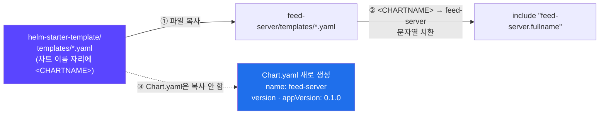
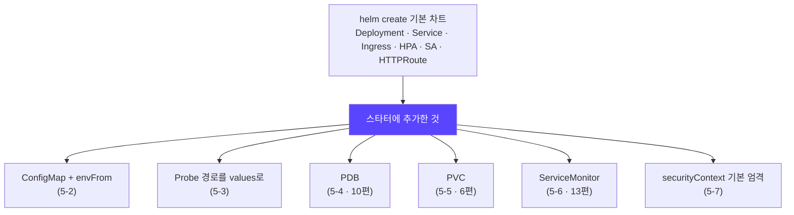
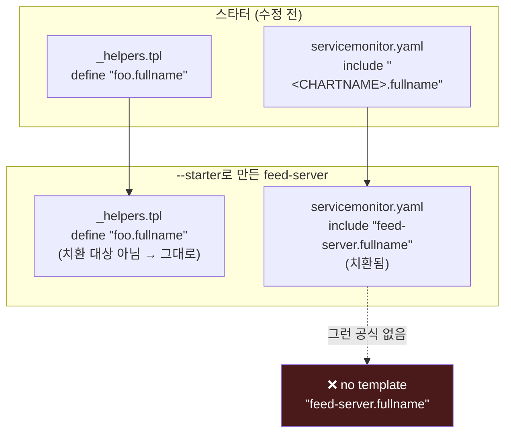
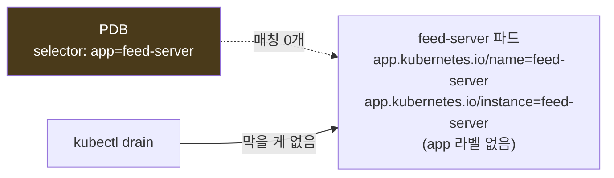

## 📚 들어가며

[12편](/posts/EKS-Rebuild-12-Helm-Chart-Template-Values/)~[16편](/posts/EKS-Rebuild-16-MySQL-Operator-InnoDB-Cluster/)에서 설치한 Redis, Kafka(Strimzi), MySQL Operator는 모두 **공개(Public) Helm 차트**였다. 남이 만든 차트에 values만 바꿔 넣으면 됐다.

그런데 이제 올릴 SNS 애플리케이션의 서버들(feed-server, user-server, image-server …)은 **우리가 만든 앱**(In-House Private Application)이다. 공개 차트가 없으니 차트를 **직접** 만들어야 한다.

이번 편은 그 차트를 서비스마다 처음부터 만들지 않도록, **"회사 표준 차트"의 틀인 Starter Template**을 만든다. 다음 편에서 이 틀로 SNS 서비스 차트들을 찍어낸다.


`helm install`로만 Helm을 써본 사람을 대상으로, 차트 구조, Go 템플릿 문법, `_helpers.tpl`, Starter Template과 `<CHARTNAME>` 플레이스홀더, PDB·ServiceMonitor·securityContext를 설명했다.

> **이번 편 학습 지도**
>
> ```
> 왜 (1~2장)                 문법 (3장)                스타터 (4~5장)                검증 (6장) 🔦
> ──────────                 ──────────                ──────────────                ─────────────
> 사내 앱도 공개 차트 수준    if · with · range         --starter = 복사 + 치환       foo와 <CHARTNAME> 혼재
> helm create의 한계          include · nindent         ConfigMap · Probe · PDB       PDB selector 불일치
> HTTPRoute까지 생성 (v4)     toYaml · quote            PVC · ServiceMonitor          → 전부 켜고 렌더링
>                                                       securityContext 기본 엄격
> ```

---

## 1. 왜 사내 애플리케이션 차트를 직접 만드나

강의가 강조하는 점은 **"사내 차트도 공개 차트 수준의 기능과 재사용성이 필요하다"** 는 것이다. 강의 슬라이드의 Redis 차트 일부를 보면 공개 차트가 얼마나 많은 것을 values로 열어두는지 알 수 있다.

```yaml
# Redis Helm Chart 예시 (강의 슬라이드)
containers:
- name: redis
  image: {{ template "redis.image" . }}
  imagePullPolicy: {{ .Values.image.pullPolicy | quote }}
  {{- if .Values.master.lifecycleHooks }}
  lifecycle: {{- include "common.tplvalues.render" (dict "value" .Values.master.lifecycleHooks "context" $) | nindent 12 }}
  {{- end }}
  {{- if .Values.master.containerSecurityContext.enabled }}
  securityContext: {{- omit .Values.master.containerSecurityContext "enabled" | toYaml | nindent 12 }}
  {{- end }}
  ...
```

거의 모든 설정이 `if .Values.xxx`로 켜고 끌 수 있게 되어 있다. 이래야 환경(dev/prod)이나 고객사마다 **values만 바꿔서 같은 차트를** 쓸 수 있다. 13편에서 Redis 차트의 `sysctl.enabled`, `serviceMonitor.enabled`를 values로 껐다 켰다 할 수 있었던 것도 이 구조 덕분이다.

---

## 2. `helm create` 기본 차트와 그 한계

### 2-1. 기본 차트 만들기

```bash
helm version
helm create foo
ls foo/templates/
```

| 항목 | 강의 (Helm v3.14.0) | 내 실습 (Helm v4.3.1) |
|---|---|---|
| templates/ | NOTES.txt, deployment, ingress, serviceaccount, `_helpers.tpl`, hpa, service, tests | 왼쪽 전부 + **`httproute.yaml`** |

최신 `helm create`는 **Gateway API의 HTTPRoute** 템플릿까지 만들어준다. Gateway API는 Ingress의 후속 표준으로, values의 `httpRoute.enabled: true`로 켤 수 있다. 이 시리즈는 AWS Load Balancer Controller의 Ingress를 쓰므로(5편) 꺼둔 채로 둔다. 1편부터 반복된 "강의 시점과 지금의 차이"가 `helm create` 한 줄에서도 보인다.

### 2-2. 차트 디렉토리 구조

```
foo/
├── Chart.yaml          # 차트 메타데이터 (이름, 차트 버전, 앱 버전)
├── values.yaml         # 템플릿에 들어갈 기본값
├── charts/             # 의존 차트(서브차트)
└── templates/
    ├── _helpers.tpl    # 재사용 템플릿 조각 정의 (_로 시작 → 리소스로 렌더링 안 됨)
    ├── deployment.yaml
    ├── service.yaml
    ├── ingress.yaml
    ├── hpa.yaml
    ├── serviceaccount.yaml
    ├── NOTES.txt       # install 후 터미널에 출력되는 안내문
    └── tests/          # helm test로 실행하는 테스트 파드
```

12편에서 남이 만든 차트를 **읽는** 입장으로 본 구조를, 이번엔 **쓰는** 입장에서 본다.

- **`Chart.yaml`의 `version` vs `appVersion`** — `version`은 차트 자체의 버전(템플릿을 고치면 올림), `appVersion`은 배포하는 앱의 버전이다(12편의 "포장지 vs 내용물"). 이미지 태그를 values에 안 쓰면 `appVersion`이 태그로 쓰인다(`.Values.image.tag | default .Chart.AppVersion`).

### 2-3. 기본 차트에 없는 것

강의가 꼽은 기본 차트의 한계는 셋이다.

- **ConfigMap, ServiceMonitor** 같은 실무 필수 리소스가 없다.
- **Requests/Limits**, Probe, 보안 설정 같은 상세 설정이 비어 있거나 주석 처리돼 있다.
- 고객사(환경)마다 필요한 **보안·고가용성 설정**(PDB 등)을 넣을 자리가 없다.

9편(requests), 10편(PDB, Graceful Shutdown), 13편(ServiceMonitor) — **이 시리즈에서 "운영에 필요하다"고 배운 것들이 기본 차트에는 거의 다 빠져 있다.** 그걸 채우는 게 이번 편의 일이다.

---

## 3. 먼저 알아야 할 Helm 템플릿 문법

Helm 템플릿은 **Go 템플릿** 문법이다. 12편에서 일부를 봤는데, 이번 실습에서 쓰는 것을 모아 정리했다.

| 문법 | 의미 | 예 |
|---|---|---|
| `{{ .Values.x }}` | values.yaml(또는 `-f`, `--set`) 값 | `{{ .Values.pdb.minAvailable }}` |
| `{{ .Release.Name }}` | `helm install <이름>`의 그 이름 | `{{ .Release.Name }}-configmap` |
| `{{ .Chart.Name }}` | Chart.yaml의 name | 컨테이너 이름 |
| `{{- ... }}` / `{{ ... -}}` | 왼쪽/오른쪽 **공백·줄바꿈 제거** | 빈 줄이 생기지 않게 |
| `if ... end` | 조건부 렌더링 | `{{- if .Values.pdb.enabled }}` |
| `with ... end` | 값이 비어 있지 않을 때만 블록 실행, 블록 안에서 `.`이 그 값이 됨 | `{{- with .Values.resources }}` |
| `range $k, $v := ...` | map/list 반복 | ConfigMap data 채우기 |
| `include "이름" .` | `_helpers.tpl`에 `define`한 조각을 문자열로 가져옴 | `{{ include "foo.fullname" . }}` |
| `\| nindent N` | 줄바꿈 후 N칸 들여쓰기 (YAML 위치 맞추기) | `{{- toYaml . \| nindent 12 }}` |
| `\| toYaml` | values의 객체를 YAML 문자열로 | resources, securityContext 통째로 넣기 |
| `\| quote` | 큰따옴표로 감싸기 | ConfigMap 값은 문자열이어야 하므로 |

> **`include` vs `template`**: 둘 다 `define`한 조각을 불러오지만, `include`는 결과를 **파이프(`|`)로 넘길 수 있어서** `nindent`로 들여쓰기를 맞출 수 있다. 그래서 실무 차트는 거의 `include`를 쓴다. 1장의 Redis 예시에 `template "redis.image"`가 섞여 있는 건, 이미지 문자열처럼 **들여쓰기가 필요 없는 한 줄**이라서다.

---

## 4. Starter Template이란

### 4-1. 개념

**Starter Template**은 `helm create`가 차트를 만들 때 **기본 차트 대신 쓰는 "틀"** 이다.

```bash
helm create feed-server --starter <스타터 경로>
```

- 기본 차트의 빈 곳(ConfigMap, Probe, PDB, ServiceMonitor, 보안 설정)을 **미리 채워둔 세트**를 만들어 두면, 새 서비스 차트를 만들 때마다 같은 구성이 복사된다.
- 효과는 두 가지다. **배포의 일관성**(모든 서비스가 같은 구조) + **재사용성**(새 서비스 추가가 명령 한 줄).

### 4-2. 스타터의 동작 방식 (중요)



`--starter`로 차트를 만들면 Helm은 이렇게 동작한다.

1. 스타터 디렉토리의 파일을 새 차트 디렉토리로 **복사**하고,
2. 파일 안의 **`<CHARTNAME>` 문자열을 새 차트 이름으로 바꾸고**,
3. `Chart.yaml`은 **새로 생성**한다(이름 = 새 차트 이름, `version`·`appVersion` = 0.1.0).

실제로 feed-server의 `Chart.yaml`은 스타터의 것이 아니라 Helm이 새로 쓴 것이다.

```yaml
# sns/feed-server/Chart.yaml (Helm이 생성)
apiVersion: v2
appVersion: 0.1.0
description: A Helm chart for Kubernetes
name: feed-server
type: application
version: 0.1.0
```

그래서 스타터 자체의 `Chart.yaml`이 `name: foo`, `appVersion: "1.16.0"` 그대로여도 동작에는 영향이 없다.

> 스타터 위치: 경로를 그대로 주거나(`--starter <경로>/helm-starter-template`), `$(helm env HELM_DATA_HOME)/starters/` 아래에 두고 이름만 줄 수 있다. 내 환경은 `~/Library/helm/starters`가 없어서 경로로 지정했다.

**그래서 스타터의 템플릿은 차트 이름이 들어갈 자리에 전부 `<CHARTNAME>`을 써야 한다.** `_helpers.tpl`의 `define "foo.fullname"`처럼 이름이 박혀 있으면 새 차트에서도 그대로 `foo`가 남는다. 12편 3장에서 `_helpers.tpl`을 "이름을 만드는 공식"이라고 했는데, 그 **공식의 이름 자체**가 차트마다 달라져야 하는 것이다. (6장에서 실제로 이 문제가 생겼다.)

---

## 5. 스타터 만들기 — 추가한 리소스와 설정



### 5-1. 기본 차트 → 스타터로 (강의 절차)

```bash
helm create foo
mv foo helm-starter-template
mkdir ci && mv values.yaml ci/{CLUSTER_NAME}-values.yaml
```

내 practice에서는 `ci/mydev-values.yaml`로 옮겼다.

- **왜 values.yaml을 `ci/`로 옮기나** — 클러스터(환경)별 values를 `ci/<클러스터>-values.yaml`로 관리하는 이 강의의 규칙이다. 4편부터 LB Controller·Redis 등에 같은 규칙을 써왔다.
- **⚠️ 주의** — 차트 루트에 `values.yaml`이 없으므로 **설치할 때 `-f ci/mydev-values.yaml`을 빼면 실패한다.** 직접 확인해보니 `helm template feed-server .`만 실행하면 이렇게 깨진다.

  ```
  Error: feed-server/templates/tests/test-connection.yaml:14:63
    executing "..." at <.Values.service.port>:
      nil pointer evaluating interface {}.port
  ```

  기본값이 하나도 없어서 `.Values.service`가 nil이기 때문이다. `helm lint`도 `values.yaml: file does not exist`를 INFO로 알려준다. 12편에서 "차트의 `values.yaml`은 고치지 않고 바꿀 값만 따로 적는다"고 했는데, 스타터에서는 **아예 기본값 파일이 없는** 구조라 `ci/` 파일이 사실상 values.yaml 역할을 한다.

### 5-2. ConfigMap + envFrom

```yaml
# templates/configmap.yaml
{{- if .Values.configMap.enabled }}
apiVersion: v1
kind: ConfigMap
metadata:
  name: {{ .Release.Name }}-configmap
data:
  {{- range $key, $value := .Values.configMap.data }}
    {{ $key }}: {{ $value | quote }}
  {{- end }}
{{- end }}
```

```yaml
# templates/deployment.yaml (컨테이너 안)
          {{- if .Values.configMap.enabled }}
          envFrom:
            - configMapRef:
                name: {{ .Release.Name }}-configmap
          {{- end }}
```

```yaml
# values
configMap:
  enabled: false
  data:
    SPRING_PROFILES_ACTIVE: dev
```

- `range`로 values의 key/value를 그대로 ConfigMap data로 펼친다. 서비스마다 환경 변수가 달라도 **템플릿은 그대로 두고 values만** 바꾸면 된다.
- `envFrom.configMapRef`는 ConfigMap의 **모든 키를 컨테이너 환경 변수로** 넣는다. Spring 앱이면 `SPRING_PROFILES_ACTIVE` 같은 값을 여기서 준다.
- **`quote`를 쓰는 이유** — ConfigMap data 값은 반드시 문자열이어야 한다. `true`나 `8080` 같은 값이 따옴표 없이 들어가면 YAML이 bool/숫자로 해석해서 거부된다.

### 5-3. Liveness / Readiness Probe

```yaml
          {{- if .Values.probes.liveness.enabled }}
          livenessProbe:
            httpGet:
              path: {{ .Values.probes.liveness.path }}
              port: http
          {{- end }}
          {{- if .Values.probes.readiness.enabled }}
          readinessProbe:
            httpGet:
              path: {{ .Values.probes.readiness.path }}
              port: http
          {{- end }}
```

```yaml
probes:
  liveness:
    enabled: false
    path: /healthcheck/live
  readiness:
    enabled: false
    path: /healthcheck/ready
```

| Probe | 실패하면 | 묻는 것 |
|---|---|---|
| **Liveness** | kubelet이 컨테이너를 **재시작** | "살아 있나?" |
| **Readiness** | Service 엔드포인트에서 **빠짐** | "트래픽 받을 준비 됐나?" |

기본 차트는 경로가 `/`로 박혀 있는데, 이를 values로 빼서 서비스마다 경로를 바꿀 수 있게 했다. `port: http`는 컨테이너 포트의 **이름**을 참조한다. 15편에서 "probe 실패는 결과일 뿐, 원인은 로그에 있다"고 했는데, 그 probe를 이번엔 **만드는** 쪽에 섰다.

### 5-4. PodDisruptionBudget (PDB)

```yaml
# templates/pdb.yaml (처음 작성한 버전)
{{- if .Values.pdb.enabled }}
apiVersion: policy/v1
kind: PodDisruptionBudget
metadata:
  name: {{ .Release.Name }}
spec:
  minAvailable: {{ .Values.pdb.minAvailable }}
  selector:
    matchLabels:
      app: {{ .Release.Name }}       # ⚠️ 6-2에서 고침
{{- end }}
```

- **PDB**(10편)는 노드 drain, Karpenter consolidation 같은 **자발적 중단** 때 "최소 몇 개는 살아 있어야 한다"를 지정한다. `minAvailable: 1`이면 파드를 쫓아낼 때 최소 1개는 남을 때까지 eviction을 막는다. 노드 장애 같은 비자발적 중단은 막지 못한다.
- Karpenter가 노드를 자주 교체하는 이 클러스터에서는 특히 의미가 있다.
- **강의 슬라이드 오타** — 슬라이드의 pdb.yaml은 조건이 `{{- if .Values.configMap.enabled }}`로 되어 있다. ConfigMap을 켜면 PDB가 같이 켜지는 버그다. 내 파일은 `.Values.pdb.enabled`로 작성했다.
- ⚠️ selector에 진짜 문제가 하나 더 있었다. 6-2에서 다룬다.

### 5-5. PVC

```yaml
# templates/pvc.yaml
{{- if .Values.pvc.enabled }}
apiVersion: v1
kind: PersistentVolumeClaim
metadata:
  name: {{ .Release.Name }}-pvc
spec:
  accessModes:
    - {{ .Values.pvc.accessModes }}
  storageClassName: {{ .Values.pvc.storageClassName }}
  resources:
    requests:
      storage: {{ .Values.pvc.capacity }}
{{- end }}
```

```yaml
pvc:
  enabled: false
  accessModes: "ReadWriteOnce"
  storageClassName: "ebs-sc"
  capacity: "1Gi"
```

- `storageClassName` 기본값을 6편에서 만든 `ebs-sc`(gp3)로 뒀다.
- 이 템플릿은 **PVC만 만든다.** 파드에 붙이려면 values의 `volumes`/`volumeMounts`에 `claimName: <릴리스명>-pvc`를 직접 적어야 한다.
- EBS는 `ReadWriteOnce`라서 **한 노드에서만** 마운트된다(6편 1-7). Deployment의 replica가 여러 노드에 퍼지면 두 번째 파드부터 붙지 못한다. 데이터가 필요한 앱은 13편처럼 StatefulSet이나 S3 같은 외부 저장소를 고려해야 한다.

### 5-6. ServiceMonitor

```yaml
# templates/servicemonitor.yaml
{{- if .Values.metrics.enabled }}
apiVersion: monitoring.coreos.com/v1
kind: ServiceMonitor
metadata:
  name: {{ include "<CHARTNAME>.fullname" . }}
spec:
  selector:
    matchLabels:
      {{- include "<CHARTNAME>.selectorLabels" . | nindent 6 }}
  endpoints:
  - port: http
    path: {{ .Values.metrics.path }}
    interval: 10s
{{- end }}
```

- **ServiceMonitor**는 Prometheus Operator(kube-prometheus-stack)의 CRD다. "이 라벨을 가진 Service의 `http` 포트 `/metrics`를 10초마다 긁어 가라"를 선언한다. Prometheus 설정 파일을 직접 고치지 않고 **앱 차트 안에서** 모니터링 대상을 등록할 수 있다.
- CRD가 없는 클러스터에서 켜면 `no matches for kind "ServiceMonitor"`로 설치가 실패한다(13편 4-1). 그래서 기본값은 `enabled: false`이고, kube-prometheus-stack을 설치한 뒤 켠다.

### 5-7. Security Context — "기본이 엄격, 필요하면 완화"

```yaml
# Security
podSecurityContext:
  runAsNonRoot: true
  runAsUser: 1000
  runAsGroup: 2000
  fsGroup: 3000

securityContext:
  allowPrivilegeEscalation: false
  privileged: false
  capabilities:
    drop:
    - ALL
  readOnlyRootFilesystem: false
```

| 필드 | 레벨 | 의미 |
|---|---|---|
| `runAsNonRoot: true` | 파드 | 이미지가 root(UID 0)로 실행되려 하면 **컨테이너 시작을 거부** |
| `runAsUser` / `runAsGroup` | 파드 | 프로세스의 UID/GID 지정 |
| `fsGroup` | 파드 | 마운트된 볼륨의 그룹 소유권을 이 GID로 바꿔서 쓰기 가능하게 |
| `allowPrivilegeEscalation: false` | 컨테이너 | setuid 등으로 권한 상승 금지 |
| `privileged: false` | 컨테이너 | 호스트 장치 접근 같은 특권 모드 금지 |
| `capabilities.drop: [ALL]` | 컨테이너 | 리눅스 capability(예: 1024 미만 포트 바인딩 `NET_BIND_SERVICE`) 전부 제거 |
| `readOnlyRootFilesystem` | 컨테이너 | 루트 파일시스템 읽기 전용 (여기선 false) |

- 기본 차트는 이 값들이 주석 처리된 빈 값(`{}`)이다. 스타터에서 **"기본이 엄격, 필요하면 완화"** 로 뒤집은 것이 핵심이다. 13편에서 Redis 차트의 command 없는 `sysctl`(빈 privileged 컨테이너)을 끈 것과 같은 방향이다 — **필요 없는 권한은 처음부터 주지 않는다.**
- deployment.yaml은 `{{- with .Values.podSecurityContext }} ... toYaml`로 values를 통째로 넣기 때문에 템플릿 수정 없이 values만 바꾸면 된다.
- ⚠️ 이렇게 엄격하면 **root로 도는 이미지는 못 뜬다.** 다음 편에서 placeholder 이미지로 둔 `nginx`가 바로 그런 이미지다.

---

## 6. 🔦 직접 렌더링해 보니 — 스타터의 문제 2개

`helm template`(클러스터 없이 YAML만 렌더링하는 명령)으로 feed-server 차트를 확인했더니 문제가 두 가지 나왔다. 둘 다 **기본값이 꺼져 있어서 평소엔 드러나지 않는** 종류였다.

### 6-1. `foo`와 `<CHARTNAME>`이 섞여 있음 → ServiceMonitor를 켜면 렌더링 실패

내 스타터는 `helm create foo`로 만든 기본 차트를 바탕으로 했다. 그래서 `_helpers.tpl`과 deployment 등에는 `foo.fullname`이 박혀 있었다. 그런데 servicemonitor.yaml만 강의 레포에서 가져와서 `<CHARTNAME>.fullname`을 쓰고 있었다.



`--starter`로 feed-server를 만들면 `<CHARTNAME>`만 `feed-server`로 바뀐다. 공식을 **정의하는 쪽**은 `foo`인데 **부르는 쪽**만 `feed-server`가 된 것이다.

```bash
helm template feed-server . -f ci/mydev-values.yaml --set metrics.enabled=true
```

```
Error: feed-server/templates/servicemonitor.yaml:5:11
    error calling include:
template: no template "feed-server.fullname" associated with template "gotpl"
```

기본값이 `metrics.enabled: false`라서 평소에는 드러나지 않는다. **모니터링을 붙이는 날 터지는 버그**다.

**해결**: 강의 레포처럼 스타터의 모든 파일에서 `foo`를 `<CHARTNAME>`으로 바꿨다.

```bash
cd helm-starter-template
grep -rl 'foo\.' templates/ | xargs sed -i '' 's/"foo\./"<CHARTNAME>./g'
grep -rn 'foo' templates/   # 남은 것 확인
```

이미 만든 feed-server와 image-server는 `foo`를 각자의 차트 이름으로 맞췄다.

### 6-2. PDB의 selector가 파드 라벨과 안 맞음 → PDB가 아무것도 보호하지 않음

```bash
helm template feed-server . -f ci/mydev-values.yaml --set pdb.enabled=true
```

렌더링 결과를 비교하면 이렇다.

| | 라벨 |
|---|---|
| PDB selector (수정 전) | `app: feed-server` |
| Deployment가 만드는 파드 | `app.kubernetes.io/name: feed-server`, `app.kubernetes.io/instance: feed-server` |



파드에는 `app` 라벨이 없다. **PDB는 에러 없이 생성되지만 매칭되는 파드가 0개**라서 drain 때 아무것도 막지 못한다. 에러가 안 나서 더 위험한 유형이다. (강의 레포의 스타터도 같은 selector를 쓴다.)

10편에서 "ALLOWED DISRUPTIONS가 0인 PDB는 노드를 영원히 못 비운다"는 **너무 빡빡한 PDB**의 함정을 봤다. 이번엔 반대로 **아무것도 지키지 않는 PDB**다. 둘 다 PDB 리소스는 멀쩡히 존재한다는 점이 같다. 4편 함정 ②, 6편 2-4, 9편에 이어 **"이름(라벨)이 어긋나면 에러 없이 조용히 실패한다"** 는 패턴이 또 나왔다.

**해결**: Deployment와 **같은 헬퍼**를 쓴다.

```yaml
  selector:
    matchLabels:
      {{- include "<CHARTNAME>.selectorLabels" . | nindent 6 }}
```

이렇게 하면 PDB와 Deployment가 **같은 공식**에서 라벨을 받으니 절대 어긋나지 않는다. 12편 3-5의 "공식을 한 곳에 두면 모든 리소스 이름이 같은 규칙으로 나온다"가 라벨에도 그대로 적용된다.

클러스터에 설치된 상태라면 이렇게 확인한다.

```bash
kubectl get pdb <이름> -o jsonpath='{.status.expectedPods}'   # 매칭되는 파드가 0개면 0
kubectl get pdb                                                # ALLOWED DISRUPTIONS도 0
```

### 6-3. 고친 뒤 확인

두 수정을 반영하고, **모든 옵션을 켠 상태로** 다시 렌더링했다.

```bash
helm lint . -f ci/mydev-values.yaml \
  --set pdb.enabled=true,metrics.enabled=true,pvc.enabled=true,configMap.enabled=true,autoscaling.enabled=true
# 1 chart(s) linted, 0 chart(s) failed
```

렌더링된 리소스는 ConfigMap, Deployment, HPA, Ingress, PVC, PDB, Service, ServiceAccount, ServiceMonitor, 테스트 Pod까지 **10종 모두 정상**이었다. PDB selector도 이제 파드 라벨과 같다.

```
PDB selector:  app.kubernetes.io/name: feed-server
               app.kubernetes.io/instance: feed-server
파드 라벨:     app.kubernetes.io/name: feed-server
               app.kubernetes.io/instance: feed-server
```

고친 스타터로 `helm create demo-server --starter ...`를 새로 만들어봐도 `<CHARTNAME>`이 하나도 남지 않고 전부 `demo-server`로 치환됐다.

> **💡 교훈 — 스타터는 모든 옵션을 켜고 렌더링해본다**
>
> 템플릿은 `enabled: false`인 블록은 **렌더링조차 안 된다.** 그 안에 버그가 있어도 아무도 모른다. 스타터처럼 "여러 서비스가 물려받는 틀"이라면, 만든 직후 **모든 옵션을 켠 상태로 `helm template`/`helm lint`를 한 번 돌려보는 것**이 좋다.
>
> ```bash
> helm template t . -f ci/mydev-values.yaml \
>   --set pdb.enabled=true,metrics.enabled=true,pvc.enabled=true,configMap.enabled=true,autoscaling.enabled=true
> ```
>
> 15편에서 "장애가 났던 조건을 일부러 다시 만들어서 검증한다"고 했는데, 템플릿에서는 **꺼져 있는 조건을 일부러 다 켜서** 검증하는 셈이다.

---

## 📝 이번 편 요약

```
왜
├─ 사내 앱 차트도 공개 차트처럼 values로 켜고 끌 수 있어야 환경마다 재사용
└─ helm create 기본 차트엔 ConfigMap · ServiceMonitor · PDB · 보안 설정이 없다 (v4는 HTTPRoute 추가)

Starter Template
├─ helm create <이름> --starter <경로>
├─ 동작: 파일 복사 + <CHARTNAME>만 치환 + Chart.yaml은 새로 생성
└─ 그래서 스타터의 차트 이름 자리는 전부 <CHARTNAME>

스타터에 채운 것
├─ ConfigMap(range + quote) + envFrom
├─ Probe 경로를 values로
├─ PDB · PVC(ebs-sc) · ServiceMonitor(기본 off)
├─ securityContext 기본 엄격 (runAsNonRoot · drop ALL)
└─ values는 ci/<클러스터>-values.yaml → -f 필수

검증 🔦
├─ foo와 <CHARTNAME> 혼재 → ServiceMonitor 켜는 날 렌더링 실패
├─ PDB selector(app=) ≠ 파드 라벨(app.kubernetes.io/*) → 조용히 아무것도 안 지킴
└─ 해결 후 모든 옵션 ON으로 lint · template 통과
```

| 개념 | 한 줄 정의 |
|---|---|
| **Starter Template** | `helm create`가 기본 차트 대신 복사하는 사용자 정의 차트 틀 |
| **`<CHARTNAME>`** | 스타터 안에서 새 차트 이름으로 치환되는 플레이스홀더 |
| **`range`** | values의 map/list를 반복해서 펼치는 템플릿 문법 |
| **`envFrom.configMapRef`** | ConfigMap의 모든 키를 환경 변수로 넣기 |
| **Liveness / Readiness Probe** | 실패 시 재시작 / 실패 시 엔드포인트에서 제외 |
| **ServiceMonitor** | Prometheus Operator의 CRD. 앱 차트 안에서 수집 대상을 선언 |
| **`runAsNonRoot`** | root로 실행하려는 컨테이너의 시작을 거부 |
| **`capabilities.drop: [ALL]`** | 리눅스 capability를 모두 제거 |
| **`selectorLabels`** | `_helpers.tpl`의 라벨 공식. Deployment·Service·PDB가 공유해야 어긋나지 않음 |

---

## 💭 느낀 점

**1. 차트를 "읽는" 것과 "쓰는" 것은 달랐다.**

12편에서 `_helpers.tpl`이 공식이라는 걸 배웠을 때는 남의 차트를 이해하는 데 썼다. 이번엔 직접 스타터를 만들면서, 그 공식의 **이름까지** 차트마다 달라져야 한다는 걸 알게 됐다. `foo.fullname`이 한 군데만 `<CHARTNAME>`으로 바뀌어 있어도 렌더링이 깨진다. 읽을 때는 보이지 않던 것이 쓸 때 보인다.

**2. 꺼져 있는 코드는 테스트되지 않은 코드다.**

두 버그 모두 기본값이 `false`라서 평소엔 아무 문제가 없었다. ServiceMonitor 버그는 모니터링을 붙이는 날, PDB 버그는 노드가 drain되는 날 — 즉 **정작 그 기능이 필요한 순간에** 드러날 버그였다. 15편에서 "테스트가 그 버그를 밟지 않았을 뿐"이라고 썼던 게 템플릿에서도 똑같이 나타났다.

**3. "조용히 실패하는" 버그가 시리즈 내내 반복된다.**

Pod Identity 이름 불일치(4편), 애드온 SA 이름 오타(6편), 그리고 이번 PDB selector. 셋 다 리소스는 멀쩡히 만들어지는데 **실제로는 아무 일도 안 하는** 상태다. 이번에 찾은 해결책 — 같은 헬퍼(`selectorLabels`)를 쓰게 해서 **애초에 어긋날 수 없게** 만드는 것 — 이 이런 종류의 버그에 대한 가장 확실한 대응인 것 같다.

---

## 🔗 다음 편 예고

다음 편은 이 스타터로 SNS 애플리케이션의 **feed-server, image-server 차트**를 만들고, AWS Load Balancer Controller의 **IngressGroup**(5편)으로 여러 서비스를 ALB 하나에 묶는 Ingress 설정을 정리한다. 이번 편 5-7의 엄격한 securityContext 때문에 placeholder 이미지인 `nginx`가 어떻게 되는지도 거기서 다룬다.

---

## 📚 참고

- [Helm — Chart Starter Packs](https://helm.sh/docs/topics/charts/#chart-starter-packs)
- [Helm — Chart Template Guide](https://helm.sh/docs/chart_template_guide/)
- [Kubernetes — Configure a Security Context for a Pod or Container](https://kubernetes.io/docs/tasks/configure-pod-container/security-context/)
- [Kubernetes — Configure Liveness, Readiness and Startup Probes](https://kubernetes.io/docs/tasks/configure-pod-container/configure-liveness-readiness-startup-probes/)
- [Prometheus Operator — ServiceMonitor](https://prometheus-operator.dev/docs/developer/getting-started/)

> 2-1의 Helm 버전은 `helm version --short` 기준이다. 5-1의 values 없이 렌더링한 에러, 6장의 두 문제와 6-3의 수정 후 검증(모든 옵션 ON `helm lint`·`helm template`, 고친 스타터로 새 차트 생성)은 직접 렌더링해서 확인한 결과다. 6장의 수정은 practice 레포에 커밋돼 있다.
