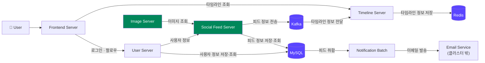
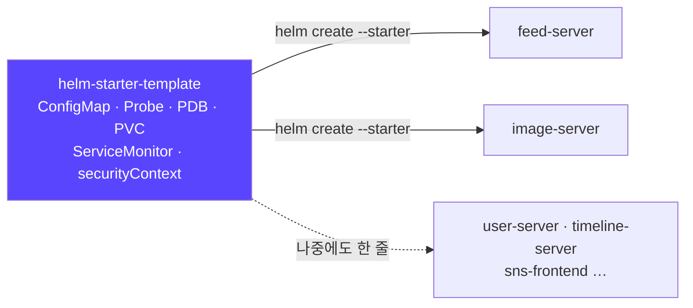
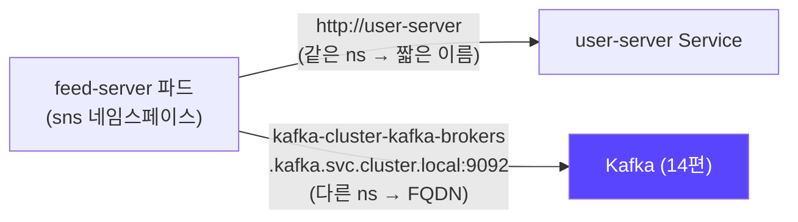
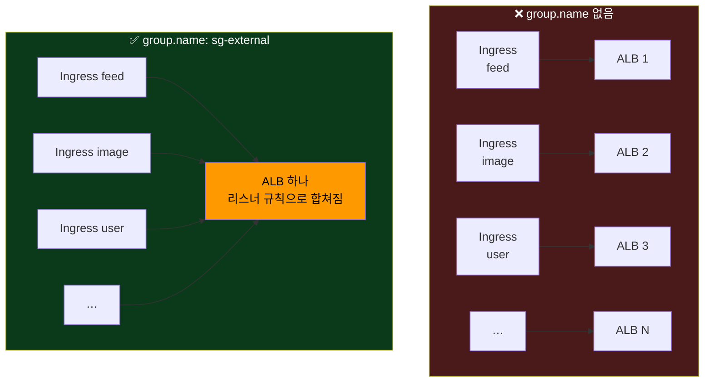
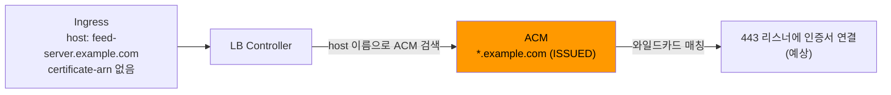
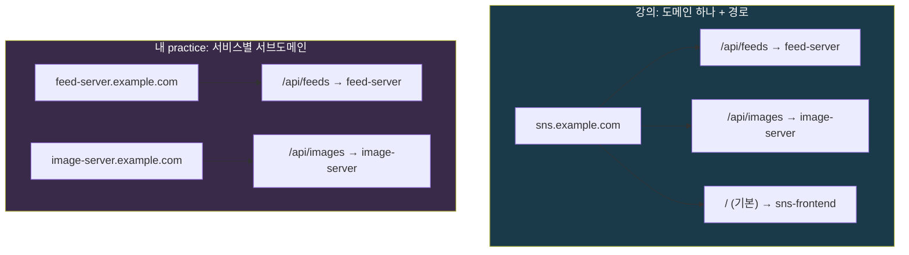
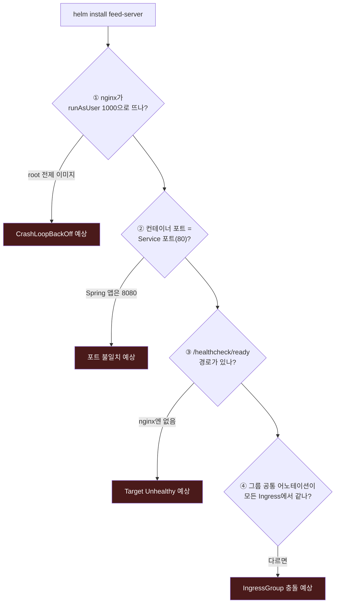

## 📚 들어가며

[18편](/posts/EKS-Rebuild-18-Helm-Starter-Template/)에서 "회사 표준 차트"의 틀인 **Starter Template**을 만들었다. 이번 편은 그 틀로 SNS 애플리케이션의 서비스 차트를 **찍어내고**, 각 서비스를 외부에 노출하는 **Ingress 설정**을 values로 채운다.

핵심은 둘이다.

- **Starter 한 줄로 차트 만들기** — 서비스별로 다른 건 values에만 둔다
- **IngressGroup** — 서비스가 여러 개여도 **ALB는 하나만** 만든다

그리고 강의와 다르게 간 부분이 하나 있다. 강의는 **도메인 하나 + 경로**로 서비스를 나눴는데, 내 practice는 **서비스마다 서브도메인**을 줬다. 이 설계 차이를 비교하는 게 이번 편의 개성이다.

**아직 클러스터에 배포하지는 않았다.** 렌더링까지 확인했고, 마지막 장은 "배포 전에 걸릴 것으로 예상되는 함정"으로 마무리한다.

> **이번 편 학습 지도**
>
> ```
> 차트 만들기 (1~3장)          Ingress (4장)                  설계 (5장)                  배포 전 (6장)
> ───────────────────          ─────────────                  ──────────                  ─────────────
> SNS 앱 구성 = 13~16편 연결   ALB 어노테이션 하나씩           도메인 하나 + 경로 (강의)     렌더링까지 확인
> helm create --starter        IngressGroup 🔦 = ALB 하나     서비스별 서브도메인 (나)      예상 함정 4가지
> 차이는 values에만             인증서 자동 탐색               CORS · 인증서 · DNS 차이     (배포로 확인 전)
> ```

---

## 1. SNS 애플리케이션 구성

강의의 실습용 SNS 앱은 EKS 위에 이렇게 구성된다. 강의 슬라이드의 구성도를 정리했다.



| 구성 요소 | 역할 | 이 시리즈에서 |
|---|---|---|
| Frontend Server | 사용자 화면 | 차트 미작성 |
| User Server | 로그인, 팔로우, 사용자 정보 | 차트 미작성 |
| **Social Feed Server** (feed-server) | 피드 저장·조회, Kafka로 피드 이벤트 전송 | **이번 편에서 차트 작성** |
| **Image Server** | 이미지 조회 | **이번 편에서 차트 작성** |
| Timeline Server | Kafka에서 받은 피드로 타임라인을 만들어 Redis에 저장 | 차트 미작성 |
| Notification Batch | 피드를 모아 이메일 발송 | 차트 미작성 |
| Kafka / Redis / MySQL | 상태 저장 (Stateful) | 13·14·16편에서 설치 |

보라색 세 개가 13·14·16편에서 설치한 것들이다. **그동안 "앱이 이 주소로 찾아오니 이름을 바꾸면 안 된다"고 반복했던 바로 그 앱들**이 이제 등장한다. 17편에서 Stateful 앱이라고 묶었던 세 개가 이 SNS 앱의 백엔드였다.

---

## 2. Starter로 서비스 차트 만들기

```bash
helm create feed-server  --starter <경로>/helm-starter-template
helm create image-server --starter <경로>/helm-starter-template
```



- 만들어진 차트는 스타터의 템플릿(ConfigMap, PDB, PVC, ServiceMonitor, 보안 설정 포함)을 그대로 가진다. `Chart.yaml`만 Helm이 새로 만든다(이름 = 차트 이름, version/appVersion = 0.1.0, 18편 4-2).
- 나중에 서비스가 늘어도(user-server, timeline-server …) **명령 한 줄**이면 같은 구조의 차트가 생긴다. 이게 18편에서 스타터를 만든 이유다.
- 18편 6장에서 고친 스타터 버그(`foo`/`<CHARTNAME>` 혼용, PDB selector)는 이 두 차트에도 복사돼 있었는데, 스타터와 함께 세 차트 모두 고쳤다.

practice에서는 처음에 레포 루트에 만들었다가, 강의 레포 구조에 맞춰 `sns/` 아래로 옮겼다.

```
practice/
├── helm-starter-template/
└── sns/
    ├── feed-server/
    │   ├── Chart.yaml
    │   ├── ci/mydev-values.yaml
    │   └── templates/...
    └── image-server/
        ├── Chart.yaml
        ├── ci/mydev-values.yaml
        └── templates/...
```

---

## 3. 서비스별 values 수정

**템플릿은 스타터에서 그대로 오고, 서비스마다 다른 것은 values에만 적는다.** 강의 슬라이드의 feed-server 예다.

```yaml
image:
  repository: <AWS_ACCOUNT_ID>.dkr.ecr.ap-northeast-2.amazonaws.com/feed-server
  pullPolicy: Always
  tag: "1.0.0"

configMap:
  enabled: true
  data:
    SPRING_PROFILES_ACTIVE: dev
    USER_SERVICE: http://user-server
```

- **이미지** — ECR(AWS의 컨테이너 레지스트리) 주소다. `pullPolicy: Always`는 같은 태그라도 매번 새로 받는다.
- **ConfigMap** — 18편의 ConfigMap 템플릿이 이 값을 환경 변수로 넣는다. `USER_SERVICE: http://user-server`는 **쿠버네티스 Service DNS 이름**이다. 같은 네임스페이스의 `user-server` Service로 요청이 간다.
  - 강의 레포의 완성본에는 `KAFKA_HOST: kafka-cluster-kafka-brokers.kafka.svc.cluster.local`, `KAFKA_PORT: "9092"`도 들어 있다. 다른 네임스페이스(`kafka`)의 서비스라서 FQDN(`<서비스>.<네임스페이스>.svc.cluster.local`)으로 적는다. **14편 5-3에서 "Kafka 이름은 `kafka-cluster`, 네임스페이스는 `kafka`여야 한다"고 고정했던 이유가 바로 이 한 줄**이다.



### 내 practice의 현재 상태

| 항목 | 강의 | 내 practice |
|---|---|---|
| image | ECR `feed-server:1.0.0` | 아직 `nginx` (placeholder, ECR 미생성) |
| configMap | enabled, 서비스 주소 등 | `enabled: false` (기본값 그대로) |
| ingress | 4장 | **작성 완료** |

feed-server와 image-server values를 `diff`해 보면 차이는 **ingress의 호스트와 경로뿐**이다.

```diff
-    external-dns.alpha.kubernetes.io/hostname: feed-server.example.com
+    external-dns.alpha.kubernetes.io/hostname: image-server.example.com
   hosts:
-  - host: feed-server.example.com
+  - host: image-server.example.com
     paths:
-    - path: /api/feeds
+    - path: /api/images
```

**두 서비스의 차이가 values의 세 줄**이라는 게 Starter Template의 효과를 그대로 보여준다.

---

## 4. Ingress 설정 — ALB 어노테이션 하나씩

```yaml
ingress:
  enabled: true
  className: "alb"
  annotations:
    alb.ingress.kubernetes.io/scheme: internet-facing
    alb.ingress.kubernetes.io/target-type: ip
    alb.ingress.kubernetes.io/group.name: sg-external
    alb.ingress.kubernetes.io/listen-ports: '[{"HTTP": 80}, {"HTTPS":443}]'
    alb.ingress.kubernetes.io/ssl-redirect: "443"
    alb.ingress.kubernetes.io/success-codes: '200,302'
    # alb.ingress.kubernetes.io/certificate-arn: arn:aws:acm:ap-northeast-2:${AWS_ACCOUNT_ID}:certificate/${CERTIFICATE_ID}
    alb.ingress.kubernetes.io/healthcheck-path: /healthcheck/ready
    external-dns.alpha.kubernetes.io/hostname: feed-server.example.com
  hosts:
  - host: feed-server.example.com
    paths:
    - path: /api/feeds
      pathType: Prefix
  tls: []
```

5편에서 echoserver로 처음 본 어노테이션들이 거의 그대로다. 5편이 "테스트 Ingress 하나"였다면, 이번엔 **실제 서비스 차트의 values**로 들어갔다.

| 설정 | 의미 |
|---|---|
| `className: alb` | AWS Load Balancer Controller가 이 Ingress를 처리하게 한다 (IngressClass `alb`) |
| `scheme: internet-facing` | 퍼블릭 서브넷에 인터넷용 ALB 생성. 내부용이면 `internal` |
| `target-type: ip` | ALB가 **파드 IP로 직접** 보낸다(노드 포트를 거치지 않음). VPC CNI 환경이라 파드가 VPC IP를 가지므로 가능(6편). `instance`는 NodePort 경유 |
| **`group.name: sg-external`** | **IngressGroup.** 같은 group.name을 가진 Ingress들은 **ALB 하나를 공유**하고, 각 Ingress의 규칙이 그 ALB의 리스너 규칙으로 합쳐진다 (4-1) |
| `listen-ports` | 리스너 80, 443을 연다 |
| `ssl-redirect: "443"` | 80으로 온 요청을 443으로 리다이렉트 |
| `success-codes: '200,302'` | Target Group 헬스체크가 성공으로 볼 HTTP 코드 |
| `healthcheck-path` | ALB 헬스체크 경로. 18편 readiness 경로와 맞춘 `/healthcheck/ready` |
| `certificate-arn` | HTTPS 리스너용 ACM 인증서. **주석 처리돼 있다** (4-2) |
| `external-dns…/hostname` | external-dns가 이 이름으로 DNS 레코드(→ ALB 주소)를 만든다. 나는 Cloudflare 연동(4편) |
| `pathType: Prefix` | `/api/feeds`로 **시작하는** 모든 경로 (`/api/feeds/123` 포함) |

### 4-1. 🔦 IngressGroup — 서비스마다 ALB를 만들지 않기

`group.name`이 없으면 **Ingress 하나당 ALB 하나**가 생긴다. 서비스가 6개면 ALB가 6개다. ALB는 시간당 과금이라 비용과 관리 부담이 같이 커진다.



`group.name: sg-external`을 모든 서비스에 똑같이 주면 ALB는 하나만 생기고 **규칙만 쌓인다.** 강의 슬라이드의 ALB 콘솔 화면(리스너 규칙)을 옮기면 이렇다.

| 우선순위 | 조건 | 대상 Target Group |
|:---:|---|---|
| 1 | Path `/api/feeds`, `/api/feeds/*` + Host `sns.<도메인>` | feed-server |
| 2 | Path `/api/images`, `/api/images/*` + Host | image-server |
| 3 | Path `/api/timeline`, `/api/timeline/*` + Host | timeline-server |
| 4 | Path `/api/follows`, `/api/follows/*` + Host | user-server |
| 5 | Path `/api/users`, `/api/users/*` + Host | user-server |
| 기본 | 그 외 전부 | sns-frontend |

- Ingress의 `Prefix /api/feeds` 하나가 ALB에서는 **`/api/feeds` OR `/api/feeds/*`** 두 패턴으로 바뀐 것을 볼 수 있다. ALB의 경로 조건엔 "Prefix"라는 개념이 없어서, 컨트롤러가 같은 의미의 두 패턴으로 번역한 것이다.
- Target Group의 등록 대상은 **파드 IP:컨테이너 포트**다. `target-type: ip`이기 때문이다.
- 규칙 순서를 직접 정하고 싶으면 `alb.ingress.kubernetes.io/group.order` 어노테이션을 쓴다.

> 5편 1-3에서 echoserver(`default` 네임스페이스)와 nginx-hello(`nginx` 네임스페이스)에 같은 `sg-external`을 줬더니 **네임스페이스가 달라도 ALB가 하나**였다. 그 그룹 이름이 그대로 SNS 서비스들에도 쓰인다. 같은 그룹에 있는 Ingress는 **어느 네임스페이스에 있든** 같은 ALB에 들어간다.

### 4-2. 인증서 ARN이 주석인데 HTTPS가 되나 — ACM 인증서 자동 탐색

`certificate-arn`은 강의 슬라이드에는 명시돼 있지만, **강의 레포의 완성본 values에서도 주석 처리**돼 있다. 내 values도 그 줄을 그대로 주석으로 뒀다. 그런데 HTTPS 443 리스너에는 인증서가 반드시 필요하다.



AWS Load Balancer Controller는 `certificate-arn`이 없으면 **Ingress의 host 이름으로 ACM에서 맞는 인증서를 자동으로 찾는다**(certificate discovery). 내 계정 ACM을 조회해보면 와일드카드 인증서가 있다.

```bash
aws acm list-certificates --region ap-northeast-2 \
  --query 'CertificateSummaryList[].[DomainName,Status]' --output text
# *.example.com   ISSUED
```

따라서 `feed-server.<도메인>`, `image-server.<도메인>` 둘 다 이 인증서로 매칭될 것으로 예상한다. 5편 1-3의 팁 박스에서 "ACM 인증서는 미리 발급받아 둬야 하고, ALB와 같은 리전이어야 한다"고 했는데, 그때 발급해둔 와일드카드 인증서가 여기서 쓰인다.

**계정 ID나 인증서 ID를 Git에 남기지 않아도 된다**는 장점도 있다. 15편에서 "재생성하면 바뀌는 값은 애초에 적지 않는다"고 했던 것처럼, 인증서 ARN도 적지 않으면 고칠 일이 없다. **단, 실제 배포로 확인한 것은 아니다**(6장).

---

## 5. 설계 비교 — 도메인 하나 + 경로 vs 서비스별 서브도메인

강의 레포의 SNS 서비스 values를 열어보면 호스트가 전부 `sns.<도메인>` 하나이고, 서비스는 경로로만 나뉜다. 내 practice는 서비스마다 서브도메인을 줬다.



| | 강의 | 내 practice |
|---|---|---|
| 호스트 | 모든 서비스가 `sns.<도메인>` 하나 | `feed-server.<도메인>`, `image-server.<도메인>` 서비스별 |
| 서비스 구분 | **경로**(`/api/feeds`, `/api/images` …) | **호스트 + 경로** |
| ALB | IngressGroup으로 1개 | IngressGroup으로 1개 (같음) |
| DNS 레코드 | 1개 | 서비스 수만큼 |
| 인증서 | `sns.<도메인>` 하나면 충분 | 와일드카드 필요 (이미 있음) |

**ALB가 하나라는 점은 같다.** IngressGroup은 호스트가 달라도 규칙을 한 ALB에 합쳐준다. 차이는 그 ALB 앞의 **DNS와 인증서**, 그리고 **frontend가 API를 부르는 방식**이다.

**고려할 점 — frontend와 CORS.** 강의 구조에서 frontend는 **같은 도메인(`sns.<도메인>`)의 `/api/...`로** API를 호출한다. 기본 규칙(경로 미매칭)이 frontend로 가는 것도 그래서다. 서비스별 서브도메인으로 나누면 frontend가 **다른 출처(origin)** 를 호출하게 되어 **CORS 설정**이 필요해지고, frontend 코드가 각 API의 주소를 따로 알아야 한다.

| | 같은 도메인 + 경로 | 서비스별 서브도메인 |
|---|---|---|
| frontend → API | 같은 출처, 상대 경로(`/api/feeds`) | 다른 출처, 절대 주소 필요 |
| CORS | 필요 없음 | 서비스마다 허용 설정 필요 |
| 서비스 하나만 따로 노출·차단 | 경로 규칙으로 | DNS 레코드 단위로도 가능 |

지금은 feed-server와 image-server 두 개만 있어서 어느 쪽이든 문제가 드러나지 않는다. **frontend와 나머지 서비스 차트를 만들 때 어느 구조로 갈지 정해야 한다.**

---

## 6. 배포와 검증

### 6-1. 강의의 배포 방법

```bash
helm install feed-server -f ci/<클러스터>-values.yaml .
```

- 강의는 **이상 여부 검증용으로 차트 하나만** helm으로 배포하고, 전체 서비스 배포는 **ArgoCD**로 한다(다음 단원).
- 검증은 AWS 콘솔에서 생성된 ALB의 **Host/Path 규칙, Group, Target Group의 Healthy 상태**를 확인한다(4-1의 표).
- CLI로 확인하려면 이렇다.

```bash
kubectl get ingress -A          # ADDRESS에 ALB DNS 이름이 나오면 생성 완료
aws elbv2 describe-load-balancers --query 'LoadBalancers[].[LoadBalancerName,DNSName]' --output table
aws elbv2 describe-rules --listener-arn <443 리스너 ARN> \
  --query 'Rules[].[Priority,Conditions[].Values[]]' --output text
aws elbv2 describe-target-health --target-group-arn <TG ARN>
```

### 6-2. 내 상태: 렌더링까지만 확인

practice의 차트는 **아직 클러스터에 배포하지 않았다.** 대신 `helm template`으로 렌더링을 확인했다(12편 4-1).

```bash
cd sns/feed-server
helm lint . -f ci/mydev-values.yaml
# 1 chart(s) linted, 0 chart(s) failed
helm template feed-server . -f ci/mydev-values.yaml -s templates/ingress.yaml
```

렌더링된 Ingress는 이렇다.

```yaml
spec:
  ingressClassName: alb
  rules:
    - host: "feed-server.example.com"
      http:
        paths:
          - path: /api/feeds
            pathType: Prefix
            backend:
              service:
                name: feed-server
                port:
                  number: 80
```

### 6-3. 배포 전에 걸릴 것들 (예상)

> **⚠️ 이 절은 렌더링 결과와 values를 보고 예상한 것이다. 실제로 배포해서 확인한 것은 아니다.**



**① nginx가 뜨지 않을 것이다.** 18편 5-7에서 스타터의 securityContext를 "기본이 엄격"으로 잡았다 — `runAsNonRoot: true`, `runAsUser: 1000`, `capabilities.drop: [ALL]`. 공식 `nginx` 이미지는 root로 실행되는 것을 전제로 `/var/cache/nginx` 디렉토리와 pid 파일을 만들기 때문에, UID 1000으로 띄우면 `mkdir() ... Permission denied` 같은 권한 오류로 CrashLoopBackOff가 날 가능성이 높다. placeholder로 테스트하려면 `nginxinc/nginx-unprivileged`(8080 포트, 비root) 같은 이미지를 쓰거나, 진짜 서비스 이미지(ECR)를 넣어야 한다. **엄격한 기본값이 제 역할을 하는 장면**이기도 하다.

**② 컨테이너 포트가 Service 포트(80)에 묶여 있다.** 내 스타터의 deployment는 `containerPort: {{ .Values.service.port }}`다. 강의 레포 완성본은 `container.port: 8080`을 따로 두고(`containerPort: {{ .Values.container.port }}`), Service는 80 → `targetPort: http`(8080)로 연결한다. Spring 앱은 보통 8080이므로, **스타터에 `container.port` 값을 분리하는 게 좋다.** 18편에서 "스타터의 버그는 모든 서비스에 복사된다"는 걸 봤으니, 고친다면 스타터부터 고쳐야 한다.

**③ ALB 헬스체크가 실패할 것이다.** 헬스체크 경로가 `/healthcheck/ready`인데, nginx 기본 페이지에는 이 경로가 없어서 404 → Target이 Unhealthy가 된다. 실제 앱 이미지를 넣으면 해결된다.

**④ IngressGroup의 설정 충돌.** 같은 group의 Ingress끼리 `scheme`처럼 **ALB 자체에 적용되는 설정**이 다르면, 컨트롤러가 충돌 에러를 내고 조정을 멈춘다. 서비스별 values를 복사해서 만들 때 **그룹 공통 어노테이션은 똑같이 유지**해야 한다. ALB가 하나라는 건 **그 ALB의 설정도 하나**라는 뜻이다.

---

## 📝 이번 편 요약

```
차트 만들기
├─ SNS 앱의 백엔드 = 13·14·16편의 Redis · Kafka · MySQL
├─ helm create <이름> --starter <경로> — 서비스 차트는 한 줄
└─ 서비스별 차이는 values에만 (feed vs image = 호스트·경로 3줄)

서비스 간 호출
└─ 같은 ns = 짧은 Service 이름 / 다른 ns = FQDN (14편 kafka-cluster 이름 고정의 이유)

Ingress
├─ target-type: ip — ALB가 파드 IP로 직접
├─ IngressGroup 🔦 — 같은 group.name이면 ALB 하나에 규칙만 쌓임 (네임스페이스 무관)
│    Prefix 경로는 ALB에서 /path OR /path/* 로 번역됨
└─ certificate-arn 생략 → host 이름으로 ACM 자동 탐색 (와일드카드 인증서)

설계
└─ 강의: 도메인 하나 + 경로 / 나: 서비스별 서브도메인
     ALB는 둘 다 1개. 차이는 DNS · 인증서 · frontend의 CORS

배포 전 (예상, 미확인)
└─ nginx + 엄격한 securityContext · 포트 80 고정 · 헬스체크 경로 · 그룹 설정 충돌
```

| 개념 | 한 줄 정의 |
|---|---|
| **IngressGroup** (`group.name`) | 같은 그룹명의 Ingress들이 ALB 하나를 공유하고 규칙을 합치는 기능 |
| **`group.order`** | IngressGroup 안에서 규칙의 우선순위를 직접 정하는 어노테이션 |
| **certificate discovery** | `certificate-arn`이 없을 때 host 이름으로 ACM 인증서를 찾는 기능 |
| **`success-codes`** | ALB 헬스체크가 성공으로 볼 HTTP 상태 코드 |
| **FQDN** | `<서비스>.<네임스페이스>.svc.cluster.local` 형식의 전체 DNS 이름 |
| **CORS** | 브라우저가 다른 출처(origin)로 요청할 때 서버의 허용이 필요한 보안 정책 |
| **ECR** | AWS의 컨테이너 이미지 레지스트리 |

---

## 💭 느낀 점

**1. 두 서비스의 차이가 values 세 줄이었다.**

feed-server와 image-server의 values를 `diff`하니 호스트 두 줄과 경로 한 줄만 달랐다. 18편에서 스타터를 만들 때는 "이게 얼마나 쓸모 있을까" 싶었는데, 서비스 두 개를 만들어보니 효과가 바로 보였다. 나머지 서비스들도 이 세 줄만 바꾸면 된다.

**2. 앞에서 고정해둔 이름들이 여기서 다 연결됐다.**

13편 `redis-master.redis`, 14편 `kafka-cluster-kafka-brokers.kafka`, 16편 `mysql-cluster.mysql-cluster`. 그때마다 "앱이 이 주소로 찾아오니 이름을 바꾸면 안 된다"고 적었는데, 그 "앱"이 이번에 처음 등장했다. 강의 레포의 feed-server ConfigMap에 `KAFKA_HOST`가 FQDN으로 적혀 있는 걸 보고 나서야, 14편에서 지킨 이름이 무엇을 위한 것이었는지 실감했다.

**3. 엄격한 기본값은 처음에 불편하다.**

18편에서 securityContext를 "기본이 엄격"으로 잡았는데, 그 결과 placeholder로 쓴 `nginx`부터 못 뜰 것으로 예상된다. 불편하지만, 이게 바로 의도한 동작이다 — **root로 도는 이미지는 애초에 못 뜨게** 막는 것. 실제 서비스 이미지가 비root로 만들어져 있어야 한다는 요구 사항이 차트 쪽에서 자연스럽게 생긴다.

---

## 🔗 다음 편 예고

강의 흐름상 다음은 **ArgoCD로 SNS 애플리케이션 전체를 배포**하는 단원이다. 그 전에 서비스 이미지를 담을 **ECR**과 나머지 서비스(user, timeline, frontend) 차트가 필요하다. 그리고 이번 편 6-3의 예상 함정들이 실제로 맞는지는 배포하면서 확인할 예정이다.

---

## 📚 참고

- [AWS Load Balancer Controller — Ingress annotations (IngressGroup, group.order)](https://kubernetes-sigs.github.io/aws-load-balancer-controller/latest/guide/ingress/annotations/)
- [AWS Load Balancer Controller — Certificate Discovery](https://kubernetes-sigs.github.io/aws-load-balancer-controller/latest/guide/ingress/cert_discovery/)
- [Kubernetes — DNS for Services and Pods](https://kubernetes.io/docs/concepts/services-networking/dns-pod-service/)
- [nginxinc/nginx-unprivileged](https://hub.docker.com/r/nginxinc/nginx-unprivileged)

> 3장의 values diff, 4-2의 ACM 조회, 6-2의 `helm lint`·Ingress 렌더링은 직접 확인한 결과다. 4-1의 ALB 리스너 규칙 표는 강의 화면 기준이다. 6-3은 배포 전 예상이며 실제 배포로 확인하지 않았다. 도메인은 `example.com`으로, 강의 화면의 계정 ID는 `<AWS_ACCOUNT_ID>`로 바꿨다.
