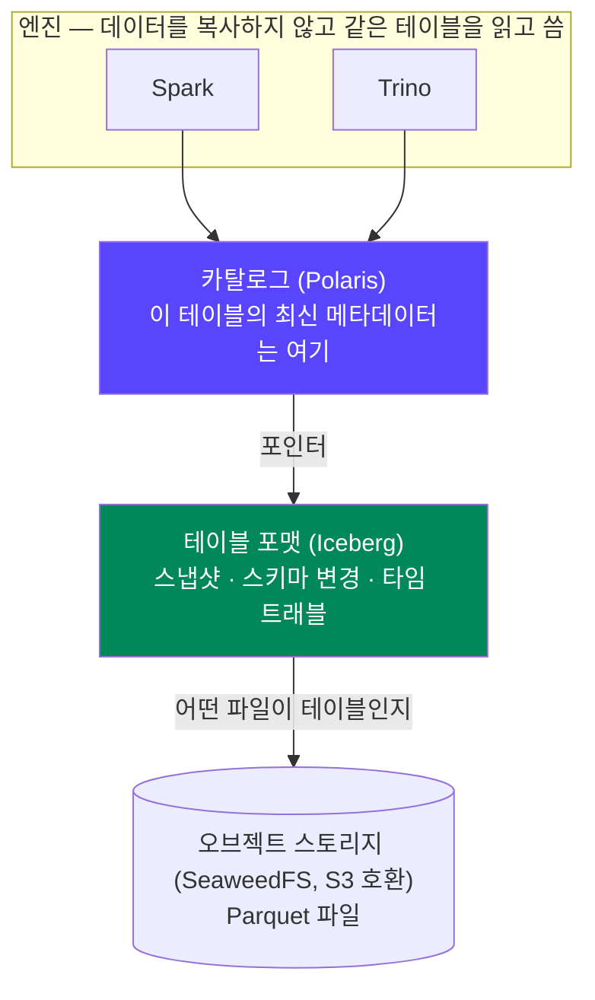
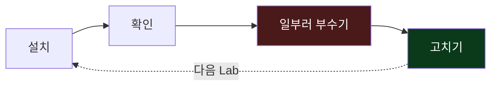
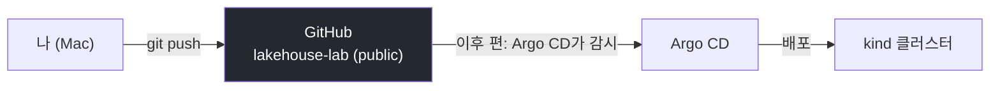
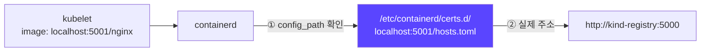
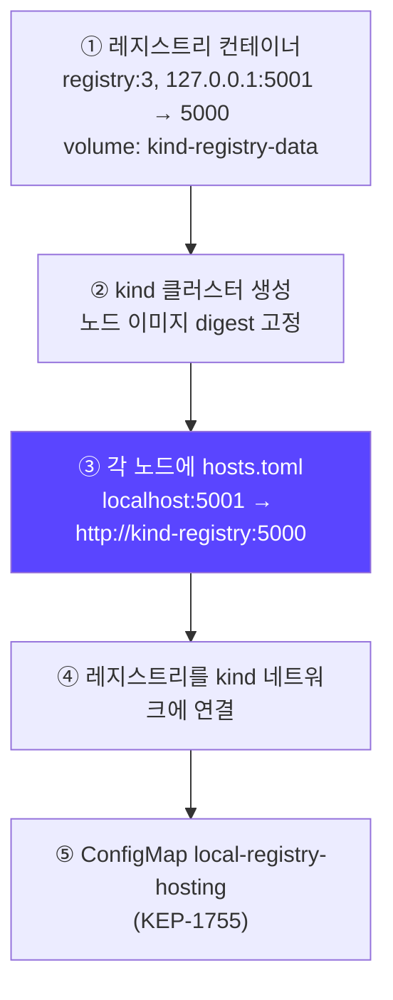
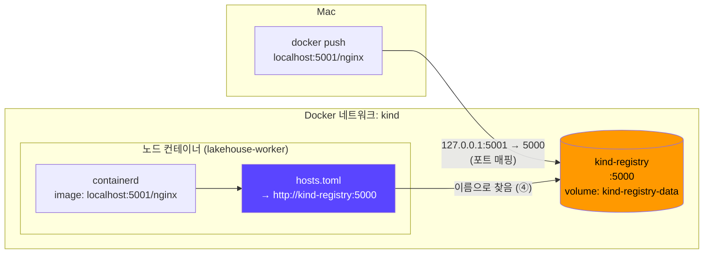
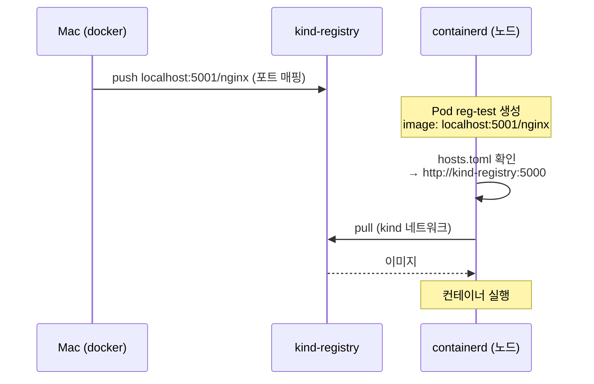

## 📚 들어가며

새 시리즈를 시작한다. 목표는 **Mac 한 대 위의 Kubernetes 클러스터에 레이크하우스 오픈소스 스택을 올리고, 장애를 직접 내고 고쳐 보는 것**이다. 참고하는 문서는 「로컬 레이크하우스 실습 가이드」이고, 이 글에서는 편의상 **"가이드"** 라고 부른다.

첫 편은 그 모든 것의 바닥이다.

- **kind 클러스터** — control-plane 1 + worker 2, 노드 3개
- **로컬 이미지 레지스트리** — `localhost:5001`
- **스크립트 하나**(`scripts/kind-up.sh`)로 둘 다 만들고, 여러 번 실행해도 안전하게(멱등) 짠다

이번 편의 핵심은 **노드 안의 containerd에게 "`localhost:5001` 이미지는 실제로 `http://kind-registry:5000`에서 받아라"라고 알려 주는 구조**다. 마지막에 Mac에서 push한 이미지를 클러스터에서 pull해서 이 구조가 동작하는지 확인했다.

> **이번 편 학습 지도**
>
> ```
> 전체 그림 (1장)            준비 (2장)               클러스터 (3~4장)                확인 (5~6장)
> ───────────────            ──────────               ────────────────                ─────────────
> 레이크하우스란?             Docker 메모리 확인        cluster.yaml 노드 3개           노드 3개 Ready
> 전체 스택 · Lab 흐름        CLI 도구 설치             containerdConfigPatches 🔦      StorageClass standard
> 이번 편 = 바닥             GitHub 저장소 (GitOps)    kind-up.sh 5단계 · 멱등          push → pull 검증
>                                                     hosts.toml 매핑                 자주 막히는 지점
> ```

---

## 1. 무엇을 만들려는가 — 로컬 레이크하우스 실습

### 1-1. 레이크하우스란

**레이크하우스(Lakehouse)** 는 두 구조의 장점을 합친 것이다.

- **데이터 레이크** — S3 같은 오브젝트 스토리지에 Parquet 같은 파일로 저장한다. 저렴하고 확장이 쉽다.
- **데이터 웨어하우스** — 트랜잭션과 스키마를 관리한다.

파일만 쌓아 두면 그냥 "파일 더미"다. 여기에 **테이블 포맷**(Iceberg)이 테이블 개념을 얹고, **카탈로그**(Polaris)가 테이블의 최신 상태를 가리킨다.



| 구성 | 역할 |
|---|---|
| 테이블 포맷 (Iceberg) | 파일 묶음 위에 **테이블**을 정의한다. 스냅샷, 스키마 변경, 타임 트래블 |
| 카탈로그 (Polaris) | "이 테이블의 최신 메타데이터는 어디 있다"는 **포인터**를 관리한다 |
| 엔진 (Spark, Trino) | 카탈로그를 거쳐 **같은 테이블**을 읽고 쓴다. 엔진마다 데이터를 복사하지 않는다 |

### 1-2. 전체 스택

가이드의 전체 스택이다. 버전은 2026-11-11 기준 각 프로젝트의 최신 안정판이다.

| 계층 | 구성 요소 |
|---|---|
| 배포 | kind, 로컬 레지스트리(`localhost:5001`), Argo CD (app-of-apps) |
| 저장 | SeaweedFS(S3 호환), CloudNativePG(PostgreSQL) |
| 카탈로그 | Apache Polaris (Iceberg REST) |
| 처리 | Spark Operator + Spark 4.1.4 / Iceberg 1.12.0, Trino |
| 수집 | Strimzi Kafka 4.2 (KRaft), Spark Structured Streaming |
| 관측 | kube-prometheus-stack, Loki, Alloy |
| 운영 | Iceberg 유지보수, 스케줄링, 폐쇄망 설치, 런북 |

각 Lab은 같은 순서로 진행한다.



이번 편은 이 표의 **맨 아래 바닥**, 즉 "Kubernetes 클러스터 + 이미지 레지스트리"를 만든다.

---

## 2. Lab 0 — 도구 설치와 실습 저장소 준비

### 2-1. Docker 메모리 확인

kind는 Docker Desktop, OrbStack 둘 다에서 동작한다. **병목은 메모리**다. 그래서 Docker에 메모리를 충분히 주고, 컴포넌트는 Lab마다 필요한 것만 켠다.

```bash
docker info --format 'CPUs={{.NCPU}} Memory={{.MemTotal}} Arch={{.Architecture}}'
# CPUs=10 Memory=8319504384 Arch=aarch64
```

| | 가이드 | 내 환경 |
|---|---|---|
| Docker 메모리 | 16GB Mac 기준 **10~11GB 이상** 권장 | **약 8.3GB** (8,319,504,384 bytes ≈ 7.7GiB) |

아직 조정하지 않았다. Lab 1~3은 지금 메모리로 문제없다. 가이드 기준으로 Lab 4~6에서는 코어 묶음이 약 4GB, Spark 잡 실행 중에 약 3GB가 더 필요해서, **그때는 메모리를 늘려야 할 것으로 예상한다**(아직 확인 전).

### 2-2. CLI 도구

```bash
brew install kind kubectl helm k9s argocd awscli jq yq crane stern gh
```

| 도구 | 쓰는 곳 |
|---|---|
| kind | Docker 컨테이너로 Kubernetes 노드를 띄운다 |
| kubectl, k9s, stern | 클러스터 조회, 터미널 UI, 여러 Pod 로그 동시 보기 |
| helm | Argo CD 최초 설치, 폐쇄망용 차트 내려받기 |
| argocd | 앱 상태 확인과 수동 동기화 |
| awscli | Mac에서 S3(SeaweedFS) 확인 |
| jq, yq | JSON·YAML 처리 |
| crane | 폐쇄망 Lab에서 이미지 복사 |
| gh | GitHub 저장소 만들기 |

> 확인 시점에 `stern`은 아직 설치하지 않은 상태였다. 이번 편에서는 쓰지 않는다.

### 2-3. 실습 저장소를 GitHub에 올리기

```bash
git init -b main && git add -A && git commit -m "initial lab skeleton"
gh repo create lakehouse-lab --public --source=. --push
```

실습 저장소를 **public** GitHub 저장소로 올렸다. 다음 편 이후로 **Argo CD가 이 저장소를 보고 배포**하기 때문이다(GitOps). 비밀 값은 저장소에 넣지 않으므로 공개해도 된다.



---

## 3. kind 클러스터 정의 — `kind/cluster.yaml`

### 3-1. kind란

**kind (Kubernetes IN Docker)** 는 **Docker 컨테이너 하나를 "노드(서버) 하나"처럼 써서** Kubernetes 클러스터를 만드는 도구다. 원래는 Kubernetes 자체를 테스트하려고 만들어졌는데, 로컬에서 멀티 노드 클러스터를 가볍게 띄울 수 있어서 실습용으로 많이 쓴다. 내부 원리는 다음 편에서 자세히 본다.

### 3-2. 설정 파일

```yaml
# kind/cluster.yaml
kind: Cluster
apiVersion: kind.x-k8s.io/v1alpha4
containerdConfigPatches:
  - |-
    [plugins."io.containerd.grpc.v1.cri".registry]
      config_path = "/etc/containerd/certs.d"
nodes:
  - role: control-plane
  - role: worker
  - role: worker
```

- **노드 3개** — control-plane 1 + worker 2. worker가 2개여야 "노드 하나가 죽으면?" 같은 실험을 할 수 있다(다음 편).
- **`containerdConfigPatches`** — 이번 편의 핵심이다(3-3).

### 3-3. 🔦 containerdConfigPatches — containerd가 hosts.toml을 읽게 하기

먼저 **containerd**가 뭔지부터. containerd는 노드에서 **실제로 이미지를 받고 컨테이너를 실행하는 런타임**이다. kubelet이 "이 Pod 띄워"라고 하면 containerd가 이미지를 pull하고 컨테이너를 만든다.

`containerdConfigPatches`는 각 노드의 containerd 설정에 이 한 줄을 넣는다.

```toml
config_path = "/etc/containerd/certs.d"
```

이 설정이 있으면 containerd는 이미지를 받을 때 **`/etc/containerd/certs.d/<레지스트리 주소>/hosts.toml`을 먼저 읽고**, "이 레지스트리는 실제로 어디서 받을지"를 정한다.



`cluster.yaml`은 **"hosts.toml을 읽어라"까지만** 정한다. hosts.toml 파일 자체는 클러스터를 만든 뒤 스크립트가 각 노드에 넣는다(4장 3단계).

> **💡 YAML 팁 — 시퀀스 들여쓰기는 둘 다 된다**
>
> 처음에는 `nodes:` 아래 리스트를 들여쓰지 않고(`- role: worker`) 커밋했다. 가이드는 2칸 들여쓴 형태(`  - role: worker`)라서, 가이드와 같게 바꿔 다시 커밋했다(`fix: kind의 cluster.yaml 문법에 맞게 수정`).
>
> 커밋 메시지는 "문법에 맞게"라고 썼지만, 실제로는 **문법 오류가 아니었다.** YAML에서 매핑 아래의 시퀀스는 들여써도, 안 들여써도 유효하고 결과도 같다.
>
> ```yaml
> # 둘 다 nodes = [control-plane, worker] 로 같다
> nodes:
> - role: control-plane
> - role: worker
>
> nodes:
>   - role: control-plane
>   - role: worker
> ```
>
> 그러니 이건 **스타일을 가이드에 맞춘 것**이다. 한 파일 안에서는 한 가지 스타일로 통일하는 게 읽기 좋다.

---

## 4. 생성 스크립트 해부 — `scripts/kind-up.sh`

kind 공식 문서의 local registry 스크립트를 이 실습에 맞게 고친 것이다.

```bash
#!/usr/bin/env bash
# kind 클러스터 + 로컬 레지스트리(kind-registry, localhost:5001)를 만든다.
# kind 공식 문서의 local registry 스크립트를 이 실습에 맞게 고친 것.
set -euo pipefail

CLUSTER_NAME="${CLUSTER_NAME:-lakehouse}"
# kind v0.33.0의 기본 노드 이미지 (digest 고정)
NODE_IMAGE="${NODE_IMAGE:-kindest/node:v1.37.0@sha256:a1ed56cfb0e7b93589bdf97c8cd566405a265939e3620fc4f5de89adff580ae5}"
REG_NAME="kind-registry"
REG_PORT="5001"
ROOT_DIR="$(cd "$(dirname "$0")/.." && pwd)"

# 1) 레지스트리 컨테이너 (데이터는 named volume에 남는다)
if [ "$(docker inspect -f '{{.State.Running}}' "${REG_NAME}" 2>/dev/null || true)" != 'true' ]; then
  docker run -d --restart=always \
    -p "127.0.0.1:${REG_PORT}:5000" \
    -v kind-registry-data:/var/lib/registry \
    --network bridge --name "${REG_NAME}" \
    registry:3
fi

# 2) 클러스터
if ! kind get clusters | grep -qx "${CLUSTER_NAME}"; then
  kind create cluster --name "${CLUSTER_NAME}" --image "${NODE_IMAGE}" \
    --config "${ROOT_DIR}/kind/cluster.yaml"
fi

# 3) 각 노드의 containerd에 "localhost:5001 → http://kind-registry:5000" 매핑 추가
REGISTRY_DIR="/etc/containerd/certs.d/localhost:${REG_PORT}"
for node in $(kind get nodes --name "${CLUSTER_NAME}"); do
  docker exec "${node}" mkdir -p "${REGISTRY_DIR}"
  printf '[host."http://%s:5000"]\n' "${REG_NAME}" \
    | docker exec -i "${node}" cp /dev/stdin "${REGISTRY_DIR}/hosts.toml"
done

# 4) 레지스트리를 kind 네트워크에 연결 (노드가 이름으로 찾을 수 있게)
if [ "$(docker inspect -f='{{json .NetworkSettings.Networks.kind}}' "${REG_NAME}")" = 'null' ]; then
  docker network connect "kind" "${REG_NAME}"
fi

# 5) 로컬 레지스트리 위치를 클러스터에 알리는 표준 ConfigMap (KEP-1755)
kubectl apply -f - <<EOF
apiVersion: v1
kind: ConfigMap
metadata:
  name: local-registry-hosting
  namespace: kube-public
data:
  localRegistryHosting.v1: |
    host: "localhost:${REG_PORT}"
    help: "https://kind.sigs.k8s.io/docs/user/local-registry/"
EOF

echo
kubectl get nodes -o wide
```

### 4-1. 5단계 한눈에 보기



| 단계 | 하는 일 | 다시 실행하면 |
|---|---|---|
| ① 레지스트리 | `registry:3` 컨테이너. 데이터는 named volume `kind-registry-data`에 둬서 **컨테이너를 지워도 이미지가 남는다** | 이미 돌고 있으면 건너뜀 |
| ② 클러스터 | 노드 이미지를 **digest(`@sha256:...`)까지 고정**. 언제 다시 만들어도 같은 이미지 | 이미 있으면 건너뜀 |
| ③ hosts.toml | 노드마다 `localhost:5001 → http://kind-registry:5000` 매핑 | **매번 덮어씀** |
| ④ 네트워크 연결 | 레지스트리를 `kind` Docker 네트워크에 붙여 노드가 `kind-registry`라는 이름으로 찾게 함 | 이미 연결돼 있으면 건너뜀 |
| ⑤ ConfigMap | "이 클러스터의 로컬 레지스트리는 `localhost:5001`"이라고 알리는 표준(KEP-1755). Tilt 같은 도구가 이걸 읽고 레지스트리를 자동으로 찾는다 | `kubectl apply`라 결과가 같음 |

### 4-2. 왜 매핑이 필요한가 — 같은 이름, 다른 길

이 스크립트가 해결하는 문제는 하나다. **같은 이미지 이름 `localhost:5001/nginx`가 Mac과 노드에서 각자 다른 길로 같은 레지스트리에 닿아야 한다.**

- **Mac에서**의 `localhost:5001`은 포트 매핑(`127.0.0.1:5001 → 5000`)을 통해 레지스트리 컨테이너로 간다.
- **노드 안에서**의 `localhost`는 **노드 컨테이너 자기 자신**이다. 노드 안에는 5001번 포트에 아무것도 없다.

그래서 노드의 containerd에게만 "`localhost:5001`은 사실 `kind-registry:5000`이야"라고 알려 준다(③). 그리고 노드가 `kind-registry`라는 이름을 찾으려면 레지스트리가 같은 Docker 네트워크에 있어야 한다(④).



이 구조를 처음부터 붙여 두는 이유는 뒤 Lab에 있다.

- **Lab 6** — 직접 빌드한 Spark 이미지를 이 레지스트리에 올려서 쓴다.
- **Lab 11** — 폐쇄망 설치에서 **같은 구조**(hosts.toml로 레지스트리 주소 바꾸기)로 미러를 붙인다.

### 4-3. 🔦 멱등성 — 다시 돌리는 것이 복구 수단

**멱등성(idempotency)** 은 몇 번을 실행해도 결과가 같은 성질이다. 4-1 표의 오른쪽 열이 그 설계다.

- 레지스트리·클러스터·네트워크 연결은 **"이미 있으면 건너뛴다"**
- hosts.toml은 **"매번 덮어쓴다"**

그래서 무언가 꼬였을 때 **스크립트를 다시 돌리는 것 자체가 복구 수단**이 된다. 예를 들어 노드 안의 hosts.toml이 사라져도 `scripts/kind-up.sh`를 한 번 더 실행하면 다시 생긴다. 다음 편에서 일부러 레지스트리 매핑을 지우고 이 방법으로 고쳐 볼 예정이다.

### 4-4. 작은 결정들

| 코드 | 이유 |
|---|---|
| `set -euo pipefail` | 명령 하나라도 실패하면(`-e`), 정의 안 된 변수를 쓰면(`-u`), 파이프 중간이 실패하면(`pipefail`) 즉시 멈춘다. 인프라 스크립트의 기본 안전장치 |
| 포트 **5001** | macOS의 AirPlay 수신기가 5000번 포트를 쓴다 |
| `127.0.0.1:5001` 바인딩 | Mac 자신에서만 접근 가능. 같은 네트워크의 다른 기기에는 레지스트리를 열지 않는다 |
| `--restart=always` | Docker를 재시작해도 레지스트리가 다시 뜬다 |
| digest 고정 | 태그(`v1.37.0`)는 다시 푸시될 수 있지만 digest는 이미지 내용 그 자체다. 재현 가능한 환경 |
| `CLUSTER_NAME`, `NODE_IMAGE` 기본값 | `${VAR:-기본값}` 형태라 환경 변수로 덮어쓸 수 있다 |

---

## 5. 생성과 확인

```bash
scripts/kind-up.sh
```

### 5-1. 노드 3개

```bash
kubectl get nodes -o wide
```

```
NAME                      STATUS   ROLES           AGE     VERSION   INTERNAL-IP   OS-IMAGE                       KERNEL-VERSION            CONTAINER-RUNTIME
lakehouse-control-plane   Ready    control-plane   3h32m   v1.37.0   172.18.0.4    Debian GNU/Linux 13 (trixie)   7.0.12-linuxkit (arm64)   containerd://2.3.4
lakehouse-worker          Ready    <none>          3h32m   v1.37.0   172.18.0.3    Debian GNU/Linux 13 (trixie)   7.0.12-linuxkit (arm64)   containerd://2.3.4
lakehouse-worker2         Ready    <none>          3h32m   v1.37.0   172.18.0.2    Debian GNU/Linux 13 (trixie)   7.0.12-linuxkit (arm64)   containerd://2.3.4
```

- 노드 3개 모두 **Ready**, Kubernetes **v1.37.0**, 런타임 **containerd 2.3.4**.
- `KERNEL-VERSION`이 `linuxkit`이다. 노드들은 **Docker VM의 커널 하나를 같이 쓴다.** 노드가 "서버"가 아니라 "컨테이너"라는 증거다.
- `INTERNAL-IP`의 `172.18.0.x`는 `kind` Docker 네트워크의 주소다.

### 5-2. 노드는 그냥 Docker 컨테이너다

```bash
docker ps --format '{{.Names}}\t{{.Image}}\t{{.Status}}\t{{.Ports}}'
```

```
lakehouse-worker2         kindest/node:v1.37.0   Up 4 hours
lakehouse-worker          kindest/node:v1.37.0   Up 4 hours
lakehouse-control-plane   kindest/node:v1.37.0   Up 4 hours   127.0.0.1:64585->6443/tcp
kind-registry             registry:3             Up 4 hours   127.0.0.1:5001->5000/tcp
```

| 컨테이너 | 포트 | 의미 |
|---|---|---|
| `lakehouse-control-plane` | `127.0.0.1:64585 → 6443` | **API 서버.** Mac의 kubectl이 이 포트로 접속한다 (포트 번호는 kind가 임의로 고름) |
| `lakehouse-worker`, `worker2` | 없음 | 외부 포트가 필요 없다 |
| `kind-registry` | `127.0.0.1:5001 → 5000` | Mac에서 push할 때 쓰는 길 |

### 5-3. 기본 StorageClass

```bash
kubectl get storageclass
```

```
NAME                 PROVISIONER             RECLAIMPOLICY   VOLUMEBINDINGMODE      ALLOWVOLUMEEXPANSION
standard (default)   rancher.io/local-path   Delete          WaitForFirstConsumer   false
```

**StorageClass**는 PVC(볼륨 요청)가 들어오면 실제 볼륨을 어떻게 만들지 정하는 템플릿이다. kind에는 `standard`가 기본으로 들어 있다.

- **`rancher.io/local-path`** — 노드의 로컬 디렉터리를 볼륨으로 쓰는 단순한 방식이다.
- **`WaitForFirstConsumer`** — PVC를 만든 순간이 아니라, **그 PVC를 쓰는 Pod가 어느 노드에 스케줄될지 정해진 뒤에** 그 노드에 볼륨을 만든다. 로컬 디렉터리 방식이라 Pod와 볼륨이 같은 노드에 있어야 하기 때문이다.

이후 SeaweedFS와 PostgreSQL의 데이터가 여기에 저장된다.

### 5-4. 🔦 레지스트리 검증 — Mac에서 push, 클러스터에서 pull

```bash
docker pull nginx:1.29-alpine
docker tag nginx:1.29-alpine localhost:5001/nginx:1.29-alpine
docker push localhost:5001/nginx:1.29-alpine

kubectl run reg-test --image=localhost:5001/nginx:1.29-alpine
kubectl get pod reg-test -o wide   # Running 이면 성공
curl -s localhost:5001/v2/_catalog
kubectl delete pod reg-test
```



**같은 이미지 이름이 Mac(Docker)과 노드(containerd) 양쪽에서 통한다**는 게 포인트다. 레지스트리에 이미지가 들어갔는지는 레지스트리 API로 바로 볼 수 있다.

```bash
curl -s localhost:5001/v2/_catalog
# {"repositories":["nginx"]}
```

> Mac의 Docker가 `localhost:5001`에 **HTTP**로 push할 수 있는 건, Docker가 `localhost` 레지스트리에 한해 기본으로 HTTP를 허용하기 때문이다. 노드 쪽은 hosts.toml에 `http://`를 직접 적어서 HTTP로 받는다.

### 5-5. 노드 안 들여다보기

**`crictl`** 은 containerd용 CLI다. 노드 컨테이너 안에서 실행하면 그 노드에 캐시된 이미지와 돌고 있는 컨테이너를 볼 수 있다.

```bash
docker exec lakehouse-worker cat /etc/containerd/certs.d/localhost:5001/hosts.toml
# [host."http://kind-registry:5000"]

docker exec lakehouse-worker crictl images | head
# IMAGE                  TAG           IMAGE ID        SIZE
# localhost:5001/nginx   1.29-alpine   7f7dcd27f920b   25.8MB

docker exec lakehouse-worker crictl ps

kubectl -n kube-public get cm local-registry-hosting -o jsonpath='{.data}'
# {"localRegistryHosting.v1":"host: \"localhost:5001\"\nhelp: \"https://kind.sigs.k8s.io/docs/user/local-registry/\"\n"}
```

| 확인한 것 | 결과 | 의미 |
|---|---|---|
| hosts.toml | `[host."http://kind-registry:5000"]` | ③단계 매핑이 노드에 들어갔다 |
| `crictl images` | `localhost:5001/nginx:1.29-alpine` | worker 노드가 **이 레지스트리에서 이미지를 받아 캐시했다** = pull 성공 |
| ConfigMap | `host: "localhost:5001"` | ⑤단계 KEP-1755 ConfigMap이 있다 |

`reg-test` Pod가 Running이 된 화면은 따로 캡처하지 않았다. 대신 **레지스트리 카탈로그에 nginx가 있고, worker 노드에 `localhost:5001/nginx` 이미지가 캐시돼 있다**는 두 가지로 pull이 성공했다는 걸 확인했다.

---

## 6. 자주 막히는 지점

가이드에 정리된 것들이다. **나는 이번에 겪지 않았지만** 다음에 클러스터를 다시 만들 때를 위해 옮겨 둔다.

| 증상 | 원인과 해결 |
|---|---|
| `kind create`가 "failed to init node with kubeadm"에서 멈춤 | **Docker 메모리 부족**이 가장 흔하다. 클러스터를 삭제하고 메모리를 늘려 다시 시도 |
| Pod 로그에 `too many open files` | Docker VM의 inotify 한도. `fs.inotify.max_user_watches`, `fs.inotify.max_user_instances` 상향 |
| Docker 재시작 후 kubectl 연결 거부 | 노드 컨테이너가 다시 뜨는 데 1~2분 걸린다. 기다리면 된다 |
| `docker push localhost:5001/...`가 HTTPS 오류 | Docker는 `localhost` 레지스트리만 기본으로 HTTP를 허용한다. 다른 이름(예: `kind-registry:5001`)을 쓰지 않았는지 확인 |

첫 번째 줄은 2-1의 메모리 이야기와 이어진다. 지금 8.3GB로도 클러스터 생성은 됐지만, 컴포넌트가 늘어나는 Lab 4 이후에는 이 표의 첫 줄을 먼저 의심하게 될 것 같다.

---

## 📝 이번 편 요약

```
전체 그림
├─ 레이크하우스 = 레이크(파일, 저렴) + 웨어하우스(트랜잭션, 스키마)
│    Iceberg(테이블 포맷) · Polaris(카탈로그) · Spark/Trino(엔진)
└─ 이번 편 = 바닥: K8s 클러스터 + 이미지 레지스트리

준비 (Lab 0)
├─ Docker 메모리 약 8.3GB (가이드 권장 10~11GB, Lab 4 이후 늘릴 예정)
└─ 실습 저장소 = public GitHub (이후 Argo CD가 감시, GitOps)

클러스터
├─ kind = Docker 컨테이너 하나가 노드 하나 (control-plane 1 + worker 2)
└─ containerdConfigPatches 🔦 — containerd가 certs.d/<레지스트리>/hosts.toml을 읽게 함

kind-up.sh (5단계, 멱등)
├─ ① registry:3 (127.0.0.1:5001 → 5000, named volume)
├─ ② 클러스터 (노드 이미지 digest 고정)
├─ ③ hosts.toml: localhost:5001 → http://kind-registry:5000  (매번 덮어씀)
├─ ④ 레지스트리를 kind 네트워크에 연결
└─ ⑤ KEP-1755 ConfigMap
     → 꼬이면 다시 실행하는 것이 복구 수단

확인
├─ 노드 3개 Ready, containerd 2.3.4, 커널은 Docker VM 공유(linuxkit)
├─ StorageClass standard (local-path, WaitForFirstConsumer)
└─ Mac push → 노드 pull: _catalog에 nginx, worker crictl에 이미지 캐시
```

| 개념 | 한 줄 정의 |
|---|---|
| **레이크하우스** | 오브젝트 스토리지의 파일 위에 테이블 포맷과 카탈로그를 얹어 웨어하우스처럼 쓰는 구조 |
| **kind** | Docker 컨테이너를 노드처럼 써서 Kubernetes 클러스터를 만드는 도구 |
| **containerd** | 노드에서 이미지를 받고 컨테이너를 실행하는 런타임 |
| **`containerdConfigPatches`** | kind가 각 노드의 containerd 설정에 덧붙이는 설정 조각 |
| **hosts.toml** | containerd가 특정 레지스트리를 실제로 어디서 받을지 정하는 파일 (`certs.d/<레지스트리>/`) |
| **KEP-1755 ConfigMap** | `kube-public/local-registry-hosting`. 클러스터의 로컬 레지스트리 위치를 도구들에 알리는 표준 |
| **멱등성** | 몇 번을 실행해도 결과가 같은 성질 |
| **digest** | 이미지 내용으로 만든 해시(`@sha256:...`). 태그와 달리 바뀌지 않는다 |
| **StorageClass** | PVC가 들어오면 실제 볼륨을 어떻게 만들지 정하는 템플릿 |
| **`WaitForFirstConsumer`** | Pod가 스케줄될 노드가 정해진 뒤에 볼륨을 만드는 바인딩 모드 |
| **crictl** | containerd 같은 CRI 런타임을 직접 조회하는 CLI |

---

## 💭 느낀 점

**1. 레지스트리를 처음부터 붙이는 데는 이유가 있었다.**

처음에는 "클러스터만 만들면 되지 레지스트리까지?" 싶었다. 그런데 가이드를 끝까지 보니 Lab 6에서 직접 빌드한 Spark 이미지를 올리고, Lab 11에서 폐쇄망 미러를 붙일 때 **똑같이 hosts.toml로 레지스트리 주소를 바꾸는 구조**가 다시 나온다. 첫 편에서 만든 이 몇 줄이 뒤 Lab까지 이어진다.

**2. 멱등한 스크립트는 그 자체로 복구 도구다.**

"이미 있으면 건너뛰고, 설정 파일은 매번 덮어쓴다." 이 규칙만 지키면 무언가 꼬였을 때 원인을 다 찾기 전에 **스크립트를 다시 돌리는 것**부터 할 수 있다. 다음 편에서 레지스트리 매핑을 일부러 지워 보면서 이걸 확인할 생각이다.

**3. 노드 이미지를 digest로 고정했다.**

태그 `v1.37.0`만 적으면 같은 태그에 다른 이미지가 올라올 수도 있다. digest까지 적어 두면 몇 달 뒤에 클러스터를 다시 만들어도 같은 환경이 나온다. 실습 환경이야말로 "그때는 됐는데"가 없어야 한다.

**4. 데이터 플랫폼도 바닥부터 알아야 한다.**

Spark 잡이 `ImagePullBackOff`로 안 뜨면, 원인은 Spark가 아니라 이번 편에서 만든 containerd·hosts.toml·레지스트리 쪽에 있을 가능성이 크다. 데이터 플랫폼 엔지니어도 K8s, 컨테이너 런타임, 레지스트리를 알아야 장애 범위를 좁힐 수 있다.

---

## 🔗 다음 편 예고

이번에 만든 kind 클러스터는 실제로 어떻게 동작할까? 다음 편에서는 **컨테이너 안의 노드, kubeadm, Pod·Service 네트워크(kindnet, kube-proxy)를 실제 라우팅 테이블로 해부**한다. 그리고 **워커 노드 다운**과 **레지스트리 매핑 누락** 장애를 일부러 내고 고쳐 본다.

---

## 📚 참고

- [kind — Local Registry](https://kind.sigs.k8s.io/docs/user/local-registry/)
- [kind — Configuration](https://kind.sigs.k8s.io/docs/user/configuration/)
- [containerd — Registry Configuration (hosts.toml)](https://github.com/containerd/containerd/blob/main/docs/hosts.md)
- [KEP-1755 — Communicating a local registry](https://github.com/kubernetes/enhancements/tree/master/keps/sig-cluster-lifecycle/generic/1755-communicating-a-local-registry)

> 2장의 `docker info`, 저장소 생성, 3~5장의 `cluster.yaml`·`kind-up.sh`와 노드·StorageClass·`docker ps`·레지스트리 카탈로그·hosts.toml·`crictl images`·ConfigMap 출력은 직접 확인한 결과다. `reg-test` Pod가 Running이 된 화면은 캡처하지 않았고, pull 성공은 카탈로그와 노드의 이미지 캐시로 확인했다. 1장의 스택 표와 6장의 "자주 막히는 지점"은 가이드 문서 기준이다. Lab 4 이후 메모리가 부족할 것이라는 내용은 예상이며 아직 확인하지 않았다.
