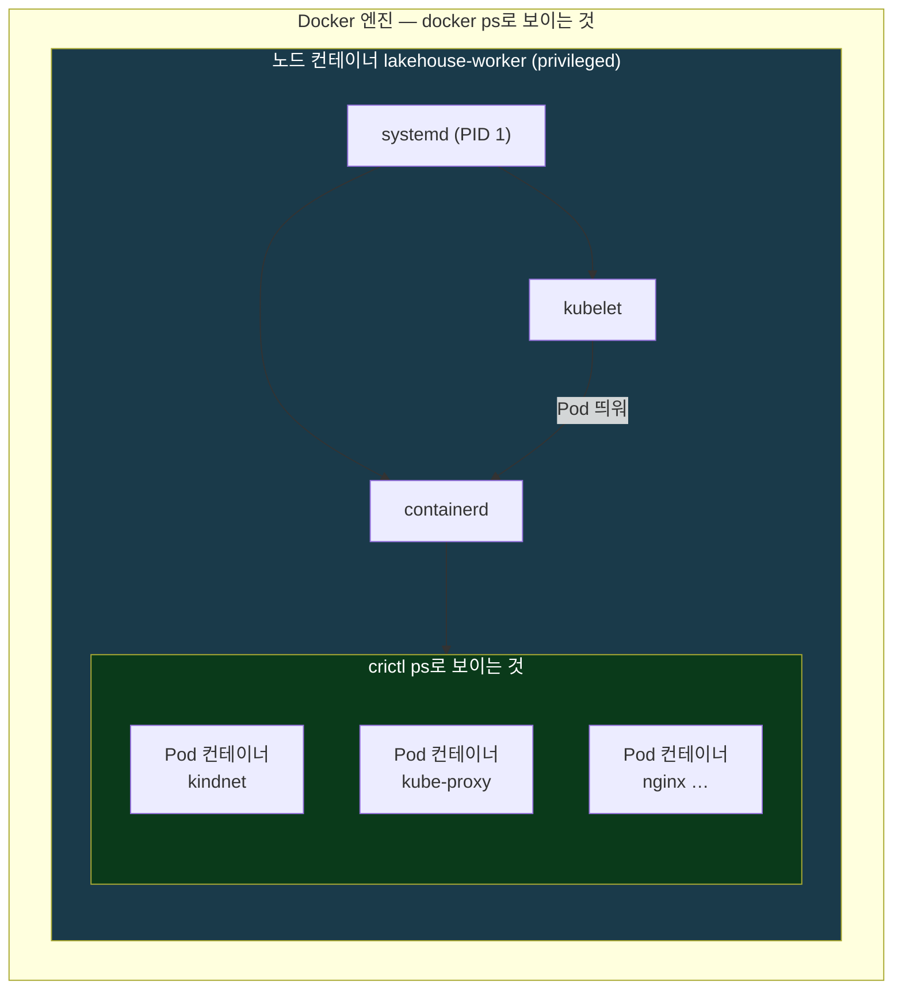
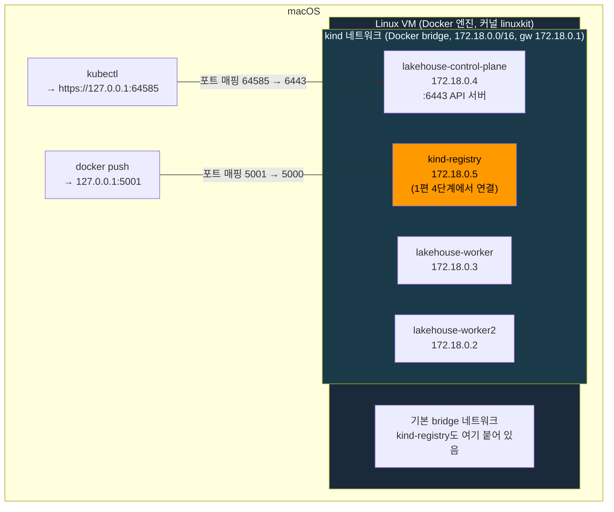
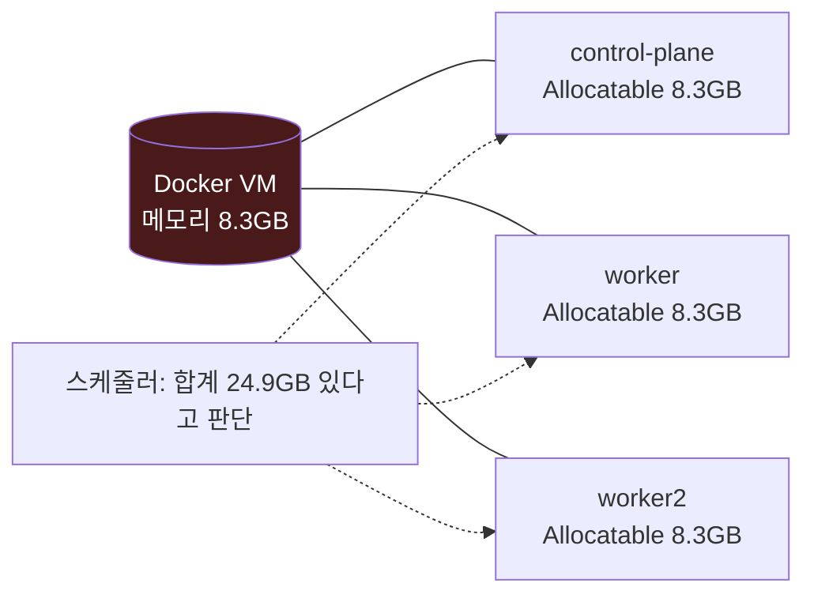
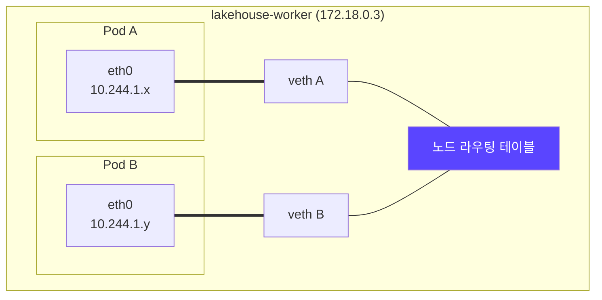
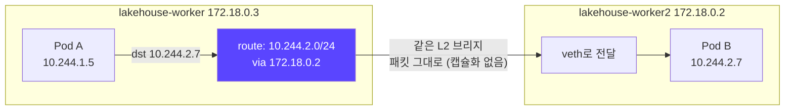
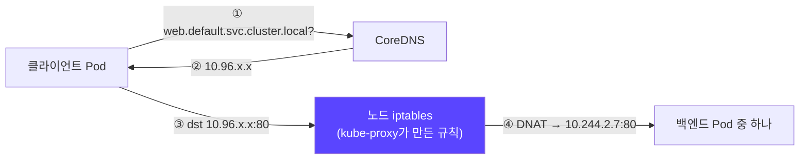
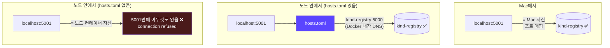
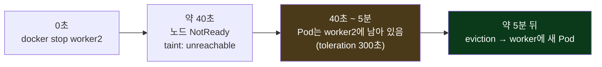
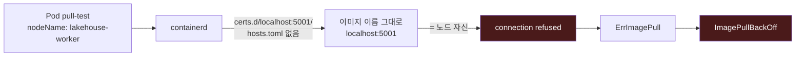
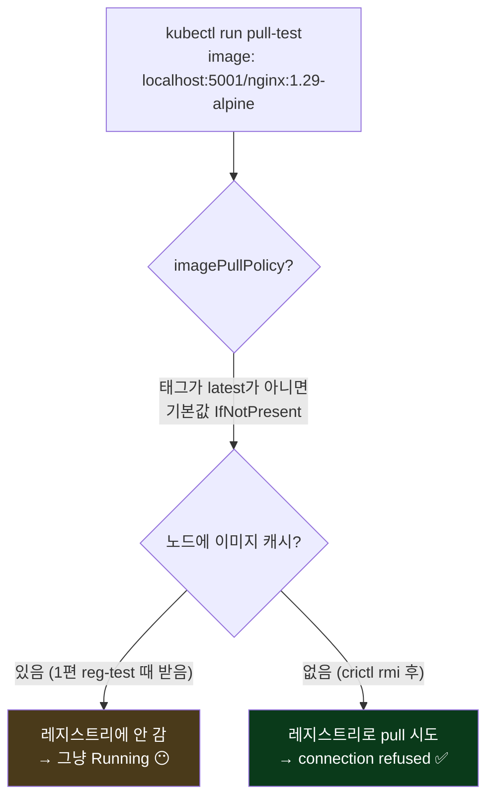

## 📚 들어가며

[1편](/posts/Lakehouse-Lab-01-Kind-Cluster-Local-Registry/)에서 `scripts/kind-up.sh` 한 번으로 노드 3개짜리 kind 클러스터와 `localhost:5001` 레지스트리를 만들었다. 이번 편은 그 클러스터를 **뜯어보고, 일부러 부숴 본다.**

- **원리** — "Docker 컨테이너 하나 = 노드 하나"가 실제로 어떻게 동작하는가
- **네트워크** — 노드 / Pod / Service 3층을 **실제 라우팅 테이블**로 확인
- **부수고 고치기** — 워커 노드 다운(A), 레지스트리 매핑 누락(B)

가이드와 다르게 간 부분이 하나 있다. 시나리오 B에서 **장애를 내기 전에 노드의 이미지 캐시부터 지웠다.** 그러지 않으면 장애가 재현되지 않기 때문인데, 이 "재현이 안 되는 이유"가 이번 편에서 제일 배운 게 많은 부분이다(6-3).

> **이번 편 학습 지도**
>
> ```
> 원리 (1~2장)                네트워크 (3장)              hosts.toml (4장)           부수기 (5~6장)
> ────────────                ──────────────              ────────────────           ──────────────
> 노드 = privileged 컨테이너   노드 IP 172.18/16           노드 안 localhost = 노드    A. 워커 다운
> systemd → containerd·kubelet Pod IP 10.244/16 (kindnet)  두 파일이 짝                  toleration 300초 🔦
> kubeadm · static Pod         Service IP 10.96/16         재시작 불필요               B. 매핑 누락
> Mac → Docker VM → 노드       오버레이 없이 라우팅만 🔦    = 사내 미러 설정             이미지 캐시 함정 🔦
> ```

---

## 1. kind의 원리 — "컨테이너 하나 = 노드 하나"

### 1-1. 노드 컨테이너 안에는 작은 Linux 서버가 있다

노드 이미지 `kindest/node`는 Debian 기반이고, 안에 **systemd, containerd, kubelet, kubeadm**이 들어 있다. 컨테이너가 뜨면 systemd가 PID 1로 뜨고, 그 아래에서 containerd와 kubelet이 돈다. 그래서 컨테이너 하나가 "작은 Linux 서버"처럼 동작한다.

```bash
docker inspect lakehouse-worker --format 'privileged={{.HostConfig.Privileged}} image={{.Config.Image}}'
# privileged=true image=kindest/node:v1.37.0@sha256:a1ed56cf...

docker exec lakehouse-worker ps -eo comm | sort | uniq
# containerd containerd-shim kindnetd kube-proxy kubelet pause systemd systemd-journal
```

| 프로세스 | 역할 |
|---|---|
| `systemd` | 노드 컨테이너의 PID 1. containerd·kubelet을 서비스로 띄운다 |
| `systemd-journal` | `systemd-journald`. `ps`의 `comm`은 15자에서 잘려서 이렇게 보인다 |
| `containerd`, `containerd-shim` | 컨테이너 런타임. shim은 Pod 컨테이너 하나마다 붙는 중간 프로세스 |
| `kubelet` | 이 노드에서 Pod를 실행하는 담당 |
| `kindnetd`, `kube-proxy` | Pod 네트워크(3장), Service 규칙(3-4) |
| `pause` | Pod마다 하나씩 뜨는 "네임스페이스를 잡고 있는" 컨테이너 |

노드 컨테이너는 **privileged**로 뜬다. 그래야 컨테이너 안에서 또 컨테이너를 만들고(cgroup·네임스페이스), iptables와 라우팅을 바꿀 수 있다.

### 1-2. 🔦 중첩 구조 — 바깥은 docker, 안쪽은 crictl



**Docker 컨테이너(노드) 안의 containerd가 Pod용 컨테이너를 또 만든다.**

- `docker ps` → **바깥**(노드 컨테이너)을 본다
- `docker exec <노드> crictl ps` → **안쪽**(Pod 컨테이너)을 본다

1편 5-5에서 `crictl images`로 노드에 캐시된 이미지를 봤던 게 바로 이 "안쪽"이다.

### 1-3. kubeadm과 static Pod

**kubeadm**은 Kubernetes 공식 클러스터 설치 도구다. 1편 `kind-up.sh` 2단계의 `kind create cluster`는 내부적으로 이렇게 한다.


**실제 서버에 클러스터를 설치하는 과정과 같다.** 차이는 "서버"가 컨테이너라는 것뿐이다.

그런데 kubeadm에는 닭-달걀 문제가 있다. **Pod는 API 서버를 통해 만드는데, API 서버 자체도 Pod로 띄워야 한다.** 이걸 푸는 게 **static Pod**다.

```bash
docker exec lakehouse-control-plane ls /etc/kubernetes/manifests
# etcd.yaml  kube-apiserver.yaml  kube-controller-manager.yaml  kube-scheduler.yaml
```

static Pod는 **API 서버 없이 kubelet이 `/etc/kubernetes/manifests/`의 YAML을 직접 읽어서 띄우는 Pod**다. kubeadm은 control-plane 구성 요소 4개를 이렇게 띄운다.

| 구성 요소 | 역할 | 어디서 |
|---|---|---|
| etcd | 클러스터 상태 저장소 | control-plane (static Pod) |
| kube-apiserver | 모든 요청의 입구 | control-plane (static Pod) |
| kube-scheduler | Pod를 어느 노드에 둘지 결정 | control-plane (static Pod) |
| kube-controller-manager | 원하는 상태와 실제 상태를 맞추는 컨트롤러 모음 | control-plane (static Pod) |
| kubelet | Pod 실행 담당 | 모든 노드 (systemd 서비스) |
| kube-proxy | Service 규칙 | 모든 노드 (DaemonSet) |

### 1-4. kube-system Pod의 IP를 보면 두 종류가 있다

```bash
kubectl get pods -n kube-system -o wide
```

```
coredns-559f6c778d-6dnr4                          10.244.0.2   lakehouse-control-plane
coredns-559f6c778d-mqzs9                          10.244.0.4   lakehouse-control-plane
etcd-lakehouse-control-plane                      172.18.0.4   lakehouse-control-plane
kindnet-bmfv5                                     172.18.0.2   lakehouse-worker2
kindnet-ktqkq                                     172.18.0.3   lakehouse-worker
kindnet-rbbc8                                     172.18.0.4   lakehouse-control-plane
kube-apiserver-lakehouse-control-plane            172.18.0.4   lakehouse-control-plane
kube-controller-manager-lakehouse-control-plane   172.18.0.4   lakehouse-control-plane
kube-proxy-cn8bk                                  172.18.0.3   lakehouse-worker
kube-proxy-d89h9                                  172.18.0.2   lakehouse-worker2
kube-proxy-gt727                                  172.18.0.4   lakehouse-control-plane
kube-scheduler-lakehouse-control-plane            172.18.0.4   lakehouse-control-plane
```

| IP 대역 | Pod | 의미 |
|---|---|---|
| **172.18.x** (노드 IP) | etcd, apiserver, controller-manager, scheduler, kindnet, kube-proxy | **`hostNetwork`** — 노드의 네트워크를 그대로 쓴다. 그래서 Pod IP = 노드 IP |
| **10.244.x** (Pod 대역) | CoreDNS만 | 자기 네트워크 네임스페이스와 Pod IP를 받는 일반 Pod |

`hostNetwork`인 이유는 간단하다. **Pod 네트워크를 만드는 쪽(kindnet)과 그보다 먼저 떠야 하는 쪽(control-plane)은 Pod 네트워크에 기댈 수 없다.**

---

## 2. Mac에서 보면 한 겹 더 — Docker VM과 포트 매핑

### 2-1. 구조

Docker는 Linux 기능이라 Mac에서는 Docker Desktop/OrbStack이 **Linux VM을 띄우고, 모든 컨테이너가 그 안에서 돈다.** 1편 5-1에서 노드 커널이 `linuxkit`이었던 게 그 증거다.

```bash
docker network inspect kind --format '{{range .IPAM.Config}}{{.Subnet}} gw={{.Gateway}} {{end}}'
# fc00:f853:ccd:e793::/64 gw=fc00:f853:ccd:e793::1 172.18.0.0/16 gw=172.18.0.1

docker network inspect kind --format '{{range .Containers}}{{.Name}} {{.IPv4Address}}{{"\n"}}{{end}}'
# lakehouse-worker2 172.18.0.2/16
# kind-registry 172.18.0.5/16
# lakehouse-worker 172.18.0.3/16
# lakehouse-control-plane 172.18.0.4/16
```

`kind` 네트워크는 IPv4(`172.18.0.0/16`)와 IPv6(`fc00:...`) 대역을 둘 다 가진다. 이 실습에서는 IPv4만 본다.



`kind-registry`는 **두 네트워크에 동시에** 붙어 있다. 처음 `docker run` 할 때의 기본 `bridge`(Mac 포트 매핑용)와, 1편 `kind-up.sh` 4단계에서 연결한 `kind`(노드가 이름으로 찾는 용)다.

### 2-2. 이 구조에서 나오는 결과 3가지

**결과 1 — Mac에서 `172.18.x.x`에 직접 접속할 수 없다.** 172.18 대역은 VM 안의 브리지라 macOS에서는 보이지 않는다. 그래서 **Docker 포트 매핑**이나 **`kubectl port-forward`** 를 쓴다. 이후 Lab에서 ArgoCD, SeaweedFS, Polaris UI를 전부 port-forward로 여는 이유다.

**결과 2 — Mac의 `kubectl`도 포트 매핑으로 붙는다.**

```bash
docker port lakehouse-control-plane
# 6443/tcp -> 127.0.0.1:64585

kubectl config view --minify -o jsonpath='{.clusters[0].cluster.server}'
# https://127.0.0.1:64585
```

control-plane 컨테이너의 6443(API 서버)을 Mac의 임의 포트로 열고, kubeconfig가 그 포트를 가리킨다. **클러스터를 다시 만들면 포트 번호가 바뀐다.** kubeconfig는 kind가 다시 써 주므로 신경 쓸 일은 없지만, 포트를 어딘가에 하드코딩하면 안 된다.

**결과 3 — 🔦 노드 3개가 메모리 하나를 나눠 쓰는데, 각자 전부 자기 것이라고 보고한다.**

```bash
kubectl describe node lakehouse-worker | grep -A7 Allocatable
# Allocatable:
#   cpu:                10
#   memory:             8124516Ki
```

`8124516Ki × 1024 = 8,319,504,384 bytes`. 1편 2-1에서 `docker info`로 본 Docker VM 메모리와 **바이트 단위까지 똑같다.** CPU도 VM 전체인 10개다.



스케줄러는 노드마다 8.3GB씩 자리가 있다고 판단한다. 하지만 실제 메모리는 셋이 합쳐서 8.3GB다. **스케줄러는 "아직 넣을 수 있다"고 보는데, VM 전체가 OOM에 빠질 수 있다.** 실제 서버 클러스터에서는 일어나지 않는 kind만의 함정이다. 1편에서 Lab 4 이후 메모리를 늘려야 할 것 같다고 적었는데, 이 구조라면 메모리가 부족할 때 스케줄링 단계에서 막히는 게 아니라 **실행 중에** 문제가 생길 것으로 예상한다.

---

## 3. 클러스터 네트워크 3층 — 노드 / Pod / Service

### 3-1. 세 개의 대역

| 층 | 대역 | 누가 관리 | 예시 |
|---|---|---|---|
| 노드 IP | `172.18.0.0/16` | Docker bridge | worker = `172.18.0.3` |
| Pod IP | `10.244.0.0/16` (노드마다 `/24`) | **kindnet** (CNI) | CoreDNS = `10.244.0.2` |
| Service IP | `10.96.0.0/16` | **kube-proxy** (iptables) | ClusterIP |

```bash
kubectl get nodes -o custom-columns='NAME:.metadata.name,PODCIDR:.spec.podCIDR'
# NAME                      PODCIDR
# lakehouse-control-plane   10.244.0.0/24
# lakehouse-worker          10.244.1.0/24
# lakehouse-worker2         10.244.2.0/24
```

Pod 대역 `10.244.0.0/16`을 노드마다 `/24`로 잘라서 나눠 준다. control-plane이 `.0`, worker가 `.1`, worker2가 `.2`. 1-4에서 CoreDNS가 `10.244.0.x`였던 건 control-plane에 떠 있기 때문이다.

Service 대역은 kube-apiserver의 인자로 정해진다.

```bash
docker exec lakehouse-control-plane grep service-cluster-ip-range /etc/kubernetes/manifests/kube-apiserver.yaml
# - --service-cluster-ip-range=10.96.0.0/16
```

### 3-2. CNI와 kindnet — 같은 노드 안

**CNI (Container Network Interface)** 는 Pod에 네트워크 인터페이스와 IP를 붙여 주는 플러그인 규격이다. kind의 기본 CNI는 **kindnet**이고, 실무에서는 Calico, Cilium, Flannel 등을 쓴다.

```bash
docker exec lakehouse-worker cat /etc/cni/net.d/10-kindnet.conflist
```

```
"type": "ptp",
"ipam": { "type": "host-local", "ranges": [[ { "subnet": "10.244.1.0/24" } ]] }
...
"type": "portmap"
```

| 플러그인 | 하는 일 |
|---|---|
| `ptp` | Pod마다 **veth 쌍**(가상 랜선)을 만든다. 한쪽은 Pod 안의 `eth0`, 한쪽은 노드에 붙는다 |
| `host-local` (IPAM) | 이 노드의 `/24`(`10.244.1.0/24`) 안에서 IP를 하나씩 나눠 준다 |
| `portmap` | Pod의 `hostPort` 설정을 노드 포트로 연결한다 |



### 3-3. 🔦 다른 노드로 — 오버레이 없이 라우팅만으로

worker 노드의 라우팅 테이블이다.

```bash
docker exec lakehouse-worker ip route
```

```
default via 172.18.0.1 dev eth0
10.244.0.0/24 via 172.18.0.4 dev eth0
10.244.2.0/24 via 172.18.0.2 dev eth0
172.18.0.0/16 dev eth0 proto kernel scope link src 172.18.0.3
```

| 라우트 | 의미 |
|---|---|
| `default via 172.18.0.1` | 클러스터 밖은 Docker 게이트웨이로 |
| `10.244.0.0/24 via 172.18.0.4` | **control-plane의 Pod들**은 control-plane 노드 IP로 |
| `10.244.2.0/24 via 172.18.0.2` | **worker2의 Pod들**은 worker2 노드 IP로 |
| `172.18.0.0/16 dev eth0 … scope link` | 노드끼리는 **같은 L2**. 바로 닿는다 |

각 노드의 `kindnetd`가 **"다른 노드의 Pod 대역은 그 노드 IP로 보내라"** 는 라우트를 넣은 것이다. 자기 대역인 `10.244.1.0/24`가 없는 건, ptp 방식에서는 자기 노드의 Pod마다 `veth`로 가는 라우트가 따로 생기는데 **이 시점에 worker에는 Pod 네트워크를 쓰는 Pod가 없었기 때문**이다(kindnet·kube-proxy는 hostNetwork).



> Pod A·B의 IP는 설명을 위한 예시다.

노드들이 **같은 L2 브리지**에 있으므로 패킷을 다른 패킷으로 감싸는(VXLAN 같은 오버레이) 과정 없이 **라우팅만으로** 충분하다. Calico BGP 모드나 Flannel host-gw 모드와 같은 원리다. 노드가 서로 다른 서브넷에 흩어져 있어서 중간 라우터가 Pod 대역을 모르면, 그때 오버레이가 필요해진다.

**바깥으로 나갈 때는** kindnet이 Pod IP를 노드 IP로 **masquerade(SNAT)** 하고, Docker가 한 번 더 NAT해서 VM 밖으로 나간다. Lab 11에서는 이 출구를 iptables로 막아 폐쇄망을 흉내 낸다.

### 3-4. Service와 kube-proxy, CoreDNS

**Service의 ClusterIP는 어떤 인터페이스에도 붙어 있지 않은 가상 IP**다. kube-proxy가 노드마다 iptables 규칙을 만들어서, ClusterIP로 가는 패킷을 실제 Pod IP 중 하나로 **DNAT**한다. 그래서 **ClusterIP에 ping은 안 되고, Service에 정의된 포트만 통한다.**



**CoreDNS**는 `<서비스>.<네임스페이스>.svc.cluster.local` 이름을 ClusterIP로 풀어 주는 클러스터 DNS다.

iptables 규칙은 이 명령으로 볼 수 있다. **이 출력은 직접 확인하지 않았다.** 직접 해 볼 명령으로 남겨 둔다.

```bash
docker exec lakehouse-worker iptables-save -t nat | grep -m5 KUBE-SVC
```

---

## 4. hosts.toml 다시 보기 — 왜 노드 안의 localhost가 문제인가

### 4-1. 두 파일이 짝이다

```bash
docker exec lakehouse-worker ls -la /etc/containerd/certs.d/localhost:5001/
# -rw------- 1 root root   35 Nov 12 05:19 hosts.toml

docker exec lakehouse-worker cat /etc/containerd/certs.d/localhost:5001/hosts.toml
# [host."http://kind-registry:5000"]

docker exec lakehouse-worker grep -n -A1 'registry]' /etc/containerd/config.toml
# 23:    [plugins."io.containerd.grpc.v1.cri".registry]
# 24-      config_path = "/etc/containerd/certs.d"
```

| 파일 | 만든 곳 | 담당 |
|---|---|---|
| `/etc/containerd/config.toml`의 `config_path` | 1편 `cluster.yaml`의 `containerdConfigPatches` | "`certs.d` 디렉터리를 봐라" |
| `/etc/containerd/certs.d/localhost:5001/hosts.toml` | 1편 `kind-up.sh` 3단계 | "`localhost:5001`은 사실 `kind-registry:5000`" |

디렉터리 이름 `localhost:5001`은 **이미지 이름의 레지스트리 부분과 정확히 같아야** 한다. `localhost:5001/nginx`를 pull하면 containerd는 `certs.d/localhost:5001/`을 찾는다.

### 4-2. 🔦 localhost는 어디서 실행하느냐에 따라 다르다

이미지 pull은 Pod 네트워크가 아니라 **노드(containerd) 수준**에서 일어난다. 그래서 `localhost`의 의미가 이렇게 갈린다.



- 이미지 이름은 클러스터 안팎에서 **똑같이 `localhost:5001/...`** 로 쓴다.
- **노드 쪽에서만** hosts.toml로 실제 주소(`kind-registry:5000`)로 바꿔 준다.
- `kind-registry`라는 이름은 같은 `kind` 브리지에 있으니 **Docker 내장 DNS**로 풀린다(2-1에서 본 `172.18.0.5`).

containerd는 **pull할 때마다 hosts.toml을 읽는다.** 그래서 파일을 바꿔도 containerd를 재시작할 필요가 없다. 6장에서 파일을 지우자마자 장애가 나고, 다시 쓰자마자 복구되는 게 그 때문이다.

### 4-3. 실무에서는 사내 레지스트리 미러 설정

이 구조가 그대로 **사내 레지스트리 미러 설정**이다. "이미지 이름은 그대로 두고, 노드에서만 실제로 받을 곳을 바꾼다."

| 환경 | 같은 역할을 하는 설정 |
|---|---|
| containerd 직접 | `certs.d/<레지스트리>/hosts.toml` |
| RKE2 | `registries.yaml` |
| OpenShift | `ImageDigestMirrorSet` |

Lab 11 폐쇄망에서 다시 등장한다.

---

## 5. 부수고 고치기 A — 워커 노드 다운

> **⚠️ 이 장은 가이드 기준이다. 직접 실행한 출력은 남기지 않았다.**

### 5-1. 실험

```bash
kubectl create deployment web --image=localhost:5001/nginx:1.29-alpine --replicas=4
kubectl get pods -o wide                      # 두 워커에 나뉘어 배치됨
docker stop lakehouse-worker2
kubectl get nodes -w                          # 약 40초 뒤 NotReady
kubectl describe node lakehouse-worker2 | grep -A3 Taints

# 확인 후 복구
docker start lakehouse-worker2 && kubectl delete deployment web
```

replicas 4가 **두 워커에만** 나뉘는 건 control-plane 노드에 일반 Pod를 받지 않는 taint가 있기 때문이다. 1편에서 worker를 2개로 만든 이유가 이 실험이다. 하나를 꺼도 Pod가 갈 곳이 남는다.

### 5-2. 🔦 노드가 죽어도 Pod는 5분 동안 그대로다



노드가 NotReady가 돼도 **Pod는 바로 옮겨지지 않는다.**

1. 노드가 응답하지 않으면 컨트롤러가 노드에 **`node.kubernetes.io/unreachable`** taint(`NoExecute`)를 붙인다.
2. 그런데 Pod에는 이 taint에 대한 **기본 toleration이 `tolerationSeconds: 300`** 으로 들어가 있다.
3. 300초가 지나서야 Pod가 쫓겨나고(eviction), Deployment가 다른 노드에 새 Pod를 만든다.

**taint / toleration**: taint는 노드에 붙이는 "이 노드는 피해라" 표시, toleration은 Pod가 "그 표시가 있어도 괜찮다(얼마 동안)"라고 선언하는 것이다.

```yaml
# 따로 적지 않아도 Pod에 자동으로 들어가는 기본 toleration
tolerations:
- key: node.kubernetes.io/unreachable
  operator: Exists
  effect: NoExecute
  tolerationSeconds: 300
- key: node.kubernetes.io/not-ready
  operator: Exists
  effect: NoExecute
  tolerationSeconds: 300
```

> NotReady가 되기까지의 "약 40초"는 가이드의 설명이다. 이 시간은 kube-controller-manager의 `--node-monitor-grace-period`가 정하고, Kubernetes 버전에 따라 기본값이 다를 수 있다. 직접 실행해서 확인해 볼 부분이다.

**"노드가 죽었는데 왜 Pod가 바로 안 옮겨지나요?"** 의 답이 이거다. 잠깐 네트워크가 끊길 때마다 Pod를 옮기면 더 큰 혼란이 생기니까 **일부러 기다리는 것**이다. 빨리 옮겨야 하는 워크로드는 Pod spec에 이 toleration을 직접 적어서 `tolerationSeconds`를 줄일 수 있다.

---

## 6. 부수고 고치기 B — 레지스트리 매핑 누락

### 6-1. 실험

`lakehouse-worker` 노드에서만 hosts.toml을 지우고, Pod를 그 노드에 강제로 배치해서 pull을 시킨다.

```bash
# (가이드에 없음, 내가 추가) 노드의 이미지 캐시 먼저 제거 — 6-3
docker exec lakehouse-worker crictl rmi localhost:5001/nginx:1.29-alpine

# 매핑 지우기
docker exec lakehouse-worker rm /etc/containerd/certs.d/localhost:5001/hosts.toml

# 그 노드에 Pod 강제 배치
kubectl run pull-test --image=localhost:5001/nginx:1.29-alpine \
  --overrides='{"spec":{"nodeName":"lakehouse-worker"}}'
kubectl describe pod pull-test | tail -5
```

`nodeName`을 직접 적으면 **스케줄러를 거치지 않고** 그 노드의 kubelet이 바로 Pod를 맡는다. "이 노드에서" pull하게 만들려고 쓰는 방법이다.

### 6-2. 결과 — 특정 노드에서만 pull 실패

가이드 기준 에러 메시지는 이렇다.

```
Failed to pull image ... dial tcp <localhost 주소>:5001: connect: connection refused
```



매핑이 없으니 containerd가 이미지 이름 그대로 **노드 자신의 5001번 포트**로 갔다. 4-2 그림의 맨 아래 경우다.

실무에서 이 장애는 이렇게 보인다. **"같은 이미지인데 특정 노드에 뜬 Pod만 pull 실패."** 노드 하나만 미러 설정이 빠진 경우다. Lab 11 시나리오 C에서 폐쇄망 버전으로 다시 나온다.

### 6-3. 🔦 함정 — 이미지 캐시가 있으면 재현되지 않는다

가이드는 hosts.toml을 지운 뒤 **바로** `kubectl run pull-test`를 실행한다. 그런데 내 클러스터에서는 그대로 하면 **장애가 재현되지 않을 상황**이었다.



- **원인:** 1편 5-4의 `reg-test`에서 `lakehouse-worker` 노드에 `localhost:5001/nginx:1.29-alpine`이 이미 캐시돼 있었다. `crictl images`로 직접 확인했다(1편 5-5).
- **pull 정책:** `kubectl run`으로 만든 Pod의 `imagePullPolicy` 기본값은 태그가 `latest`가 아니면 **`IfNotPresent`** 다. 캐시가 있으면 **레지스트리에 아예 가지 않는다.** hosts.toml이 있든 없든 상관이 없어진다.
- **해결:** 둘 중 하나.

```bash
# 방법 1 — 캐시 지우기 (내가 쓴 방법)
docker exec lakehouse-worker crictl rmi localhost:5001/nginx:1.29-alpine

# 방법 2 — 항상 pull하게 하기
kubectl run pull-test --image=localhost:5001/nginx:1.29-alpine --image-pull-policy=Always \
  --overrides='{"spec":{"nodeName":"lakehouse-worker"}}'
```

**장애 실험은 "부순 것"만큼 "그 경로를 정말 타는지"가 중요하다.** 캐시 때문에 pull 경로를 건너뛰면, 매핑을 지워도 아무 일도 일어나지 않고 "잘 되네?"로 끝난다.

### 6-4. 복구 — 스크립트를 다시 돌린다

```bash
scripts/kind-up.sh && kubectl delete pod pull-test
```

1편 4-3에서 말한 **"멱등한 스크립트 = 복구 도구"** 를 여기서 쓴다. 레지스트리와 클러스터는 이미 있으니 건너뛰고, 3단계가 **모든 노드의 hosts.toml을 다시 쓴다.**

```bash
# 노드별 hosts.toml 존재 확인 (예시 명령)
for n in $(kind get nodes --name lakehouse); do
  docker exec "$n" test -f /etc/containerd/certs.d/localhost:5001/hosts.toml && echo "$n: hosts.toml ok"
done
# lakehouse-worker2: hosts.toml ok
# lakehouse-worker: hosts.toml ok
# lakehouse-control-plane: hosts.toml ok

kubectl get pods
# No resources found in default namespace.   ← pull-test 정리 완료
```

세 노드 모두 hosts.toml이 돌아왔고, `pull-test`도 정리됐다. containerd는 pull할 때마다 hosts.toml을 읽으므로(4-2) **containerd 재시작은 필요 없다.**

### 6-5. 팁 — 하루 실습을 마칠 때

> **⚠️ 원리와 가이드(부록 C) 기준이다. `docker stop/start` 직후에 hosts.toml을 직접 확인하지는 않았다.**

- hosts.toml은 **노드 컨테이너의 파일시스템**에 있다. 그래서 `docker stop/start`로는 사라지지 않는다.
- `kind delete cluster`를 하면 노드 컨테이너와 함께 사라지지만, `kind-up.sh`가 다시 만든다.

```bash
# 실습 마칠 때 (또는 Docker 자체를 종료)
docker stop lakehouse-control-plane lakehouse-worker lakehouse-worker2

# 다음 날
docker start lakehouse-control-plane lakehouse-worker lakehouse-worker2
# 노드가 Ready가 되기까지 1~2분. 레지스트리는 --restart=always라 자동으로 뜬다
```

---

## 📝 이번 편 요약

```
kind의 원리
├─ 노드 = privileged Docker 컨테이너 (systemd → containerd · kubelet)
├─ 중첩 구조: docker ps = 노드 / crictl ps = Pod 컨테이너
├─ kind create = kubeadm init + kubeadm join (실제 서버와 같은 방식)
└─ control-plane 4개는 static Pod, 네트워크 담당은 hostNetwork

Mac에서 한 겹 더
├─ macOS → Linux VM → kind 브리지(172.18/16) → 노드
├─ 172.18.x는 Mac에서 직접 못 감 → 포트 매핑 · port-forward
└─ 🔦 노드마다 Allocatable = VM 전체(8.3GB) → 스케줄러는 OK, VM은 OOM 가능

네트워크 3층
├─ 노드 172.18.0.0/16 (Docker bridge)
├─ Pod 10.244.0.0/16, 노드마다 /24 (kindnet: ptp + host-local)
│    🔦 다른 노드 Pod 대역 → 그 노드 IP로 라우팅 (오버레이 없음, 같은 L2)
└─ Service 10.96.0.0/16 (kube-proxy iptables DNAT, CoreDNS가 이름 해석)

hosts.toml
├─ 노드 안 localhost = 노드 자신 → 매핑이 없으면 connection refused
├─ config_path(cluster.yaml) + hosts.toml(kind-up.sh 3단계)이 짝
└─ pull마다 읽음 → 재시작 불필요. 실무 = 사내 레지스트리 미러

부수기
├─ A. 워커 다운 → NotReady, 하지만 Pod는 300초 toleration 동안 그대로 (가이드 기준)
└─ B. 매핑 누락 → 그 노드만 ImagePullBackOff → kind-up.sh 재실행으로 복구
     🔦 IfNotPresent + 이미지 캐시 = 재현 안 됨 → crictl rmi 먼저
```

| 개념 | 한 줄 정의 |
|---|---|
| **privileged 컨테이너** | 호스트 커널 기능(cgroup, iptables 등)을 거의 다 쓸 수 있는 컨테이너 |
| **kubeadm** | Kubernetes 공식 클러스터 설치 도구 (`init`, `join`) |
| **static Pod** | API 서버 없이 kubelet이 매니페스트 디렉터리를 직접 읽어 띄우는 Pod |
| **hostNetwork** | Pod가 자기 네트워크 네임스페이스 없이 노드 네트워크를 그대로 쓰는 설정 |
| **CNI** | Pod에 네트워크 인터페이스와 IP를 붙여 주는 플러그인 규격 |
| **kindnet** | kind의 기본 CNI. 노드 간 Pod 대역 라우트를 넣는다 |
| **veth 쌍** | 양쪽 끝이 연결된 가상 랜선. 한쪽은 Pod, 한쪽은 노드 |
| **오버레이 (VXLAN 등)** | Pod 패킷을 노드 패킷으로 감싸서 보내는 방식. 노드가 다른 서브넷에 있을 때 필요 |
| **masquerade (SNAT)** | 나가는 패킷의 출발지 IP를 노드 IP로 바꾸는 것 |
| **ClusterIP / DNAT** | 인터페이스 없는 가상 IP. kube-proxy가 목적지를 실제 Pod IP로 바꾼다 |
| **taint / toleration** | 노드의 "피해라" 표시 / Pod의 "괜찮다(얼마 동안)" 선언 |
| **`tolerationSeconds: 300`** | 노드 장애 taint에 대해 Pod에 자동으로 들어가는 기본 유예 시간 |
| **`imagePullPolicy: IfNotPresent`** | 노드에 이미지가 있으면 pull하지 않는 정책. `latest`가 아닌 태그의 기본값 |
| **`nodeName`** | 스케줄러를 거치지 않고 Pod를 특정 노드에 바로 배치하는 필드 |

---

## 💭 느낀 점

**1. "localhost"는 어디서 실행하느냐에 따라 다른 곳을 가리킨다.**

1편에서는 "노드 안에서 localhost는 노드 자신"이라고 한 줄로 적고 넘어갔다. 이번에 hosts.toml을 지워서 `connection refused`가 나는 걸 보니, 이게 컨테이너 환경 트러블슈팅의 기본이라는 게 와닿았다. Mac, Docker VM, 노드 컨테이너, Pod. **같은 `localhost`가 네 군데에서 다 다른 곳이다.**

**2. 장애 실험은 "재현이 안 되는 이유"까지 알아야 제대로 한 것이다.**

가이드대로 바로 실행했으면 Pod가 Running이 됐을 것이고, "hosts.toml 없어도 되네?"라는 틀린 결론을 냈을 수도 있다. `IfNotPresent`와 이미지 캐시 때문에 pull 경로를 아예 안 탄다는 걸 알고 나서야 실험이 의미가 생겼다. **부순 곳을 실제로 지나가는지**를 먼저 확인해야 한다.

**3. Pod가 바로 안 옮겨지는 건 버그가 아니라 설계다.**

"노드가 죽었는데 Pod가 5분이나 그대로"는 처음 보면 장애 대응이 느린 것 같다. 하지만 잠깐의 끊김마다 Pod를 옮기는 쪽이 더 위험하다. 기본값에는 이유가 있고, 바꾸려면 그 이유를 알고 바꿔야 한다.

**4. kind의 네트워크는 실제 클러스터의 축소판이다.**

worker의 `ip route`에 다른 노드의 Pod 대역이 그 노드 IP로 그대로 적혀 있었다. 오버레이 없이 라우팅만으로 Pod끼리 통신하는 걸 라우팅 테이블 네 줄로 직접 봤다. Calico BGP 모드가 하는 일이 결국 이 라우트를 넣는 것이다.

**5. "특정 노드에서만 pull 실패"를 들으면 노드별 미러 설정부터 본다.**

시나리오 B는 실무에서 그대로 만날 수 있는 장애다. 같은 이미지, 같은 Deployment인데 노드에 따라 되고 안 되면, 이미지나 레지스트리보다 **그 노드의 런타임 설정**을 먼저 의심하게 될 것 같다.

---

## 🔗 다음 편 예고

Lab 2는 **Argo CD와 GitOps**다. Argo CD를 Helm으로 **한 번만** 설치하고, 이후 모든 컴포넌트를 **Git push로 켜고 끈다**(app-of-apps, multi-source). 손으로 바꾼 설정이 되돌아가는 **drift 실험**과 **없는 차트 버전을 배포하는 실험**까지 해 본다.

---

## 📚 참고

- [kind — Initial design](https://kind.sigs.k8s.io/docs/design/initial/)
- [kind — Local Registry](https://kind.sigs.k8s.io/docs/user/local-registry/)
- [containerd — Registry Configuration (hosts.toml)](https://github.com/containerd/containerd/blob/main/docs/hosts.md)
- [Kubernetes — Taints and Tolerations](https://kubernetes.io/docs/concepts/scheduling-eviction/taint-and-toleration/)
- [Kubernetes — Cluster Networking](https://kubernetes.io/docs/concepts/cluster-administration/networking/)
- [Kubernetes — Images (imagePullPolicy)](https://kubernetes.io/docs/concepts/containers/images/)

> 1~4장의 `docker inspect`·프로세스 목록·static Pod 매니페스트·kube-system Pod·Docker 네트워크·포트 매핑·Allocatable·podCIDR·`ip route`·CNI 설정·Service 대역·hosts.toml 출력은 직접 확인한 결과다. 3-4의 `iptables-save` 출력과 3-3·3-4의 Pod·Service IP 예시는 직접 확인하지 않았다. 5장(워커 노드 다운)은 가이드 기준이며 직접 실행한 출력은 없다. 6장은 이미지 캐시 확인과 복구 결과는 직접 확인했고, 실패 시점의 에러 메시지는 가이드 기준이다. 3-1의 Service 대역 값은 직접 확인했지만, 그 위의 `grep` 명령은 확인 방법을 보여 주기 위한 예시다. 6-4의 노드별 확인 명령도 결과를 보여 주기 위한 예시다. 6-5의 stop/start 후 hosts.toml 유지는 원리와 가이드 기준이며 직접 확인하지 않았다.
