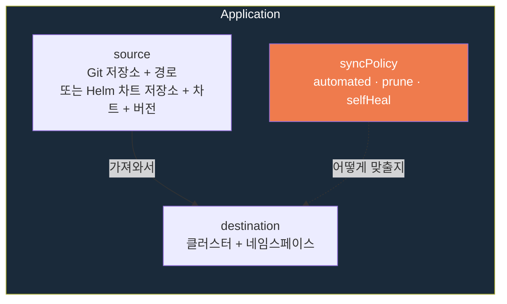
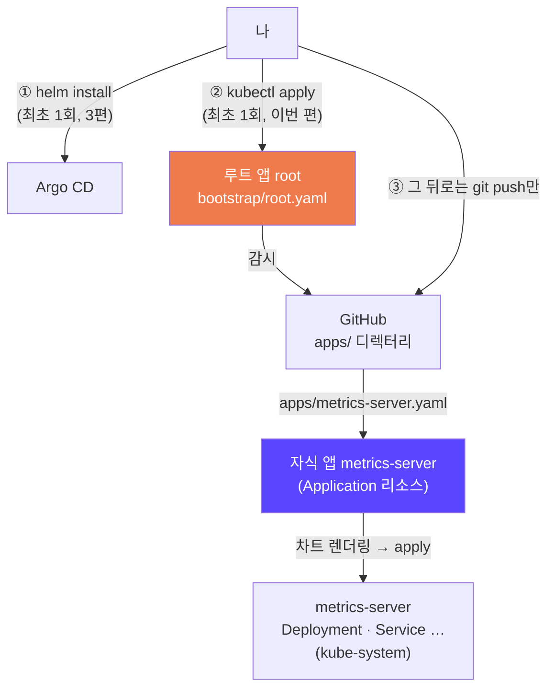
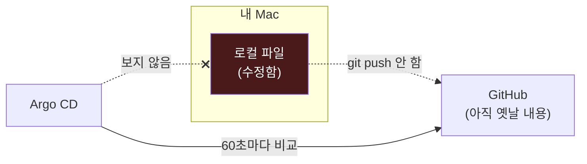
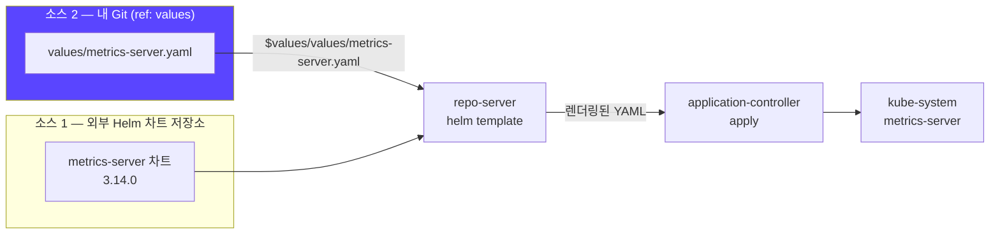
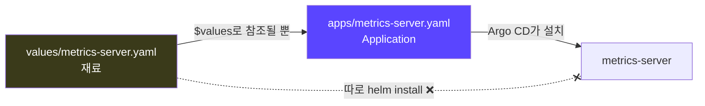
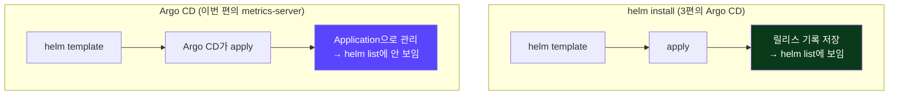
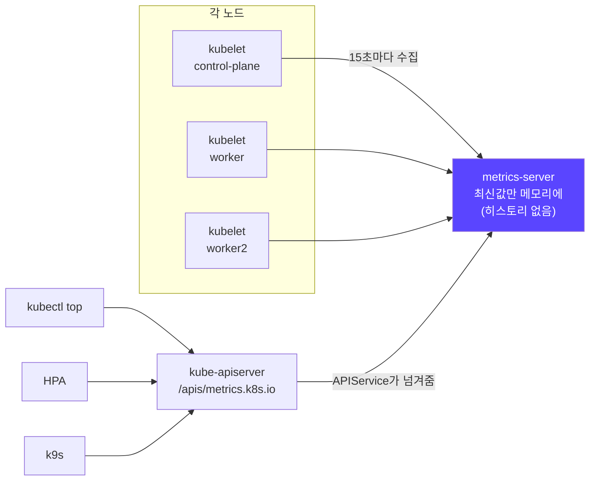
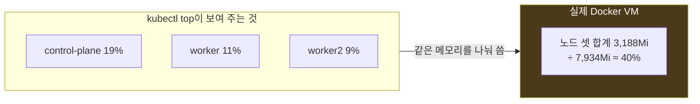
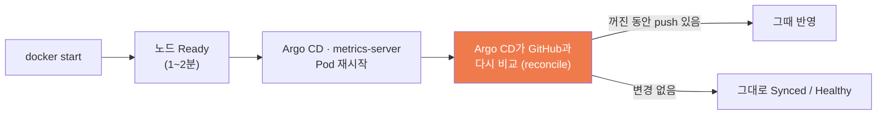

## 📚 들어가며

[3편](/posts/Lakehouse-Lab-03-ArgoCD-Helm-Install-and-Secrets/)에서 Argo CD를 Helm으로 설치했다. 하지만 아직 Argo CD는 **아무것도 배포하지 않고 있다.** 이번 편에서 루트 앱 하나를 걸어 **Git push만으로 컴포넌트가 배포되는 구조**를 완성한다.

- **app-of-apps** — 루트 Application 하나가 Git의 `apps/` 디렉터리를 감시하고, 그 안의 파일 하나하나가 컴포넌트 하나의 Application이 된다. **손으로 apply하는 건 루트 앱 하나뿐이다.**
- **multi-source** — 외부 Helm 차트 + 내 Git의 values 파일을 한 Application에서 합친다. 3편의 `helm install -f`를 GitOps로 옮긴 것이다.
- **첫 앱 metrics-server** — 대시보드가 아니다. CPU·메모리 **"현재값"** 을 `metrics.k8s.io` API로 제공하는 백엔드다.

> **이번 편 학습 지도**
>
> ```
> Application (1장)          app-of-apps (2장)           multi-source (3장)           metrics-server (4~5장)
> ─────────────────          ─────────────────           ──────────────────           ──────────────────────
> CRD · source/destination   루트 앱 = 앱을 배포하는 앱 🔦  차트 저장소 + 내 Git values 🔦  kubelet → API (현재값만)
> automated: prune·selfHeal  Argo CD는 GitHub을 본다      values는 설치 대상이 아니라 재료  Aggregated API (APIService)
>                            손으로 하는 건 두 번뿐        helm list엔 안 나온다          MEMORY(%)의 kind 함정 🔦
>                                                                                     stop/start (예상)
> ```

---

## 1. Application — Argo CD가 배포하는 단위

### 1-1. CRD로 추가된 리소스

**CRD (Custom Resource Definition)** 는 Kubernetes에 **새 리소스 종류를 추가하는 방법**이다. Argo CD를 설치하면 `Application`이라는 새 kind가 생기고, 다른 리소스처럼 조회할 수 있다.

```bash
kubectl get applications -n argocd
```

이후 Lab의 오퍼레이터들(CloudNativePG, Strimzi, Spark Operator)도 모두 이 방식이다. CRD로 새 리소스를 만들고, 컨트롤러가 그 리소스를 보고 일한다. Argo CD에서 그 컨트롤러가 3편에서 본 **`argocd-application-controller`** 다.

### 1-2. Application의 세 부분

**Application**은 "**어디서**(source) 무엇을 가져와서, **어디에**(destination) 배포하고, **어떻게** 맞출지(syncPolicy)"를 선언한다.



| 필드 | 의미 |
|---|---|
| `source` | Git 저장소 + 경로, 또는 Helm 차트 저장소 + 차트 + 버전 |
| `destination.server` | 배포할 클러스터. `https://kubernetes.default.svc` = **Argo CD가 떠 있는 바로 그 클러스터** |
| `destination.namespace` | 배포할 네임스페이스 |
| `syncPolicy.automated` | Git이 바뀌면 **자동으로** 적용 |
| `prune: true` | Git에서 **사라진** 리소스는 클러스터에서도 지운다 |
| `selfHeal: true` | 누가 클러스터를 손으로 바꾸면(drift) **Git 상태로 되돌린다** |

`selfHeal`은 다음 편 "부수고 고치기 A"의 주인공이다.

> 1장은 가이드 내용을 정리한 것이다.

---

## 2. 루트 앱 — `bootstrap/root.yaml` (app-of-apps)

### 2-1. 🔦 Application을 배포하는 Application

**app-of-apps 패턴**은 Application을 배포하는 Application이다. 루트 앱의 source는 `apps/` 디렉터리이고, 그 안에는 **다른 Application YAML들**이 들어 있다.



1. 루트 앱이 `apps/`의 YAML들을 클러스터에 apply한다. 그 YAML들은 **Application 리소스**다.
2. 클러스터에 생긴 자식 Application을 Argo CD가 다시 보고, **실제 컴포넌트**를 배포한다.

이렇게 하면 **손으로 하는 건 두 번뿐이다.** Argo CD 설치(3편)와 루트 앱 apply(이번 편). 그다음부터 컴포넌트를 켜고 끄는 건 **"`apps/` 디렉터리에 파일을 넣고 빼는 것 + git push"** 가 된다.

클러스터를 통째로 다시 만들어도 마찬가지다. 루트 앱 하나만 apply하면 Argo CD가 `apps/`에 있는 것을 전부 다시 깐다. 가이드가 1주차 산출물로 꼽는 **"루트 앱 하나로 복구되는 클러스터"** 가 이것이다.

### 2-2. 설정

```yaml
# bootstrap/root.yaml
# 루트 앱: apps/ 디렉터리의 Application들을 관리한다 (app-of-apps).
# apps/에 파일을 넣고 push하면 켜지고, apps-disabled/로 옮기면 꺼진다.
apiVersion: argoproj.io/v1alpha1
kind: Application
metadata:
  name: root
  namespace: argocd
spec:
  project: default
  source:
    repoURL: https://github.com/<GITHUB_ID>/lakehouse-lab.git
    targetRevision: main
    path: apps
  destination:
    server: https://kubernetes.default.svc
    namespace: argocd
  syncPolicy:
    automated:
      prune: true
      selfHeal: true
```

- **`path: apps`** — 저장소의 `apps/` 디렉터리 안의 YAML을 전부 apply한다.
- **`destination.namespace: argocd`** — 자식 Application 리소스들은 `argocd` 네임스페이스에 만들어진다. 실제 워크로드가 어디에 뜰지는 **각 자식 앱의 destination**이 정한다.
- **루트 앱은 `bootstrap/`에 따로 둔다.** 루트 앱 자신이 `apps/` 안에 있으면 자기가 자기를 관리하는 순환이 생긴다.
- **`prune: true`** — `apps/`에서 파일을 빼면 그 자식 Application이 클러스터에서도 지워진다. 주석의 "`apps-disabled/`로 옮기면 꺼진다"가 이 설정 덕분이다(다음 편).

### 2-3. ⚠️ Argo CD는 내 Mac이 아니라 GitHub을 본다



Argo CD는 **GitHub에 push된 내용**을 본다. 로컬에서 고치고 push를 안 하면 **아무 일도 일어나지 않는다.** GitOps에서 가장 흔한 실수다. 그래서 순서가 이렇다.

```bash
git push            # 먼저 GitHub에 올려야 Argo CD가 읽을 수 있다
kubectl apply -f bootstrap/root.yaml
argocd app list                                  # root, metrics-server
argocd app wait metrics-server --health --timeout 300
```

push 후 반영까지는 3편에서 설정한 **`timeout.reconciliation: 60s`** 만큼 걸릴 수 있다. 기다리기 싫으면 `argocd app get <앱> --refresh`.

### 2-4. 결과

```
$ kubectl -n argocd get applications
NAME             SYNC     HEALTH    REVISION
metrics-server   Synced   Healthy   [3.14.0 769f8419c9ca474c30b92d03aefdabfd86ba54fb]
root             Synced   Healthy

# root 앱이 관리하는 리소스 = 자식 Application
Application/metrics-server   Synced
```

- **root 앱이 관리하는 리소스는 `Application/metrics-server` 하나**다. Deployment가 아니라 Application이다. app-of-apps의 구조가 그대로 보인다.
- **metrics-server의 REVISION이 두 개**다. multi-source의 흔적이다(3장).
  - `3.14.0` — 차트 버전
  - `769f8419…` — values를 읽어 온 **Git 커밋 해시**. 이번 편의 커밋 `feat: app of apps 패턴으로 root 및 metrics-server 추가`의 해시와 같다.
- **root도 Healthy**다. 3편 3-2에서 넣은 **Application health Lua** 덕분에, root의 Health는 자식 metrics-server의 실제 Health를 반영한 값이다. Lua가 없었다면 metrics-server가 망가져도 root는 Healthy로 보였을 것이다.

### 2-5. 가이드와 다른 점 — repoURL을 처음부터 내 주소로

| | 가이드 | 내 practice |
|---|---|---|
| Application의 `repoURL` | `https://github.com/CHANGE-ME/lakehouse-lab.git` 자리표시자 | 처음부터 `https://github.com/<GITHUB_ID>/lakehouse-lab.git` |
| 바꾸는 방법 | `scripts/set-repo-url.sh <내 저장소 URL>`로 한 번에 치환 | 바꿀 게 없음 |

가이드 저장소에는 `CHANGE-ME`가 루트 앱뿐 아니라 `apps-disabled/`의 여러 Application에도 들어 있다. 그래서 저장소를 통째로 가져와 쓰는 사람을 위해 `set-repo-url.sh`가 모든 YAML의 `CHANGE-ME`를 한 번에 바꿔 준다.

내 practice는 정답지 파일을 통째로 가져오지 않고 **하나씩 직접 작성**하고 있다. 확인해 보니 practice 저장소에는 `CHANGE-ME`도 `set-repo-url.sh`도 없다. 앞으로 `apps-disabled/`의 앱을 하나씩 작성할 때도 처음부터 내 주소로 쓰면 된다. 3편 7장 표의 첫 줄("repository not found → `grep -r CHANGE-ME apps*`")은 가이드 저장소를 그대로 쓸 때 생기는 문제다.

그 외 `bootstrap/root.yaml`, `apps/metrics-server.yaml`, `values/metrics-server.yaml`의 내용은 정답지와 같다.

---

## 3. 자식 앱 — `apps/metrics-server.yaml` (multi-source)

### 3-1. 설정

```yaml
# apps/metrics-server.yaml
apiVersion: argoproj.io/v1alpha1
kind: Application
metadata:
  name: metrics-server
  namespace: argocd
  finalizers:
    - resources-finalizer.argocd.argoproj.io   # 앱을 지우면 만든 리소스도 지운다
spec:
  project: default
  sources:
    - repoURL: https://kubernetes-sigs.github.io/metrics-server/   # 외부 Helm 차트
      chart: metrics-server
      targetRevision: 3.14.0
      helm:
        releaseName: metrics-server
        valueFiles:
          - $values/values/metrics-server.yaml    # 아래 Git 소스의 파일
    - repoURL: https://github.com/<GITHUB_ID>/lakehouse-lab.git
      targetRevision: main
      ref: values                                 # ↑ $values 로 참조
  destination:
    server: https://kubernetes.default.svc
    namespace: kube-system
  syncPolicy:
    automated:
      prune: true
      selfHeal: true
    syncOptions:
      - ServerSideApply=true
```

```yaml
# values/metrics-server.yaml
# kind의 kubelet 인증서는 자체 서명이라 검증을 건너뛴다 (실습 전용)
args:
  - --kubelet-insecure-tls
resources:
  requests: {cpu: 50m, memory: 64Mi}
  limits: {memory: 128Mi}
```

### 3-2. 🔦 multi-source — 차트는 저장소에서, values는 내 Git에서

루트 앱은 `source`(단수)였는데, 자식 앱은 **`sources`(복수)** 다. 소스를 두 개 둔다.



| 소스 | 역할 |
|---|---|
| 소스 1 | 외부 Helm 차트 저장소의 `metrics-server` 차트 `3.14.0` |
| 소스 2 | 내 Git 저장소. 배포할 것은 없고 **`ref: values`로 이름만 붙여 둔다** |

소스 2에 `ref: values`라는 이름을 붙이면, 소스 1에서 **`$values/...`** 로 그 저장소의 파일을 참조할 수 있다.

```
$values/values/metrics-server.yaml
└──┬──┘ └───────────┬───────────┘
 소스 2      그 저장소 루트 기준 경로
(내 Git)    → values/metrics-server.yaml
```

`$values` 다음의 `values/`는 내 저장소의 **디렉터리 이름**이다. ref 이름과 디렉터리 이름이 둘 다 `values`라서 헷갈리기 쉽다.

### 3-3. 3편의 `helm install -f`를 Argo CD가 대신 한다

이 Application은 아래 명령에 해당하는 일을 **Argo CD가 Git에서 읽어 대신 하는 것**이다.

```bash
helm install metrics-server metrics-server/metrics-server --version 3.14.0 -f values/metrics-server.yaml
```

| 3편의 Helm | 이번 편의 Application |
|---|---|
| `metrics-server/metrics-server` (저장소/차트) | `repoURL` + `chart` |
| `--version 3.14.0` | `targetRevision: 3.14.0` |
| `-f values/metrics-server.yaml` | `valueFiles: [$values/values/metrics-server.yaml]` |
| 릴리스 이름 `metrics-server` | `helm.releaseName` |
| `-n kube-system` | `destination.namespace` |

3편에서 "차트는 그대로, 바꿀 값만 `-f`로 덮어쓴다"고 했다. 그걸 그대로 GitOps로 옮긴 것이다. **차트는 포크하지 않고 values만 Git으로 관리한다.** 고객사별 values 파일을 따로 두는 실무 구조와 같다.

### 3-4. values 파일은 설치 대상이 아니라 재료다

처음에 헷갈렸던 부분이다. `values/` 디렉터리에 `metrics-server.yaml`이 있으니, **이걸로 `helm install`을 먼저 해야 하는 줄 알았다.**



values 파일은 Application이 `$values/...`로 참조하는 **재료**다. 따로 설치할 필요가 없다. 설치는 Argo CD가 한다. 그래서 할 일은 **Git에 push한 뒤 루트 앱만 apply하는 것**이었고, 그러자 Argo CD가 metrics-server까지 배포했다.

### 3-5. `helm list`에는 안 나오는데 라벨은 Helm이다

metrics-server 앱이 만든 리소스다.

```
Service/metrics-server                                   Synced
ServiceAccount/metrics-server                            Synced
APIService/v1beta1.metrics.k8s.io                        Synced
Deployment/metrics-server                                Synced
ClusterRole/system:metrics-server                        Synced
ClusterRole/system:metrics-server-aggregated-reader      Synced
ClusterRoleBinding/metrics-server:system:auth-delegator  Synced
ClusterRoleBinding/system:metrics-server                 Synced
RoleBinding/metrics-server-auth-reader                   Synced
```

그런데 `helm list`에는 **Argo CD만** 있다.

```
$ helm list -A
NAME    NAMESPACE  REVISION  STATUS    CHART            APP VERSION
argocd  argocd     1         deployed  argo-cd-10.17.2  v3.6.1
```

그런데 metrics-server 리소스의 라벨에는 Helm이 찍혀 있다.

```
"app.kubernetes.io/managed-by": "Helm",
"app.kubernetes.io/version": "0.9.0",
"helm.sh/chart": "metrics-server-3.14.0"
```



- Argo CD는 내부적으로 **`helm template`으로 YAML만 렌더링**하고, 그 결과를 **자기가 apply**한다. Helm 릴리스를 만들지 않으니 `helm list`에 안 나온다. 관리 주체는 Helm이 아니라 **Argo CD Application**이다.
- 그런데도 `managed-by: Helm` 라벨이 있는 건, **차트 템플릿에 그 라벨이 그렇게 쓰여 있어서** 렌더링 결과에 그대로 들어갔을 뿐이다.
- `app.kubernetes.io/version: 0.9.0`은 metrics-server 앱 자체의 버전, `helm.sh/chart: metrics-server-3.14.0`은 차트 버전이다. 3편에서 본 "차트 버전 ≠ 앱 버전"이 여기서도 보인다.

> 그래서 Argo CD로 배포한 앱은 `helm upgrade`나 `helm uninstall`로 다루면 안 된다. Helm 입장에서는 그런 릴리스가 없다. 버전을 바꾸고 싶으면 `targetRevision`을 고쳐서 push한다.

### 3-6. finalizer와 ServerSideApply

| 설정 | 의미 |
|---|---|
| `finalizers: resources-finalizer.argocd.argoproj.io` | 이 Application을 지우면 **Argo CD가 만든 리소스도 같이 지운다.** 이게 없으면 Application만 사라지고 metrics-server는 **고아로 남는다** |
| `syncOptions: ServerSideApply=true` | 큰 리소스(특히 CRD)를 client-side apply하면 `last-applied-configuration` annotation이 **크기 제한(256KB)** 에 걸린다. 서버 쪽에서 병합하게 해서 피한다 |

metrics-server에는 큰 CRD가 없어서 ServerSideApply가 꼭 필요하진 않다. **모든 앱에 같은 틀을 쓰려고** 넣어 둔 것이다. 3편 7장 표의 "metadata.annotations: Too long" 에러가 이걸로 막힌다. finalizer는 다음 편에서 앱을 끌 때 다시 나온다.

---

## 4. metrics-server는 무엇인가 — 대시보드가 아니다

### 4-1. 동작



| 단계 | 하는 일 |
|---|---|
| 1. 수집 | **15초마다**(`--metric-resolution=15s`) 각 노드의 kubelet에 컨테이너별 CPU·메모리 현재 사용량을 묻는다 |
| 2. 보관 | 디스크 저장 없음. **최신값만 메모리에.** 히스토리가 없다 |
| 3. 제공 | `metrics.k8s.io` API를 Kubernetes API에 추가한다 |

### 4-2. Aggregated API — APIService

```bash
kubectl get apiservice v1beta1.metrics.k8s.io
# NAME                     SERVICE                      AVAILABLE
# v1beta1.metrics.k8s.io   kube-system/metrics-server   True
```

**Aggregated API**는 Kubernetes API 서버에 **외부 API를 붙이는 방법**이다. `v1beta1.metrics.k8s.io` APIService가 "이 경로로 오는 요청은 `kube-system/metrics-server`로 넘겨라"라고 등록한다. `AVAILABLE: True`는 API 서버가 metrics-server에 정상적으로 닿는다는 뜻이다.

그래서 API 서버의 경로로 바로 조회할 수 있다.

```bash
kubectl get --raw /apis/metrics.k8s.io/v1beta1/nodes/lakehouse-worker \
  | jq '{name: .metadata.name, timestamp, window, usage}'
```

```json
{
  "name": "lakehouse-worker",
  "timestamp": "2026-11-17T07:48:07Z",
  "window": "20.029s",
  "usage": { "cpu": "43411802n", "memory": "973360Ki" }
}
```

- **`cpu: 43411802n`** — 단위 `n`은 나노코어다. 43,411,802n ≈ **43m**(밀리코어). 4-4의 `kubectl top`에서 worker가 `44m`인 것과 같은 값이다.
- **`memory: 973360Ki`** ≈ **950Mi**. `kubectl top`의 `950Mi`와 같다.
- **`window`** — 이 사용량을 계산한 측정 구간이다. `timestamp`가 "지금"이고, 그보다 이전 기록은 없다.

`kubectl top`은 결국 이 API를 보기 좋게 출력해 주는 것이다.

### 4-3. 누가 쓰나

| 사용처 | 설명 |
|---|---|
| `kubectl top nodes/pods` | metrics-server가 없으면 "Metrics API not available" |
| HPA (Horizontal Pod Autoscaler) | "CPU 70% 넘으면 Pod 늘려라"를 판단한다 |
| VPA, k9s | k9s의 CPU/MEM 열도 여기서 온다 |

**가장 먼저 켜는 이유**는 두 가지다.

1. 가볍고 의존성이 없어서 **GitOps 흐름을 처음 시험하기 좋다.** 실패해도 원인이 Argo CD 쪽인지 금방 보인다.
2. 메모리가 빠듯한 kind에서 이후 Lab마다 **`kubectl top`으로 여유를 확인**해야 한다.

### 4-4. 🔦 `kubectl top`과 MEMORY(%)의 함정

```bash
kubectl top nodes
```

```
NAME                      CPU(cores)   CPU(%)   MEMORY(bytes)   MEMORY(%)
lakehouse-control-plane   149m         1%       1516Mi          19%
lakehouse-worker          44m          0%       950Mi           11%
lakehouse-worker2         39m          0%       722Mi           9%
```

MEMORY(%)만 보면 노드마다 10~20%라서 **여유가 많아 보인다.** 그런데 이 %는 [2편 2-2](/posts/Lakehouse-Lab-02-Kind-Internals-Network-Break-Fix/)에서 본 대로 **각 노드가 Docker VM 전체(Allocatable 7,934Mi ≈ 8.3GB)를 자기 것으로 보고 계산한 값**이다. 1516Mi ÷ 7,934Mi ≈ 19%다.



세 노드를 합치면 1516 + 950 + 722 = **3,188Mi(≈3.1GiB)** 다. 실제로는 **VM 메모리의 약 40%** 를 이미 쓰고 있다(레지스트리 컨테이너 등은 빼고 노드 셋만 센 값이다). 실제 여유는 "VM 전체 − 세 노드 합계"로 봐야 한다. **%만 보면 여유가 많아 보이는 것이 kind의 함정이다.**

Pod 단위로 보면 누가 먹고 있는지 보인다.

```bash
kubectl top pods -A --sort-by=memory | head -6
```

```
NAMESPACE     NAME                                       CPU(cores)   MEMORY(bytes)
kube-system   kube-apiserver-lakehouse-control-plane     45m          575Mi
argocd        argocd-repo-server-7b6f88d448-jvngk        1m           295Mi
argocd        argocd-server-846969df6c-b9s56             2m           203Mi
argocd        argocd-application-controller-0            5m           177Mi
kube-system   kube-controller-manager-lakehouse-...      16m          145Mi
```

메모리 상위 5개 중 3개가 Argo CD다. 3편에서 걸어 둔 limit(repo-server 512Mi, server 256Mi, controller 768Mi) 안에서 돌고 있다. server는 203Mi로 limit 256Mi에 꽤 가깝다.

### 4-5. 인자 확인 — 내 values가 들어갔나

```bash
kubectl -n kube-system get deploy metrics-server \
  -o jsonpath='{.spec.template.spec.containers[0].args}' | jq -r '.[]'
```

```
--secure-port=10250
--cert-dir=/tmp
--kubelet-preferred-address-types=InternalIP,ExternalIP,Hostname
--kubelet-use-node-status-port
--metric-resolution=15s
--kubelet-insecure-tls        ← 내 values 파일에서 추가된 인자
```

위 다섯 줄은 차트 기본값이고, **마지막 줄만 내 values 파일에서 왔다.** multi-source로 합친 values가 실제로 반영된 것을 여기서 확인할 수 있다.

**`--kubelet-insecure-tls`를 넣은 이유**: metrics-server는 kubelet에 **HTTPS**로 접속하는데, kind의 kubelet 인증서는 **자체 서명**이라 검증에 실패한다. 그래서 검증을 건너뛴다. **실습 전용이다.** 운영에서는 kubelet 인증서를 클러스터 CA로 서명하게 하고(`serverTLSBootstrap`) 이 옵션은 뺀다.

### 4-6. Prometheus + Grafana와의 관계

Lab 9에서 Prometheus와 Grafana를 올린다. metrics-server와는 **대체 관계가 아니라 역할이 다르다.**

| | metrics-server | Prometheus + Grafana |
|---|---|---|
| 데이터 | CPU·메모리만 | 거의 모든 지표 |
| 기간 | **지금 값만** | **히스토리 저장** |
| 화면 | 없음 (`kubectl top`) | Grafana 대시보드 |
| 알림 | 없음 | Alertmanager |
| 용도 | 오토스케일링, 빠른 확인 | 모니터링, 장애 분석 |

**"지금 뭐가 메모리를 먹지?"** 는 `kubectl top`, **"어제 밤 몇 시부터 늘었지?"** 는 Grafana.

---

## 5. kind 노드를 멈췄다 켜면 앱은 그대로 있을까

> **⚠️ 이 장은 원리와 가이드를 바탕으로 한 예상이다.** Argo CD 자체가 stop/start 후 살아 돌아온 것은 [3편 2-3](/posts/Lakehouse-Lab-03-ArgoCD-Helm-Install-and-Secrets/)의 RESTARTS 1로 확인했다. 하지만 **metrics-server를 배포한 뒤에는 아직 stop/start를 해 보지 않았다.**

```bash
docker stop lakehouse-control-plane lakehouse-worker lakehouse-worker2
docker start lakehouse-control-plane lakehouse-worker lakehouse-worker2
kubectl -n argocd get applications
kubectl -n argocd port-forward svc/argocd-server 8080:80
```

### 5-1. 남는 것과 다시 해야 하는 것

루트 앱과 자식 앱(Application 리소스), 그리고 배포된 Deployment·Service 등은 전부 **etcd에 저장되는 리소스**다. etcd는 control-plane 노드 컨테이너 안에 있고, `docker stop`은 컨테이너를 지우지 않으므로 **그대로 남는다.**



| | stop/start 후 |
|---|---|
| Application·Deployment 등 | etcd에 남아 있다 |
| Pod | 노드가 Ready가 되면 재시작된다 |
| 꺼진 동안 push한 변경 | Argo CD가 다시 비교하면서 그때 반영 |
| port-forward | **끊긴다.** 다시 띄워야 한다 |
| CLI 로그인 | 토큰이 `~/.config/argocd/`에 있어 보통 재로그인 불필요 |

### 5-2. 켤 때 인터넷이 없으면

Argo CD가 GitHub과 차트 저장소에 못 붙는다. 앱이 `ComparisonError`나 `Unknown`으로 보인다. 하지만 **이미 떠 있는 워크로드는 계속 돈다.** Argo CD는 "맞추는" 역할이지, 워크로드를 실행하는 쪽이 아니기 때문이다. **Argo CD가 죽어도 워크로드는 계속 돈다.**

### 5-3. `kind delete cluster`를 했다면

etcd까지 사라지므로 처음부터 해야 한다. 그래도 Git에 모든 게 있으니 손으로 하는 건 네 줄이다.

```bash
scripts/kind-up.sh                                   # 1편
scripts/create-secrets.sh                            # 3편 (env 파일은 Mac에 남아 있으니 같은 값)
helm install argocd argo/argo-cd --version 10.17.2 \
  -n argocd --create-namespace -f values/argocd.yaml # 3편
kubectl apply -f bootstrap/root.yaml                 # 이번 편
```


`create-secrets.sh`가 같은 값으로 Secret을 다시 만드는 건 3편의 `ensure` 덕분이다. env 파일은 클러스터가 아니라 Mac에 있으니, 클러스터를 지워도 **값의 원본은 그대로**다.

---

## 6. 막히면 볼 표

가이드의 "막히면" 표다. 이번에는 겪지 않았다.

| 증상 | 원인과 해결 |
|---|---|
| 앱이 Unknown, "repository not found" | 저장소가 private이거나 `repoURL`을 안 바꿈(2-5) |
| push했는데 반영이 안 됨 | 감지 주기 60초. `argocd app get <앱> --refresh` |
| `kubectl top`이 "metrics not available yet" | 첫 수집 전이다. 1분 정도 기다리면 된다 |

---

## 📝 이번 편 요약

```
Application
├─ CRD로 추가된 리소스: source(어디서) · destination(어디에) · syncPolicy(어떻게)
└─ automated: prune(Git에서 빠지면 삭제) · selfHeal(손으로 바꾸면 원복)

app-of-apps
├─ 🔦 루트 앱 = apps/ 디렉터리를 배포하는 앱 → 자식 Application → 실제 컴포넌트
├─ 손으로 하는 건 helm install argocd + kubectl apply root.yaml 두 번뿐
├─ 루트 앱은 bootstrap/에 (자기 순환 방지)
├─ ⚠️ Argo CD는 GitHub을 본다 — push 안 하면 아무 일도 없다
└─ root Healthy = 3편 Lua 덕에 자식의 실제 Health

multi-source
├─ 🔦 소스 1: 차트 저장소 / 소스 2: 내 Git (ref: values) → $values/values/...
├─ = 3편 helm install -f 를 Argo CD가 Git에서 읽어 대신
├─ values 파일은 설치 대상이 아니라 재료
├─ REVISION 두 개 = 차트 버전 + values 커밋 해시
└─ helm template + Argo CD apply → helm list엔 없음, 라벨은 Helm

metrics-server
├─ kubelet → 15초마다 수집 → 메모리에 최신값만 → metrics.k8s.io
├─ APIService(Aggregated API)로 kube-apiserver에 붙음
├─ kubectl top · HPA · k9s가 사용 / Prometheus와는 역할이 다름
├─ 🔦 MEMORY(%)는 노드마다 VM 전체 기준 → 실제는 합계로 봐야 함 (≈40%)
└─ --kubelet-insecure-tls = 실습 전용 (kind kubelet 인증서가 자체 서명)

stop/start (예상, 미확인)
└─ etcd에 남음 → Pod 재시작 → 다시 reconcile / port-forward만 다시
```

| 개념 | 한 줄 정의 |
|---|---|
| **CRD** | Kubernetes에 새 리소스 종류를 추가하는 방법 |
| **Application** | Argo CD의 배포 단위. source · destination · syncPolicy를 선언한다 |
| **app-of-apps** | Application YAML들이 든 디렉터리를 배포하는 루트 Application 패턴 |
| **`prune`** | Git에서 사라진 리소스를 클러스터에서도 지우는 옵션 |
| **`selfHeal`** | 클러스터를 손으로 바꾸면 Git 상태로 되돌리는 옵션 |
| **multi-source** | 한 Application에 소스를 여러 개 두는 기능 (`sources`) |
| **`ref` / `$values`** | 소스에 이름을 붙이고, 다른 소스에서 그 소스의 파일을 참조하는 문법 |
| **resources-finalizer** | Application을 지울 때 만든 리소스도 같이 지우게 하는 finalizer |
| **ServerSideApply** | 병합을 API 서버가 하게 해서 annotation 크기 제한을 피하는 apply 방식 |
| **metrics-server** | kubelet에서 CPU·메모리 현재값을 모아 `metrics.k8s.io`로 제공하는 컴포넌트 |
| **Aggregated API (APIService)** | API 서버의 특정 경로를 다른 Service로 넘기도록 등록하는 방법 |
| **나노코어 (`n`)** | CPU 단위. 1m = 1,000,000n |

---

## 💭 느낀 점

**1. 손으로 하는 건 두 번뿐이다.**

Argo CD 설치와 루트 앱 apply. 그다음부터는 `apps/`에 파일을 넣고 push하는 게 전부다. 5-3에서 클러스터를 지웠을 때의 복구 순서를 적어 보니 네 줄이었다. 나머지는 전부 Git에 있다. **"클러스터는 언제든 다시 만들 수 있는 것"** 이 된다.

**2. Argo CD는 내 로컬이 아니라 GitHub을 본다.**

당연한 말인데 처음에는 자꾸 잊는다. 로컬 파일을 고치고 "왜 반영이 안 되지?" 하게 된다. GitOps에서는 **push가 곧 배포**다.

**3. values 파일은 설치 대상이 아니라 재료다.**

`values/metrics-server.yaml`을 보고 이걸로 뭔가를 설치해야 한다고 생각했다. 3편에서 `helm install -f values/argocd.yaml`을 직접 했으니 그럴 만했다. 그런데 이번에는 그 `-f`에 해당하는 부분을 Application의 `valueFiles`가 대신한다. **같은 values 파일인데 쓰는 주체가 사람에서 Argo CD로 바뀌었다.**

**4. `helm list`에 안 보여도 Helm 차트로 배포된 것이다.**

`helm list`에 metrics-server가 없어서 잠깐 당황했는데, 라벨에는 `managed-by: Helm`이 있었다. Argo CD는 Helm을 **렌더링 도구로만** 쓰고, 설치와 관리는 자기가 한다. 그러니 Argo CD 앱을 `helm upgrade`로 건드리면 안 된다.

**5. metrics-server = 지금 값, Prometheus = 히스토리.**

"모니터링 도구"라고 뭉뚱그려 생각했는데, metrics-server는 화면도 히스토리도 없는 **API 백엔드**였다. 그리고 `kubectl top`의 %를 그대로 믿으면 안 된다는 것도 배웠다. 노드마다 19%, 11%, 9%인데 실제로는 VM의 40%를 쓰고 있었다. 2편의 Allocatable 이야기가 이렇게 실제 숫자로 돌아왔다.

---

## 🔗 다음 편 예고

- **on/off 스위치** — `git mv apps-disabled/xxx.yaml apps/` + push로 컴포넌트를 켜고 끈다. 끌 때 finalizer와 PVC가 어떻게 되는지.
- **부수고 고치기 A** — `kubectl scale`로 손으로 바꾼 설정이 몇 초 만에 원복되는 drift(`selfHeal`). "분명히 고쳤는데 원복됐다" 문의의 정체와 긴급 수동 조치 순서.
- **부수고 고치기 B** — 없는 차트 버전(`9.9.9`)을 push했을 때의 `ComparisonError`와 `git revert` 복구.

---

## 📚 참고

- [Argo CD — Cluster Bootstrapping (App of Apps)](https://argo-cd.readthedocs.io/en/stable/operator-manual/cluster-bootstrapping/)
- [Argo CD — Multiple Sources for an Application](https://argo-cd.readthedocs.io/en/stable/user-guide/multiple_sources/)
- [Argo CD — Automated Sync Policy (prune, selfHeal)](https://argo-cd.readthedocs.io/en/stable/user-guide/auto_sync/)
- [Argo CD — Sync Options (ServerSideApply)](https://argo-cd.readthedocs.io/en/stable/user-guide/sync-options/)
- [Argo CD — App Deletion (finalizer)](https://argo-cd.readthedocs.io/en/stable/user-guide/app_deletion/)
- [metrics-server](https://github.com/kubernetes-sigs/metrics-server)
- [Kubernetes — Resource metrics pipeline](https://kubernetes.io/docs/tasks/debug/debug-cluster/resource-metrics-pipeline/)

> 2~4장의 YAML, Application 상태와 REVISION, metrics-server가 만든 리소스 목록, `helm list`, 라벨, APIService, `kubectl top`, raw API 응답, Deployment 인자는 직접 확인한 결과다. 2-5의 "practice 저장소에 `CHANGE-ME`와 `set-repo-url.sh`가 없다"는 것과 세 파일이 정답지와 같다는 것도 직접 확인했다. 1장의 개념 정리와 6장 표는 가이드 기준이다. 4-4의 "VM의 약 40%"는 `kubectl top` 값과 Allocatable로 계산한 값이다. 5장(stop/start 후 metrics-server·Application 유지)은 예상이며 아직 확인하지 않았다. 저장소 주소의 GitHub ID는 `<GITHUB_ID>`로 바꿨다.
