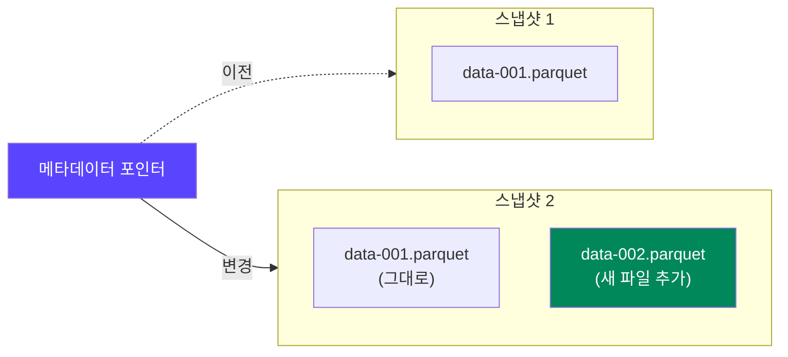
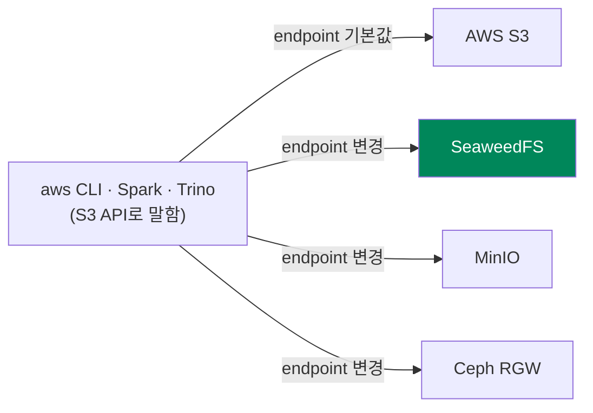
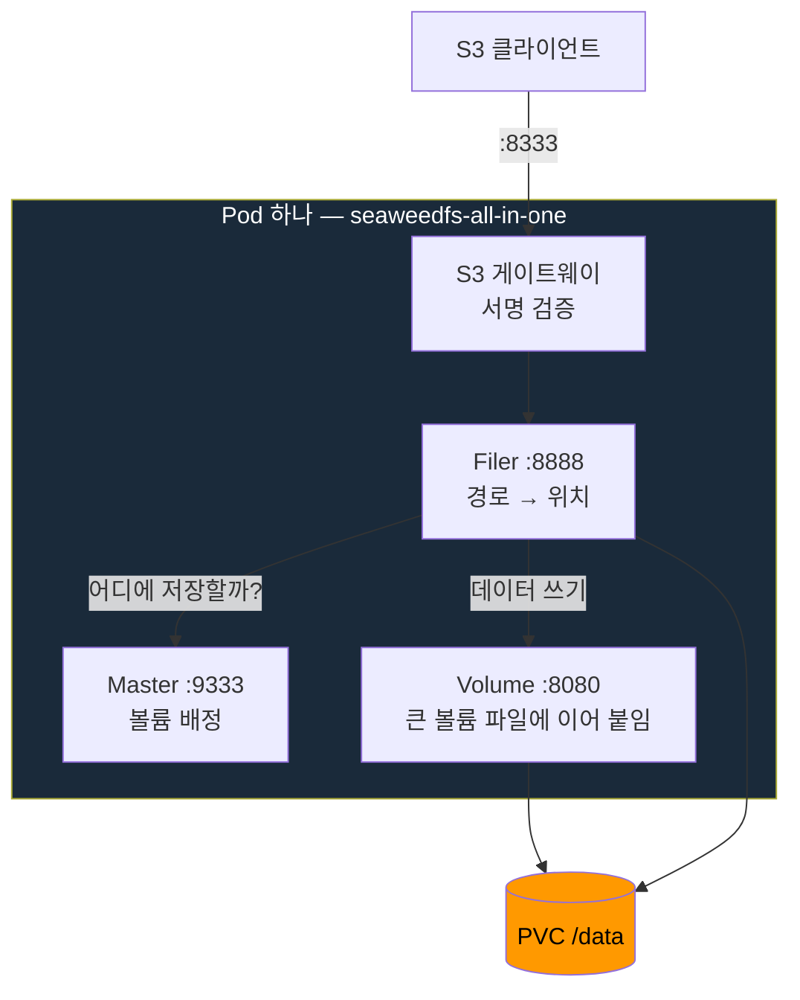
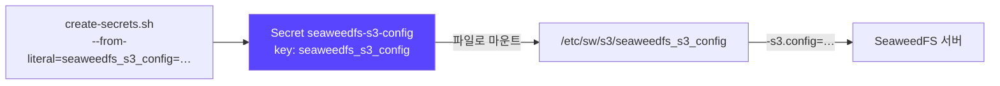
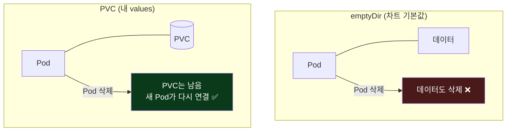
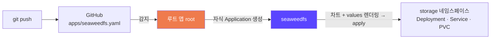
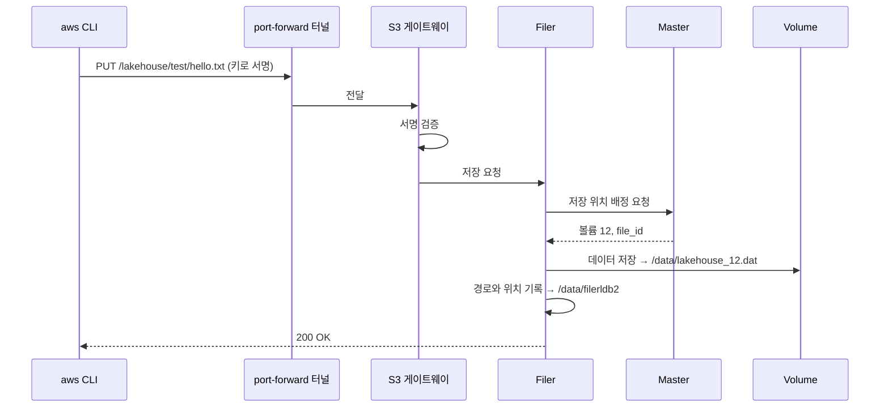
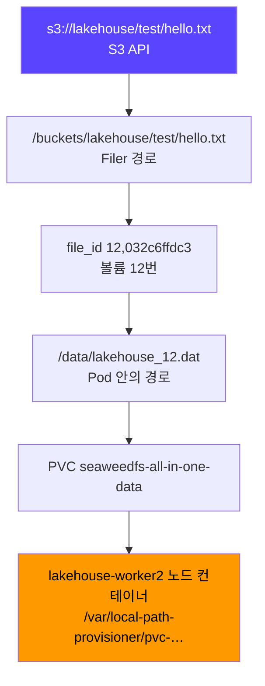

## 📚 들어가며

[4편](/posts/Lakehouse-Lab-04-ArgoCD-App-of-Apps-Metrics-Server/)에서 Git push만으로 컴포넌트가 배포되는 구조를 완성했다. 4편 예고에서는 on/off 스위치와 부수기 실험을 다룬다고 적었는데, **그 실습은 아직 하지 않고 Lab 3으로 먼저 넘어왔다.**

이번 편은 레이크하우스의 바닥인 저장 계층이다.

- **왜 S3인가** — 레이크하우스의 데이터는 결국 오브젝트 스토리지에 파일로 저장된다. S3 API만 맞추면 aws CLI, Spark, Trino가 코드 수정 없이 붙는다.
- **SeaweedFS** — S3 게이트웨이, Filer, Master, Volume 네 역할을 all-in-one으로 Pod 하나에 띄우고, 데이터는 PVC에 저장한다.
- **직접 추적** — `s3 cp`로 올린 `hello.txt`를 Filer 메타데이터, 볼륨 파일(`lakehouse_12.dat`), 그리고 **kind 노드의 실제 디렉터리**까지 따라간다.

> **이번 편 학습 지도**
>
> ```
> 개념 (1~2장)              배포 (3~4장)                접속 (5장)                 추적 (6장)
> ────────────              ────────────                ──────────                 ──────────
> 버킷 + 키 → 데이터         all-in-one values           port-forward               s3 cp 한 번의 흐름
> S3 호환 = endpoint만 교체   emptyDir → PVC 🔦           source + export            file_id 12,032c6ffdc3 🔦
> S3 · Filer · Master · Volume  apps/ 파일 하나 + git push    --endpoint-url 🔦          .dat · .idx · .vif
> ```

---

## 1. 오브젝트 스토리지와 S3 — 왜 필요한가

### 1-1. 오브젝트 스토리지

**오브젝트 스토리지**는 파일을 폴더 트리가 아니라 **`버킷 + 키(이름) → 데이터`** 형태로 저장하고, HTTP API로 읽고 쓰는 저장소다.

```
s3://lakehouse/test/hello.txt
     ~~~~~~~~~ ~~~~~~~~~~~~~~
       버킷          키
```

여기서 두 가지가 일반 파일 시스템과 다르다.

| | 파일 시스템 | 오브젝트 스토리지 |
|---|---|---|
| 구조 | 디렉터리 트리 | 버킷 + 키. **`test/`는 진짜 폴더가 아니라 키 이름의 일부** |
| 수정 | 파일의 일부만 고칠 수 있다 | **일부만 고칠 수 없다. 통째로 다시 쓴다** |
| 접근 | 마운트, 시스템 콜 | HTTP API |

두 번째 차이가 레이크하우스의 설계를 결정한다. [1편](/posts/Lakehouse-Lab-01-Kind-Cluster-Local-Registry/)에서 소개한 **Iceberg가 기존 파일을 수정하지 않고, 새 파일을 추가한 뒤 메타데이터 포인터를 바꾸는 방식으로 동작하는 이유**가 이것이다.



### 1-2. S3 호환 스토리지

**S3 호환 스토리지**는 AWS S3의 API를 그대로 구현한 저장소다. S3 API가 사실상 표준이라 **클라이언트는 접속 주소(endpoint)만 바꾸면 된다.** 온프레미스에서는 MinIO, Ceph RGW, SeaweedFS 등이 쓰인다.



가이드가 SeaweedFS를 고른 이유는 라이선스다. 가이드에 따르면 MinIO 커뮤니티 에디션 저장소가 2026년 4월에 아카이브되어, **Apache 2.0 라이선스인 SeaweedFS**를 쓴다. S3 API 관점의 트러블슈팅은 MinIO, Ceph RGW와 같다.

> 1장은 가이드 내용을 정리한 것이다.

---

## 2. SeaweedFS 구조 — 네 가지 역할

| 역할 | 포트 | 하는 일 |
|---|---|---|
| **S3 게이트웨이** | 8333 | S3 요청을 받고 키를 검증 |
| **Filer** | 8888 | "경로 → 데이터 위치" **메타데이터** 관리 |
| **Master** | 9333 | 어느 볼륨에 저장할지 배정, 볼륨 상태 관리 |
| **Volume** | 8080 | 실제 **데이터**를 디스크에 저장 |



**작은 파일을 파일 하나씩 만들지 않고 큰 볼륨 파일에 이어 붙이는 것**이 SeaweedFS의 특징이다. 6장에서 이 볼륨 파일을 직접 본다.

실제 운영에서는 역할별로 나눠 여러 대로 띄운다. 실습은 메모리를 아끼려고 **all-in-one** 모드로 Pod 하나에 모두 넣었다. 대신 **이 Pod가 죽으면 S3 전체가 멈춘다**(단일 장애점). 서버 인자의 `-master.defaultReplication=000`도 복제 없이 **한 벌만** 저장한다는 뜻으로, 실습용 설정이다.

Service의 포트를 보면 네 역할이 그대로 드러난다.

```bash
kubectl -n storage get svc seaweedfs-all-in-one -o jsonpath='{range .spec.ports[*]}{.name} {.port}{"\n"}{end}'
```

```
swfs-master 9333
swfs-master-grpc 19333
swfs-volume 8080
swfs-volume-grpc 18080
swfs-filer 8888
swfs-filer-grpc 18888
swfs-s3 8333
server-metrics 9324
```

Master, Volume, Filer는 HTTP 포트에 **10000을 더한 gRPC 포트**를 하나씩 더 가진다. 클라이언트가 쓰는 건 S3 포트 **8333**뿐이다.

---

## 3. `values/seaweedfs.yaml` 해설

```yaml
# values/seaweedfs.yaml
# SeaweedFS 4.53 (차트 4.53.0) - all-in-one 모드
# master + volume + filer + S3 게이트웨이를 Pod 하나로 띄운다.
# 개별 컴포넌트(StatefulSet)는 끈다.
master:
  enabled: false
volume:
  enabled: false
filer:
  enabled: false
s3:
  enabled: false

allInOne:
  enabled: true
  s3:
    enabled: true
    enableAuth: true
    # scripts/create-secrets.sh 가 만든 Secret (키: seaweedfs_s3_config)
    existingConfigSecret: seaweedfs-s3-config
  # 기본값 emptyDir이면 Pod 재시작 때 데이터가 사라진다 → PVC로 바꾼다
  data:
    type: persistentVolumeClaim
    size: 20Gi
  resources:
    requests: {cpu: 100m, memory: 256Mi}
    limits: {memory: 1Gi}
```

| 설정 | 의미 |
|---|---|
| `master/volume/filer/s3.enabled: false` | 역할별 개별 배포를 끈다 |
| `allInOne.enabled: true` | 네 역할을 Pod 하나로 띄운다 |
| `enableAuth: true` + `existingConfigSecret` | S3 인증을 켜고, 3편의 `create-secrets.sh`가 만든 사용자 목록 Secret을 쓴다 |
| `data.type: persistentVolumeClaim` | **가장 중요한 설정.** 데이터를 PVC에 저장한다 |

### 3-1. Secret의 key 이름은 쓰는 쪽과의 약속

[3편 6-2](/posts/Lakehouse-Lab-03-ArgoCD-Helm-Install-and-Secrets/)에서 "Secret의 key 이름은 쓰는 쪽과의 약속"이라고 했다. 그 실제 사례가 여기 있다.



Secret의 **key 이름이 곧 마운트된 파일 이름**이 되고, 서버는 `-s3.config=/etc/sw/s3/seaweedfs_s3_config`로 그 파일을 읽는다. key 이름이 다르면 서버가 파일을 찾지 못한다.

### 3-2. 🔦 emptyDir vs PVC — 차트 기본값을 믿지 말 것

| | emptyDir | PVC (PersistentVolumeClaim) |
|---|---|---|
| 정체 | Pod 수명과 함께하는 **임시 디렉터리** | Pod와 **별개로 유지되는** 볼륨을 요청하는 리소스 |
| Pod가 사라지면 | **데이터도 사라진다** | 데이터가 남는다 |
| 이 차트에서 | **기본값** | values로 직접 바꿔야 함 |



스토리지를 설치했는데 기본값 그대로면, **Pod가 재시작되는 순간 데이터가 전부 사라진다.** 설치도 잘 되고 업로드도 잘 되니까 배포 직후에는 문제가 드러나지 않는다.

---

## 4. Git push로 배포하기 — `apps/seaweedfs.yaml`

### 4-1. 가이드와 다른 점

| | 가이드 | 내 practice |
|---|---|---|
| 앱 켜는 방법 | 미리 준비된 `apps-disabled/seaweedfs.yaml`을 `git mv`로 `apps/`에 옮긴다 | `apps-disabled/`가 없어서 `apps/seaweedfs.yaml`을 **직접 작성** |
| 파일 내용 | — | 정답지와 같다. `repoURL`만 내 저장소 |

정답지를 복사하지 않고 파일을 하나씩 직접 만들면서 공부하고 있어서다. `values/seaweedfs.yaml`도 정답지와 같다.

### 4-2. Application

[4편](/posts/Lakehouse-Lab-04-ArgoCD-App-of-Apps-Metrics-Server/)의 metrics-server와 **같은 multi-source 구조**다. 외부 Helm 차트에 내 Git의 values 파일을 얹는다.

```yaml
# apps/seaweedfs.yaml
apiVersion: argoproj.io/v1alpha1
kind: Application
metadata:
  name: seaweedfs
  namespace: argocd
  finalizers:
    - resources-finalizer.argocd.argoproj.io
spec:
  project: default
  sources:
    - repoURL: https://seaweedfs.github.io/seaweedfs/helm
      chart: seaweedfs
      targetRevision: 4.53.0
      helm:
        releaseName: seaweedfs
        valueFiles:
          - $values/values/seaweedfs.yaml
    - repoURL: https://github.com/<GITHUB_ID>/lakehouse-lab.git
      targetRevision: main
      ref: values
  destination:
    server: https://kubernetes.default.svc
    namespace: storage
  syncPolicy:
    automated:
      prune: true
      selfHeal: true
    syncOptions:
      - CreateNamespace=true
      - ServerSideApply=true
```

metrics-server와 달라진 곳은 차트 저장소·버전, 네임스페이스, 그리고 **`CreateNamespace=true`** 정도다. 대상 네임스페이스가 없으면 만들어 주는 옵션인데, `storage`는 3편의 스크립트로 이미 만들었으므로 안전장치에 해당한다.

### 4-3. 🔦 파일 두 개 + git push = 스토리지 배포

```bash
git add apps/seaweedfs.yaml values/seaweedfs.yaml
git commit -m "feat: seaweedfs 추가" && git push
argocd app get root --refresh >/dev/null
argocd app wait seaweedfs --health --timeout 600
kubectl -n storage get pod,svc,pvc
```



이번 배포에서 **`helm install`도, 컴포넌트에 대한 `kubectl apply`도 손으로 하지 않았다.** `argocd app get root --refresh`는 60초 감지 주기를 기다리지 않으려고 바로 확인시킨 것이다.

```
NAME             SYNC     HEALTH    REVISION
metrics-server   Synced   Healthy   [3.14.0 de645d5b67f0611f62c618d18b44abca4afb7d00]
root             Synced   Healthy   <none>
seaweedfs        Synced   Healthy   [4.53.0 de645d5b67f0611f62c618d18b44abca4afb7d00]

NAME                                      READY   STATUS    RESTARTS   AGE
pod/seaweedfs-all-in-one-fff48544-cx664   1/1     Running   0          103m

NAME                           TYPE        CLUSTER-IP     PORT(S)
service/seaweedfs-all-in-one   ClusterIP   10.96.125.76   9333/TCP,19333/TCP,8080/TCP,18080/TCP,8888/TCP,18888/TCP,8333/TCP,9324/TCP

NAME                                              STATUS   CAPACITY   ACCESS MODES   STORAGECLASS
persistentvolumeclaim/seaweedfs-all-in-one-data   Bound    20Gi       RWO            standard
```

- **REVISION의 해시 `de645d5…`** 는 방금 push한 커밋 `feat: seaweedfs 추가`다. 눈여겨볼 건 **metrics-server의 해시도 같이 바뀌었다**는 점이다. 4편에서는 `769f841…`이었다. values 소스가 `targetRevision: main`을 따라가므로 main이 움직이면 revision도 함께 움직인다. metrics-server의 매니페스트는 바뀐 게 없어서 그대로 Synced다.
- **PVC가 `Bound`, StorageClass는 `standard`** — [1편 5-3](/posts/Lakehouse-Lab-01-Kind-Cluster-Local-Registry/)에서 본 kind 기본 StorageClass(local-path)가 이 PVC를 만들어 줬다.

---

## 5. Mac에서 S3 접속하기 — 명령어 한 줄씩

```bash
# 터미널 1: 통로 열기
kubectl -n storage port-forward svc/seaweedfs-all-in-one 8333:8333

# 터미널 2: 접속 정보 준비
source ~/.lakehouse-lab.env
export AWS_ACCESS_KEY_ID=$S3_ACCESS_KEY AWS_SECRET_ACCESS_KEY=$S3_SECRET_KEY AWS_DEFAULT_REGION=us-east-1
alias s3='aws --endpoint-url http://localhost:8333 s3'

# 버킷 생성, 업로드, 조회
s3 mb s3://lakehouse
echo hello > /tmp/hello.txt && s3 cp /tmp/hello.txt s3://lakehouse/test/hello.txt
s3 ls s3://lakehouse --recursive
```

```
2026-11-18 05:58:27          6 test/hello.txt
```

| 명령 | 의미 |
|---|---|
| `kubectl port-forward` | Service의 ClusterIP는 클러스터 안에서만 닿는다([2편 2-2](/posts/Lakehouse-Lab-02-Kind-Internals-Network-Break-Fix/)). `Mac의 8333 → Pod의 8333` 터널을 만든다. **명령이 실행 중일 때만 유지**되므로 다른 터미널에 띄워 둔다 |
| `source` + `export` | env 파일의 키를 셸 변수로 불러온 뒤, aws CLI가 자동으로 읽는 이름의 환경 변수로 내보낸다 |
| `--endpoint-url` | **핵심.** 요청의 목적지를 내 SeaweedFS로 바꾼다 |
| `s3 mb` | make bucket. 버킷 생성 |
| `s3 cp` | 업로드 |
| `s3 ls --recursive` | 버킷 안의 모든 오브젝트 조회 |

**`source` + `export`** 는 3편 5-3에서 실험한 "셸 변수 vs 환경 변수"의 실제 사례다. aws CLI는 **환경 변수에서 키를 직접 읽는 자식 프로세스**라서 `export`가 필요하다. 그때 "Lab 3에서 `export`를 따로 한다"고 적었던 줄이 바로 이것이다.

> **🔦 `--endpoint-url`이 없으면 진짜 AWS로 간다**
>
> 이 옵션을 빼면 aws CLI는 **실제 AWS S3로 요청을 보낸다.** 1-2에서 말한 "endpoint만 바꾸면 된다"가 이 한 줄이다. `alias`로 묶어 둔 이유이기도 하다.

`export`와 `alias`는 **그 터미널에서만 유효**하다. 새 터미널을 열면 다시 실행해야 한다.

---

## 6. hello.txt는 실제로 어디에 저장됐을까

### 6-1. `s3 cp` 한 번의 흐름



**데이터와 메타데이터가 다른 곳에 저장된다.** 오브젝트 스토리지도 뜯어보면 "내용"과 "그 내용이 어디 있는가"가 나뉘어 있다.

### 6-2. 🔦 Filer에서 메타데이터 조회

```bash
kubectl -n storage exec deploy/seaweedfs-all-in-one -- \
  curl -s -H 'Accept: application/json' 'http://localhost:8888/buckets/lakehouse/test/' \
  | jq '.Entries[] | {FullPath, FileSize, Mime, chunks: [.chunks[] | {file_id, size}]}'
```

```json
{
  "FullPath": "/buckets/lakehouse/test/hello.txt",
  "FileSize": 6,
  "Mime": "text/plain",
  "chunks": [
    { "file_id": "12,032c6ffdc3", "size": 6 }
  ]
}
```

- **`FullPath`** — 버킷은 Filer의 **`/buckets/<이름>`** 디렉터리다. S3 API에서 `test/`는 키의 일부일 뿐이지만, **SeaweedFS 내부의 Filer에서는 실제 디렉터리처럼 조회된다.** 위 명령도 `test/`를 디렉터리로 조회한 것이다.
- **`FileSize: 6`** — `hello` 5글자 + 줄바꿈 1글자.
- **`chunks`** — 파일의 내용이 어디 있는지 가리키는 목록이다. 작은 파일이라 조각이 하나다.

`file_id`를 나눠 보면 이렇다.

```
12 , 03 2c6ffdc3
~~   ~~ ~~~~~~~~
│    │  └ 쿠키 (임의의 값, 파일 ID를 추측해 접근하는 것을 막는다)
│    └ 파일 키 (볼륨 안에서 이 파일의 번호)
└ 볼륨 번호 → lakehouse_12.dat
```

### 6-3. 볼륨 파일 확인

```bash
kubectl -n storage exec deploy/seaweedfs-all-in-one -- sh -c 'ls -la /data | grep -E "lakehouse_12\.|filerldb"'
kubectl -n storage exec deploy/seaweedfs-all-in-one -- grep -c hello /data/lakehouse_12.dat
```

```
drwxr-xr-x   10 root     root          4096 Nov 18 05:29 filerldb2
-rw-r--r--    1 root     root            72 Nov 18 05:58 lakehouse_12.dat
-rw-r--r--    1 root     root            16 Nov 18 05:58 lakehouse_12.idx
-rw-r--r--    1 root     root           194 Nov 18 05:58 lakehouse_12.vif

# grep -c hello
1
```

| 파일 | 내용 | 이번에 본 크기 |
|---|---|---|
| `lakehouse_12.dat` | **실제 데이터** | 72바이트. 6바이트 내용에 헤더와 메타데이터가 함께 저장된다 |
| `lakehouse_12.idx` | 볼륨 안에서 위치를 찾는 **인덱스** | 16바이트. 파일 하나에 대한 항목 하나 크기다 |
| `lakehouse_12.vif` | **볼륨 정보** | 194바이트 |
| `filerldb2/` | **Filer의 메타데이터 DB** | 6-2에서 조회한 경로와 위치 |

`grep -c hello`가 `1`이다. **내가 올린 `hello`가 볼륨 파일 안에 그대로 들어 있다.**

파일 이름의 `lakehouse`는 **Collection** 이름이다. 볼륨에서는 버킷을 Collection으로 구분하기 때문에 `<버킷>_<볼륨 번호>.dat`가 된다.

### 6-4. /data는 어디인가 — kind 노드의 디렉터리까지

`/data`는 PVC에 연결되어 있다. 그 PVC의 실제 위치를 PV에서 찾아봤다.

```bash
PV=$(kubectl -n storage get pvc seaweedfs-all-in-one-data -o jsonpath='{.spec.volumeName}')
kubectl get pv "$PV" -o jsonpath='path={.spec.hostPath.path}{"\n"}reclaim={.spec.persistentVolumeReclaimPolicy}{"\n"}node={.spec.nodeAffinity.required.nodeSelectorTerms[0].matchExpressions[0].values[0]}{"\n"}'
kubectl -n storage get deploy seaweedfs-all-in-one -o jsonpath='strategy={.spec.strategy.type}{"\n"}'
```

```
path=/var/local-path-provisioner/pvc-7873ae26-ac80-4eda-a2b5-edcbdf12140a_storage_seaweedfs-all-in-one-data
reclaim=Delete
node=lakehouse-worker2
strategy=Recreate
```

전체 경로를 이어 보면 이렇다.



여기서 세 가지를 알 수 있다.

| 확인한 값 | 의미 |
|---|---|
| `node=lakehouse-worker2` | 데이터는 **worker2 노드에만** 있다. 1편의 `WaitForFirstConsumer`대로 Pod가 스케줄된 노드에 볼륨이 만들어졌다. 그래서 이 Pod는 **worker2에 묶인다** |
| `reclaim=Delete` | **PVC를 지우면 데이터도 지워진다.** Pod가 사라져도 남지만, PVC까지 지우면 끝이다 |
| `strategy=Recreate` | 업데이트할 때 옛 Pod를 **먼저 내리고** 새 Pod를 띄운다. 같은 데이터 디렉터리를 두 Pod가 동시에 쓰는 일이 없다. 대신 그 사이에는 S3가 멈춘다 |

[2편 5장](/posts/Lakehouse-Lab-02-Kind-Internals-Network-Break-Fix/)의 워커 노드 다운 실험을 떠올리면, worker2가 죽었을 때 이 Pod는 **다른 노드로 옮겨 갈 수 없다.** 데이터가 worker2의 로컬 디렉터리에 있기 때문이다. local-path 방식의 한계이고, 운영에서 복제나 분산 스토리지를 쓰는 이유다.

---

## 7. 막히면 볼 표

가이드의 "막히면" 표다. 이번에는 겪지 않았다.

| 증상 | 원인과 해결 |
|---|---|
| Pod가 `CreateContainerConfigError` | `seaweedfs-s3-config` Secret이 없음. `scripts/create-secrets.sh` 실행 |
| PVC가 `Pending` | 기본 StorageClass가 없거나 노드 디스크 부족. `kubectl get sc`, `kubectl describe pvc` |
| 업로드 중 `No writable volumes` | 볼륨 개수나 디스크 한도. `weed shell`의 `volume.list`로 확인 |
| `x-amz-checksum`, `aws-chunked` 관련 오류 | AWS SDK v2의 기본 체크섬을 스토리지가 지원하지 않는 경우. `AWS_REQUEST_CHECKSUM_CALCULATION=when_required`, `AWS_RESPONSE_CHECKSUM_VALIDATION=when_required` 설정 |
| `Could not connect to the endpoint URL` (Mac) | port-forward가 끊김. 다시 실행 |

---

## 📝 이번 편 요약

```
오브젝트 스토리지
├─ 버킷 + 키 → 데이터, HTTP API (test/는 키의 일부)
├─ 일부 수정 불가 → Iceberg가 새 파일 + 포인터 변경으로 동작하는 이유
└─ S3 호환 = 클라이언트는 endpoint만 교체

SeaweedFS
├─ S3 게이트웨이(8333) · Filer(8888) · Master(9333) · Volume(8080)
├─ 작은 파일을 큰 볼륨 파일에 이어 붙임
└─ all-in-one + 복제 000 = 실습용 (단일 장애점)

배포
├─ values: 개별 컴포넌트 끄고 allInOne, S3 인증 + 3편 Secret
├─ 🔦 emptyDir(기본값) → PVC로 변경해야 데이터가 남음
└─ apps/ 파일 + values 파일 + git push → 손으로 설치한 것 없음

접속
├─ port-forward 8333 (실행 중일 때만)
├─ source + export (aws CLI는 환경 변수를 읽음)
└─ 🔦 --endpoint-url 없으면 진짜 AWS로 간다

hello.txt 추적
├─ S3 키 → Filer 경로 → file_id 12,032c6ffdc3 → lakehouse_12.dat
├─ .dat 데이터 / .idx 인덱스 / .vif 볼륨 정보 / filerldb2 메타데이터
└─ /data → PVC → worker2의 /var/local-path-provisioner/… (reclaim Delete)
```

| 개념 | 한 줄 정의 |
|---|---|
| **오브젝트 스토리지** | 버킷과 키로 데이터를 저장하고 HTTP API로 읽고 쓰는 저장소 |
| **S3 호환 스토리지** | AWS S3의 API를 구현해 클라이언트가 endpoint만 바꿔 쓸 수 있는 저장소 |
| **endpoint** | 클라이언트가 요청을 보낼 스토리지의 접속 주소 |
| **Filer** | SeaweedFS에서 경로와 데이터 위치(메타데이터)를 관리하는 역할 |
| **Master** | 볼륨 배정과 상태를 관리하는 역할 |
| **Volume** | 실제 데이터를 큰 볼륨 파일에 저장하는 역할 |
| **Collection** | 볼륨을 묶는 이름. 버킷 이름이 그대로 쓰인다 |
| **file_id** | `볼륨 번호,파일 키+쿠키` 형식의 데이터 위치 식별자 |
| **all-in-one** | SeaweedFS의 모든 역할을 Pod 하나로 띄우는 배포 모드 |
| **emptyDir** | Pod 수명과 함께 사라지는 임시 볼륨 |
| **PVC** | Pod와 별개로 유지되는 볼륨을 요청하는 리소스 |
| **reclaimPolicy `Delete`** | PVC를 지우면 실제 볼륨도 함께 지우는 정책 |

---

## 💭 느낀 점

**1. 오브젝트 스토리지도 뜯어보면 메타데이터와 데이터가 나뉘어 있다.**

S3는 그동안 "버킷에 파일 넣으면 되는 곳"이었다. Filer에 경로와 위치가 있고, Volume에 데이터가 있고, Master가 그 사이를 배정한다. 나중에 Iceberg의 카탈로그, 메타데이터, 데이터 파일을 볼 때도 **"내용"과 "위치 정보"를 나눠서** 생각하게 될 것 같다.

**2. 버킷, 키, 볼륨이 실제 파일로 연결되는 걸 직접 따라갔다.**

`s3://lakehouse/test/hello.txt`에서 출발해서 `file_id`, `lakehouse_12.dat`, PVC, 노드의 디렉터리까지 이어졌다. 추상화된 줄 알았던 것이 결국 **어떤 노드의 어떤 디렉터리에 있는 파일**이었다. 장애가 나면 이 경로를 거꾸로 짚어 가게 될 것이다.

**3. `--endpoint-url` 하나가 S3 호환의 힘이다.**

옵션 하나로 목적지가 AWS에서 내 클러스터로 바뀐다. 클라이언트 코드는 그대로다. Spark와 Trino도 같은 방식으로 붙을 거라고 생각하면, S3 API가 왜 사실상 표준인지 이해된다.

**4. 차트 기본값을 믿지 말고 영속성부터 확인하기.**

이 차트의 기본값은 `emptyDir`이다. 그대로 두면 설치와 업로드까지는 문제가 없으니, 재시작하고 나서야 데이터가 없다는 걸 알게 된다. **상태를 가진 컴포넌트를 올릴 때는 "데이터가 어디에 저장되는가"를 제일 먼저 봐야 한다.**

**5. Git push 한 번으로 스토리지가 배포됐다.**

파일 두 개를 만들어 push했더니 Deployment, Service, PVC가 생겼다. 4편에서 만든 구조가 두 번째 앱부터 제값을 한다. 앞으로 켤 컴포넌트들도 이 흐름 그대로다.

---

## 🔗 다음 편 예고

이번에는 Mac에서 port-forward로 접근했다. 다음 편에서는 **클러스터 안에서** 같은 S3에 접근해 본다. **toolbox Pod**와 **Service DNS**로 접속하고, **SeaweedFS 내부 상태**를 확인한 뒤, **잘못된 키**와 **잘못된 주소 방식**으로 일부러 부숴 본다.

---

## 📚 참고

- [SeaweedFS](https://github.com/seaweedfs/seaweedfs)
- [SeaweedFS Wiki](https://github.com/seaweedfs/seaweedfs/wiki)
- [Amazon S3 — What is Amazon S3?](https://docs.aws.amazon.com/AmazonS3/latest/userguide/Welcome.html)
- [AWS CLI — S3 commands](https://docs.aws.amazon.com/cli/latest/reference/s3/)
- [Kubernetes — Persistent Volumes](https://kubernetes.io/docs/concepts/storage/persistent-volumes/)
- [Kubernetes — Use Port Forwarding to Access Applications in a Cluster](https://kubernetes.io/docs/tasks/access-application-cluster/port-forward-access-application-cluster/)

> 2~6장의 Service 포트, values와 Application, 배포 결과, `s3 ls`, Filer 메타데이터, 볼륨 파일 목록, 6-4의 PV 경로·노드·reclaimPolicy, Deployment의 `Recreate` 전략, 서버 인자는 직접 확인한 결과다. 1장의 개념 정리, MinIO 관련 내용, 7장의 표는 가이드 기준이다. `file_id`의 구조와 `.dat`·`.idx` 크기에 대한 설명, 6-1의 내부 호출 순서는 SeaweedFS의 구조를 바탕으로 정리한 것이며 내부 호출을 직접 추적한 것은 아니다. worker2 장애 시 Pod가 옮겨 가지 못한다는 내용은 local-path의 동작을 바탕으로 한 설명이고 실험하지는 않았다. 비밀 값은 글에 넣지 않았고, 저장소 주소의 GitHub ID는 `<GITHUB_ID>`로 바꿨다.
