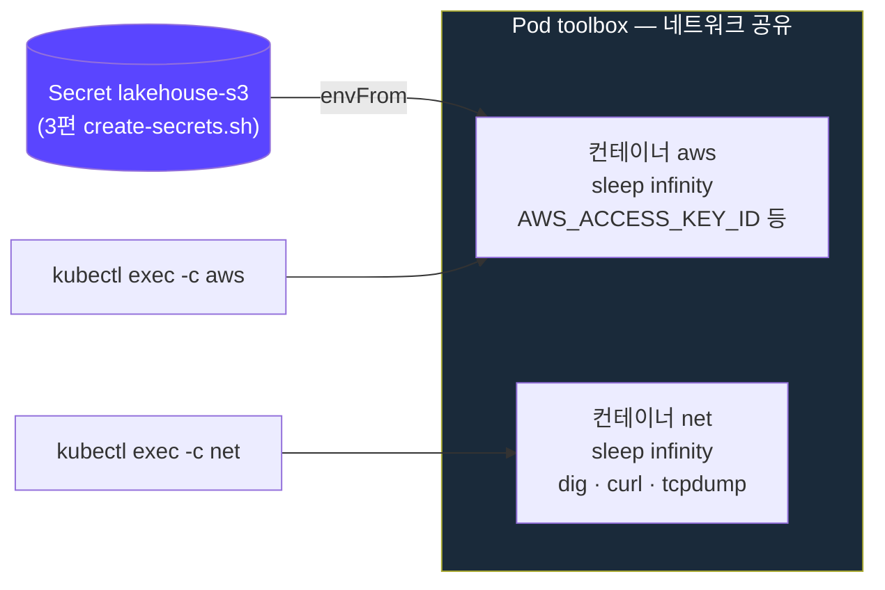
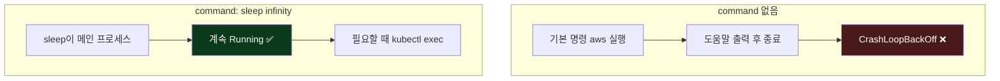
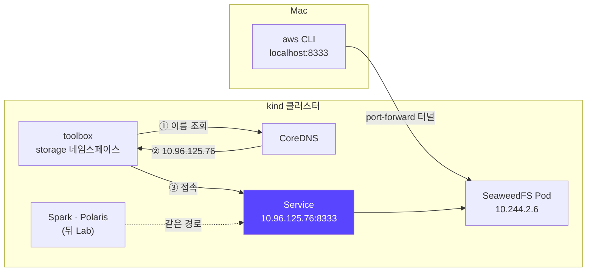
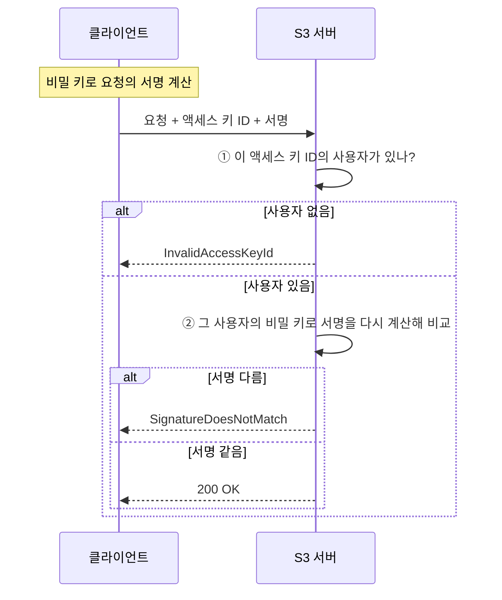
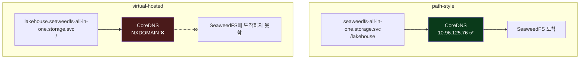
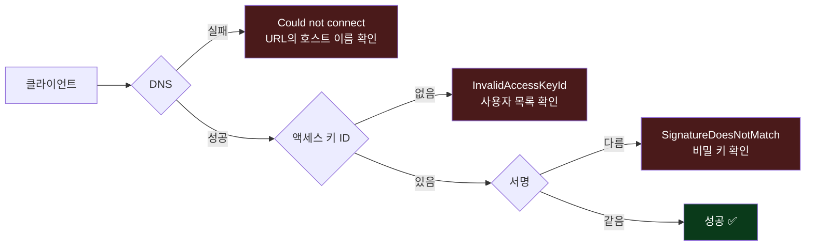
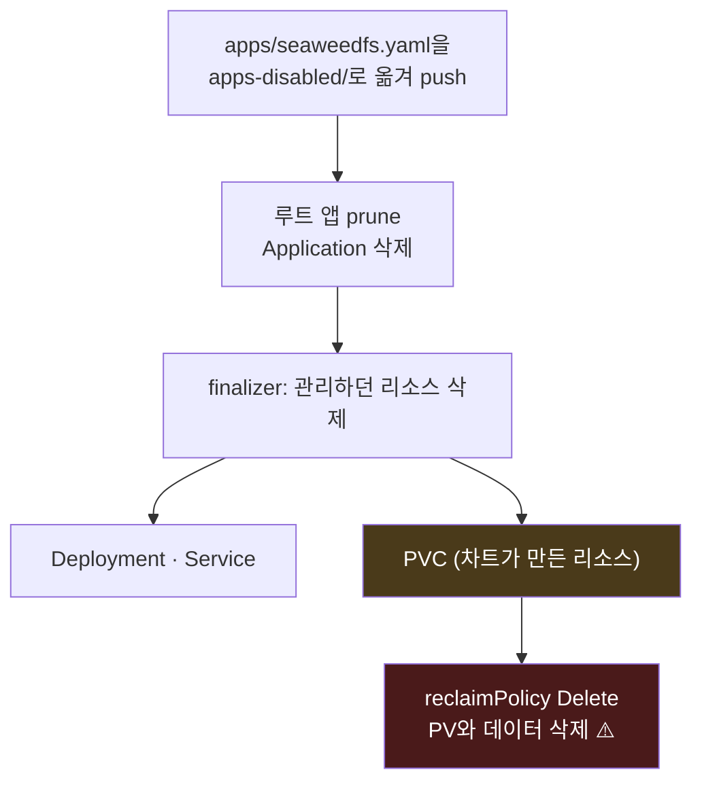

## 📚 들어가며

[5편](/posts/Lakehouse-Lab-05-SeaweedFS-S3-Storage/)에서는 Mac에서 port-forward로 SeaweedFS에 접속했다. 그런데 앞으로 S3를 실제로 쓸 Spark와 Polaris는 port-forward를 쓰지 않는다. **클러스터 내부 DNS**로 접속한다. 이번 편은 그 경로를 미리 검증하고, 일부러 부숴 본다.

- **toolbox Pod** — 클러스터 안에서 S3와 네트워크를 점검하는 도구 상자
- **잘못된 키** — `InvalidAccessKeyId`는 사용자가 없는 것, `SignatureDoesNotMatch`는 사용자는 있지만 비밀 키가 틀린 것
- **잘못된 주소 방식** — virtual-hosted 방식은 버킷 이름이 호스트 이름 앞에 붙어 **DNS 단계에서** 실패한다

가이드와 다르게 간 부분이 두 가지 있다.

| 시나리오 | 가이드 | 내 practice | 이유 |
|---|---|---|---|
| A. 잘못된 키 | Mac에서 port-forward를 통해 접속 | **toolbox Pod 안에서** 환경 변수만 바꿔 재현 | 클러스터 내부 경로에서 같은 오류가 나는지 함께 보고, 내 터미널의 환경 변수를 건드리지 않는다 |
| B. virtual-hosted | `aws configure set`으로 toolbox의 기본 설정을 바꾼 뒤 되돌림 | **임시 설정 파일**(`AWS_CONFIG_FILE=/tmp/virtual-test`)로 재현 | 실험 후 복구를 빼먹어도 toolbox가 망가지지 않는다 |

> **이번 편 학습 지도**
>
> ```
> 점검 도구 (1~3장)             부수기 A (4장)              부수기 B (5장)              남은 숙제 (6~7장)
> ─────────────────             ──────────────              ──────────────              ─────────────────
> toolbox: aws + net            SigV4 = 서명만 보낸다        path-style vs virtual-hosted  Pod 재시작 (미실행)
> sleep infinity의 의미          InvalidAccessKeyId 🔦       버킷 이름이 호스트 앞으로 🔦   앱을 끄면 데이터는? 🔦
> Service DNS · dig             SignatureDoesNotMatch 🔦    NXDOMAIN = DNS 단계 실패      (설정 근거의 예상)
> weed shell volume.list
> ```

---

## 1. toolbox Pod — 클러스터 안의 점검 도구 상자

```yaml
# manifests/tools/toolbox.yaml
# 클러스터 안에서 S3·네트워크를 점검하는 도구 Pod
apiVersion: v1
kind: Pod
metadata:
  name: toolbox
  namespace: storage
spec:
  containers:
    - name: aws
      image: amazon/aws-cli:2.40.0
      command: ["sleep", "infinity"]
      envFrom:
        - secretRef: {name: lakehouse-s3}
    - name: net
      image: nicolaka/netshoot:v0.16
      command: ["sleep", "infinity"]
```

```bash
kubectl apply -f manifests/tools/toolbox.yaml
kubectl -n storage wait pod/toolbox --for=condition=Ready --timeout=180s
```

```
NAME      READY   STATUS    RESTARTS   AGE
toolbox   2/2     Running   0          35m
```

| 컨테이너 | 이미지 | 용도 |
|---|---|---|
| `aws` | `amazon/aws-cli` | S3 점검 |
| `net` | `nicolaka/netshoot` | `dig`, `curl`, `tcpdump` 등 네트워크 점검 |



- **멀티 컨테이너 Pod** — 한 Pod의 컨테이너들은 네트워크를 공유한다. `kubectl exec`할 때 `-c`로 컨테이너를 고른다.
- **`envFrom`** — [3편 6-2](/posts/Lakehouse-Lab-03-ArgoCD-Helm-Install-and-Secrets/)에서 만든 `lakehouse-s3` Secret의 항목이 그대로 환경 변수가 된다. 그래서 `aws` 컨테이너에서는 `export` 없이 S3 키를 쓸 수 있다. 키가 필요 없는 `net` 컨테이너에는 넣지 않았다.
- **Deployment 없이 Pod를 직접 만들었다.** 지우면 다시 생기지 않는다. 일회성 점검 도구라 이걸로 충분하다. `manifests/tools/`는 루트 앱이 보는 `apps/` 밖에 있어서 Argo CD가 관리하지 않고, 손으로 apply한다.

### 🔦 `sleep infinity`가 필요한 이유

처음에는 **`sleep infinity` 때문에 Pod가 Running이 되지 않는 줄 알았다.** 실제로는 정반대다.



컨테이너는 **메인 프로세스가 살아 있는 동안만** Running이다. aws-cli 이미지는 기본 명령이 `aws`라서 그대로 띄우면 도움말만 출력하고 종료된다. `command`로 기본 명령을 덮어써서 계속 대기하게 만들고, 필요할 때 `kubectl exec`로 명령을 실행하는 것이다.

정말 Running이 안 된다면 원인은 `sleep`이 아니라 **이미지 pull, Secret 누락, 자원 부족** 쪽에서 찾아야 한다.

---

## 2. 클러스터 안에서 S3 접근과 Service DNS

### 2-1. 같은 S3, 다른 경로

| | Mac에서 접근 (5편) | 클러스터 안에서 접근 (이번 편) |
|---|---|---|
| 주소 | `localhost:8333` | `seaweedfs-all-in-one.storage.svc:8333` |
| 경로 | port-forward 터널 | **Service DNS** |
| 키 | `export`로 직접 설정 | Secret의 `envFrom` |



**Spark와 Polaris가 쓰는 경로는 클러스터 안쪽 경로다.** Mac에서 된다고 클러스터 안에서도 되는 것은 아니다. 뒤 Lab에서 문제가 생기기 전에 **실제로 쓸 경로**를 검증해 둔다.

```bash
kubectl -n storage exec toolbox -c aws -- \
  aws --endpoint-url http://seaweedfs-all-in-one.storage.svc:8333 s3 ls s3://lakehouse --recursive
```

```
2026-11-18 05:58:27          6 test/hello.txt
```

5편에서 **Mac으로 올린 `hello.txt`가 클러스터 안에서도 보인다.** 시각까지 같다.

`kubectl exec ... --`에서 `--` 뒤는 **Pod 안에서 실행할 명령**이다.

### 2-2. Service DNS

**Service DNS**는 [2편 3-4](/posts/Lakehouse-Lab-02-Kind-Internals-Network-Break-Fix/)에서 본 대로, CoreDNS가 `<서비스>.<네임스페이스>.svc.cluster.local` 이름을 Service의 ClusterIP로 바꿔 주는 것이다.

```bash
kubectl -n storage exec toolbox -c net -- dig +short seaweedfs-all-in-one.storage.svc.cluster.local
```

```
10.96.125.76
```

5편에서 본 Service의 `CLUSTER-IP`와 같은 값이다. `dig`는 기본적으로 짧은 이름을 자동 완성하지 않아서 **전체 이름으로** 조회했다.

---

## 3. SeaweedFS 내부 상태 들여다보기

이번에는 toolbox가 아니라 **SeaweedFS Pod 안에서** 명령을 실행한다. 그래서 여기서 `localhost`는 **SeaweedFS Pod 자신**이다.

```bash
kubectl -n storage exec deploy/seaweedfs-all-in-one -- curl -s localhost:9333/cluster/status
kubectl -n storage exec deploy/seaweedfs-all-in-one -- sh -c 'echo "volume.list" | weed shell -master=localhost:9333' | head -20
```

### 3-1. `/cluster/status`

```json
{"IsLeader":true,"Leader":"10.244.2.6:9333.19333","MaxVolumeId":14}
```

| 필드 | 의미 |
|---|---|
| `IsLeader: true` | 이 Master가 리더 역할을 하고 있다 |
| `Leader` | 리더의 주소. `10.244.2.6`은 SeaweedFS Pod의 IP다 |
| `MaxVolumeId: 14` | 현재 최대 볼륨 번호 |

`10.244.2.x`는 [2편 3-1](/posts/Lakehouse-Lab-02-Kind-Internals-Network-Break-Fix/)에서 본 **worker2의 Pod 대역**이다. 5편 6-4에서 PV가 `lakehouse-worker2`에 있다고 확인한 것과 맞아떨어진다.

### 3-2. `weed shell`의 `volume.list`

**`weed shell`** 은 SeaweedFS의 관리 콘솔이다. 대화형으로 쓰는 대신 `volume.list`를 입력으로 넣어 실행했다.

> **파이프 위치 주의**
>
> ```
> kubectl exec … -- sh -c 'echo "volume.list" | weed shell …' | head -20
>                          └─────── Pod 안에서 실행 ───────┘   └ Mac에서 실행 ┘
> ```
>
> 작은따옴표 안의 `|`는 **Pod 안**에서, 맨 끝의 `| head -20`은 **Mac**에서 실행된다.

핵심 줄만 추리면 이렇다.

```
Topology volumeSizeLimit:1000 MB hdd(volume:14/204 active:14 free:190 remote:0)
      DataNode 10.244.2.6:8080 hdd(volume:14/204 active:14 free:190 remote:0)
          volume Id:12, Size:72, ReplicaPlacement:000, Collection:lakehouse, Version:3, Ttl:, FileCount:1, DeleteCount:0, DeletedByteCount:0, ReadOnly:false
total size:2880 file_count:4
```

출력은 `Topology → DataCenter → Rack → DataNode → Disk → volume` 계층이다.

| 값 | 의미 |
|---|---|
| `volume Id:12` | 5편의 `file_id: 12,032c6ffdc3`에서 본 **12번 볼륨** |
| `Size:72` | 5편에서 본 `lakehouse_12.dat`의 크기 72바이트와 같다 |
| `Collection:lakehouse` | 버킷에 해당한다 |
| `FileCount:1` | 이 볼륨에 파일 하나, 즉 `hello.txt`가 들어 있다 |
| `ReplicaPlacement:000` | **복제 없이 한 벌만** 저장한다 |
| `volume:14/204` | 볼륨 14개 사용 중, 최대 204개 |

5편에서 파일로 추적한 내용을 이번에는 **SeaweedFS의 관리 도구로 다시 확인**한 셈이다.

---

## 4. 부수고 고치기 A — 잘못된 키

### 4-1. S3 요청 서명 (SigV4)

**비밀 키는 네트워크로 보내지 않는다.** 클라이언트가 비밀 키로 요청의 서명을 계산해 **액세스 키 ID와 서명만** 보내고, 서버는 그 ID의 비밀 키로 서명을 다시 계산해 비교한다.



그래서 오류가 두 종류로 나뉜다.

| 오류 | 의미 | 확인할 것 |
|---|---|---|
| `InvalidAccessKeyId` | 그 액세스 키를 가진 **사용자가 없음** | 액세스 키 ID, 서버의 사용자 목록 |
| `SignatureDoesNotMatch` | **사용자는 있지만** 서명이 다름 | 비밀 키, 프록시의 헤더 변경 여부 |

### 4-2. 실험

```bash
E=http://seaweedfs-all-in-one.storage.svc:8333

# 비밀 키만 틀리게
kubectl -n storage exec toolbox -c aws -- sh -c "AWS_SECRET_ACCESS_KEY=wrong aws --endpoint-url $E s3 ls"

# 없는 사용자
kubectl -n storage exec toolbox -c aws -- sh -c "AWS_ACCESS_KEY_ID=nobody aws --endpoint-url $E s3 ls"
```

```
aws: [ERROR]: An error occurred (SignatureDoesNotMatch) when calling the ListBuckets operation: The request signature we calculated does not match the signature you provided. Check your key and signing method.

aws: [ERROR]: An error occurred (InvalidAccessKeyId) when calling the ListBuckets operation: The access key ID you provided does not exist in our records.
```

`VAR=값 명령` 형태는 **그 명령 한 번에만** 환경 변수를 덮어쓴다. Pod의 환경 변수는 그대로라서 되돌릴 것이 없다.

| 실험 | 액세스 키 ID | 비밀 키 | 결과 |
|---|---|---|---|
| 비밀 키만 틀리게 | 맞음 | `wrong` | `SignatureDoesNotMatch` |
| 없는 사용자 | `nobody` | 맞음 | `InvalidAccessKeyId` |

서버가 판단하는 기준은 3편에서 만든 `seaweedfs-s3-config`의 **사용자 목록**이다. 접근 오류가 나면 **이 두 가지부터 구분한다.** 어느 쪽이냐에 따라 봐야 할 곳이 달라진다.

---

## 5. 부수고 고치기 B — virtual-hosted 스타일 주소

### 5-1. path-style vs virtual-hosted

| 방식 | 버킷 이름 위치 | 요청 URL |
|---|---|---|
| **path-style** | URL 경로 | `http://seaweedfs-all-in-one.storage.svc:8333/lakehouse` |
| **virtual-hosted** | 호스트 이름 앞 | `http://lakehouse.seaweedfs-all-in-one.storage.svc:8333/` |

AWS S3는 버킷마다 `버킷이름.s3.amazonaws.com` DNS가 자동으로 있어서 virtual-hosted가 표준이다. **클러스터 안에는 그런 DNS 이름이 없다.**



### 5-2. 실험 — 임시 설정 파일로 재현

가이드는 toolbox의 기본 설정을 바꾸고 되돌린다.

```bash
# 가이드의 방법
kubectl -n storage exec toolbox -c aws -- sh -c \
  'aws configure set default.s3.addressing_style virtual && \
   aws --endpoint-url http://seaweedfs-all-in-one.storage.svc:8333 s3 ls s3://lakehouse'

# 복구 (빼먹으면 toolbox의 S3 명령이 계속 실패한다)
kubectl -n storage exec toolbox -c aws -- aws configure set default.s3.addressing_style path
```

나는 복구를 빼먹어도 괜찮도록 **임시 설정 파일**을 썼다. `AWS_CONFIG_FILE`이 가리키는 파일에만 설정이 들어가므로 기본 설정은 그대로다.

```bash
kubectl -n storage exec toolbox -c aws -- sh -c '
  export AWS_CONFIG_FILE=/tmp/virtual-test
  aws configure set default.s3.addressing_style virtual
  aws --endpoint-url http://seaweedfs-all-in-one.storage.svc:8333 s3 ls s3://lakehouse
  rm -f /tmp/virtual-test'
```

```
aws: [ERROR]: Could not connect to the endpoint URL: "http://lakehouse.seaweedfs-all-in-one.storage.svc:8333/?list-type=2&prefix=&delimiter=%2F&encoding-type=url"
```

**인증 오류가 아니라 연결 오류**다. 요청이 SeaweedFS에 도착하기도 전에 실패했다는 뜻이다. 그리고 **단서는 오류 메시지의 URL 맨 앞에 있다.** 호스트 이름에 버킷 이름 `lakehouse.`이 붙어 있다.

### 5-3. DNS로 원인 확인

```bash
kubectl -n storage exec toolbox -c net -- dig seaweedfs-all-in-one.storage.svc.cluster.local | grep status
kubectl -n storage exec toolbox -c net -- dig lakehouse.seaweedfs-all-in-one.storage.svc.cluster.local | grep status
```

| 조회한 이름 | status | 결과 |
|---|---|---|
| `seaweedfs-all-in-one.storage.svc.cluster.local` | `NOERROR` | `10.96.125.76` |
| `lakehouse.seaweedfs-all-in-one.storage.svc.cluster.local` | **`NXDOMAIN`** | 그런 이름이 없다 |

### 5-4. 뒤 Lab의 설정에 path-style이 들어가는 이유

| 컴포넌트 | 설정 |
|---|---|
| Polaris (Lab 5) | `"pathStyleAccess": true` |
| Spark (Lab 6) | `spark.sql.catalog.polaris.s3.path-style-access=true` |
| Trino (Lab 7) | `s3.path-style-access=true` |

이번 환경의 aws CLI는 별도 설정이 없을 때 요청이 path-style로 나갔다(디버그 출력으로 확인). 하지만 **다른 엔진도 같을 것이라 가정하지 말고 직접 지정한다.**

> `aws --debug` 출력에는 인증 헤더가 포함될 수 있다. 블로그나 이슈에 원문을 그대로 붙이면 안 된다.

### 5-5. 오류 메시지가 문제 구간을 알려 준다

A와 B의 오류를 요청 경로 위에 놓으면 이렇게 된다.



---

## 6. 부수고 고치기 C — Pod 재시작과 데이터

> **⚠️ 이 시나리오는 아직 실행하지 않았다.** SeaweedFS Pod는 처음 뜬 뒤 재시작 0회다. 아래는 가이드와 설정을 바탕으로 한 예상이다.

SeaweedFS Pod를 지워도 Deployment가 새 Pod를 만들고, 5편에서 설정한 **PVC 덕분에 `hello.txt`가 남아 있어야 한다.**

```bash
kubectl -n storage delete pod -l app.kubernetes.io/component=seaweedfs-all-in-one
kubectl -n storage rollout status deploy/seaweedfs-all-in-one

# 클러스터 안에서 확인
kubectl -n storage exec toolbox -c aws -- \
  aws --endpoint-url http://seaweedfs-all-in-one.storage.svc:8333 s3 ls s3://lakehouse --recursive
```

가이드는 Mac의 `s3 ls`로 확인한다. 다만 `kubectl port-forward`는 연결한 Pod가 사라지면 끊기므로, **Mac에서 확인하려면 port-forward를 다시 띄워야 한다.** 그래서 위에는 toolbox 경로로 적었다.

가이드의 추가 실험은 `data.type`을 기본값 `emptyDir`로 돌려 push하고 같은 실험을 하는 것이다. 그러면 **버킷이 통째로 사라진다.** 확인 후에는 되돌리고 버킷을 다시 만들어야 한다. 5편 3-2의 교훈 그대로다. **차트 기본값을 믿지 말고 영속성부터 확인한다.**

---

## 7. 주의 — SeaweedFS 앱을 끄면 데이터가 남을까

> **⚠️ 설정을 근거로 한 예상이다.** 데이터가 지워지는 실험이라 실행하지 않았다.

Lab 2 가이드는 앱을 끄는 것에 대해 이렇게 설명한다. "끄면 Deployment·Service는 지워지지만 StatefulSet의 PVC는 차트가 만든 게 아니라서 남는다."

StatefulSet이라면 맞는 말이다. 그런데 **SeaweedFS all-in-one은 StatefulSet이 아니다.** 실제 리소스를 확인해 보니 조건이 다르다.

| 확인한 것 | 결과 | 의미 |
|---|---|---|
| 워크로드 종류 | **Deployment** | StatefulSet의 `volumeClaimTemplates`가 아니다 |
| PVC를 만든 주체 | **차트** (`templates/all-in-one/all-in-one-pvc.yaml`, 라벨 `helm.sh/chart: seaweedfs-4.53.0`) | 렌더링 결과에 포함된 리소스다 |
| Argo CD 추적 | `argocd.argoproj.io/tracking-id: seaweedfs:/PersistentVolumeClaim:storage/seaweedfs-all-in-one-data` | **Argo CD가 관리하는 리소스**다 |
| 앱의 finalizer | `resources-finalizer.argocd.argoproj.io` | 앱을 지우면 관리하던 리소스도 지운다 |
| PVC의 보호 annotation | `helm.sh/resource-policy: keep`, `Delete=false` **없음** | 삭제를 막는 표시가 없다 |
| PV의 reclaimPolicy | `Delete` (5편 6-4) | PVC가 지워지면 실제 데이터도 지워진다 |



그래서 **`apps/seaweedfs.yaml`을 `apps-disabled/`로 옮겨 앱을 끄면 PVC와 데이터까지 함께 삭제될 가능성이 높다.** 메모리가 부족해도 SeaweedFS는 끄지 말고 켜 둔다.

---

## 📝 이번 편 요약

```
toolbox Pod
├─ aws(S3 점검) + net(dig · curl) 컨테이너 2개, 네트워크 공유
├─ 🔦 sleep infinity = 메인 프로세스를 살려 둬서 Running 유지
└─ envFrom lakehouse-s3 → export 없이 S3 키 사용

클러스터 내부 경로
├─ seaweedfs-all-in-one.storage.svc:8333 (Spark · Polaris가 쓸 경로)
├─ CoreDNS: Service 이름 → ClusterIP 10.96.125.76
└─ 내부 상태: /cluster/status, weed shell volume.list (12번 볼륨, FileCount 1)

부수기 A — 잘못된 키
├─ SigV4: 비밀 키는 보내지 않고 서명만 보낸다
├─ 🔦 InvalidAccessKeyId = 사용자 없음
└─ 🔦 SignatureDoesNotMatch = 사용자는 있지만 비밀 키가 틀림

부수기 B — virtual-hosted
├─ 버킷 이름이 호스트 앞으로 → lakehouse.seaweedfs-all-in-one…
├─ NXDOMAIN → SeaweedFS에 도착하기 전에 실패 (연결 오류)
└─ Polaris · Spark · Trino 모두 path-style을 직접 지정

남은 숙제 (예상, 미확인)
├─ C. Pod 재시작 → PVC 덕분에 데이터 유지
└─ 🔦 앱 끄기 → 차트가 만든 PVC + finalizer + reclaim Delete = 데이터 삭제 가능성
```

| 개념 | 한 줄 정의 |
|---|---|
| **멀티 컨테이너 Pod** | 네트워크를 공유하는 여러 컨테이너를 묶은 Pod |
| **`envFrom`** | Secret·ConfigMap의 항목을 그대로 환경 변수로 넣는 설정 |
| **Service DNS** | CoreDNS가 Service 이름을 ClusterIP로 풀어 주는 기능 |
| **`weed shell`** | SeaweedFS의 관리 콘솔 |
| **SigV4** | 비밀 키로 요청 서명을 계산해 서명만 보내는 AWS 인증 방식 |
| **`InvalidAccessKeyId`** | 그 액세스 키를 가진 사용자가 없다는 오류 |
| **`SignatureDoesNotMatch`** | 사용자는 있지만 서명이 다르다는 오류 |
| **path-style** | 버킷 이름을 URL 경로에 넣는 주소 방식 |
| **virtual-hosted** | 버킷 이름을 호스트 이름 앞에 넣는 주소 방식 |
| **NXDOMAIN** | 조회한 DNS 이름이 존재하지 않는다는 응답 |
| **`AWS_CONFIG_FILE`** | aws CLI가 읽을 설정 파일의 경로를 지정하는 환경 변수 |
| **tracking-id** | Argo CD가 자기가 관리하는 리소스에 남기는 표시 |

---

## 💭 느낀 점

**1. 오류 메시지가 문제 구간을 알려 준다.**

사용자가 없다, 비밀 키가 틀렸다, DNS에서 실패했다. 세 오류는 요청 경로의 서로 다른 지점을 가리킨다. "S3 접속이 안 돼요"라는 한 문장 안에 전혀 다른 원인이 들어 있고, **오류 메시지를 정확히 읽는 것만으로 범위가 좁혀진다.**

**2. URL 맨 앞의 버킷 이름 하나가 결정적인 단서다.**

`Could not connect`만 보면 네트워크나 Service를 의심하기 쉽다. 그런데 URL을 끝까지 읽으면 호스트 이름 앞에 `lakehouse.`이 붙어 있다. 답이 오류 메시지 안에 이미 있었다.

**3. Mac에서 된다고 클러스터 안에서도 되는 것은 아니다.**

5편에서 port-forward로 업로드가 됐다고 해서 Spark가 붙는다는 보장은 없다. 주소도, DNS도, 키를 받는 방법도 다르다. **실제로 쓸 경로로 검증해야 한다.**

**4. `localhost`는 명령을 실행하는 위치에 따라 달라진다.**

2편에서 노드 안의 `localhost`를 다뤘는데, 이번에도 같은 이야기다. `kubectl exec deploy/seaweedfs-all-in-one -- curl localhost:9333`의 `localhost`는 SeaweedFS Pod다. 파이프도 마찬가지로, 따옴표 안쪽은 Pod에서, 바깥쪽은 Mac에서 실행된다.

**5. 가이드의 일반론도 컴포넌트마다 다시 확인해야 한다.**

"앱을 꺼도 PVC는 남는다"는 설명은 StatefulSet에서는 맞다. 하지만 SeaweedFS all-in-one은 차트가 PVC를 직접 만든다. **PVC를 누가 만드는가**에 따라 결과가 달라진다. 데이터가 걸린 일이라면 일반론을 믿기 전에 실제 리소스를 봐야 한다.

---

## 🔗 다음 편 예고

Lab 4는 **CloudNativePG**다. 오퍼레이터로 Polaris 카탈로그가 쓸 PostgreSQL을 **primary 1 + standby 1**로 구성하고, primary를 강제로 죽여 **자동 failover**를 확인한다.

---

## 📚 참고

- [Amazon S3 — Virtual hosting of buckets](https://docs.aws.amazon.com/AmazonS3/latest/userguide/VirtualHosting.html)
- [AWS CLI — S3 configuration (addressing_style)](https://docs.aws.amazon.com/cli/latest/topic/s3-config.html)
- [AWS — Signature Version 4](https://docs.aws.amazon.com/IAM/latest/UserGuide/reference_sigv.html)
- [Amazon S3 — Error responses](https://docs.aws.amazon.com/AmazonS3/latest/API/ErrorResponses.html)
- [Kubernetes — DNS for Services and Pods](https://kubernetes.io/docs/concepts/services-networking/dns-pod-service/)
- [Argo CD — Sync Options](https://argo-cd.readthedocs.io/en/stable/user-guide/sync-options/)
- [SeaweedFS Wiki](https://github.com/seaweedfs/seaweedfs/wiki)

> 1~5장의 toolbox 상태, 클러스터 내부 S3 조회, `dig`, `/cluster/status`, `volume.list`, 시나리오 A·B의 오류 메시지와 DNS 응답은 직접 확인한 결과다. `volume.list`는 핵심 줄만 추렸다. 7장 표의 PVC 라벨·annotation, 앱의 finalizer, reclaimPolicy도 실제 리소스에서 확인했다. 6장(Pod 재시작, emptyDir 실험)은 실행하지 않았고, 7장의 "앱을 끄면 데이터가 삭제될 가능성이 높다"는 결론도 설정을 근거로 한 예상이며 실험하지 않았다. 5-4의 Polaris·Spark·Trino 설정은 뒤 Lab의 가이드 기준이다. 비밀 값과 `aws --debug` 원문은 글에 넣지 않았다.
