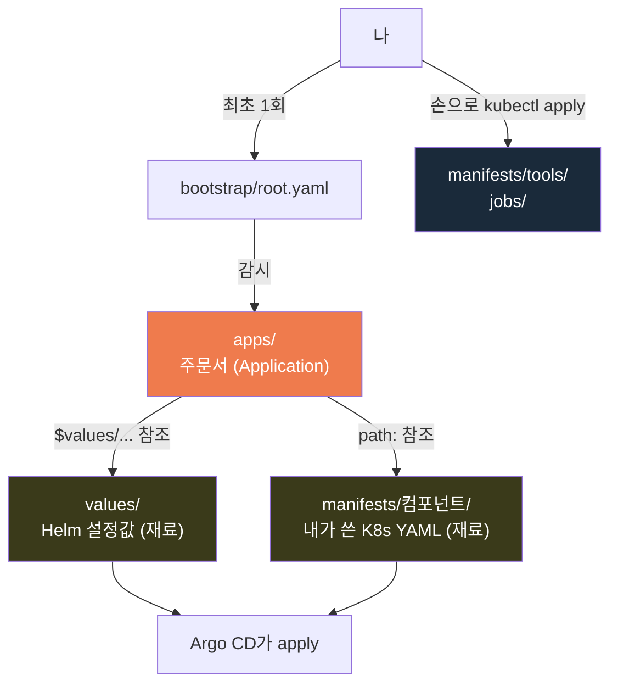
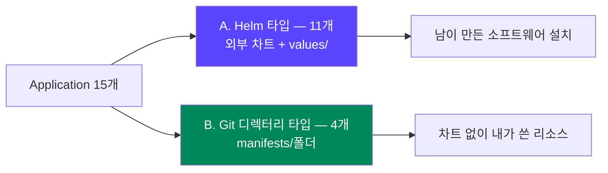
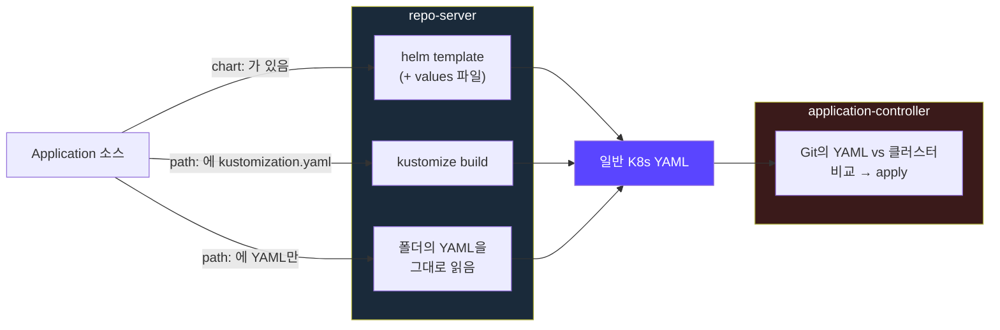
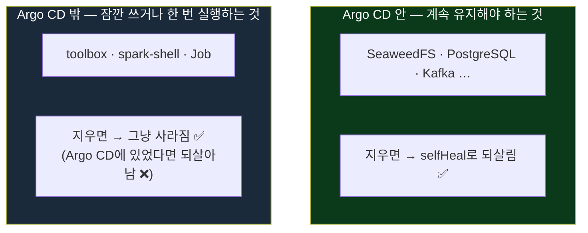
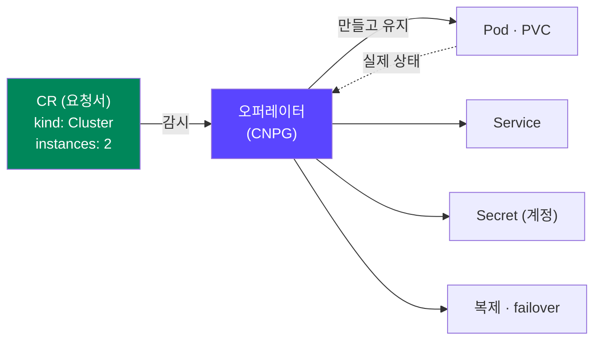
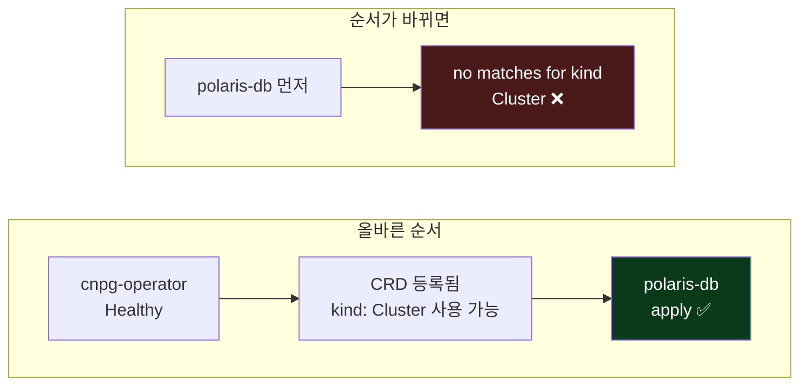
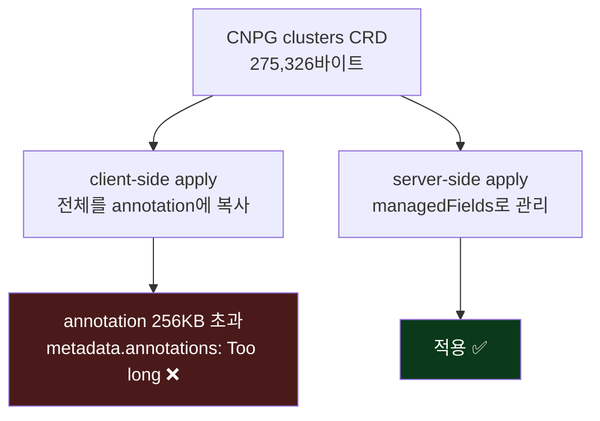

## 📚 들어가며

[6편](/posts/Lakehouse-Lab-06-SeaweedFS-Internal-Access-Break-Fix/)에서 SeaweedFS(S3) 점검을 마쳤다. 다음은 Lab 4, Polaris 카탈로그가 쓸 PostgreSQL이다.

그런데 Lab 4부터 저장소의 모양이 달라진다. 지금까지는 `apps/`에 Application 하나, `values/`에 설정 파일 하나를 두면 됐다. Lab 4부터는 **`manifests/` 아래 폴더를 가리키는 Application**이 섞여 나오기 시작한다. 그래서 Lab 4를 시작하기 전에 **"어떤 건 `apps/`, 어떤 건 `manifests/`, 어떤 건 `values/`로 가는 이유"** 를 먼저 정리했다. 가이드에는 따로 없는 장이다.

- **결국 전부 YAML이다.** Argo CD가 클러스터에 apply하는 것은 일반 Kubernetes YAML이다. Helm과 Kustomize는 그 YAML을 만드는 데에만 쓰인다.
- **주문서와 재료.** `apps/`는 Argo CD에게 주는 주문서, `values/`와 `manifests/`는 그 주문서가 가리키는 재료다. `manifests/tools/`와 `jobs/`는 일부러 Argo CD 밖에 둔다.
- **오퍼레이터 + 인스턴스.** 앞으로 반복될 패턴은 "오퍼레이터는 Helm으로 설치하고, 인스턴스(CR)는 `manifests/`에 직접 쓴다"이다. 이번 편에서 첫 오퍼레이터인 **CloudNativePG**를 설치한다.

> **이번 편 학습 지도**
>
> ```
> 저장소 구조 (1~4장)                  오퍼레이터 (5장)                CNPG 설치 (6장)
> ───────────────────                  ────────────────                ───────────────
> apps/ = 주문서, values·manifests = 재료  CRD = 새 kind 등록              single source, values 없음
> Helm 타입 11 · Git 디렉터리 타입 4 🔦   오퍼레이터 = 운영 지식의 코드      CRD 11개 등록
> repo-server: template · build · 읽기    오퍼레이터(Helm) ➡ 인스턴스(CR) 🔦  ServerSideApply 🔦
> tools/ · jobs/는 일부러 밖에            순서: CRD가 먼저                  clusters CRD 275KB
> ```

---

## 1. 저장소의 디렉터리별 역할

정답 저장소의 Application 15개 파일을 전부 열어 분류해 봤다. 결론부터 적으면 이렇다. **디렉터리마다 역할이 다르다. `apps/`는 주문서이고, `values/`와 `manifests/`는 그 주문서가 가리키는 재료다.**

| 디렉터리 | 들어 있는 것 | 누가 쓰나 | 클러스터에 직접 apply되나 |
|---|---|---|---|
| `bootstrap/` | 루트 앱(`root.yaml`) 하나 | 나 (`kubectl apply` 최초 1회) | ✅ |
| `apps/` | Application (**주문서**) | root 앱이 감시 | ✅ (Application 리소스로) |
| `values/` | Helm values override | Helm 타입 Application이 `$values/...`로 참조 | ❌ **재료일 뿐** |
| `manifests/<컴포넌트>/` | 일반 K8s YAML | Git 디렉터리 타입 Application이 `path:`로 참조 | ✅ (Argo CD가) |
| `manifests/tools/` | 점검용 Pod (toolbox 등) | 나 (`kubectl apply`) | ✅ (손으로) |
| `jobs/` | 1회 실행 Job, SparkApplication | 나 (`kubectl apply`) | ✅ (손으로) |



`values/` 파일은 **Kubernetes 리소스가 아니다.** `kind:`가 없는 설정값 묶음일 뿐이라 혼자서는 apply할 수 없다. Helm 차트와 합쳐져야 의미가 생긴다.

[4편 3-4](/posts/Lakehouse-Lab-04-ArgoCD-App-of-Apps-Metrics-Server/)에서 "`values/metrics-server.yaml`을 helm으로 설치해야 하나?" 하고 헷갈렸던 이유가 여기서 풀린다. `values/`는 디렉터리 이름만 보면 설치할 것들이 모인 곳 같지만, 실제로는 **재료 창고**다.

---

## 2. Application의 두 가지 타입

정답 저장소의 Application 15개를 소스 종류로 나누면 **두 종류뿐**이다.



### 2-1. A. Helm 타입 — 외부 차트 + `values/`

남이 만든 소프트웨어를 설치할 때 쓴다.

| Application | 차트 | 소스 |
|---|---|---|
| metrics-server | metrics-server | multi-source |
| seaweedfs | seaweedfs | multi-source |
| **cnpg-operator** | cloudnative-pg | **single source** |
| polaris | polaris | multi-source |
| spark-operator | spark-operator | multi-source |
| trino | trino | multi-source |
| strimzi-operator | strimzi-kafka-operator | multi-source |
| kube-prometheus-stack | kube-prometheus-stack | multi-source |
| loki | loki | multi-source |
| alloy | alloy | multi-source |
| airflow | airflow | multi-source |

대부분 [4편](/posts/Lakehouse-Lab-04-ArgoCD-App-of-Apps-Metrics-Server/)에서 본 multi-source다. 첫 번째 소스는 차트 저장소, 두 번째 소스는 내 Git 저장소(`ref: values`)이고, `$values/values/xxx.yaml`로 설정을 끼워 넣는다.

```yaml
# A. Helm 타입 (예: apps/seaweedfs.yaml, 5편)
sources:
  - repoURL: https://seaweedfs.github.io/seaweedfs/helm   # 차트 저장소
    chart: seaweedfs
    targetRevision: 4.53.0
    helm:
      valueFiles: [$values/values/seaweedfs.yaml]          # ← values/ 참조
  - repoURL: https://github.com/<GITHUB_ID>/lakehouse-lab.git
    targetRevision: main
    ref: values
```

**예외는 cnpg-operator 하나다.** 차트 기본값으로 충분해서 values 파일 없이 single source다(6장).

### 2-2. B. Git 디렉터리 타입 — `manifests/<폴더>`

차트가 없는, **내가 직접 쓴 리소스**를 배포할 때 쓴다.

| Application | 경로 | 안에 있는 것 |
|---|---|---|
| polaris-db | `manifests/polaris-db` | CNPG `Cluster` |
| airflow-db | `manifests/airflow` | CNPG `Cluster`, RBAC |
| kafka | `manifests/kafka` | Strimzi `Kafka`, `KafkaTopic`, 이벤트 생성기 |
| monitoring-extras | `manifests/monitoring` | `PodMonitor`, 알림 규칙, 대시보드 ConfigMap (Kustomize) |

```yaml
# B. Git 디렉터리 타입 (예: apps/polaris-db.yaml, 다음 편에서 사용)
source:
  repoURL: https://github.com/<GITHUB_ID>/lakehouse-lab.git
  targetRevision: main
  path: manifests/polaris-db        # ← 이 폴더의 YAML 전부
```

`chart:` 대신 **`path:`** 가 있다. 이 폴더 안의 YAML을 전부 배포하라는 뜻이다. [4편](/posts/Lakehouse-Lab-04-ArgoCD-App-of-Apps-Metrics-Server/)의 루트 앱도 `path: apps`였으니, 사실 루트 앱도 이 타입이다.

> 15개 모두 `syncOptions`에 `ServerSideApply=true`가 들어 있다. 4편 3-6에서 "모든 앱에 같은 틀을 쓰려고 넣어 둔 것"이라고 했는데, 정답 저장소 전체가 실제로 그렇게 되어 있다.

---

## 3. Argo CD 내부에서 일어나는 일 — 결국 전부 YAML

### 3-1. 🔦 repo-server가 YAML을 만들고, application-controller가 apply한다

Argo CD의 **repo-server**가 소스 종류를 보고 알맞은 도구로 YAML을 만든다. 그다음 **application-controller**가 Git에서 만든 YAML과 클러스터의 현재 상태를 비교(diff)하고 apply한다. 세 경우 모두 **이 뒷부분은 똑같다.**



Helm이든 Kustomize든 **YAML을 만드는 도구일 뿐**이고, apply는 Argo CD가 한다.

### 3-2. 그래서 보이는 것들

| 현상 | 이유 |
|---|---|
| Helm으로 설치한 앱이 `helm list`에 안 나온다 ([4편 3-5](/posts/Lakehouse-Lab-04-ArgoCD-App-of-Apps-Metrics-Server/)에서 확인) | Argo CD는 `helm install`을 실행하지 않는다. `helm template`으로 YAML만 만들어 직접 apply한다 |
| Argo CD 자체만 `helm list`에 나온다 ([3편](/posts/Lakehouse-Lab-03-ArgoCD-Helm-Install-and-Secrets/)) | 그것만 내가 `helm install`로 설치했다 |
| `manifests/monitoring/`에 `kustomization.yaml`이 있다 | Argo CD가 이 파일을 발견하면 Kustomize로 처리한다. 그 안의 `configMapGenerator`가 Grafana 대시보드 JSON을 ConfigMap으로 만들어 준다(Lab 9 예정) |

정답 저장소의 `manifests/monitoring/`에는 `kustomization.yaml`, `podmonitors.yaml`, `rules.yaml`, 그리고 `dashboards/` 폴더가 있다. 대시보드 JSON 파일을 그대로 두고, Kustomize가 ConfigMap으로 감싸 주는 구조다.

> 3장의 렌더링 경로는 Argo CD 문서를 기준으로 정리한 것이다. `helm list`에 argocd만 나오는 것은 4편에서 직접 확인했다.

---

## 4. `manifests/tools/`와 `jobs/`가 Argo CD 밖에 있는 이유

정답 저장소의 Application 15개 중 **어느 것도 `manifests/tools/`나 `jobs/`를 가리키지 않는다.** 일부러 뺀 것이다.

| 디렉터리 | 들어 있는 것 | Argo CD에 넣으면 |
|---|---|---|
| `manifests/tools/` | `toolbox.yaml`, `spark-shell.yaml`, `kafka-client.yaml` | 필요할 때 띄웠다가 지우는 점검 도구다. Argo CD가 관리하면 지워도 **selfHeal 때문에 다시 살아난다** |
| `jobs/` | `polaris-bootstrap.yaml`, `spark-pi.yaml`, `iceberg-basics.yaml` 등 7개 | 한 번 실행하고 끝나는 작업이다. 동기화할 때마다 **다시 실행되거나, 실패한 Job이 쌓인다** |



[6편](/posts/Lakehouse-Lab-06-SeaweedFS-Internal-Access-Break-Fix/)에서 toolbox를 `kubectl apply`로 띄운 이유가 이것이다. 가이드 Lab 5에서도 Polaris 부트스트랩 Job을 Argo CD에 넣지 않은 이유로 같은 점을 설명한다.

### 새 파일을 어디에 둘지 고르는 기준

| 만들려는 것 | 둘 곳 |
|---|---|
| Helm 차트가 있는 소프트웨어 설치 | `apps/xxx.yaml` (Helm 타입) + `values/xxx.yaml` |
| 차트 없이 내가 쓰는 리소스를 GitOps로 관리 | `manifests/xxx/` + `apps/xxx.yaml` (Git 디렉터리 타입) |
| 잠깐 쓰는 점검 Pod | `manifests/tools/` → `kubectl apply` |
| 한 번 실행하고 끝나는 작업 | `jobs/` → `kubectl apply` |

---

## 5. 오퍼레이터 패턴 — 운영 지식을 코드로 만든 것

### 5-1. CRD와 오퍼레이터

**CRD(Custom Resource Definition)** 는 Kubernetes에 **새 리소스 종류(kind)를 등록**하는 것이다. 예를 들어 CNPG CRD를 설치하면 `kind: Cluster`(`postgresql.cnpg.io/v1`)를 Pod나 Service처럼 쓸 수 있다. [4편 1-1](/posts/Lakehouse-Lab-04-ArgoCD-App-of-Apps-Metrics-Server/)에서 Argo CD가 `Application`을 추가한 것과 같은 방식이다.

**오퍼레이터(Operator)** 는 CRD로 만든 리소스(CR)를 **계속 감시하면서, 적힌 대로 실제 리소스를 만들고 유지하는 컨트롤러 프로그램**이다. "PostgreSQL 2대짜리 클러스터"라는 요청서를 읽고 Pod·디스크·계정·복제·장애 조치를 알아서 처리한다. **DBA가 하던 운영 지식을 코드로 만든 것**이다.



### 5-2. 🔦 오퍼레이터는 Helm 타입, 인스턴스는 Git 디렉터리 타입

2장의 Git 디렉터리 타입 폴더에 들어 있는 것은 대부분 **오퍼레이터에게 보내는 요청서(CR)** 다. 그래서 Helm 타입 앱과 **짝을 이룬다.**

| 오퍼레이터 설치 (Helm 타입) | ➡ | 인스턴스 요청 (Git 디렉터리 타입) |
|---|:---:|---|
| cnpg-operator | ➡ | polaris-db, airflow-db: "PostgreSQL 클러스터 만들어 줘" |
| strimzi-operator | ➡ | kafka: "Kafka 클러스터와 토픽 만들어 줘" |
| kube-prometheus-stack | ➡ | monitoring-extras: "이 Pod들 메트릭 수집하고 이 조건이면 알림 줘" |

이렇게 나누는 이유는 이렇다.

- **오퍼레이터**는 "PostgreSQL을 운영하는 프로그램"이다. 누구나 같은 것을 쓰므로 **차트로 설치한다.**
- **"어떤 DB를 몇 대로 만들지"** 는 환경마다 다르므로 **내가 직접 YAML로 쓴다.**

[4편](/posts/Lakehouse-Lab-04-ArgoCD-App-of-Apps-Metrics-Server/)의 metrics-server와 [5편](/posts/Lakehouse-Lab-05-SeaweedFS-S3-Storage/)의 SeaweedFS는 **"앱 자체"** 를 설치한 것이었다. 이번에는 처음으로 **"앱을 운영하는 앱"** 을 설치한다.

### 5-3. 순서 주의 — CRD가 먼저다

`kind: Cluster`는 오퍼레이터가 CRD를 등록해야 생긴다. 오퍼레이터보다 인스턴스를 먼저 apply하면 `no matches for kind "Cluster"` 같은 오류가 날 것이다.



그래서 가이드도 **cnpg-operator를 먼저 켜고 Healthy가 된 뒤** polaris-db를 켠다.

> 순서가 바뀌었을 때의 오류 메시지는 예상이다. 일부러 순서를 바꿔 보지는 않았다.

---

## 6. CloudNativePG 오퍼레이터 설치

### 6-1. 왜 오퍼레이터로 PostgreSQL을 만드나

Polaris 카탈로그는 메타데이터(네임스페이스, 테이블 포인터, 권한)를 **PostgreSQL에 저장**한다. [1편](/posts/Lakehouse-Lab-01-Kind-Cluster-Local-Registry/)에서 "카탈로그가 테이블의 최신 메타데이터 포인터를 관리한다"고 했는데, 그 포인터가 여기에 들어간다. **이 DB가 죽으면 모든 커밋이 멈춘다.**

그래서 직접 StatefulSet으로 만들지 않고, 복제와 failover를 알아서 해 주는 **CloudNativePG(CNPG) 오퍼레이터**를 쓴다.

### 6-2. 가이드와 다른 점

| | 가이드 | 내 practice |
|---|---|---|
| 앱 켜는 방법 | `apps-disabled/cnpg-operator.yaml`을 `git mv`로 `apps/`에 옮긴다 | `apps/cnpg-operator.yaml`을 **직접 작성**해 커밋했다 (`d3da8ad feat: lab4 cnpg 추가 - app of apps of argocd`) |
| 파일 내용 | — | 정답지와 같다 |

4편부터 계속 이 방식이다. 파일 하나하나를 직접 써 보면서 익히려고 한다. 결과는 같다. root 앱이 `apps/`를 감시하고 있으므로 push하면 cnpg-operator Application이 생긴다.

### 6-3. Application

```yaml
# apps/cnpg-operator.yaml
apiVersion: argoproj.io/v1alpha1
kind: Application
metadata:
  name: cnpg-operator
  namespace: argocd
  finalizers:
    - resources-finalizer.argocd.argoproj.io
spec:
  project: default
  source:
    repoURL: https://cloudnative-pg.github.io/charts
    chart: cloudnative-pg
    targetRevision: 0.29.1      # 오퍼레이터 1.30.1
    helm:
      releaseName: cnpg
  destination:
    server: https://kubernetes.default.svc
    namespace: cnpg-system
  syncPolicy:
    automated:
      prune: true
      selfHeal: true
    syncOptions:
      - CreateNamespace=true
      # CRD가 커서 client-side apply의 annotation 크기 제한(256KB)에 걸린다
      - ServerSideApply=true
```

- **차트 `cloudnative-pg` 0.29.1** 을 설치하면 **오퍼레이터 1.30.1**이 들어온다. 3편에서 본 "차트 버전 ≠ 앱 버전"이다.
- **`source`(단수)** — values 파일이 없는 single source다. 차트 기본값으로 충분하다.
- **releaseName `cnpg`**, 네임스페이스 **`cnpg-system`**. 6-5에서 보는 Deployment 이름 `cnpg-cloudnative-pg`는 이 releaseName과 차트 이름을 이어 붙인 것이다.

### 6-4. 🔦 ServerSideApply가 필요한 이유 — CRD가 256KB를 넘는다

| | client-side apply (기본) | server-side apply |
|---|---|---|
| "마지막으로 apply한 내용" 저장 | **`kubectl.kubernetes.io/last-applied-configuration` annotation에 전체를 저장** | annotation을 쓰지 않는다 |
| 병합 방식 | 클라이언트가 계산 | **API 서버가 필드 단위로 소유자(managedFields)를 관리** |
| 큰 리소스 | annotation 크기 제한(256KB)에 걸린다 | 문제없다 |



말로만 "CRD가 크다"고 하면 감이 안 와서 실제로 재 봤다.

```bash
for c in clusters poolers backups; do
  printf "%s " $c
  kubectl get crd $c.postgresql.cnpg.io -o json | jq -c 'del(.metadata.managedFields, .status)' | wc -c
done
```

```
clusters   275326
poolers   352086
backups    13113
```

| CRD | 크기 | 256KiB(262,144바이트)와 비교 |
|---|---|---|
| `clusters` | 275,326바이트 | **넘는다** |
| `poolers` | 352,086바이트 | **넘는다** |
| `backups` | 13,113바이트 | 여유 있다 |

`clusters` 하나만 해도 annotation에 통째로 복사하면 제한을 넘는다. 실제로 이 CRD에는 `last-applied-configuration` annotation이 **없다**. server-side apply로 들어갔기 때문이다.

[3편 7장](/posts/Lakehouse-Lab-03-ArgoCD-Helm-Install-and-Secrets/)의 "막히면" 표에 있던 **"metadata.annotations: Too long → `ServerSideApply=true`"** 가 실제로 필요한 첫 앱이 이것이다.

### 6-5. 설치와 확인

```bash
git add apps/cnpg-operator.yaml && git commit -m "feat: lab4 cnpg 추가" && git push
argocd app get root --refresh >/dev/null && argocd app wait cnpg-operator --health --timeout 300
kubectl get crd | grep cnpg.io
```

[4편](/posts/Lakehouse-Lab-04-ArgoCD-App-of-Apps-Metrics-Server/)에서 쓴 `argocd app get root --refresh`(Git 변경을 즉시 반영)를 그대로 썼다. 한 번에 Synced/Healthy가 됐다.

```
$ kubectl -n argocd get applications
NAME             SYNC STATUS   HEALTH STATUS
cnpg-operator    Synced        Healthy
metrics-server   Synced        Healthy
polaris-db       Synced        Healthy
root             Synced        Healthy
seaweedfs        Synced        Healthy
```

> 출력은 글을 쓰는 시점에 클러스터를 조회한 결과라 polaris-db가 이미 있다. polaris-db는 다음 편에서 다룬다.

```
$ kubectl -n cnpg-system get deploy
NAME                  READY   UP-TO-DATE   AVAILABLE   IMAGES
cnpg-cloudnative-pg   1/1     1            1           ghcr.io/cloudnative-pg/cloudnative-pg:1.30.1
```

오퍼레이터는 Deployment 하나, Pod 하나다. 이미지 태그가 `1.30.1`, 즉 오퍼레이터 버전이다.

### 6-6. CRD 11개 — 오퍼레이터가 받는 요청서 종류

```
$ kubectl get crd | grep cnpg.io
backups.postgresql.cnpg.io                Namespaced   v1(storage)
clusterimagecatalogs.postgresql.cnpg.io   Cluster      v1(storage)
clusters.postgresql.cnpg.io               Namespaced   v1(storage)
databaseroles.postgresql.cnpg.io          Namespaced   v1(storage)
databases.postgresql.cnpg.io              Namespaced   v1(storage)
failoverquorums.postgresql.cnpg.io        Namespaced   v1(storage)
imagecatalogs.postgresql.cnpg.io          Namespaced   v1(storage)
poolers.postgresql.cnpg.io                Namespaced   v1(storage)
publications.postgresql.cnpg.io           Namespaced   v1(storage)
scheduledbackups.postgresql.cnpg.io       Namespaced   v1(storage)
subscriptions.postgresql.cnpg.io          Namespaced   v1(storage)
```

CRD가 **11개** 등록됐다. 이번 Lab에서 쓰는 것은 `clusters` 하나지만, PostgreSQL 운영의 거의 모든 일을 CR로 관리할 수 있다는 뜻이다.

| 분류 | CRD |
|---|---|
| 클러스터 | `clusters` ← 다음 편에서 사용 |
| 백업 | `backups`, `scheduledbackups` |
| 커넥션 풀러 | `poolers` |
| DB·롤 선언 | `databases`, `databaseroles` |
| 논리 복제 | `publications`, `subscriptions` |
| 이미지 | `imagecatalogs`, `clusterimagecatalogs` |
| 장애 조치 | `failoverquorums` |

`clusterimagecatalogs`만 SCOPE가 `Cluster`이고 나머지는 `Namespaced`다. 대부분의 요청서는 네임스페이스 안에 만든다.

---

## 📝 이번 편 요약

```
저장소 구조
├─ apps/ = 주문서 (Application), values/ · manifests/ = 재료
├─ values/는 K8s 리소스가 아님 (kind 없음) → 혼자 apply 불가
└─ manifests/tools/ · jobs/ = 일부러 Argo CD 밖 (selfHeal · 재실행 방지)

Application 두 타입 (정답 저장소 15개)
├─ 🔦 A. Helm 타입 11개: 외부 차트 + values/ (cnpg-operator만 single source)
└─ 🔦 B. Git 디렉터리 타입 4개: path: manifests/<폴더>

Argo CD 내부
├─ repo-server: helm template / kustomize build / 폴더 YAML 읽기
├─ → 전부 일반 K8s YAML
└─ application-controller: Git vs 클러스터 비교 → apply (helm list엔 안 나옴)

오퍼레이터 패턴
├─ CRD = 새 kind 등록, 오퍼레이터 = CR을 감시하며 실제 리소스 유지
├─ 🔦 오퍼레이터(Helm 타입) ➡ 인스턴스 CR(Git 디렉터리 타입)
│    cnpg → polaris-db · airflow-db / strimzi → kafka / prometheus → monitoring-extras
└─ 순서: 오퍼레이터(CRD)가 먼저, 인스턴스는 그다음

CNPG 설치
├─ 차트 cloudnative-pg 0.29.1 → 오퍼레이터 1.30.1, cnpg-system
├─ 🔦 ServerSideApply: clusters CRD 275KB > annotation 제한 256KB
└─ CRD 11개 등록 (clusters · backups · poolers · databases …)
```

| 개념 | 한 줄 정의 |
|---|---|
| **Helm 타입 Application** | 외부 Helm 차트를 소스로 하는 Application. 설정은 `values/`에서 |
| **Git 디렉터리 타입 Application** | Git 저장소의 폴더(`path:`)를 소스로 하는 Application |
| **repo-server** | 소스를 받아 Helm·Kustomize 등으로 YAML을 렌더링하는 Argo CD 구성 요소 |
| **Kustomize** | YAML을 템플릿 없이 덧붙이고 변형해서 최종 YAML을 만드는 도구 |
| **`configMapGenerator`** | 파일 내용으로 ConfigMap을 만들어 주는 Kustomize 기능 |
| **CRD** | Kubernetes에 새 리소스 종류(kind)를 등록하는 것 |
| **CR (Custom Resource)** | CRD로 만든 kind의 실제 리소스. 오퍼레이터에게 보내는 요청서 |
| **오퍼레이터** | CR을 감시하며 실제 리소스를 만들고 유지하는 컨트롤러 |
| **CloudNativePG (CNPG)** | PostgreSQL 클러스터의 복제·failover·백업을 관리하는 오퍼레이터 |
| **client-side apply** | 마지막 apply 내용을 annotation에 저장하고 클라이언트가 병합하는 방식 |
| **server-side apply** | API 서버가 필드별 소유자(managedFields)로 병합을 관리하는 방식 |

---

## 💭 느낀 점

**1. "주문서와 재료"로 나누니 한 번에 정리됐다.**

처음에는 `apps/`, `values/`, `manifests/`가 뒤섞여 보였다. 15개 파일을 다 열어서 분류해 보니 Application은 두 종류뿐이었고, 디렉터리는 주문서와 재료로 나뉘었다. `values/`라는 이름 때문에 "여기 있는 걸 설치해야 하나?" 했던 4편의 헷갈림도 같이 풀렸다.

**2. Helm이든 Kustomize든 결국 YAML을 만드는 도구일 뿐이다.**

Argo CD 안에서 Helm은 `helm template`만 쓰는 **렌더링 도구**다. Kustomize도 마찬가지다. apply는 언제나 Argo CD가 한다. 이걸 알고 나니 "이 리소스는 누가 관리하나?"라는 질문의 답이 항상 Argo CD라는 게 분명해졌다.

**3. 오퍼레이터 = 운영 노하우를 코드로 만든 것.**

앞으로 Kafka(Strimzi), 모니터링(Prometheus Operator)도 "오퍼레이터는 Helm으로, 인스턴스는 `manifests/`에"라는 같은 구조로 나온다. 미리 알아 두니 큰 그림이 보인다. Lab마다 새로운 걸 배우는 게 아니라, **같은 틀에 다른 컴포넌트를 끼우는 것**이다.

**4. 처음 보는 GitOps 저장소도 이 질문부터 하면 된다.**

실무에서 처음 보는 데이터 플랫폼 저장소를 열었을 때도 "이건 Helm 앱인가, Git 디렉터리 앱인가, 손으로 apply하는 건가"부터 구분하면 될 것 같다. 디렉터리 이름은 저장소마다 달라도 이 세 가지 구분은 그대로일 것이다.

---

## 🔗 다음 편 예고

CNPG에 **`Cluster` 요청서 한 장**(`manifests/polaris-db/cluster.yaml`)을 보내 PostgreSQL **primary 1 + standby 1**을 만든다. CNPG가 대신 만들어 주는 **Pod·PVC·Service·Secret**을 하나씩 확인하고, Polaris가 이 Secret을 어떻게 쓰는지 본다.

---

## 📚 참고

- [Argo CD — Tools (Helm, Kustomize, Directory)](https://argo-cd.readthedocs.io/en/stable/user-guide/application_sources/)
- [Argo CD — Multiple Sources for an Application](https://argo-cd.readthedocs.io/en/stable/user-guide/multiple_sources/)
- [Argo CD — Sync Options (ServerSideApply)](https://argo-cd.readthedocs.io/en/stable/user-guide/sync-options/)
- [Kubernetes — Operator pattern](https://kubernetes.io/docs/concepts/extend-kubernetes/operator/)
- [Kubernetes — Custom Resources](https://kubernetes.io/docs/concepts/extend-kubernetes/api-extension/custom-resources/)
- [Kubernetes — Server-Side Apply](https://kubernetes.io/docs/reference/using-api/server-side-apply/)
- [CloudNativePG 문서](https://cloudnative-pg.io/documentation/current/)
- [CloudNativePG Helm charts](https://github.com/cloudnative-pg/charts)

> 1·2·4장의 분류는 정답 저장소의 Application 15개와 `manifests/`·`jobs/` 디렉터리를 직접 열어 확인한 결과다(15개 모두 `ServerSideApply=true`인 것, 어느 앱도 `manifests/tools/`·`jobs/`를 가리키지 않는 것 포함). 6장의 Application 상태, CRD 목록, 오퍼레이터 Deployment, CRD 크기, CRD에 `last-applied-configuration` annotation이 없는 것은 실제 클러스터에서 확인했다. 3장의 렌더링 경로는 Argo CD 문서 기준이고, 4장의 Lab 5 Job 관련 설명은 가이드 기준이다. 5-3의 순서가 바뀌었을 때의 오류 메시지는 예상이며 직접 실험하지 않았다. 저장소 주소의 GitHub ID는 `<GITHUB_ID>`로 바꿨다.
