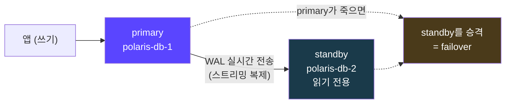
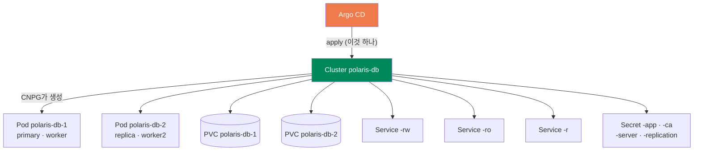
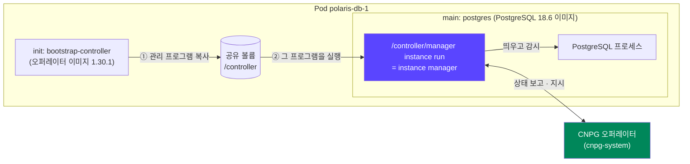
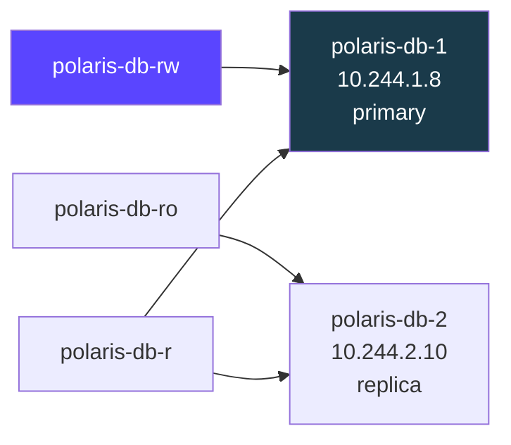
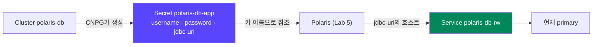
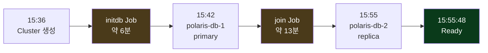
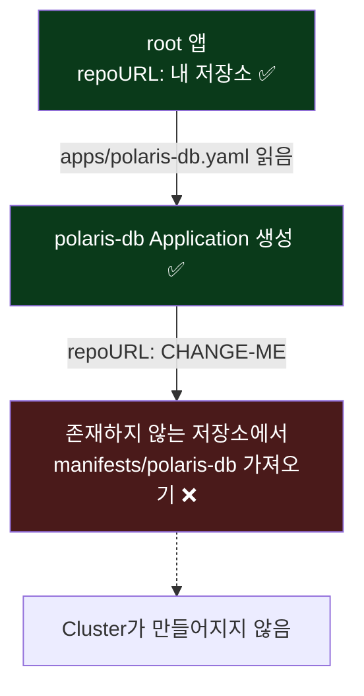
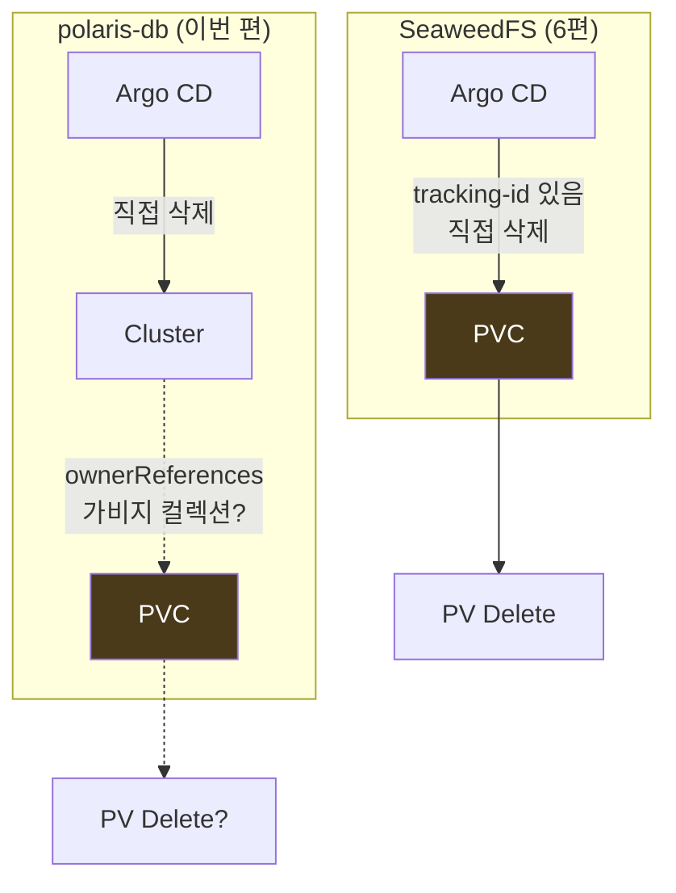

## 📚 들어가며

[7편](/posts/Lakehouse-Lab-07-GitOps-Repo-Layout-and-Operators/)에서 CNPG 오퍼레이터를 설치하고 "오퍼레이터는 Helm으로, 인스턴스(CR)는 `manifests/`에"라는 패턴을 정리했다. 이번 편은 그 **인스턴스 쪽**이다. CNPG에 `Cluster` 요청서를 보내 Polaris 카탈로그가 쓸 PostgreSQL(`polaris-db`)을 만든다.

- **요청서 한 장** — Argo CD는 `kind: Cluster` YAML **한 장만** apply한다. Pod 2개, PVC 2개, Service 3개, Secret·인증서는 전부 CNPG가 만든 2차 리소스다.
- **연결 지점** — CNPG가 만드는 `polaris-db-app` Secret(접속 정보)과 `polaris-db-rw` Service(항상 현재 primary)가 Polaris와 DB를 잇는다. DB 비밀번호를 내가 만들 필요가 없고, failover가 일어나도 Polaris는 주소를 바꾸지 않는다.
- **스키마는 미리** — Polaris는 스키마를 직접 만들지 않는다. `postInitApplicationSQL`로 `polaris_schema`를 만들어 둔다. 이 SQL은 클러스터를 처음 만들 때 **한 번만** 실행된다.

가이드와 다르게 간 부분이 두 가지 있다.

| | 가이드 | 내 practice |
|---|---|---|
| 앱 켜기 | `apps-disabled/polaris-db.yaml`을 `git mv`로 `apps/`에 옮기고, repoURL은 미리 바꿔 둔다 | `apps/polaris-db.yaml`과 `manifests/polaris-db/cluster.yaml`을 직접 작성. 그런데 **`CHANGE-ME`를 그대로 커밋했다가 4분 뒤 고쳤다**(7장) |
| 상태 확인 | `kubectl cnpg status` (CNPG 전용 kubectl 플러그인) | 플러그인 없이 `kubectl get cluster`, Pod 라벨, Cluster의 `.status`, `psql`로 확인. 기본 kubectl만으로 어디까지 볼 수 있는지 먼저 보고 싶었다 |

> **이번 편 학습 지도**
>
> ```
> 요청서 (1~2장)              2차 리소스 (3장)             연결 지점 (4장)            확인 (5~7장)
> ──────────────              ────────────────             ───────────────            ────────────
> kind: Cluster 한 장          Pod 2 · PVC 2 · Service 3    polaris-db-app Secret 🔦    polaris_schema · 복제
> instances: 2 = primary+standby  StatefulSet이 없다 🔦       jdbc-uri → -rw Service      timeline 1
> postInitApplicationSQL 🔦     instance manager            비밀번호를 몰라도 된다       생성 타임라인 20분
> Git 디렉터리 타입 첫 사용     -rw · -ro · -r                                         CHANGE-ME 실수
> ```

---

## 1. Cluster 요청서 읽기 — `manifests/polaris-db/cluster.yaml`

```yaml
# manifests/polaris-db/cluster.yaml
# Polaris 메타스토어용 PostgreSQL (CloudNativePG 1.30)
# instances: 2 → primary 1 + standby 1 (Lab 12에서 failover 실습)
apiVersion: postgresql.cnpg.io/v1
kind: Cluster
metadata:
  name: polaris-db
  namespace: polaris
spec:
  instances: 2
  imageName: ghcr.io/cloudnative-pg/postgresql:18.6-system-trixie
  storage:
    size: 2Gi
  resources:
    requests: {cpu: 100m, memory: 256Mi}
    limits: {memory: 512Mi}
  bootstrap:
    initdb:
      database: polaris
      owner: polaris
      # Polaris는 스키마를 직접 만들지 않는다 (CREATE SCHEMA는 DBA 몫).
      # 기본 스키마 이름 POLARIS_SCHEMA → PostgreSQL에서는 소문자 polaris_schema
      postInitApplicationSQL:
        - CREATE SCHEMA IF NOT EXISTS polaris_schema AUTHORIZATION polaris
```

`apiVersion: postgresql.cnpg.io/v1`, `kind: Cluster`는 [7편 6-6](/posts/Lakehouse-Lab-07-GitOps-Repo-Layout-and-Operators/)에서 CNPG가 등록한 CRD다. Kubernetes 기본 리소스가 아니다. 7편의 "오퍼레이터 + 인스턴스(CR)" 패턴에서 **인스턴스 쪽**이 이 파일이다.

| 설정 | CNPG가 하는 일 |
|---|---|
| `instances: 2` | Pod 2개를 띄운다. 하나는 **primary**(읽기/쓰기)로 initdb를 하고, 나머지는 primary를 통째로 복사(`pg_basebackup`)한 다음 스트리밍 복제로 따라가는 **standby**가 된다 |
| `imageName` | 사용할 PostgreSQL 이미지 (18.6) |
| `storage.size: 2Gi` | 인스턴스마다 PVC를 하나씩 만든다. kind에서는 local-path 프로비저너(StorageClass `standard`)가 처리한다 |
| `resources` | 각 PostgreSQL Pod의 requests/limits |
| `bootstrap.initdb` | **최초 생성 때 한 번만** 실행. `polaris` DB와 소유자 `polaris` 계정을 만든다 |
| `postInitApplicationSQL` | initdb 직후 앱 DB(`polaris`)에서 실행할 SQL |

### 1-1. primary / standby와 스트리밍 복제

primary가 쓰는 **WAL**(Write-Ahead Log, 변경 기록)을 standby가 실시간으로 받아 그대로 재생해서 같은 데이터를 유지한다. standby는 읽기만 할 수 있다. primary가 죽으면 standby 하나를 primary로 **승격(promote)** 한다. 이것이 **failover**다.



### 1-2. 🔦 왜 `postInitApplicationSQL`이 중요한가

Polaris 1.8은 JDBC 접속 속성 `currentSchema=POLARIS_SCHEMA`로 스키마를 고르고, **스키마가 미리 있어야 한다**고 문서에 적혀 있다. Polaris가 스키마를 직접 만들지 않으니, DB를 만드는 쪽에서 준비해 둬야 한다.

PostgreSQL은 따옴표 없는 이름을 **소문자로** 바꾼다. 그래서 `POLARIS_SCHEMA`의 실제 이름은 `polaris_schema`다.

```
Polaris 설정:  currentSchema=POLARIS_SCHEMA
                             │ (따옴표 없음 → 소문자로)
PostgreSQL:    polaris_schema   ← postInitApplicationSQL로 미리 만들어 둔 것
```

`AUTHORIZATION polaris`는 이 스키마의 소유자를 앱 계정 `polaris`로 정한다. 그래야 Polaris가 이 스키마 안에 테이블을 만들 수 있다.

실무에서 고객사의 **기존 DB를 받아 쓸 때**도 같은 이야기다. Polaris가 알아서 만들어 주지 않으니, 이 스키마와 권한(USAGE, 부트스트랩 때는 CREATE)을 **DBA에게 요청**해야 한다.

---

## 2. Git 디렉터리 타입 Application — `apps/polaris-db.yaml`

7편에서 정리한 **B 타입(Git 디렉터리 타입)** 을 처음 직접 써 본다. Helm 차트가 없고, `path: manifests/polaris-db` 폴더 안의 YAML을 그대로 apply한다.

```yaml
# apps/polaris-db.yaml
apiVersion: argoproj.io/v1alpha1
kind: Application
metadata:
  name: polaris-db
  namespace: argocd
  finalizers:
    - resources-finalizer.argocd.argoproj.io
spec:
  project: default
  source:
    repoURL: https://github.com/<GITHUB_ID>/lakehouse-lab.git
    targetRevision: main
    path: manifests/polaris-db
  destination:
    server: https://kubernetes.default.svc
    namespace: polaris
  syncPolicy:
    automated:
      prune: true
      selfHeal: true
    syncOptions:
      - CreateNamespace=true
      - ServerSideApply=true
```

- **`source`(단수) + `path:`** — 7편 2-2의 B 타입 그대로다. `chart:`도 `ref:`도 없다.
- **`ServerSideApply=true`** — 정답 저장소의 설정을 그대로 따랐다. 7편에서 본 대로 15개 앱 모두에 들어 있다.
- **`CreateNamespace=true`** — `polaris` 네임스페이스가 없어도 만든다. 이 네임스페이스는 Lab 5에서 Polaris 서버도 함께 쓴다. [3편](/posts/Lakehouse-Lab-03-ArgoCD-Helm-Install-and-Secrets/)의 `create-secrets.sh`가 이미 `polaris-s3`, `polaris-root`, `polaris-token-broker` Secret을 이 네임스페이스에 만들어 뒀다.

```bash
git add apps/polaris-db.yaml manifests/polaris-db/cluster.yaml
git commit -m "feat: lab4 polaris-db argocd로 추가" && git push
argocd app get root --refresh >/dev/null && argocd app wait polaris-db --health --timeout 600
kubectl -n polaris get cluster polaris-db
```

```
NAME         AGE    INSTANCES   READY   STATUS                     PRIMARY
polaris-db   136m   2           2       Cluster in healthy state   polaris-db-1
```

`kubectl get cluster`만으로도 인스턴스 수, Ready 수, 상태, **현재 primary**가 보인다. CRD가 출력 열을 정의해 둔 덕분이다.

---

## 3. CNPG가 대신 만들어 준 것들 — Pod, PVC, Service

### 3-1. 요청서 한 장, 리소스 여러 개

내가 apply한 것은 `Cluster` **하나뿐**인데, `polaris` 네임스페이스에는 이런 리소스가 생겼다. 모두 `ownerReferences`가 `Cluster`로 되어 있다. Argo CD UI 트리에서도 `Cluster` 밑에 자식으로 보인다.



```bash
kubectl -n polaris get pods -L cnpg.io/instanceRole -o wide
kubectl -n polaris get pvc,svc
```

```
NAME           READY   STATUS    RESTARTS   AGE    IP            NODE                INSTANCEROLE
polaris-db-1   1/1     Running   0          130m   10.244.1.8    lakehouse-worker    primary
polaris-db-2   1/1     Running   0          117m   10.244.2.10   lakehouse-worker2   replica

NAME                                 STATUS   CAPACITY   ACCESS MODES   STORAGECLASS
persistentvolumeclaim/polaris-db-1   Bound    2Gi        RWO            standard
persistentvolumeclaim/polaris-db-2   Bound    2Gi        RWO            standard

NAME                    TYPE        CLUSTER-IP      PORT(S)
service/polaris-db-r    ClusterIP   10.96.68.101    5432/TCP
service/polaris-db-ro   ClusterIP   10.96.206.127   5432/TCP
service/polaris-db-rw   ClusterIP   10.96.93.155    5432/TCP
```

(출력 일부 열은 생략했다.)

- **두 Pod가 서로 다른 노드**에 배치됐다. primary는 `lakehouse-worker`, replica는 `lakehouse-worker2`. IP도 [2편 3-1](/posts/Lakehouse-Lab-02-Kind-Internals-Network-Break-Fix/)에서 본 노드별 Pod 대역(`10.244.1.x`, `10.244.2.x`) 그대로다.
- **PVC는 인스턴스마다 하나**다. [5편](/posts/Lakehouse-Lab-05-SeaweedFS-S3-Storage/)의 SeaweedFS처럼 `standard`(local-path)가 만들었다. 그래서 각 PVC는 Pod가 있는 노드에 묶인다.

### 3-2. 🔦 StatefulSet이 없다

DB라면 StatefulSet이 있을 것 같은데, **없다.** CNPG는 Pod와 PVC를 **직접** 관리한다.

| | StatefulSet | CNPG |
|---|---|---|
| Pod 관리 | StatefulSet 컨트롤러 | **CNPG 오퍼레이터가 직접** |
| Pod의 역할 | 모두 같다 (번호만 다름) | **primary / replica가 다르다** |
| 역할 표시 | 없음 | Pod 라벨 `cnpg.io/instanceRole` (`primary` 또는 `replica`) |

StatefulSet은 Pod를 "번호만 다른 같은 것"으로 다룬다. 그런데 PostgreSQL 클러스터에서는 **어느 Pod가 primary인지**가 핵심이고, failover 때 그 역할이 바뀐다. 그래서 오퍼레이터가 직접 Pod를 들고 역할을 정하고 바꾼다. 위 출력의 `INSTANCEROLE` 열이 그 라벨이다.

### 3-3. Pod 구조 — instance manager

```bash
kubectl -n polaris get pod polaris-db-1 -o json \
  | jq '{init:[.spec.initContainers[]|{name,image}], containers:[.spec.containers[]|{name,image,command}], owner:.metadata.ownerReferences[0].kind}'
```

```
init 컨테이너:  bootstrap-controller  ghcr.io/cloudnative-pg/cloudnative-pg:1.30.1
메인 컨테이너:  postgres              ghcr.io/cloudnative-pg/postgresql:18.6-system-trixie
  command: /controller/manager instance run --status-port-tls --log-level=info
owner: Cluster
```



1. init 컨테이너 `bootstrap-controller`(**오퍼레이터 이미지**)가 CNPG 관리 프로그램을 공유 볼륨에 복사한다.
2. 메인 컨테이너 `postgres`는 PostgreSQL을 직접 실행하지 않고, 그 프로그램(`/controller/manager instance run`)을 먼저 실행한다. 이것이 **instance manager**다.
3. instance manager가 PostgreSQL 프로세스를 띄우고 감시하면서 오퍼레이터와 통신한다.

그래서 PostgreSQL 공식 이미지 대신 **CNPG가 제공하는 이미지**를 쓴다. `owner: Cluster`로 이 Pod의 주인이 Cluster라는 것도 확인된다.

### 3-4. Service 3개 — 역할 라벨로 대상을 고른다

| Service | 가리키는 곳 | 용도 |
|---|---|---|
| **`polaris-db-rw`** | 현재 **primary** | 쓰기 (Polaris가 사용) |
| `polaris-db-ro` | **standby만** | 읽기 분산 |
| `polaris-db-r` | **모든 인스턴스** | 읽기 (primary 포함) |

실제 엔드포인트를 보면 정말 그렇다.

```bash
kubectl -n polaris get endpointslices -o json \
  | jq -r '.items[] | "\(.metadata.labels["kubernetes.io/service-name"]): \([.endpoints[]?.addresses[]] | join(","))"'
```

```
polaris-db-r: 10.244.1.8,10.244.2.10
polaris-db-ro: 10.244.2.10
polaris-db-rw: 10.244.1.8
```



`-rw`는 primary의 Pod IP, `-ro`는 replica의 Pod IP, `-r`은 둘 다를 가리킨다. failover가 일어나면 CNPG가 Pod의 역할 라벨을 바꾸고, **`-rw`가 새 primary를 가리키게 된다.** 이건 다음 편에서 확인할 예정이다.

---

## 4. Polaris와 이어지는 지점 — `polaris-db-app` Secret

### 4-1. 🔦 비밀번호를 내가 만들지 않는다

CNPG는 **`<클러스터이름>-app` Secret을 자동으로 만든다.** 앱 계정(`polaris`)의 비밀번호는 CNPG가 랜덤으로 생성한다. 그래서 3편의 `create-secrets.sh`에는 **Polaris DB 비밀번호가 없다.**

```bash
kubectl -n polaris get secret polaris-db-app -o json | jq -r '.data | keys[]'
```

```
dbname fqdn-jdbc-uri fqdn-uri host jdbc-uri password pgpass port uri user username
```

`jdbc-uri`의 형태는 이렇다(비밀번호는 가렸다).

```
jdbc:postgresql://polaris-db-rw.polaris:5432/polaris?password=***&user=polaris
```

호스트가 **`polaris-db-rw.polaris`**, 즉 `-rw` Service다. Pod IP가 아니라 Service에 붙기 때문에 **failover 뒤에도 주소가 그대로다.**

가이드가 예시로 든 키 외에 `fqdn-jdbc-uri`, `fqdn-uri`도 있었다. 이름으로 보아 호스트를 `polaris-db-rw.polaris.svc.cluster.local` 같은 전체 도메인으로 쓴 버전으로 보인다. 값은 열어 보지 않았다.

> **⚠️ `jdbc-uri`, `uri`, `pgpass`, `fqdn-*` 값에는 비밀번호가 평문으로 들어 있다.** 블로그나 이슈에 붙일 때는 키 목록만 보이거나 마스킹해야 한다.

### 4-2. Polaris는 키 이름만 안다

Lab 5에서 쓸 `values/polaris.yaml`은 이 Secret을 그대로 참조한다(정답 저장소 기준).

```yaml
# values/polaris.yaml (Lab 5에서 사용할 부분, 정답 저장소 기준)
# 메타스토어: CNPG가 만든 Secret(polaris-db-app)을 그대로 쓴다.
persistence:
  type: relational-jdbc
  relationalJdbc:
    secret:
      name: polaris-db-app     # ← CNPG가 만든 Secret
      username: username
      password: password
      jdbcUrl: jdbc-uri
```



[3편 6-2](/posts/Lakehouse-Lab-03-ArgoCD-Helm-Install-and-Secrets/)에서 말한 **"Secret의 key 이름은 쓰는 쪽과의 약속"** 이 여기서도 적용된다. 이번에는 방향이 반대다. 3편에서는 내가 Secret을 만들면서 쓰는 쪽에 key 이름을 맞췄다. 이번에는 **CNPG가 정한 key 이름(`username`, `password`, `jdbc-uri`)에 Polaris 쪽 설정을 맞춘다.**

### 4-3. 그 밖의 Secret

```bash
kubectl -n polaris get secret -o custom-columns=NAME:.metadata.name,TYPE:.type
```

```
NAME                     TYPE
polaris-db-app           kubernetes.io/basic-auth
polaris-db-ca            Opaque
polaris-db-replication   kubernetes.io/tls
polaris-db-server        kubernetes.io/tls
polaris-root             Opaque
polaris-s3               Opaque
polaris-token-broker     Opaque
```

| Secret | 만든 곳 | 용도 |
|---|---|---|
| `polaris-db-app` | CNPG | 앱 계정 접속 정보 |
| `polaris-db-ca` | CNPG | 인증서를 발급한 CA |
| `polaris-db-server` | CNPG | PostgreSQL 서버의 TLS 인증서 |
| `polaris-db-replication` | CNPG | standby가 복제 접속에 쓰는 **클라이언트 인증서** |
| `polaris-root`, `polaris-s3`, `polaris-token-broker` | 3편 `create-secrets.sh` | Polaris 서버용 (Lab 5) |

노드 사이 복제도 비밀번호가 아니라 **TLS 인증서로 인증**한다. 이 인증서들까지 CNPG가 만들어 준다.

---

## 5. DB 안에서 확인 — 스키마와 복제

```bash
PRIMARY=$(kubectl -n polaris get cluster polaris-db -o jsonpath='{.status.currentPrimary}')
kubectl -n polaris exec -it $PRIMARY -c postgres -- psql -d polaris -c '\dn'
kubectl -n polaris exec $PRIMARY -c postgres -- psql -c 'select client_addr, state, sync_state from pg_stat_replication'
kubectl -n polaris get cluster polaris-db -o json \
  | jq '{phase:.status.phase, currentPrimary:.status.currentPrimary, timeline:.status.timelineID}'
```

`.status.currentPrimary`로 **현재 primary Pod 이름**을 얻는다. primary가 바뀌어도 이 명령은 그대로 쓸 수 있다. 그 Pod의 `postgres` 컨테이너 안에서 `psql`을 실행하면, 로컬 소켓으로 붙으므로 **비밀번호 없이 superuser로** 접속된다.

### 5-1. 스키마

```
          List of schemas
      Name      |       Owner
----------------+-------------------
 polaris_schema | polaris
 public         | pg_database_owner
(2 rows)
```

`polaris_schema | polaris`가 있다. **`postInitApplicationSQL`이 제대로 실행됐다.** 소유자도 `AUTHORIZATION polaris`대로 `polaris`다.

### 5-2. 복제

```
 client_addr |   state   | sync_state
-------------+-----------+------------
 10.244.2.10 | streaming | async
(1 row)
```

`pg_stat_replication`은 primary에서 **"누가 나를 복제하고 있는지"** 보여 준다.

| 열 | 값 | 의미 |
|---|---|---|
| `client_addr` | `10.244.2.10` | replica Pod(`polaris-db-2`)의 IP |
| `state` | `streaming` | WAL을 실시간으로 받고 있다 |
| `sync_state` | `async` | **비동기 복제** |

`async`는 primary가 standby의 확인을 **기다리지 않고** 커밋한다는 뜻이다. 그래서 primary가 갑자기 죽으면 **아주 최근 커밋이 일부 빠질 수 있다.** CNPG는 동기 복제 설정도 지원한다.

### 5-3. timeline

```json
{
  "phase": "Cluster in healthy state",
  "currentPrimary": "polaris-db-1",
  "timeline": 1
}
```

PostgreSQL은 승격이 일어날 때마다 **timeline 번호를 올린다.** 1이면 아직 failover가 한 번도 없었다는 뜻이다. failover를 하면 2가 될 것이다.

---

## 6. 생성 과정 타임라인 — 왜 Healthy까지 20분 가까이 걸렸나

```bash
kubectl -n polaris get cluster polaris-db -o json \
  | jq '{created:.metadata.creationTimestamp, currentPrimaryTimestamp:.status.currentPrimaryTimestamp, conds:[.status.conditions[]|{type,status,lastTransitionTime}]}'
kubectl -n polaris get pods -o custom-columns=NAME:.metadata.name,CREATED:.metadata.creationTimestamp
docker exec lakehouse-worker crictl images | grep postgresql
```

```
created:                 2026-11-20T06:36:27Z
currentPrimaryTimestamp: 2026-11-20T06:42:52Z
Ready=True:              2026-11-20T06:55:48Z

NAME           CREATED
polaris-db-1   2026-11-20T06:42:51Z
polaris-db-2   2026-11-20T06:55:36Z

ghcr.io/cloudnative-pg/postgresql   18.6-system-trixie   f560a0c9c17a6   270MB
```

KST로 바꿔 순서대로 놓으면 CNPG가 **하나씩 차례로** 일한 것이 보인다.

| 시각 (KST) | 일어난 일 |
|---|---|
| 15:34 | repoURL 수정 커밋 push |
| 15:36:27 | Argo CD가 `Cluster` 생성 (Application 히스토리의 첫 배포) |
| 15:36~15:42 | primary용 **initdb Job** 실행 (DB 초기화 + `postInitApplicationSQL`) |
| 15:42:51 | `polaris-db-1` Pod 생성 → primary |
| 15:42~15:55 | standby용 **join Job** 실행 (primary를 `pg_basebackup`으로 복사) |
| 15:55:36 | `polaris-db-2` Pod 생성 → replica |
| 15:55:48 | Cluster `Ready=True` |



인스턴스를 **하나씩 순서대로** 만든다. standby는 primary가 준비된 다음에야 복사를 시작할 수 있기 때문이다.

> **오래 걸린 이유는 추정이다.** 당시 이벤트가 만료돼서 이미지 pull에 걸린 시간을 직접 보지는 못했다.
>
> PostgreSQL 이미지(약 270MB)를 **노드마다 따로** 받아야 했기 때문으로 보인다. 두 Pod가 다른 노드(worker, worker2)에 배치됐고, 지금은 두 노드 모두에 이미지가 캐시돼 있다. [2편](/posts/Lakehouse-Lab-02-Kind-Internals-Network-Break-Fix/)에서 본 대로 각 노드의 containerd가 이미지를 **따로** 받는다. Docker VM 메모리(약 8GB)와 CPU가 넉넉하지 않은 것도 영향을 줬을 수 있다.

initdb·join Job은 끝나면 정리돼서 지금은 남아 있지 않다. 가이드의 "막히면" 표대로, `Setting up primary`에서 오래 멈추면 `kubectl -n polaris get pods`로 initdb Job Pod를 찾아 로그를 보면 된다. 이미지 pull 실패와 PVC Pending이 흔한 원인이다.

---

## 7. 삽질 — `CHANGE-ME`를 그대로 커밋했다

### 7-1. 증상과 원인

polaris-db Application을 push했는데 **DB가 만들어지지 않았다.**

정답 저장소에서 `apps/polaris-db.yaml`을 옮기면서 `repoURL: https://github.com/CHANGE-ME/lakehouse-lab.git`을 **그대로 커밋**했다(`8811d9b`).



- **root 앱**은 내 저장소를 보고 있으니 polaris-db **Application은 정상적으로 만들었다.**
- 그런데 **polaris-db 앱 자체**는 존재하지 않는 저장소(`CHANGE-ME`)에서 `manifests/polaris-db`를 가져오려다 실패했다.

두 단계라서 헷갈리기 쉽다. **Application이 생겼다고 그 Application이 배포에 성공한 건 아니다.**

[4편 2-5](/posts/Lakehouse-Lab-04-ArgoCD-App-of-Apps-Metrics-Server/)에서 "practice 저장소에는 `CHANGE-ME`가 없다"고 적었다. 그때는 파일을 처음부터 내 주소로 썼기 때문이다. 이번에는 정답 저장소에서 내용을 옮기다가 자리표시자까지 같이 옮겨 왔다. 정답 저장소에는 `CHANGE-ME`가 **YAML 16개 파일과 `set-repo-url.sh`** 에 들어 있고, 가이드는 이를 `set-repo-url.sh`로 한 번에 바꾸게 한다. 나는 파일을 하나씩 옮기고 있어서 직접 바꿔야 했다.

### 7-2. 해결과 근거

repoURL을 내 저장소로 고쳐 다시 push했다(`ddb7c7d fix: lab4 polaris-db repoURL 수정`). 약 2분 뒤 Cluster가 생성됐다.

```bash
kubectl -n argocd get application polaris-db -o json | jq -c '[.status.history[] | {revision: .revision[0:7], deployedAt}]'
# [{"revision":"ddb7c7d","deployedAt":"2026-11-20T06:36:27Z"}]
```

polaris-db Application의 배포 히스토리에는 기록이 **`ddb7c7d` 하나뿐**이다(15:36:27 KST). `CHANGE-ME` 버전은 **한 번도 배포되지 않았다**는 뜻이다. 6장 타임라인의 출발점도 이 시각이다.

> 당시 Argo CD UI에 뜬 정확한 오류 문구는 남기지 않았다. 존재하지 않는 저장소라 `repository not found`나 `authentication required` 계열의 ComparisonError였을 것으로 예상한다.

### 7-3. 교훈

Application을 새로 만들면 **push 전에** 확인한다.

```bash
grep -rn CHANGE-ME apps/ manifests/
```

같은 실수가 Lab 5 이후 Helm 앱의 `ref: values` 소스에서도 생길 수 있다. multi-source 앱은 repoURL이 두 개라, 하나만 고치고 하나를 놓칠 수 있다.

---

## 8. 주의 — polaris-db 앱을 끄면 PVC는 남을까

> **⚠️ 확인하지 못한 내용이다.** 실제로 지워 보지 않았다.

가이드는 "앱을 꺼도 PVC가 남는다(의도된 동작)"고 한다. 그런데 내 클러스터의 리소스를 보면 반대일 가능성도 있다.

| 확인한 것 | 결과 |
|---|---|
| PVC의 `ownerReferences` | `Cluster polaris-db` (`controller: true`) |
| PVC의 Argo CD tracking-id | **없음** (Argo CD가 직접 관리하는 리소스가 아니다) |
| Cluster의 Argo CD tracking-id | `polaris-db:postgresql.cnpg.io/Cluster:polaris/polaris-db` |
| PV reclaimPolicy | `Delete` (두 PV 모두) |

[6편 7장](/posts/Lakehouse-Lab-06-SeaweedFS-Internal-Access-Break-Fix/)의 SeaweedFS와 비교하면 **지워지는 경로가 다르다.**



Kubernetes는 owner가 지워지면 `ownerReferences`로 연결된 dependent도 **가비지 컬렉션으로 지운다**(orphan 정책으로 지우지 않는 한). 그렇다면 Argo CD가 `Cluster`를 지우는 순간 PVC도 따라 지워지고, reclaimPolicy `Delete` 때문에 데이터도 사라질 수 있다. 가이드의 설명과 이 구조 중 어느 쪽이 맞는지는 지워 봐야 알 수 있다.

Polaris 카탈로그 메타데이터가 들어갈 DB라서, 5편의 SeaweedFS처럼 **polaris-db 앱은 켜 둔 채로** 진행한다.

---

## 📝 이번 편 요약

```
요청서
├─ kind: Cluster (CNPG CRD) 한 장 = Argo CD가 apply하는 전부
├─ instances: 2 → primary(initdb) + standby(pg_basebackup → 스트리밍 복제)
└─ 🔦 postInitApplicationSQL: polaris_schema 미리 생성 (Polaris는 스키마를 안 만든다, 최초 1회만)

2차 리소스 (전부 owner = Cluster)
├─ Pod 2 (worker · worker2), PVC 2, Service 3, Secret 4
├─ 🔦 StatefulSet 없음 → 오퍼레이터가 Pod를 직접 들고 primary/replica 역할을 정함
├─ instance manager: init 컨테이너가 복사한 관리 프로그램이 PostgreSQL을 띄우고 감시
└─ -rw(primary) · -ro(standby) · -r(전체) — 역할 라벨로 대상 선택

연결 지점
├─ 🔦 polaris-db-app Secret: 비밀번호는 CNPG가 생성, 나는 모른다
├─ jdbc-uri 호스트 = polaris-db-rw.polaris → failover 후에도 주소 그대로
└─ Polaris는 CNPG가 정한 키 이름(username · password · jdbc-uri)에 맞춘다

확인
├─ \dn: polaris_schema | polaris
├─ pg_stat_replication: 10.244.2.10 streaming async
├─ timeline 1 = failover 없음
└─ 생성 20분: initdb 6분 → join 13분 (이미지 pull 추정, 미확인)

삽질
└─ CHANGE-ME 그대로 커밋 → Application은 생기지만 배포 실패 → push 전 grep
```

| 개념 | 한 줄 정의 |
|---|---|
| **primary / standby** | 쓰기를 받는 인스턴스 / WAL을 받아 따라가는 읽기 전용 인스턴스 |
| **WAL** | PostgreSQL이 데이터 변경을 먼저 기록하는 로그 |
| **스트리밍 복제** | primary의 WAL을 standby가 실시간으로 받아 재생하는 복제 방식 |
| **failover / promote** | primary가 죽었을 때 standby를 primary로 승격하는 것 |
| **`pg_basebackup`** | 실행 중인 PostgreSQL을 통째로 복사하는 도구 |
| **`postInitApplicationSQL`** | CNPG initdb 직후 앱 DB에서 한 번만 실행되는 SQL |
| **instance manager** | CNPG Pod 안에서 PostgreSQL을 띄우고 감시하며 오퍼레이터와 통신하는 프로그램 |
| **`-rw` / `-ro` / `-r` Service** | primary / standby만 / 전체 인스턴스를 가리키는 CNPG Service |
| **`<클러스터>-app` Secret** | CNPG가 만드는 앱 계정 접속 정보 Secret |
| **`async` 복제** | primary가 standby의 확인을 기다리지 않고 커밋하는 복제 |
| **timeline** | PostgreSQL이 승격될 때마다 올리는 이력 번호 |
| **ownerReferences** | 리소스의 주인을 표시하는 필드. 주인이 지워지면 함께 정리된다 |

---

## 💭 느낀 점

**1. YAML 20줄로 복제까지 되는 PostgreSQL 2대가 생긴다.**

StatefulSet, 복제 설정, TLS 인증서, 계정과 비밀번호를 직접 만들었다면 하루는 걸렸을 것이다. `kind: Cluster` 한 장을 보냈더니 Pod, PVC, Service 3개, Secret 4개가 생기고, standby가 이미 streaming 중이었다. 7편에서 "오퍼레이터 = 운영 지식을 코드로 만든 것"이라고 적었는데, 그게 어떤 의미인지 이번에 체감했다.

**2. "Pod IP가 아니라 Service에 붙는다"가 failover와 직결된다.**

`jdbc-uri`의 호스트가 `polaris-db-rw`였다. Pod IP였다면 failover 때마다 Polaris 설정을 바꿔야 했을 것이다. Service DNS는 2편과 6편에서 계속 봐 온 개념인데, 여기서 **"주소가 안 바뀐다"는 성질이 고가용성의 조건**이 된다.

**3. DB 비밀번호를 내가 모르는 채로 운영이 된다.**

비밀번호는 CNPG가 만들고, Polaris는 Secret의 **키 이름만** 안다. 3편에서는 내가 비밀 값의 원본을 관리했는데, 이번에는 원본조차 내 손을 거치지 않는다. 사람이 비밀번호를 모르면 유출될 경로도 하나 줄어든다.

**4. 정답을 옮길 때도 "내 환경에 맞게 바꿔야 할 값"을 먼저 찾자.**

`CHANGE-ME` 실수는 단순했지만, root 앱은 멀쩡하고 자식 앱만 실패하는 구조라 원인이 한 단계 안쪽에 있다. 자리표시자가 있는 저장소에서 파일을 가져올 때는 **push 전에 `grep`** 한 줄이면 된다.

**5. 기존 DB를 받아 쓸 때 DBA에게 무엇을 요청해야 하는지 감이 생겼다.**

Polaris는 스키마를 만들지 않는다. 그러니 실무에서 고객사 DB를 쓰게 되면 "`polaris_schema` 스키마, 그리고 USAGE 권한(부트스트랩 때는 CREATE까지)"을 요청해야 한다. 대문자 `POLARIS_SCHEMA`가 실제로는 소문자 `polaris_schema`라는 것도 같이 알려 줘야 한다.

---

## 🔗 다음 편 예고

다음은 Lab 4의 **부수고 고치기**를 할 예정이다. primary Pod를 강제로 죽여 standby가 승격되는 과정(`-rw` Service 전환, timeline 1 → 2)과, 부트스트랩 SQL이 정말 처음 한 번만 실행되는지 확인해 보려고 한다.

---

## 📚 참고

- [CloudNativePG — Architecture](https://cloudnative-pg.io/documentation/current/architecture/)
- [CloudNativePG — Bootstrap (initdb, postInitApplicationSQL)](https://cloudnative-pg.io/documentation/current/bootstrap/)
- [CloudNativePG — Service management (-rw/-ro/-r)](https://cloudnative-pg.io/documentation/current/service_management/)
- [CloudNativePG — Connecting from an application (app Secret)](https://cloudnative-pg.io/documentation/current/applications/)
- [CloudNativePG — Instance Manager](https://cloudnative-pg.io/documentation/current/instance_manager/)
- [CloudNativePG — kubectl plugin](https://cloudnative-pg.io/documentation/current/kubectl-plugin/)
- [PostgreSQL — Log-Shipping Standby Servers](https://www.postgresql.org/docs/current/warm-standby.html)
- [PostgreSQL — pg_stat_replication](https://www.postgresql.org/docs/current/monitoring-stats.html#MONITORING-PG-STAT-REPLICATION-VIEW)
- [Apache Polaris](https://polaris.apache.org/)

> 1~5장의 YAML, Cluster 상태, Pod·PVC·Service·엔드포인트, Pod 구조, Secret 키 목록과 종류, `jdbc-uri`의 호스트, 스키마, 복제 상태, timeline은 직접 확인한 결과다. 출력 일부(Secret 키 목록, 엔드포인트, Pod 구조, 생성 시각, 복제 상태)는 실습 뒤 같은 클러스터를 다시 조회해 모은 것으로, 실습 당시 화면과 내용은 같다. 6장의 시각과 이미지 크기는 직접 확인했지만 "이미지 pull 때문에 느렸다"는 원인은 추정이다. 7장의 배포 히스토리, `CHANGE-ME` 파일 수, 8장의 PVC owner·tracking-id·reclaimPolicy는 직접 확인했고, 당시의 Argo CD 오류 문구와 앱을 껐을 때 PVC가 지워지는지는 확인하지 않았다. `fqdn-*` 키의 내용은 열어 보지 않았다. Polaris의 `currentSchema` 동작과 `values/polaris.yaml`은 Polaris 문서와 정답 저장소 기준이다. Secret 값은 글에 넣지 않았고 `jdbc-uri`의 비밀번호는 `***`로 가렸다. 저장소 주소의 GitHub ID는 `<GITHUB_ID>`로 바꿨다.
